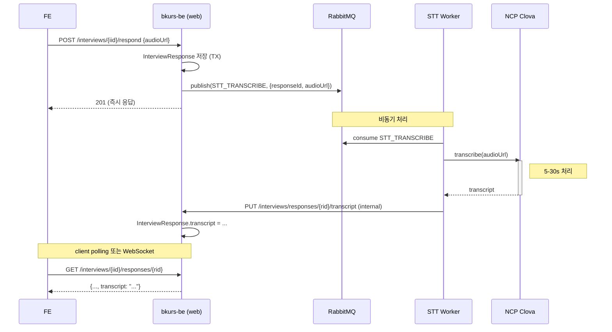

# bkurs 아키텍처 — Async / MQ / Spring Batch

> 외부 SaaS 호출 latency / production 안정성 / 정기 batch 처리. 3 영역 통합 설계.

## 1. Async / 병렬 처리 (`@EnableAsync`)

### 왜 필요한가

- **외부 SaaS 호출 latency**: STT 30s / AI 5-60s / Email 1-3s. 동기 호출 시 사용자 응답 대기.
- **Tomcat thread block**: default 200 thread — 외부 호출 spike 시 saturate → 헬스 endpoint 까지 응답 불가.
- **Bulkhead isolation**: 외부 호출 영향 ≠ 일반 작업 영향. pool 분리로 격리.

### 구조 (2 ThreadPool)

```
@EnableAsync
@EnableScheduling
AsyncConfig
├── externalCallExecutor — IO-bound SaaS 호출 전용
│   ├── core 20 / max 100 / queue 500
│   └── 사용 예: NotificationService / SttService / AiAssistant
└── defaultAsyncExecutor — 일반 background 작업
    ├── core 8 / max 32 / queue 200
    └── 사용 예: @EventListener / light compute
```

### 핵심 옵션 결정

| 옵션 | 선택 | 이유 |
|---|---|---|
| RejectedExecutionPolicy | **CallerRunsPolicy** | task loss 회피 — pool full 시 caller (request thread) 가 직접 실행 → backpressure |
| 기본 @Async executor | `defaultAsyncExecutor` | 외부 호출은 명시적 `@Async("externalCallExecutor")` 사용 강제 |
| MDC 전파 | TaskDecorator | 비동기 thread 에서도 `requestId` 추적 로그 가능 |
| Unhandled exception | `LoggingAsyncExceptionHandler` | silent fail 방지 (default 는 log 만, custom 으로 명시) |

### 호출 패턴

```java
@Component
@RequiredArgsConstructor
public class AsyncNotificationDispatcher {
    private final NotificationService notificationService;

    @Async("externalCallExecutor")
    public CompletableFuture<NotificationResult> dispatch(NotificationRequest request) {
        return CompletableFuture.completedFuture(notificationService.send(request));
    }
}

// caller
dispatcher.dispatch(req);  // 즉시 반환 (fire-and-forget)
```

### 적용 가능 위치

- ✅ `AsyncNotificationDispatcher` — TeacherInvite 이메일 발송 (B18)
- 🔄 `AsyncSttDispatcher` — InterviewResponse audio_url 전사 (B20, 후속)
- 🔄 `AsyncAiDispatcher` — PE 채점 시 AI 코멘트 (B19, 후속)

---

## 2. Message Queue (RabbitMQ + InMemory)

### 왜 필요한가

- **TX 격리**: 현재 bridge events (B9) Spring same-TX — 외부 시스템 실패 시 grade 도 롤백 위험.
- **Retry / DLX**: 외부 호출 실패 시 자동 재시도 + dead-letter queue 격리.
- **Decoupling**: producer ↔ consumer 분리. consumer 별도 worker 인스턴스 scale 가능.
- **Throughput**: high traffic 대응 — 큐 buffer 로 backpressure 흡수.

### 추상화 패턴

```
MessagingPublisher (interface)
├── InMemoryMessagingPublisher (@ConditionalOnProperty in-memory, default)
│   └── Spring ApplicationEvent 위임 — 같은 JVM 안 fire-and-forget
└── RabbitMessagingPublisher (@ConditionalOnProperty rabbit, production)
    └── PERSISTENT delivery + DLX 연결
```

### RabbitMQ 구조

| 구성 요소 | 이름 | 역할 |
|---|---|---|
| Topic Exchange | `bkurs.exchange` | 모든 message 진입점 |
| Dead Letter Exchange | `bkurs.dlx` | 실패 message 격리 |
| Queue (6) | `bkurs.{domain}.{action}.q` | 도메인 별 consumer 그룹 |
| MessageConverter | Jackson2Json | payload 자동 직렬화 |

### MessageTopic 6종

| topic | routing key | 사용 |
|---|---|---|
| NOTIFICATION_DISPATCH | bkurs.notification.dispatch | 이메일/SMS/Push 발송 |
| STT_TRANSCRIBE | bkurs.stt.transcribe | 음성 전사 job |
| AI_ANALYZE | bkurs.ai.analyze | Claude 분석 job |
| RECORD_BRIDGE | bkurs.record.bridge | 생기부 자동 생성 (B9 후속 swap) |
| STATS_AGGREGATE | bkurs.stats.aggregate | 일일 stats batch |
| PAYMENT_WEBHOOK | bkurs.payment.webhook | 결제 webhook 처리 |

### 핵심 결정

| 옵션 | 선택 | 이유 |
|---|---|---|
| Delivery mode | **PERSISTENT** | broker 재시작 시 message 유지 — 결제 webhook 등 손실 불가 |
| Dead Letter Exchange | 모든 queue (`stats` 제외) 연결 | retry 한계 초과 시 격리 + 수동 점검 |
| Default impl | `in-memory` | 개발 / 테스트 — RabbitMQ 서버 없이 동작 |
| Production impl | `rabbit` | env `bkurs.external.mq.impl=rabbit` swap |
| ApplicationEvent reuse | InMemory 가 활용 | 기존 bridge event 무영향 |

### MQ vs ApplicationEvent (B9 bridge)

- 현재: bridge events same-TX — 일관성 좋지만 외부 의존성 강함
- 후속: bridge events → MQ swap — TX 분리 + retry 가능
- (별도 PR — 본 PR 은 추상화만)

---

## 3. Spring Batch — 정기 batch

### 왜 필요한가

- **정기 집계**: 일일 출결률 / 학원 통계 snapshot — 매 요청마다 계산 (B11 stats N+1) 비효율.
- **미납 알림**: 매일 새벽 1회 — 미납 학원 → 이메일/SMS 자동 발송.
- **restart / retry**: chunk 단위 fault tolerance.
- **JobRepository 영속**: 실행 이력 / 상태 / restart point.

### 구조

```
@EnableBatchProcessing (implicit via spring-boot-starter-batch)
+ JobLauncher + JobRepository (DB 메타 테이블 V24)
└── OverduePaymentAlertJob
    └── overduePaymentAlertStep (chunk 50)
        ├── reader: ListItemReader<Academy>
        ├── processor: Academy → AlertPayload
        └── writer: MessagingPublisher.publish(NOTIFICATION_DISPATCH)
```

### Scheduler

```java
@Scheduled(cron = "0 0 3 * * *", zone = "Asia/Seoul")
public void runOverduePaymentAlert() { ... }
```

매일 새벽 3시 자동 실행. `bkurs.batch.scheduling.enabled=false` 로 비활성 가능 (test).

### 핵심 결정

| 옵션 | 선택 | 이유 |
|---|---|---|
| Meta-data 테이블 관리 | **Flyway V24** | `spring.batch.jdbc.initialize-schema=never` — Flyway 단일 관리 |
| 자동 startup job 실행 | **비활성** (`spring.batch.job.enabled=false`) | cron / 수동 trigger 만. JVM 시작 시 실행 회피 |
| chunk 크기 | 50 | memory 사용 ↔ TX commit 빈도 균형 |
| Reader 구현 | `ListItemReader` (sample) | production 은 paged JPA query (큰 데이터셋 대응) |
| Writer 위임 | `MessagingPublisher` (MQ) | batch 가 직접 외부 호출 X → MQ 위임 → consumer worker 처리 |

### Batch + MQ 결합 패턴

```
[Scheduler] @cron 새벽 3시
    ↓
[Spring Batch Job] reader → processor → writer
                                              ↓
                                    [MessagingPublisher.publish]
                                              ↓
                                  [MQ Queue (NOTIFICATION_DISPATCH)]
                                              ↓
                                    [Consumer Worker (별도 인스턴스)]
                                              ↓
                                    [SendGrid / NCP SENS / FCM]
```

장점:
- Batch 는 빨리 끝남 (publish 만)
- Consumer 가 독립적으로 retry / scale
- batch 인스턴스 1 + consumer 인스턴스 N 가능

---

## 4. 통합 흐름 — STT 자동 전사 (후속 적용 예시)



장점 정리:
- BE web 인스턴스 응답 빠름 (publish 만)
- Worker 가 STT 처리 — web 영향 X
- Worker scale 가능 (음성 spike 대응)
- 실패 시 DLX 격리 + 수동 재처리

---

## 5. dev / production 활성화 가이드

### dev 환경 (default)
```
bkurs.external.mq.impl=in-memory   # ApplicationEvent 위임
bkurs.batch.scheduling.enabled=true # cron 활성
spring.batch.job.enabled=false      # startup 자동 X
```

### production
```
bkurs.external.mq.impl=rabbit
RABBITMQ_HOST=rabbitmq.bkurs.internal
RABBITMQ_PORT=5672
RABBITMQ_USER=bkurs
RABBITMQ_PASSWORD=<from secret manager>
```

### 인프라 추가 필요 항목

- RabbitMQ 서버 (CloudAMQP / AWS MQ / 자체 호스팅)
- Worker 인스턴스 (consumer 만 실행 — `bkurs-worker` 프로필 후속)
- Sentry / Grafana — batch 실패 alert

---

## 6. 후속 작업

| # | 작업 | 영향 |
|---|---|---|
| 1 | `bridge events` Spring event → MQ swap | B9 bridge 안정성 |
| 2 | `AsyncSttDispatcher` — InterviewResponse 자동 전사 trigger | B20 활용 |
| 3 | `AsyncAiDispatcher` — PE.grade 시 AI 코멘트 async | B19 활용 |
| 4 | `DailyStatsAggregationJob` — 일일 학원 stats snapshot | B11 N+1 회피 |
| 5 | Consumer worker 인스턴스 분리 (`bkurs-worker` profile) | scale + isolation |
| 6 | docker-compose 에 rabbitmq 서비스 추가 | 로컬 dev |

## 관련

- [[architecture-hybrid-external-services]] — 외부 SaaS 추상화
- [[external-services-accounts]] — RabbitMQ 호스팅 옵션 (후속)
- [[bkurs-be]] — 진행 로그
