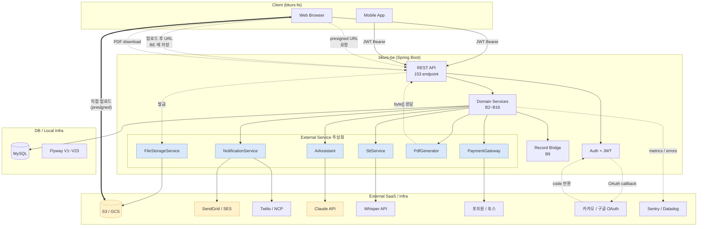
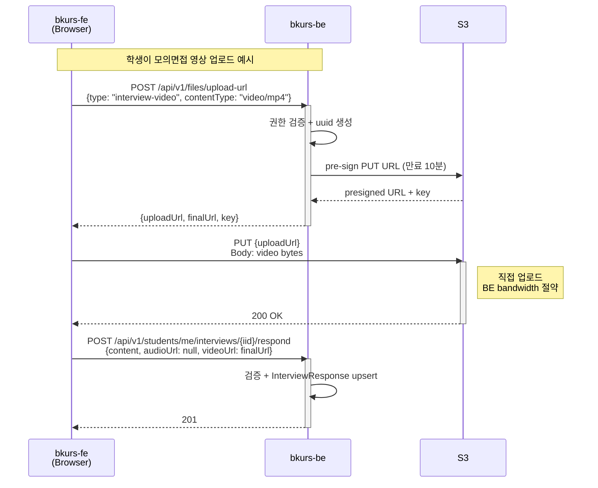
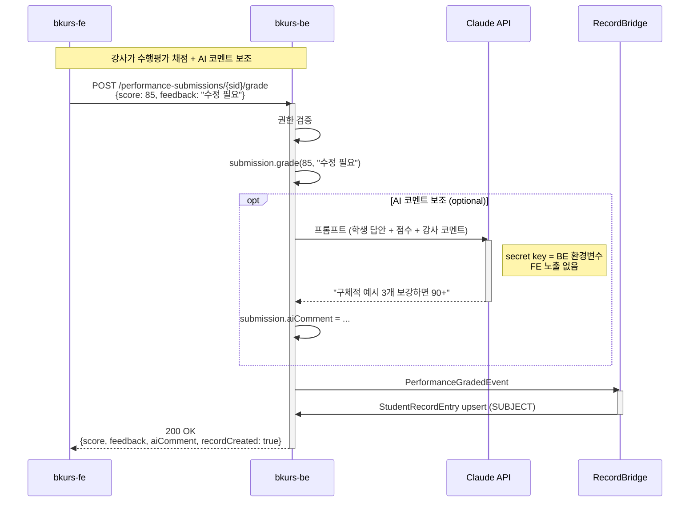
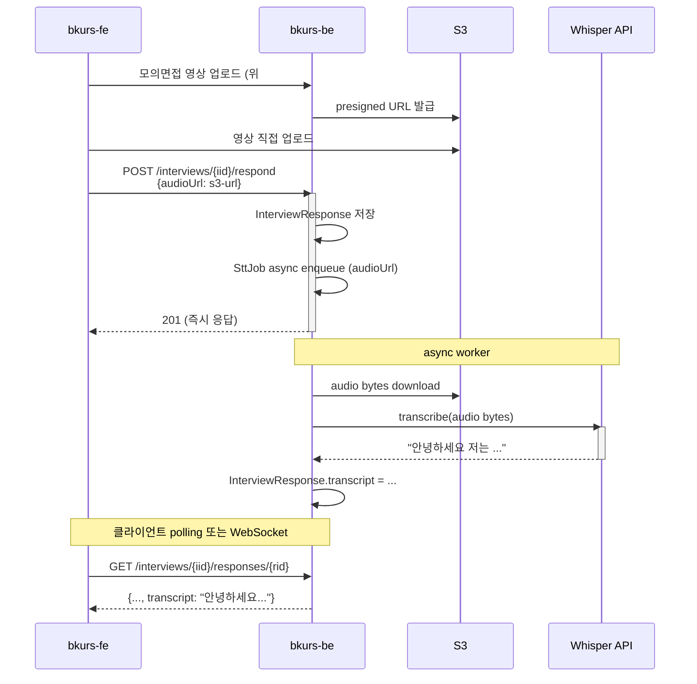
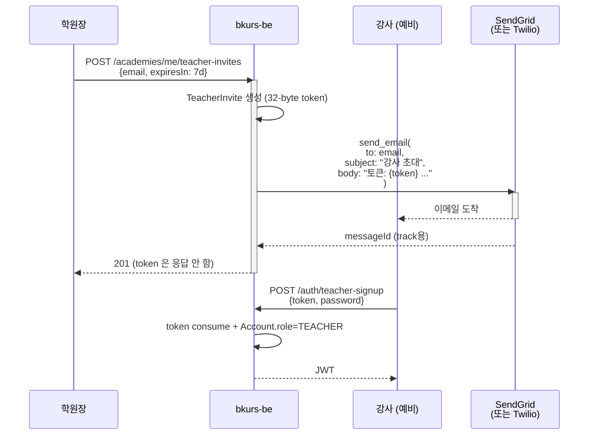

# bkurs 아키텍처 — Hybrid 외부 서비스 연동

> bkurs-be (Spring Boot 백엔드) 와 bkurs-fe (React 프론트) 가 외부 SaaS / 인프라
> 와 연결되는 표준 패턴. **BE-orchestrated 가 기본, file upload 만 presigned URL
> 예외**.

## 1. 핵심 원칙

- **Secret 은 server 전용**. AI API key / PG signing key / S3 access key 모두 BE
  환경변수로만. FE / Mobile 에는 절대 노출 X.
- **Business logic 일관성**. "PE 채점 → record 자동 생성 → 알림 발송" 같은 흐름이
  같은 트랜잭션 / saga 안에서. Client 가 중간에 끊기면 데이터 불일치.
- **Provider swap 가능**. Interface + Mock 패턴 → 실제 SaaS 1-class swap.
- **Audit 단일 지점**. 모든 외부 호출 로그가 BE 한 곳에서.

## 2. 전체 흐름도



## 3. File Upload 흐름 (presigned URL — 유일한 예외)



**왜 이 패턴?**
- 동영상/음성 = 큰 파일 (10MB-100MB+). BE proxy 통과 시 bandwidth 2배.
- presigned URL = 10분 만료, 1회용. Client 가 영구 credentials 보유 안 함.
- BE 가 발급 시점에 권한 검증 (학생 본인의 interview 만 업로드 가능).

## 4. AI 자동 평가 흐름 (BE-managed)



**왜 BE 직접?**
- Claude API key 는 server secret. Client 노출 시 비용 abuse 위험.
- AI 응답을 record 생성 트랜잭션에 포함 — 일관성.
- AI 호출 실패 시 retry / fallback 을 BE 단에서 표준화.
- 비즈니스 로직 ("AI 코멘트는 강사 채점 후 보조용") 이 server 정의.

## 5. STT (음성 전사) 흐름



**왜 BE 직접 호출?**
- Whisper API key 보호.
- 전사 결과 가 검색 (B10) 대상 → 저장이 비즈니스 로직.
- async 처리로 학생 응답 latency 영향 없음.

## 6. Notification (이메일/SMS) 흐름



**현재 vs 변경 후:**
- **현재 (Mock)**: token 이 응답 JSON 으로 노출 → 학원장이 직접 이메일/SMS forward.
- **변경 후**: BE 가 직접 이메일 발송 → 학원장은 email 만 입력하면 됨.

## 7. 인터페이스 + Mock 패턴

모든 외부 서비스는 인터페이스를 통해 추상화. 비즈니스 로직은 인터페이스만 참조.

```
com.bkurs.{domain}.gateway/
  ├── XService.java          // interface (BE-internal 계약)
  ├── MockXService.java      // 기본 구현 (개발/테스트 용)
  └── RealXService.java      // 실제 SaaS 구현 (별도 PR 에서 추가)
```

**Bean 선택**: `application-{profile}.yml` 의 `bkurs.external.{service}.impl=mock|real` property + `@ConditionalOnProperty`.

**예 — PaymentGateway (이미 구현됨, B4C)**:
```java
public interface PaymentGateway {
    ChargeResult charge(ChargeRequest req);
    RefundResult refund(String gatewayTxId);
    String name();
}

@Component
public class MockPaymentGateway implements PaymentGateway { ... }

// 후일:
// @Component
// @ConditionalOnProperty(name = "bkurs.external.payment.impl", havingValue = "portone")
// public class PortOnePaymentGateway implements PaymentGateway { ... }
```

## 8. 추상화 추가 계획 (B17~B21)

| PR | 인터페이스 | 통합 위치 | 후일 실제 구현 |
|---|---|---|---|
| B17 | `FileStorageService` | 신규 endpoint `POST /api/v1/files/upload-url` | S3 / GCS SDK |
| B18 | `NotificationService` | `TeacherInviteService.create()` 자동 호출 | SendGrid / SES / Twilio / NCP |
| B19 | `AiAssistant` | `PerformanceEvaluationService.gradeByTeacher()` 보조 호출 | Claude API |
| B20 | `SttService` | `ResponseService.submit()` async trigger | Whisper / NCP Clova STT |
| B21 | `PdfGenerator` | 신규 endpoint `GET /api/v1/students/me/record.pdf` | PDFBox / OpenPDF |

각 PR 은 **인터페이스 + Mock impl + 비즈니스 통합 + 회귀 테스트**.
실제 SaaS 구현은 사용자가 별도 PR 에서 추가.

## 9. Secret 관리 (modify 대상)

| 항목 | 현재 (commit 됨) | 변경 후 |
|---|---|---|
| DB password (local) | `application-local.yml` 평문 `'13950991*'` | `${DB_PASSWORD}` env var, `.env.example` 가이드 |
| DB password (prod) | 없음 | `application-prod.yml` + secret manager (AWS SSM / Vault) |
| JWT secret | `${JWT_SECRET:bkurs-local-dev-secret-...}` default 약함 | local default 유지, prod 필수 env |
| docker-compose | `MYSQL_PASSWORD: '13950991*'` | `MYSQL_PASSWORD: ${MYSQL_PASSWORD:-changeme}` |
| Claude API key | 없음 | `${CLAUDE_API_KEY}` (B19 추가 시) |
| Whisper API key | 없음 | `${WHISPER_API_KEY}` (B20) |
| SendGrid API key | 없음 | `${SENDGRID_API_KEY}` (B18) |
| S3 access key | 없음 | `${AWS_ACCESS_KEY_ID}` + `${AWS_SECRET_ACCESS_KEY}` (B17) |
| PortOne secret | 없음 | `${PORTONE_API_SECRET}` (B22+) |

**git history**: 평문 비번 commit 3개 (`e39c560`, `777eb2e`, `4138a18`) 는 push 됨.
- 옵션 1: `git filter-repo` 로 rewrite + force-push (파괴적, 협업자 영향).
- 옵션 2: 비번 rotate (DB user `mw` 비번 변경) — 권장.

## 10. company-infra 분리

별도 repo `company-infra` 로 이전:
- `docker-compose.yml` (현재 bkurs-be 루트)
- Kubernetes manifests (향후)
- Terraform / Pulumi IaC (향후)
- 환경 별 secret 관리 (Vault config, AWS SSM tree)

`bkurs-be` 에는 남김:
- `application.yml` / `application-local.yml` (env var 참조만)
- `.env.example`
- `Dockerfile` (앱 빌드)
- `.github/workflows/ci.yml` (앱 단위 CI)

## 관련

- [[bkurs-be|bkurs-be hub]] — 도메인 + abstraction 진행 로그
- [[../bkurs-fe/bkurs-fe|bkurs-fe hub]] — 짝 프론트엔드
- [[decisions/decision-record-bridge|B9 bridge 결정]] — same-TX 일관성 예시
- 후속: company-infra repo 신설 / 실 SaaS plug-in PR (B22+)
