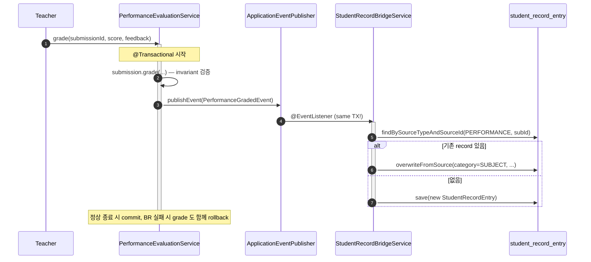

# bkurs-be — 아키텍처 개요

> "요청 한 건이 들어와서 응답까지 어떤 경로를 타는가" + "도메인 간 비동기 흐름" + "batch
> cron". 깊은 SaaS swap 은 [[external-gateways]] / [[hybrid-external-services]],
> async detail 은 [[async-mq-batch]] 가 SSoT.

## 1. 한 장 요약

```mermaid
flowchart TD
  Client[Client - bkurs-fe / curl]
  Client -->|Bearer JWT + Cookie| Filter

  subgraph FilterChain[Spring Security FilterChain  common/config/SecurityConfig]
    Filter[RequestIdFilter] --> Cors[CorsFilter] --> Jwt[JwtAuthenticationFilter]
  end

  Jwt --> Controller["@RestController<br/>path → role prefix<br/>@PreAuthorize / @Valid"]
  Controller -->|MethodArgumentNotValid| ValHandler[GlobalValidationExceptionHandler]
  ValHandler --> Envelope

  Controller --> Service["@Service @Transactional<br/>invariant 검증 / 도메인 BusinessException"]
  Service -.->|ApplicationEventPublisher| Bridge[record bridge - same TX]
  Service -.->|@Async externalCallExecutor| GW[Gateway - Mock / 실 SaaS]
  Service -.->|MessagingPublisher| MQ[Rabbit / InMemory]
  Service --> Repo[Repository - Spring Data JPA]
  Repo --> DB[(MySQL bkurs-local)]

  Service --> Envelope["ApiEnvelopes.ok / fail<br/>success + data + error + meta"]
  Service -.->|BusinessException| AdviceChain
  AdviceChain[도메인 advice → GlobalExceptionHandler fallback] --> Envelope
  Envelope --> Client
```

## 2. 요청 흐름 — 7 layer

### Layer 1. FilterChain (`common/web`, `common/config`)

순서 (filter 가 인증·CORS·요청 ID 를 결정):

1. `RequestIdFilter` — 요청에 UUID 부여 (`X-Request-Id`). `RequestIds.REQUEST_ID_ATTR` 로 envelope `meta.requestId` 에 동봉.
2. `CorsFilter` — `CorsConfig` 의 `allowedOriginPatterns` + `allowCredentials=true`. 자세히 [[auth-and-security#cors]].
3. `JwtAuthenticationFilter` — `Authorization: Bearer <jwt>` 파싱 → `SecurityContext` 에 `UsernamePasswordAuthenticationToken` 셋업. 만료 / 변조 시 거부 안 함 (anonymous 로 흘림) — 권한 거부는 `@PreAuthorize` 가.
4. Spring Security `FilterChain` — `permitAll` 패턴 (signup/login/refresh/logout/health/swagger) 외 전부 `authenticated()` 요구.

### Layer 2. Controller (`{domain}/controller/`)

- `@RestController` + `@RequestMapping("/v1/...")` (role prefix 매핑은 [[directory-structure#4]]).
- `@PreAuthorize("hasRole('OWNER')")` 으로 role gate. ROLE_ prefix 자동 부여.
- `@Valid @RequestBody CreateXRequest req` — Bean Validation. 실패 시 `MethodArgumentNotValidException` → handler.
- 응답은 `ApiEnvelopes.ok(view, request)` 또는 `created(URI, view, request)` 로 envelope wrap. raw entity 노출 금지.

### Layer 3. Service (`{domain}/service/`)

- `@Service @Transactional` — write 메서드. read 는 `@Transactional(readOnly = true)`.
- 비즈니스 invariant: 가능하면 **entity 내부 메서드** (`Academy.transferTo(...)`, `Course.updateLimited(...)`) 로 보호 — service 는 호출만.
- 도메인 예외 throw: `AcademyNotFoundException extends BusinessException`. 예외에 ErrorCodeSpec 동봉.
- cross-domain 참조: 직접 repository 호출보다 service 호출 권장. 권한 검증 (`AcademyMembershipResolver`) 도 service.
- 이벤트: `ApplicationEventPublisher.publishEvent(new PerformanceGradedEvent(...))` → record bridge 가 listen.
- 비동기 호출: `@Async("externalCallExecutor")` annotated method 또는 직접 `executor.execute(...)`.

### Layer 4. Repository (`{domain}/domain/{Entity}Repository.java`)

- `JpaRepository<Entity, Long>` extends.
- 명명 규칙: `findByXAndY`, `existsByX`, `findByXContainingIgnoreCase` (search), `findByXAndStatus` (membership 등).
- `@Modifying @Query` 는 cleanup 한정 (e.g. test cascade). 일반 update 는 dirty checking.

### Layer 5. Entity (`{domain}/domain/{Entity}.java`)

- `@Entity` + Lombok `@Getter` (`@Setter` 최대한 회피).
- invariant 메서드: `transferTo(newOwner)`, `markSubmitted()`, `recordPaid(...)`.
- 양방향 연관은 회피 — `@ManyToOne` 만 두고 N+1 회피.

### Layer 6. Handler (`{domain}/handler/` + `common/handler/`)

도메인 advice (`basePackages = "com.bkurs.{domain}"`) → 도메인 BusinessException 매핑.
fallback 은 `GlobalExceptionHandler` (`@Order(LOWEST_PRECEDENCE)`).

처리 매트릭스:

| 예외 | HTTP | code |
| --- | --- | --- |
| `BusinessException` (도메인) | ErrorCodeSpec.status() | 도메인 prefix |
| `MethodArgumentNotValidException` | 400 | COM-4003 |
| `HttpMessageNotReadableException` | 400 | COM-4002 |
| `AccessDeniedException` | 403 | COM-4005 |
| `AuthenticationCredentialsNotFoundException` | 401 | COM-4004 |
| `HttpRequestMethodNotSupportedException` | 405 | COM-4007 |
| `HttpMediaTypeNotAcceptableException` | 406 | COM-4008 |
| `HttpMediaTypeNotSupportedException` | 415 | COM-4010 |
| `NoHandlerFoundException` | 404 | COM-4006 |

> **fallback `Exception.class` 는 의도적으로 없음** — 도메인 advice (raw shape) 와 충돌하지
> 않도록. 미정의 예외 = 버그 신호, Spring 기본 500. envelope migration PR (#87) 이후 재추가
> 검토.

### Layer 7. Envelope (`common/api/`)

`ApiEnvelopes` 가 모든 envelope 생성을 통일.

```java
return envelopes.ok(view, request);                // 200
return envelopes.created(URI.create("/v1/x/" + id), view, request);  // 201
return envelopes.noContent();                       // 204
return envelopes.fail(HttpStatus.CONFLICT, error, request);  // 409
```

응답 형태:

```json
{
  "success": true,
  "data":  { ... } | null,
  "error": null | { "code": "ACA-4040", "status": 404, "message": "...", "messageKey": "...", "fieldErrors": [], "requestId": "..." },
  "meta":  { "requestId": "...", "timestamp": "2026-05-21T13:00:00Z" }
}
```

invariant 은 record 생성자에서 강제 (`success=true ↔ data ≠ null ∧ error = null`).

자세히 → [[common]].

---

## 3. 도메인 간 비동기 흐름 — record bridge

4 도메인 (performance / discussion / simulation / reading) 의 grade/evaluate 동작이 **자동으로
record (생기부)** 에 반영된다.



- **매핑** : PERFORMANCE→SUBJECT / DISCUSSION→AUTONOMY / SIMULATION→CAREER / READING→READING.
- **same-TX** : `@TransactionalEventListener` 가 아닌 `@EventListener` — bridge 실패 시 원래 grade 도 롤백 (의도).
- **idempotent** : `uk_source_type_source_id` 로 중복 방지.
- **학생부 영구** : source 도메인 (discussion post 등) DELETE 시 record 보존 — 별도 정책.
- **period 자동** : `AcademicPeriod.from(LocalDate.now(KST))` — 한국 학년도 (3~7월 1학기 / 8~12월 2학기 / 1~2월 전년도 2학기).

코드 위치: `record/bridge/` (4 event record + `StudentRecordBridgeService`). decision: [[decisions/decision-record-bridge]], [[decisions/decision-academic-period]].

---

## 4. 외부 SaaS 호출 — gateway 패턴

각 외부 의존 도메인 (file / notification / pdf / ai / stt / payment) 은 다음 4 단계 동일.

```
{domain}/gateway/
├── {Foo}Service.java          # interface
├── Mock{Foo}Service.java      # @Profile("!prod") — local + test default
├── {Real}{Foo}Service.java    # @Profile("prod") — SendGrid / PortOne / Claude / Clova
└── {Foo}Properties.java       # @ConfigurationProperties — API key / endpoint
```

호출 측은 `@Async("externalCallExecutor")` 로 비동기. saturation 이 다른 pool (default async) 에
영향 주지 않도록 **2 pool 분리** (`AsyncConfig`).

자세히 → [[external-gateways]] + [[hybrid-external-services]].

---

## 5. Messaging — fire-and-forget event

`common/messaging/MessagingPublisher` (interface) — `InMemoryMessagingPublisher` (default) /
`RabbitMessagingPublisher` (`@ConditionalOnProperty bkurs.messaging.provider=rabbit`).

도메인 → publisher 호출:

```java
messagingPublisher.publish(MessageTopic.PAYMENT_OVERDUE, payload);
```

dev/local 은 InMemory (log 만), prod 는 RabbitMQ 큐로 라우팅. consumer 는 별도 worker 서비스
(현재 자체 consumer 없음 — 후속).

자세히 → [[async-mq-batch]] §2.

---

## 6. Batch — cron job

`batch/` 패키지 — Spring Batch.

| job | trigger | 동작 |
| --- | --- | --- |
| `overduePaymentAlertJob` | cron daily 03:00 | 미납 학원 조회 → `MessagingPublisher.publish(PAYMENT_OVERDUE, ...)` |
| (후속) | | 출석 누락 알림 / 학생부 backfill 등 |

`ScheduledBatchLauncher` — `@Scheduled(cron = ...)` + `JobLauncher.run(...)`. 토글:
`bkurs.batch.scheduling.enabled=false` (test 환경).

metadata 테이블: V24 가 Spring Batch 의 `BATCH_JOB_INSTANCE / BATCH_JOB_EXECUTION ...` 생성.

자세히 → [[async-mq-batch]] §3.

---

## 7. 응답 시간 / 트랜잭션 경계 원칙

- `@Transactional` 메서드 안에서 **외부 SaaS 호출 금지** — 트랜잭션 길어짐. gateway 호출은 `@Async` 또는 별도 step.
- `OSIV = false` (`spring.jpa.open-in-view: false`) — service 종료 후 lazy 접근 시 `LazyInitializationException`. response DTO 는 service 내부에서 완성.
- bridge 의 `@EventListener` 는 **same TX 의도** — `@TransactionalEventListener(AFTER_COMMIT)` 가 아님. 변경 시 주의.

## 8. 관측 / 운영

- `RequestIdFilter` → 모든 log 의 `MDC` 에 requestId 주입. `AsyncConfig` 의 `TaskDecorator` 가 비동기로도 전파.
- actuator: `/actuator/health` (probes 활성), `/actuator/info`. permitAll.
- OpenAPI: `/swagger-ui.html` + `/v3/api-docs` — `OpenApiConfig` 의 8 group (auth / academy / course / record / plan / saenggibu / search / common). permitAll (prod 는 IP 제한 권장).

## cross-link

- [[../bkurs-be]] — 프로젝트 hub
- [[directory-structure]] — 패키지 / sub-layer
- [[common]] — common/* 상세
- [[auth-and-security]] — Security/JWT/CORS 상세
- [[external-gateways]] — gateway interface 정리
- [[async-mq-batch]] — async / mq / batch 깊은 SSoT
- [[hybrid-external-services]] — 외부 SaaS hybrid 전략
