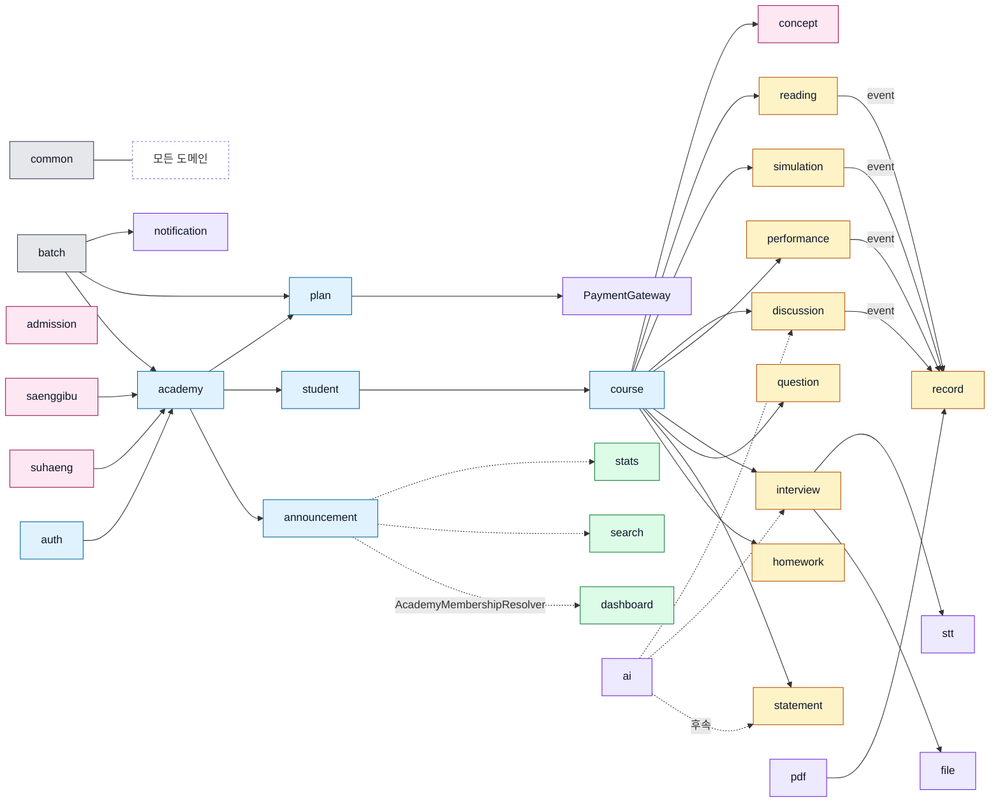

# bkurs-be — 29 도메인 카탈로그

> 각 도메인의 **상세 문서는 `domains/{name}.md`** 에 있다. 본 페이지는 그 인덱스 + 한 줄 책임 +
> 의존 그래프. 깊이 들어갈 땐 sub doc 로.

## 0. 한 장 인덱스

| 도메인 | 카테고리 | 책임 1줄 | sub doc |
| --- | --- | --- | --- |
| auth | core | 회원가입 / 로그인 / JWT / Refresh rotation | [[domains/auth]] |
| academy | core | 학원 + 학생/강사 가입·승인 + 이관 + 강사 invite | [[domains/academy]] |
| announcement | core | 학원 공지 + 읽음 추적 (`AcademyMembershipResolver` 보관) | [[domains/announcement]] |
| student | core | 학생 프로필 1:1 (school / grade 1~6 / parentPhone) | [[domains/student]] |
| plan | core | 플랜 catalog + 구독 + 결제 + 환불 (PaymentGateway) | [[domains/plan]] |
| course | core | 수업 + Enrollment + Session + Attendance + 강사 limited update | [[domains/course]] |
| homework | learning | 숙제 + 학생 제출 + 채점 (0~100) | [[domains/homework]] |
| statement | learning | 자소서 DRAFT/SUBMITTED + feedback | [[domains/statement]] |
| question | learning | 학원 강사 발행 예상/기출 + Attempt | [[domains/question]] |
| interview | learning | 모의면접 4 type + audio/video URL + 평가 | [[domains/interview]] |
| record | learning | 학생부 8 카테고리 + 4 도메인 자동 bridge | [[domains/record]] |
| discussion | learning | 토론 topic + post (uk upsert) + 협업 평가 → record AUTONOMY | [[domains/discussion]] |
| reading | learning | 독서 노트 + feedback (academy 격리 없음) → record READING | [[domains/reading]] |
| performance | learning | 수행평가 4 카테고리 + 재제출 채점 무효화 → record SUBJECT | [[domains/performance]] |
| simulation | learning | 모의지원 3 type + feasibility 1~5 → record CAREER | [[domains/simulation]] |
| search | aggregator | 5 도메인 LIKE 통합 검색 + role 분기 | [[domains/search]] |
| stats | aggregator | 학생 7 영역 통계 통합 | [[domains/stats]] |
| dashboard | aggregator | 강사 (수업별) / 학원장 (학원 rollup) | [[domains/dashboard]] |
| concept | content | 진로 / 컨셉 진단 (중·고등 공용) | [[domains/concept]] |
| suhaeng | content | 중등 수행/면담 round | [[domains/suhaeng]] |
| saenggibu | content | 중등 생기부 + 학기 lock | [[domains/saenggibu]] |
| admission | content | 입시 면접 문항 (MASTER 발행 — Past + Major) | [[domains/admission]] |
| file | gateway | Storage gateway (presigned URL) | [[domains/file]] |
| pdf | gateway | PDF 생성 gateway (학생부 출력) | [[domains/pdf]] |
| notification | gateway | Email / SMS gateway (SendGrid) | [[domains/notification]] |
| ai | gateway | Claude AI gateway (자소서 / 면접 분석) | [[domains/ai]] |
| stt | gateway | Clova STT gateway (audio → 텍스트) | [[domains/stt]] |
| batch | infra | Spring Batch + cron (미납 알림) | [[domains/batch]] |
| common | infra | envelope / error / handler / web / messaging / config | [[domains/common]] |

## 1. 카테고리별

### core (6)
계정 / 학원 / 학생 / 학원 운영 / 수업 — 다른 모든 도메인의 base.

`auth / academy / announcement / student / plan / course`

### learning (9)
학생 학습 활동 — homework / statement / question / interview / record / discussion / reading /
performance / simulation. 이 중 4개 (performance / discussion / simulation / reading) 가
**record bridge source**.

### aggregator (3)
read-only 집계. 다른 도메인 repository 만 의존.

`search / stats / dashboard`

### content (4)
공통 콘텐츠 / 중등 전용 / MASTER 발행.

`concept (공용) / suhaeng (중등) / saenggibu (중등) / admission (MASTER)`

### gateway (5)
외부 SaaS 추상화. interface + Mock + 실 구현.

`file / pdf / notification / ai / stt` — 자세히 [[external-gateways]]

### infra (2)
도메인 무관 횡단.

`batch / common`

## 2. 의존 그래프

## 3. 도메인 ↔ V마이그레이션 1:1

| V | 도메인 |
| --- | --- |
| V2 | auth (account) |
| V3 | auth (refresh_token) |
| V4 | academy (academy + membership) |
| V5 | academy (teacher invite + assignment) |
| V6 | announcement |
| V7 | academy (4 info 컬럼) |
| V8 | plan (plan + subscription) |
| V9 | plan (payment) |
| V10 | academy (owner transfer) |
| V11 | student |
| V12 | course (course + enrollment) |
| V13 | course (session + attendance) |
| V14 | homework |
| V15 | statement |
| V16 | question |
| V17 | interview |
| V18 | record (entry) |
| V19 | discussion |
| V20 | reading |
| V21 | performance |
| V22 | simulation |
| V23 | record (ALTER source) |
| V24 | batch (Spring Batch metadata) |
| V25 | concept |
| V26 | suhaeng |
| V27 | saenggibu |
| V28 | admission (past) |
| V29 | admission (major) |

## 4. ErrorCode prefix

| prefix | 도메인 |
| --- | --- |
| `COM-` | common |
| `AUT-` | auth |
| `ACA-` | academy |
| `ANN-` | announcement |
| `STU-` | student |
| `PLA-` / `PAY-` | plan / payment |
| `CRS-` | course |
| `HMW-` | homework |
| `STA-` | statement |
| `QUE-` | question |
| `ITV-` | interview |
| `REC-` | record |
| `DIS-` | discussion |
| `RDN-` | reading |
| `PEV-` | performance |
| `SIM-` | simulation |
| `SCH-` | search |
| `STS-` | stats |
| `DSH-` | dashboard |
| `CON-` | concept |
| `SHN-` | suhaeng |
| `SGB-` | saenggibu |
| `ADM-` | admission |
| `FIL-` / `PDF-` / `NOT-` / `AI-` / `STT-` | gateway |

> 신규 도메인 추가 시 prefix 충돌 없는 새 값 + 본 표 갱신.

## cross-link

- [[../bkurs-be]] — 프로젝트 hub
- [[directory-structure]] — 7 sub-layer 규칙
- [[database-and-migrations]] — V1~V29 상세
- [[external-gateways]] — gateway interface
- [[overview]] — bridge / async / batch
- `decisions/` — 도메인별 ADR 35개
