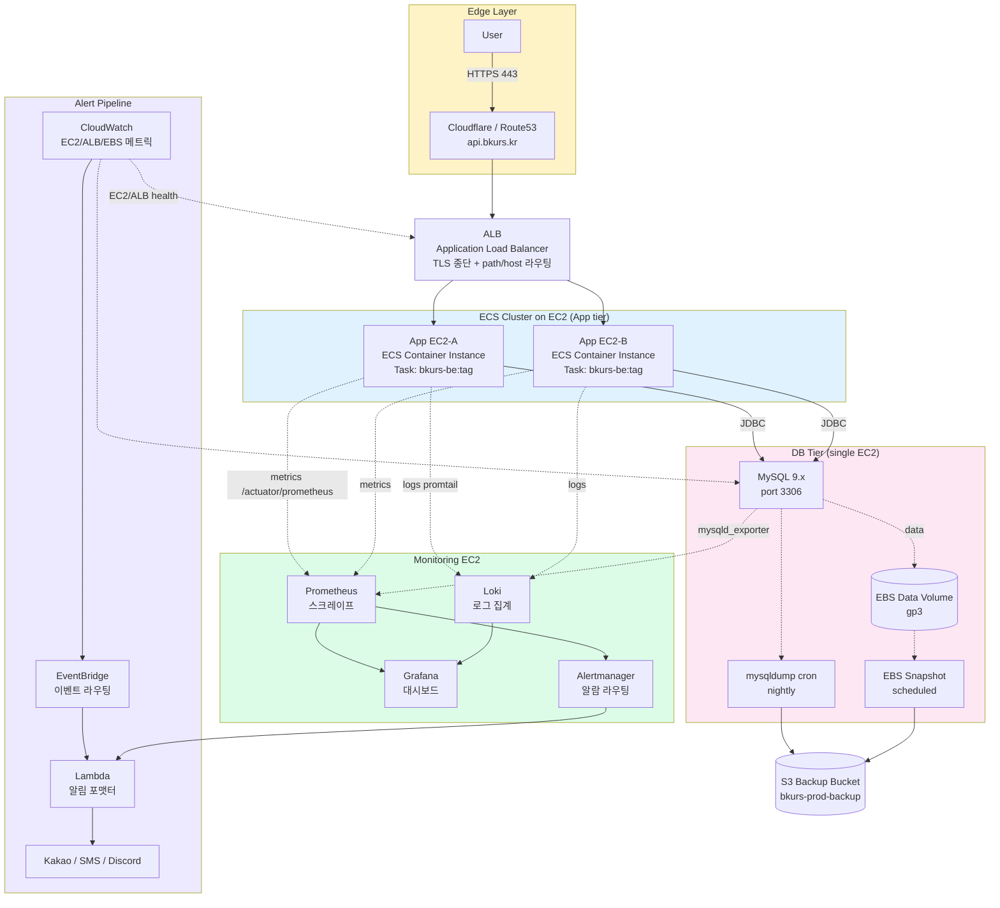
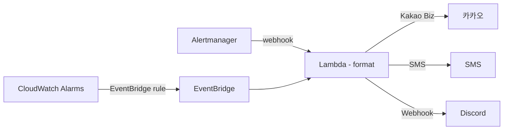
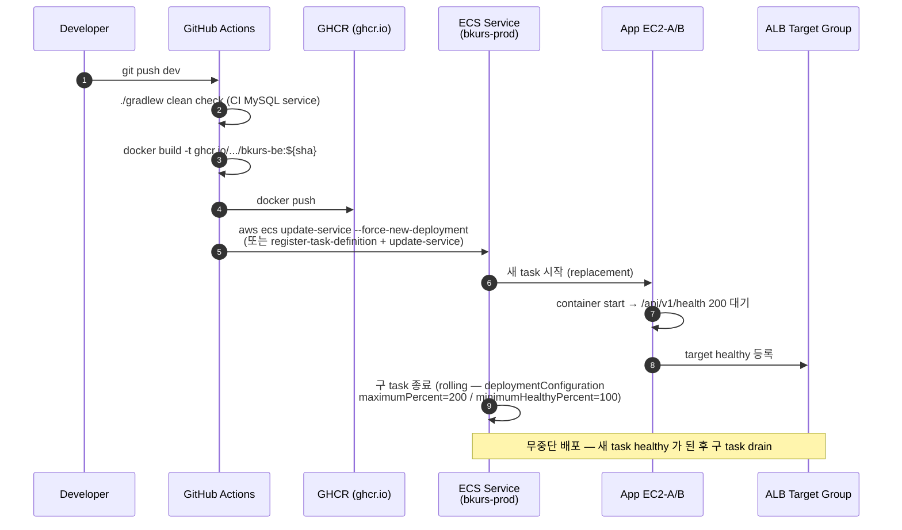

# bkurs-be — 배포 / 인프라 가이드

> **AWS ECS on EC2 + MySQL on EC2 + 자체 모니터링 스택**. RDS / EKS / CloudFront 사용 안 함.
> 본 문서는 **bkurs-be 운영 인프라의 SSoT**. 외부 SaaS 발급은 [[services-guide]], 자격 inventory 는
> [[services-accounts]] (gitignored).

## 1. 인프라 토폴로지



## 2. 컴포넌트별 책임

### 2.1 Edge — DNS + ALB

| 컴포넌트 | 역할 | 설정 |
| --- | --- | --- |
| Cloudflare 또는 Route53 | `api.bkurs.kr` 의 DNS A/ALIAS → ALB | TTL 60s, DNSSEC 권장 |
| ALB | TLS 종단 (ACM cert) + path/host 라우팅 + healthcheck | Listener 443 → Target Group :8080 |
| Target Group | ECS Service 의 Task IP/port 자동 등록 | Health: `GET /api/v1/health` 200, interval 10s, threshold 3 |

> Cloudflare 를 쓸 경우 ALB 앞에 둠 (proxy mode). ALB 의 SG 는 Cloudflare IP 만 허용해서 origin
> 직접 호출 차단. Route53 만 쓰면 ALB 가 직접 노출 — SG 로 0.0.0.0/0 :443 허용.

### 2.2 App tier — ECS Cluster on EC2

| 항목 | 값 |
| --- | --- |
| 클러스터 | `bkurs-prod` ECS cluster |
| Launch type | **EC2** (Fargate 아님 — 비용 / 영구 storage / 모니터링 agent 자유도) |
| Capacity provider | ASG (Auto Scaling Group) 2~N EC2 instance |
| EC2 type | t3.medium 권장 (vCPU 2, RAM 4GB) — 부하 따라 m6i 등 |
| Task definition | `bkurs-be-prod` family, container 1개 |
| Container image | `ghcr.io/seum-running/bkurs-be:<tag>` (사이클 2 #90 workflow) |
| Container port | 8080 (Spring) → ALB Target Group |
| Resource | task: cpu=1024 (1 vCPU), memory=1536 MiB — EC2 당 task 2개 가능 (t3.medium 기준) |
| Desired count | 2 (App EC2-A / App EC2-B 분산 placement constraint) |
| Health check | Container: `curl -f http://localhost:8080/api/v1/health || exit 1` (60s interval, 5s timeout, 3 retries) |
| Logging | `awslogs` 드라이버 (cluster log group) **+** promtail sidecar 또는 EC2 host 의 promtail 로 Loki 송신 |
| IAM Task Role | S3 (백업 bucket read), SSM (parameter store getParameter), CloudWatch (PutMetricData) |
| IAM Task Execution Role | ECR pull, CloudWatch Logs PutLogEvents (`AmazonECSTaskExecutionRolePolicy`) |

### 2.3 DB tier — MySQL on EC2

| 항목 | 값 |
| --- | --- |
| EC2 type | r6i.large 권장 (RAM 16GB — InnoDB buffer pool 8~10GB) |
| OS | Amazon Linux 2023 |
| MySQL | 9.x community |
| EBS data volume | gp3, 100GB 부터 (autoscale 검토). IOPS 3000, throughput 125 MB/s baseline |
| Mount | `/var/lib/mysql` 별도 EBS volume — root EBS 와 분리 |
| Port | 3306 — SG 는 **App tier ECS instance SG 만 허용** |
| 백업 | nightly mysqldump → S3 + EBS snapshot 매일 03:00 KST (§4) |
| 접속 | App tier 가 ECS Service Discovery 또는 내부 ALB / Private IP 로 접속 |
| TLS | RDS 가 아니므로 자동 TLS 없음 — `useSSL=true` + `mysqlsh` 로 cert 설치 시 활성 권장 |

> RDS 안 쓰는 이유 (사용자 결정): 비용 / 운영 자유도 / mysqldump+EBS snapshot 조합으로 충분.

### 2.4 Monitoring EC2

별도 EC2 1대 (t3.medium 정도) — 4 컴포넌트 docker-compose 또는 systemd:

| 컴포넌트 | 역할 | 데이터 위치 |
| --- | --- | --- |
| Prometheus | scrape (app `/actuator/prometheus`, mysqld_exporter, node_exporter) | EBS gp3 50GB / 15d retention |
| Grafana | 대시보드 (Spring Boot / MySQL / EC2 host / ALB) | EBS — provisioning yaml 관리 |
| Loki | 로그 집계 (Promtail → Loki) | EBS 또는 S3 chunk store |
| Alertmanager | 알람 라우팅 (Lambda webhook → 카카오/SMS/Discord) | 단순 config |

scrape targets:

```yaml
# prometheus.yml
scrape_configs:
  - job_name: 'bkurs-be'
    metrics_path: '/actuator/prometheus'
    static_configs:
      - targets: ['app-ec2-a.internal:8080', 'app-ec2-b.internal:8080']

  - job_name: 'mysql'
    static_configs:
      - targets: ['db-ec2.internal:9104']  # mysqld_exporter

  - job_name: 'node'
    static_configs:
      - targets: ['app-ec2-a.internal:9100', 'app-ec2-b.internal:9100', 'db-ec2.internal:9100']
```

> app 측에서는 `management.endpoints.web.exposure.include` 에 `prometheus` 추가 필요 — 자세히
> §6.2.

### 2.5 Alert 파이프라인



| 신호 | 소스 | 라우팅 |
| --- | --- | --- |
| 앱 metric (5xx / latency / JVM) | Prometheus → Alertmanager | webhook → Lambda |
| MySQL slow query / connection 포화 | Prometheus (mysqld_exporter) → Alertmanager | webhook → Lambda |
| EC2 / ALB / EBS 인프라 | CloudWatch → EventBridge rule | → Lambda |
| 배포 실패 | ECS deployment event → EventBridge | → Lambda |
| S3 백업 실패 | Lambda 결과 코드 → EventBridge | → Lambda |

**Lambda 가 단일 진입점** — 메시지 normalize 후 채널 분배 (severity 별 카카오 / SMS / Discord).

> 알람 라우팅 룰은 Terraform 또는 본 노트의 별첨. severity 분류 예:
> P0 (즉시) → 카카오+SMS+Discord, P1 (15분 내) → 카카오+Discord, P2 (영업시간) → Discord only.

## 3. 배포 파이프라인 — GHCR → ECS rolling



### 3.1 GitHub Actions workflow (`.github/workflows/dev-deploy.yml`)

```yaml
name: dev-deploy
on:
  push:
    branches: [dev]

jobs:
  test-build-deploy:
    runs-on: ubuntu-latest
    permissions:
      contents: read
      packages: write          # GHCR
      id-token: write          # OIDC → AWS
    steps:
      - uses: actions/checkout@v4
      - name: Set up JDK 21
        uses: actions/setup-java@v4
        with: { distribution: temurin, java-version: '21' }
      - run: ./gradlew clean check
      - name: Login to GHCR
        uses: docker/login-action@v3
        with:
          registry: ghcr.io
          username: ${{ github.actor }}
          password: ${{ secrets.GITHUB_TOKEN }}
      - name: Build & push
        run: |
          IMG=ghcr.io/seum-running/bkurs-be:${{ github.sha }}
          docker build -t $IMG .
          docker push $IMG
      - name: Configure AWS credentials (OIDC)
        uses: aws-actions/configure-aws-credentials@v4
        with:
          role-to-assume: arn:aws:iam::123456789012:role/bkurs-github-deploy
          aws-region: ap-northeast-2
      - name: Render task def
        id: td
        uses: aws-actions/amazon-ecs-render-task-definition@v1
        with:
          task-definition: deploy/ecs-task-bkurs-be.json
          container-name: bkurs-be
          image: ghcr.io/seum-running/bkurs-be:${{ github.sha }}
      - name: Deploy
        uses: aws-actions/amazon-ecs-deploy-task-definition@v2
        with:
          task-definition: ${{ steps.td.outputs.task-definition }}
          service: bkurs-be
          cluster: bkurs-prod
          wait-for-service-stability: true
```

### 3.2 IAM — OIDC (`role-to-assume`)

GitHub OIDC provider 신뢰. AccessKey 영구 보관 회피.

권한 (역할 `bkurs-github-deploy`):
- `ecs:RegisterTaskDefinition / UpdateService / DescribeServices`
- `iam:PassRole` (task role 두 개에 한정)
- `ecr:GetAuthorizationToken` (필요 시 — GHCR 사용 시 불필요)
- `logs:CreateLogStream / PutLogEvents`

### 3.3 Rolling 정책 (ECS Service deployment configuration)

```
maximumPercent          = 200      # 새 task 풀스케일 가능
minimumHealthyPercent   = 100      # 다운타임 0
deploymentCircuitBreaker = enable + rollback=true   # health 미달 시 자동 롤백
```

## 4. 백업 / 복구

### 4.1 백업 정책

| 종류 | 주기 | 보존 | 위치 |
| --- | --- | --- | --- |
| `mysqldump --single-transaction` | nightly 02:00 KST (cron on DB EC2) | 30일 | S3 `bkurs-prod-backup/mysqldump/YYYY/MM/DD/full.sql.gz` |
| EBS Snapshot (data volume) | nightly 03:00 KST (Data Lifecycle Manager) | 14일 (daily) + 12 (monthly) | EBS Snapshot |
| 트랜잭션 로그 (binlog) | continuous (옵션) | 7일 | S3 `bkurs-prod-backup/binlog/` (선택) |

cron 예 (`/etc/cron.d/bkurs-mysqldump`):

```cron
0 2 * * * root /opt/bkurs/scripts/mysqldump-to-s3.sh >> /var/log/bkurs-backup.log 2>&1
```

스크립트 흐름:

```bash
#!/usr/bin/env bash
set -euo pipefail
TS=$(date +%Y%m%d-%H%M%S)
DUMP=/tmp/bkurs-${TS}.sql.gz
mysqldump --single-transaction --quick --triggers --routines --events \
  -u backup -p"$BACKUP_PWD" bkurs_prod | gzip > "$DUMP"
aws s3 cp "$DUMP" "s3://bkurs-prod-backup/mysqldump/$(date +%Y/%m/%d)/full.sql.gz"
rm -f "$DUMP"
# Lambda EventBridge 가 결과 코드 확인 → 실패 시 알람
```

### 4.2 복구 (Disaster Recovery)

| 시나리오 | 절차 | 목표 |
| --- | --- | --- |
| 단일 row 삭제 사고 | mysqldump 의 특정 테이블만 복원 → 일치 시점 row INSERT | RPO 24h |
| 전체 DB 손상 | 가장 최근 EBS snapshot 으로 새 volume → attach → fsck → MySQL 재기동 | RTO ~30분 / RPO 24h |
| EC2 자체 손실 | snapshot 으로 새 EC2 + volume → DNS 재지정 (또는 ALB target 직접 갱신) | RTO ~60분 |

> 복구 drill 은 분기 1회 — staging 환경에서 실제 snapshot 복원 + smoke 테스트.

### 4.3 백업 S3 bucket 정책

- 버킷 versioning ON
- Lifecycle: 30일 이상 객체 → Glacier Deep Archive, 365일 이상 → 삭제
- Object Lock: governance mode 7일 (실수 삭제 방지)
- 접근: DB EC2 IAM Role 만 PUT, 읽기는 별도 audit 그룹

## 5. 환경 변수 / Secret 주입

### 5.1 SSM Parameter Store (Secrets Manager 대신)

비용 / 단순함 / ECS task definition native 지원 때문에 **SSM Parameter Store** 사용. 민감값은
`SecureString` (KMS 자동 암호화).

| Path 컨벤션 | 예 |
| --- | --- |
| `/bkurs-be/prod/{key}` | `/bkurs-be/prod/DB_PASSWORD` |
| `/bkurs-be/dev/{key}` | `/bkurs-be/dev/JWT_SECRET` |

### 5.2 ECS Task Definition env 매핑

```json
{
  "family": "bkurs-be-prod",
  "containerDefinitions": [{
    "name": "bkurs-be",
    "image": "ghcr.io/seum-running/bkurs-be:placeholder",
    "essential": true,
    "portMappings": [{ "containerPort": 8080, "protocol": "tcp" }],
    "environment": [
      { "name": "SPRING_PROFILES_ACTIVE", "value": "prod" },
      { "name": "DB_HOST", "value": "db-ec2.internal" },
      { "name": "DB_PORT", "value": "3306" },
      { "name": "DB_NAME", "value": "bkurs_prod" },
      { "name": "DB_USERNAME", "value": "bkurs_app" },
      { "name": "FRONTEND_URL", "value": "https://web.bkurs.kr" },
      { "name": "AWS_REGION", "value": "ap-northeast-2" }
    ],
    "secrets": [
      { "name": "DB_PASSWORD",         "valueFrom": "arn:aws:ssm:ap-northeast-2:123456789012:parameter/bkurs-be/prod/DB_PASSWORD" },
      { "name": "JWT_SECRET",          "valueFrom": "arn:aws:ssm:ap-northeast-2:123456789012:parameter/bkurs-be/prod/JWT_SECRET" },
      { "name": "ANTHROPIC_API_KEY",   "valueFrom": "arn:aws:ssm:ap-northeast-2:123456789012:parameter/bkurs-be/prod/ANTHROPIC_API_KEY" },
      { "name": "PORTONE_API_SECRET",  "valueFrom": "arn:aws:ssm:ap-northeast-2:123456789012:parameter/bkurs-be/prod/PORTONE_API_SECRET" },
      { "name": "SENDGRID_API_KEY",    "valueFrom": "arn:aws:ssm:ap-northeast-2:123456789012:parameter/bkurs-be/prod/SENDGRID_API_KEY" },
      { "name": "CLOVA_CLIENT_SECRET", "valueFrom": "arn:aws:ssm:ap-northeast-2:123456789012:parameter/bkurs-be/prod/CLOVA_CLIENT_SECRET" }
    ],
    "logConfiguration": {
      "logDriver": "awslogs",
      "options": {
        "awslogs-group": "/ecs/bkurs-be-prod",
        "awslogs-region": "ap-northeast-2",
        "awslogs-stream-prefix": "ecs"
      }
    },
    "healthCheck": {
      "command": ["CMD-SHELL", "curl -f http://localhost:8080/api/v1/health || exit 1"],
      "interval": 60, "timeout": 5, "retries": 3, "startPeriod": 30
    }
  }],
  "executionRoleArn": "arn:aws:iam::123456789012:role/ecsTaskExecutionRole",
  "taskRoleArn":      "arn:aws:iam::123456789012:role/bkurs-be-task",
  "networkMode": "awsvpc",
  "requiresCompatibilities": ["EC2"],
  "cpu": "1024",
  "memory": "1536"
}
```

> `secrets` 의 `valueFrom` 이 ECS Agent 가 task 시작 시 SSM 에서 값 조회 후 컨테이너 env 주입.
> 코드는 평소처럼 `System.getenv("DB_PASSWORD")` 또는 Spring `${DB_PASSWORD}` placeholder 사용.

### 5.3 전수 env 표 (prod)

| env | 출처 | 비고 |
| --- | --- | --- |
| `SPRING_PROFILES_ACTIVE=prod` | task def env (plain) | profile 분기 |
| `DB_HOST` | task def env (plain) | DB EC2 private DNS or IP |
| `DB_PORT=3306` | plain | |
| `DB_NAME=bkurs_prod` | plain | |
| `DB_USERNAME=bkurs_app` | plain | |
| `DB_PASSWORD` | **SSM SecureString** | 12개월 rotation |
| `JWT_SECRET` | **SSM SecureString** | 6개월 rotation + refresh family revoke 동반 |
| `FRONTEND_URL=https://web.bkurs.kr` | plain | CORS allowedOriginPatterns |
| `AWS_REGION=ap-northeast-2` | plain | |
| `S3_BUCKET_NAME=bkurs-prod-uploads` | plain | file gateway 후속 |
| `RABBIT_HOST` / `RABBIT_USERNAME` | plain / SecureString | (사용 시) |
| `ANTHROPIC_API_KEY` | **SSM SecureString** | |
| `ANTHROPIC_MODEL=claude-sonnet-4-6` | plain | |
| `CLOVA_CLIENT_ID` | plain | |
| `CLOVA_CLIENT_SECRET` | **SSM SecureString** | |
| `SENDGRID_API_KEY` | **SSM SecureString** | |
| `EMAIL_FROM=noreply@bkurs.kr` | plain | |
| `PORTONE_IMP_KEY` | plain | |
| `PORTONE_IMP_SECRET` | **SSM SecureString** | |
| `PORTONE_MERCHANT_ID` | plain | |

## 6. 관측 / 로그 / 메트릭

### 6.1 application 설정 (`application-prod.yml`)

```yaml
management:
  endpoints:
    web:
      exposure:
        include: health, info, prometheus    # ← prometheus 노출
  endpoint:
    health:
      show-details: when-authorized
      probes:
        enabled: true
  metrics:
    tags:
      application: bkurs-be
      env: prod

logging:
  pattern:
    console: '%d{yyyy-MM-dd HH:mm:ss.SSS} [%thread] %-5level [requestId=%X{requestId}] %logger{36} - %msg%n'
  level:
    root: INFO
    com.bkurs: INFO
```

### 6.2 Prometheus 메트릭 (Spring Boot Actuator + Micrometer)

기본 노출:
- JVM (heap / non-heap / threads / GC pause)
- HTTP 요청 (`http_server_requests_seconds` — uri × status × method)
- DataSource (Hikari pool active / idle / pending)
- Tomcat (sessions / threads)

추가 권장 alert rule:

| Alert | 조건 | severity |
| --- | --- | --- |
| `BkursHigh5xx` | `rate(http_server_requests_seconds_count{status=~"5.."}[5m]) > 0.05` | P1 |
| `BkursHighLatency` | `histogram_quantile(0.95, ...) > 2s for 10m` | P2 |
| `BkursJvmHeapPressure` | `jvm_memory_used_bytes{area="heap"} / max > 0.9 for 5m` | P1 |
| `BkursHikariSaturation` | `hikaricp_connections_pending > 5 for 3m` | P1 |
| `BkursDown` | `up{job="bkurs-be"} == 0 for 2m` | P0 |
| `BkursMySQLDown` | `up{job="mysql"} == 0 for 1m` | P0 |
| `BkursMySQLSlowQueries` | `rate(mysql_global_status_slow_queries[5m]) > 0.5` | P2 |
| `BkursBackupFailed` | Lambda 결과 코드 != 0 | P0 |

### 6.3 로그 (Loki)

- Promtail (App EC2 + DB EC2 host) — `/var/log/ecs/*` + `/var/lib/docker/containers/*/*-json.log` scrape
- Loki 라벨: `app=bkurs-be`, `env=prod`, `instance=<ec2-id>`, `level`
- 검색 Grafana Explore — `{app="bkurs-be"} |= "requestId=abc-123"` 형태

### 6.4 분산 추적 (선택 — 후속)

Sentry 또는 OpenTelemetry → Tempo 도입 가능. 현재 MDC requestId 만으로 단일 노드 추적 충분.

## 7. 보안

### 7.1 Security Group 매트릭스

| SG | Inbound | Source |
| --- | --- | --- |
| `sg-alb` | 443 | 0.0.0.0/0 (또는 Cloudflare IP 화이트리스트) |
| `sg-app-ecs` | 8080 | `sg-alb` only |
| `sg-db` | 3306 | `sg-app-ecs` only |
| `sg-monitoring` | 3000 (Grafana), 9090 (Prometheus), 3100 (Loki) | 회사 VPN / Bastion |

> SSH 22 는 직접 EC2 노출 금지 — **SSM Session Manager** 로 접근 (key 불필요, audit log 자동).

### 7.2 IAM Role (최소권한)

- `ecsTaskExecutionRole`: ECR/GHCR pull + CloudWatch Logs put + SSM:GetParameters (특정 path 만)
- `bkurs-be-task` (task role): S3 (file gateway bucket) RW + SES send (옵션)
- `bkurs-db-host`: S3 백업 bucket PUT + EBS snapshot create
- `bkurs-monitoring-host`: CloudWatch:GetMetricData (인프라 메트릭 합치기)
- `bkurs-github-deploy` (OIDC): ECS register/update + iam:PassRole 한정

### 7.3 TLS

- ALB ↔ Client: ACM cert (`api.bkurs.kr`, `*.bkurs.kr`)
- ALB ↔ App: HTTP (VPC 내부 — TLS 옵션)
- App ↔ MySQL: `useSSL=true` 권장 (cert 발급 후)
- Cloudflare 사용 시: "Full (strict)" mode 권장

## 8. 비용 / 확장 검토

### 8.1 현재 토폴로지 비용 (월 추정, ap-northeast-2)

| 항목 | 사양 | $/mo (대략) |
| --- | --- | --- |
| App EC2 × 2 | t3.medium reserved 1y | $50 |
| DB EC2 × 1 | r6i.large reserved 1y | $70 |
| EBS gp3 (data 100GB + root 30GB × 3) | | $20 |
| ALB | base + LCU | $20 |
| Monitoring EC2 | t3.medium | $25 |
| S3 백업 (50GB + Glacier 500GB) | | $10 |
| Data transfer | 100GB out | $10 |
| **합계** | | **~$205** |

> Fargate / RDS / EKS 대비 50~70% 절감. 운영 부담은 자체.

### 8.2 확장 시점

- **App tier**: HTTP 응답 p95 > 2s 5분 지속 시 ASG desired +1. 4 instance 도달 시 EC2 type up.
- **DB tier**: connection pool > 80% 또는 buffer pool hit ratio < 90% → instance type up (RDS 이전 고려 시점).
- **Monitoring**: Prometheus disk 75% 시 retention 축소 또는 EBS 확장.

## 9. local 개발 — 변동 없음

local 은 docker-compose (MySQL + 옵션 Rabbit) + `./gradlew bootRun`. AWS 인프라 의존 없음 —
Mock gateway 가 모든 외부 호출 처리. 상세 [[../getting-started]].

## 10. 신규 SaaS / env 추가 절차

1. `.env.example` 에 새 env 추가 (주석 + provider 선택지)
2. `application.yml` 의 `bkurs.external.<service>.*` prefix 매핑
3. `@ConfigurationProperties` record 신규/확장
4. Mock fallback impl 유지 (env 비어 있을 때 정상 동작)
5. **SSM Parameter** 생성: `/bkurs-be/prod/<KEY>` (SecureString)
6. ECS task definition 의 `secrets` 배열에 `{ name, valueFrom }` 추가
7. `executionRole` 의 SSM 권한 path 확장 (필요 시)
8. dev 배포 후 `/actuator/health` + 통합 smoke 확인
9. 본 문서 §5.3 표에 행 추가

## 11. 운영 주기

- **secret rotation**:
  - JWT_SECRET: 6개월 + refresh family revoke 동반 → 사용자 강제 재로그인
  - DB_PASSWORD: 12개월 — MySQL user password 변경 + SSM 갱신 + 무중단 rolling
  - 외부 API key (Claude/SendGrid/PortOne/Clova): 6개월 또는 침해 의심 시 즉시
- **백업 검증**: 월 1회 staging 에서 mysqldump 복원 smoke
- **DR drill**: 분기 1회 — snapshot 복원 + ALB 재지정 시간 측정
- **보안 패치**: AMI 2주 1회 갱신 → ASG instance refresh

## 12. 참고

- bkurs-be SSoT: `bkurs-be/.env.example`
- application yml 분기: `application-local.yml` / `application-dev.yml` / `application-prod.yml`
- Dockerfile: `bkurs-be/Dockerfile` (multi-stage Eclipse Temurin 21)
- GitHub Actions: `.github/workflows/ci.yml` + (후속) `.github/workflows/dev-deploy.yml`
- ECS task def template: `deploy/ecs-task-bkurs-be.json` (후속 repo 에 추가)

## 13. 관련 노트

- [[../../bkurs-be]] — 프로젝트 hub
- [[services-guide]] — SaaS 발급 / 설정 detail
- [[services-accounts]] — SaaS 자격 inventory (gitignored)
- [[../architecture/overview]] — 요청 흐름 / async / batch
- [[../architecture/hybrid-external-services]] — 외부 SaaS hybrid 전략
- [[../modules/auth-and-security]] — JWT / CORS / Cookie
- [[../../bkurs-fe/bkurs-fe]] — FE 배포는 별도 (정적 호스팅 — Cloudflare Pages 또는 S3+CloudFront 검토)
