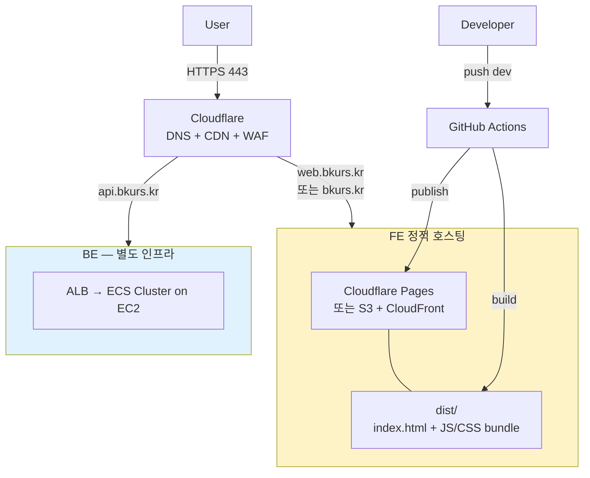

# bkurs-fe — 배포 / 인프라 가이드

> **정적 빌드 (Vite) → 정적 호스팅 (Cloudflare Pages 우선 / 또는 S3+CloudFront)**.
> BE 가 ECS on EC2 ([[../../bkurs-be/handover/operations/env-deployment]]) 라 FE 는 별도 정적
> 호스팅. 같은 도메인 (예: `bkurs.kr` → FE, `api.bkurs.kr` → BE) 또는 sub path 라우팅.

## 1. 토폴로지



## 2. 호스팅 옵션 비교

| 옵션 | 장점 | 단점 | 비용 |
| --- | --- | --- | --- |
| **Cloudflare Pages** (권장) | git 연동 자동 빌드 + 무료 TLS + 전세계 edge + preview deploy | 빌드 시간 제한 (무료 500min/월), env 관리 단순 | 무료 ~ |
| **S3 + CloudFront** | AWS 일관성 (BE 와 같은 IAM) | 빌드는 GitHub Actions 별도, invalidation 비용 | 월 ~$5-15 |
| **Vercel** | DX 우수 + preview | 한국 비용 + Cloudflare 와 중복 | 무료 ~ |

> 현 사이클: 미정. 사용자 선호 결정 시점에서 본 노트 확정.

## 3. 빌드 명령

```bash
npm ci
npm run build      # = tsc -b --noEmit --force && vite build
# → dist/
```

dist 구조:
- `index.html`
- `assets/index-{hash}.js` (~1.4MB)
- `assets/index-{hash}.css`
- `favicon.ico` 등

**lazy split 미구현** — 단일 chunk. 후속 작업 시 `React.lazy()` + `Suspense` 도입.

## 4. 환경 변수 (build-time)

Vite 의 `VITE_*` prefix env 만 번들에 포함. **secret 절대 포함 금지** (JS 번들로 클라이언트 노출).

| env | 출처 | 값 |
| --- | --- | --- |
| `VITE_API_BASE_URL` | build-time injection | dev: `https://api-dev.bkurs.kr/api` / prod: `https://api.bkurs.kr/api` |
| `VITE_SUPABASE_URL` | (선택, legacy) | 점진 제거 — [[../architecture/state-and-auth]] |
| `VITE_SUPABASE_ANON_KEY` | (선택, legacy) | 점진 제거 |

## 5. CI/CD — GitHub Actions

### 5.1 옵션 A: Cloudflare Pages (권장)

`.github/workflows/deploy.yml`:

```yaml
name: deploy
on:
  push:
    branches: [main, dev]

jobs:
  build-and-deploy:
    runs-on: ubuntu-latest
    steps:
      - uses: actions/checkout@v4
      - uses: actions/setup-node@v4
        with: { node-version: '20', cache: 'npm' }
      - run: npm ci
      - run: npm run lint
      - run: npm run typecheck
      - name: Build (prod env)
        env:
          VITE_API_BASE_URL: ${{ github.ref == 'refs/heads/main' && 'https://api.bkurs.kr/api' || 'https://api-dev.bkurs.kr/api' }}
        run: npm run build
      - name: Publish to Cloudflare Pages
        uses: cloudflare/wrangler-action@v3
        with:
          apiToken: ${{ secrets.CF_API_TOKEN }}
          accountId: ${{ secrets.CF_ACCOUNT_ID }}
          command: pages deploy dist --project-name=bkurs-fe --branch=${{ github.ref_name }}
```

### 5.2 옵션 B: S3 + CloudFront

```yaml
      - name: Build
        env: { VITE_API_BASE_URL: https://api.bkurs.kr/api }
        run: npm run build
      - name: Configure AWS (OIDC)
        uses: aws-actions/configure-aws-credentials@v4
        with:
          role-to-assume: arn:aws:iam::123456789012:role/bkurs-fe-deploy
          aws-region: ap-northeast-2
      - name: S3 sync
        run: aws s3 sync dist/ s3://bkurs-prod-web/ --delete
      - name: CloudFront invalidation
        run: aws cloudfront create-invalidation --distribution-id ${{ secrets.CF_DIST_ID }} --paths "/index.html"
```

## 6. SPA fallback (Cloudflare / CloudFront)

React Router 의 `/admin/dashboard` 같은 client-side route 가 404 떨어지지 않도록 모두 `/index.html`
로 fallback.

- **Cloudflare Pages**: `_redirects` 파일 — `/* /index.html 200`
- **S3 + CloudFront**: CloudFront 의 Custom Error Response — 403/404 → `/index.html` (200)

## 7. 캐싱 정책

| 파일 | Cache-Control |
| --- | --- |
| `/assets/*` (hash 포함) | `public, max-age=31536000, immutable` |
| `/index.html` | `public, max-age=0, must-revalidate` |

> index.html 은 매 deploy 마다 새 hash 의 asset 참조 — invalidation 없이도 새 버전 자동 진입.

## 8. 보안

- TLS: Cloudflare Universal SSL (Pages) 또는 ACM (CloudFront).
- CSP: 후속 — `Content-Security-Policy` 헤더로 `connect-src https://api.bkurs.kr` 등 제한.
- secret: build 단계 env 만, runtime 노출 0.
- supabase anon key 제거 후 `.env.example` 정리.

## 9. dev / prod 환경 매트릭스

| 환경 | branch | URL | API base |
| --- | --- | --- | --- |
| local | (working tree) | http://localhost:5173 | `${VITE_API_BASE_URL:-/api}` |
| dev | dev | https://dev.bkurs.kr | https://api-dev.bkurs.kr/api |
| prod | main | https://bkurs.kr | https://api.bkurs.kr/api |

> BE 와 같은 Cloudflare zone — dev/prod subdomain 분리, FE 정적 호스팅 + BE ECS ALB.

## 10. 운영 주기

- **lazy split 도입** — 번들 사이즈 1.4MB 초과 시 우선순위 작업.
- **Lighthouse 정기 측정** — 분기 1회, dev 환경.
- **번들 분석** — `vite-bundle-visualizer` 또는 `rollup-plugin-visualizer` 도입 검토.
- **dependency 보안 알림** — Dependabot + npm audit GH Actions 통합.

## 11. 참고

- 빌드 설정: `vite.config.ts`, `tsconfig.app.json`
- CI: `.github/workflows/`
- env 템플릿: `.env.example`
- 자세한 빌드 / TS strict 옵션: [[../modules/build-and-ci]]

## 12. 관련 노트

- [[../../bkurs-fe]] — 프로젝트 hub
- [[../modules/build-and-ci]] — vite/tsc/ESLint 상세
- [[../architecture/state-and-auth]] — supabase 점진 제거
- [[../../bkurs-be/handover/operations/env-deployment]] — BE 측 인프라 (ECS on EC2)
