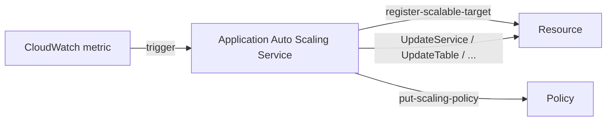

# Application Auto Scaling

> EC2 외 11+ resource 의 자동 scaling. 같은 API (`application-autoscaling`) — register-scalable-target + put-scaling-policy.

## 1. 지원 resource

| Service | Scalable Dimension |
| --- | --- |
| ECS Service | `ecs:service:DesiredCount` |
| Spot Fleet | `ec2:spot-fleet-request:TargetCapacity` |
| EMR Cluster | `elasticmapreduce:instancegroup:InstanceCount` |
| AppStream Fleet | `appstream:fleet:DesiredCapacity` |
| DynamoDB Table | `dynamodb:table:ReadCapacityUnits` / `WriteCapacityUnits` |
| DynamoDB GSI | `dynamodb:index:ReadCapacityUnits` / `WriteCapacityUnits` |
| Aurora Cluster | `rds:cluster:ReadReplicaCount` |
| Lambda Function | `lambda:function:ProvisionedConcurrency` |
| Comprehend / Translate | endpoint capacity |
| SageMaker Endpoint Variant | `sagemaker:variant:DesiredInstanceCount` |
| ElastiCache for Redis | `elasticache:replication-group:NodeGroups` |
| Neptune Cluster | `neptune:cluster:ReadReplicaCount` |
| Keyspaces / Cassandra | `cassandra:table:ReadCapacityUnits` |

## 2. 동작



## 3. 흐름 — ECS Service 예

```bash
# 1. Scalable Target
aws application-autoscaling register-scalable-target \
  --service-namespace ecs \
  --resource-id service/bkurs-prod/api \
  --scalable-dimension ecs:service:DesiredCount \
  --min-capacity 3 --max-capacity 20

# 2. Target Tracking Policy (CPU 60%)
aws application-autoscaling put-scaling-policy \
  --policy-name cpu-60 \
  --service-namespace ecs \
  --resource-id service/bkurs-prod/api \
  --scalable-dimension ecs:service:DesiredCount \
  --policy-type TargetTrackingScaling \
  --target-tracking-scaling-policy-configuration '{
    "TargetValue": 60.0,
    "PredefinedMetricSpecification": {
      "PredefinedMetricType": "ECSServiceAverageCPUUtilization"
    },
    "ScaleOutCooldown": 60,
    "ScaleInCooldown": 300
  }'
```

> 1 resource 에 여러 policy 가능 (CPU + RPS 동시). max(scale-out) / min(scale-in).

## 4. DynamoDB Auto Scaling

```bash
aws application-autoscaling register-scalable-target \
  --service-namespace dynamodb \
  --resource-id "table/bkurs-orders" \
  --scalable-dimension dynamodb:table:WriteCapacityUnits \
  --min-capacity 5 --max-capacity 1000

aws application-autoscaling put-scaling-policy \
  --policy-name write-target \
  --service-namespace dynamodb \
  --resource-id "table/bkurs-orders" \
  --scalable-dimension dynamodb:table:WriteCapacityUnits \
  --policy-type TargetTrackingScaling \
  --target-tracking-scaling-policy-configuration '{
    "TargetValue": 70.0,
    "PredefinedMetricSpecification": {
      "PredefinedMetricType": "DynamoDBWriteCapacityUtilization"
    }
  }'
```

> PAY_PER_REQUEST 모드는 auto scaling 불필요 (자동 throughput). Provisioned 모드에서만.

## 5. Aurora Reader Auto Scaling

```bash
aws application-autoscaling register-scalable-target \
  --service-namespace rds \
  --resource-id "cluster:bkurs-cluster" \
  --scalable-dimension rds:cluster:ReadReplicaCount \
  --min-capacity 1 --max-capacity 5

aws application-autoscaling put-scaling-policy \
  --policy-name reader-cpu \
  --service-namespace rds \
  --resource-id "cluster:bkurs-cluster" \
  --scalable-dimension rds:cluster:ReadReplicaCount \
  --policy-type TargetTrackingScaling \
  --target-tracking-scaling-policy-configuration '{
    "TargetValue": 50.0,
    "PredefinedMetricSpecification": {
      "PredefinedMetricType": "RDSReaderAverageCPUUtilization"
    }
  }'
```

→ 부하 ↑ → 새 reader 자동 추가 (~5분).

## 6. Lambda Provisioned Concurrency

```bash
aws lambda put-provisioned-concurrency-config --function-name bkurs-api \
  --qualifier prod --provisioned-concurrent-executions 5

aws application-autoscaling register-scalable-target \
  --service-namespace lambda \
  --resource-id "function:bkurs-api:prod" \
  --scalable-dimension lambda:function:ProvisionedConcurrency \
  --min-capacity 5 --max-capacity 50

aws application-autoscaling put-scaling-policy \
  --policy-name pc-util \
  --service-namespace lambda \
  --resource-id "function:bkurs-api:prod" \
  --scalable-dimension lambda:function:ProvisionedConcurrency \
  --policy-type TargetTrackingScaling \
  --target-tracking-scaling-policy-configuration '{
    "TargetValue": 0.7,
    "PredefinedMetricSpecification": {
      "PredefinedMetricType": "LambdaProvisionedConcurrencyUtilization"
    }
  }'
```

## 7. Predefined vs Custom Metric

```json
// Predefined
"PredefinedMetricSpecification": {
  "PredefinedMetricType": "ECSServiceAverageCPUUtilization"
}

// Custom (CloudWatch metric)
"CustomizedMetricSpecification": {
  "MetricName": "http_server_requests_total",
  "Namespace": "Bkurs",
  "Dimensions": [{ "Name": "Service", "Value": "api" }],
  "Statistic": "Sum"
}
```

→ application metric (RPS / Queue depth / processing time) 으로 scaling.

## 8. Scheduled Action

```bash
aws application-autoscaling put-scheduled-action \
  --service-namespace ecs \
  --resource-id service/bkurs-prod/api \
  --scalable-dimension ecs:service:DesiredCount \
  --scheduled-action-name morning-peak \
  --schedule "cron(0 9 ? * MON-FRI *)" \
  --timezone "Asia/Seoul" \
  --scalable-target-action "MinCapacity=10,MaxCapacity=30"

aws application-autoscaling put-scheduled-action \
  --service-namespace ecs \
  --resource-id service/bkurs-prod/api \
  --scalable-dimension ecs:service:DesiredCount \
  --scheduled-action-name night-rest \
  --schedule "cron(0 21 ? * MON-FRI *)" \
  --timezone "Asia/Seoul" \
  --scalable-target-action "MinCapacity=3,MaxCapacity=10"
```

→ 평일 09:00 → 21:00 peak. 다른 시간 baseline.

## 9. Suspend / Resume

```bash
aws application-autoscaling register-scalable-target \
  --service-namespace ecs \
  --resource-id service/bkurs-prod/api \
  --scalable-dimension ecs:service:DesiredCount \
  --suspended-state "DynamicScalingInSuspended=true,DynamicScalingOutSuspended=false,ScheduledScalingSuspended=false"
```

→ 부분 suspend (scale-in 만).

## 10. ECS Capacity Provider 와 비교

```
Capacity Provider (cluster level):
- Auto Scaling Group + ECS task placement
- managedScaling — task pending → instance scale out

Application Auto Scaling (service level):
- ECS task 의 desiredCount

→ 둘은 다른 layer. 같이 사용.
```

## 11. 비용

```
Application Auto Scaling Service 자체: 무료
CloudWatch alarm:                    $0.10/alarm/월
늘어난 resource:                       그 시간만큼
```

## 12. Multi-Policy 결합

```bash
# CPU 60% (scale-out 활성)
... target-tracking-scaling-policy-configuration ...

# Memory 70% (scale-out 활성)
... target-tracking-scaling-policy-configuration ...

# ALB RPS 500 (scale-out 활성)
... target-tracking-scaling-policy-configuration ...
```

→ 셋 중 가장 큰 desired (max). scale-in 은 가장 작은 (min).

## 13. 흔한 함정

| 함정 | 회피 |
| --- | --- |
| Provisioned mode 아닌데 auto scaling 시도 | PAY_PER_REQUEST 는 불필요 |
| min=0 → cold start | min 1+ |
| ScaleInCooldown 짧음 → oscillation | 5-10분 |
| Custom metric dimension 잘못 | metric 정확히 |
| 여러 policy 충돌 | conservative 권장 |
| Scheduled + Target Tracking 동시 → 의도 안 됨 | Scheduled 가 min/max 변경, TT 가 desired |

## 14. 다음

- ▶ [[03-predictive-and-target-tracking]]
- ▶ [[../02-policies/01-target-tracking]]
- ▶ [[../02-policies/03-scheduled]]

## 15. 영상 / 자료

| 자료 |
| --- |
| [Application Auto Scaling 공식](https://docs.aws.amazon.com/autoscaling/application/userguide/what-is-application-auto-scaling.html) |
| [Resource list](https://docs.aws.amazon.com/autoscaling/application/userguide/integrated-services-list.html) |

## 16. 참고

- [[../auto-scaling]]
- [[../../ecs/03-service/03-auto-scaling]]
- [[../../lambda/03-runtime/01-concurrency-and-scaling]]
