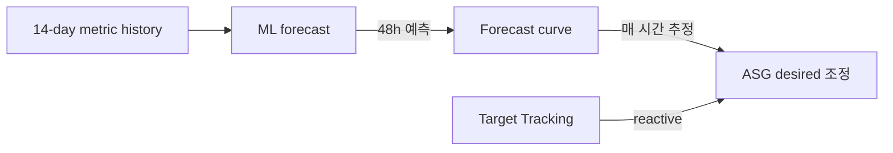
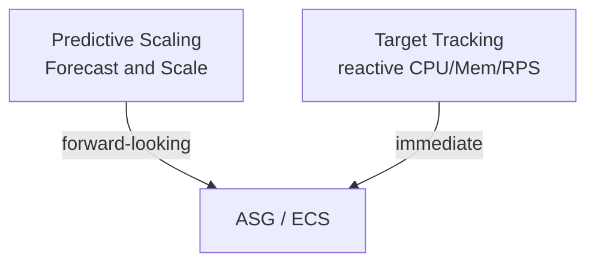

# Predictive + Target Tracking Deep

> Predictive (ML 14일 forecast) + Target Tracking (reactive). 둘 결합으로 spike 사전 + 안정 유지.

## 1. Predictive Scaling

EC2 ASG 만 (Application Auto Scaling 미지원). 14일 history → 48h forecast.

```bash
aws autoscaling put-scaling-policy --auto-scaling-group-name lab-asg \
  --policy-name predictive-cpu \
  --policy-type PredictiveScaling \
  --predictive-scaling-configuration '{
    "MetricSpecifications": [{
      "TargetValue": 50.0,
      "PredefinedMetricPairSpecification": {
        "PredefinedMetricType": "ASGCPUUtilization"
      }
    }],
    "Mode": "ForecastAndScale",
    "SchedulingBufferTime": 300,
    "MaxCapacityBreachBehavior": "HonorMaxCapacity"
  }'
```

| 옵션 | 의미 |
| --- | --- |
| `Mode=ForecastAndScale` | 예측 + 실제 scaling |
| `Mode=ForecastOnly` | 예측만 (시도용) |
| `SchedulingBufferTime` | 예상 시점 N초 전 scale-out |
| `MaxCapacityBreachBehavior` | HonorMaxCapacity / IncreaseMaxCapacity |

## 2. Predictive 의 동작



```
예: 평일 09:00 매번 peak (RPS 5x)
→ 매일 08:55 자동 scale-out (5min buffer)
→ Cold start 비용 회피
```

## 3. Predictive 권장 워크로드

✓ 적합
- 일/주 단위 패턴 있음
- 평일 9-6 peak / 야간 idle
- 이벤트 (Black Friday, 출퇴근)
- 큰 cluster (cold start 비용 ↑)

✗ 부적합
- 패턴 없음 (random spike)
- 14일 history 부족
- min=0 (no baseline)

## 4. Target Tracking Deep

```json
{
  "TargetValue": 50.0,
  "PredefinedMetricSpecification": {
    "PredefinedMetricType": "ASGAverageCPUUtilization"
  },
  "ScaleOutCooldown": 60,
  "ScaleInCooldown": 300,
  "DisableScaleIn": false
}
```

### TargetValue 의미
```
실제 metric ≥ target * 1.0  → scale out
실제 metric < target * 0.9  → scale in (10% buffer)
```

### Cooldown
- `ScaleOutCooldown` — 60s 권장 (빠른 spike)
- `ScaleInCooldown` — 300-600s 권장 (보수적)

### DisableScaleIn
```
true:  scale-out 만 (manual scale-in)
false: 양방향 (default)
```

Predictive + Target Tracking 결합 시 — Predictive 가 forward-looking, Target Tracking 이 immediate. `DisableScaleIn: false` 권장.

## 5. Multi-Metric Target Tracking

여러 metric 동시:
```bash
# Policy 1 — CPU 60%
aws application-autoscaling put-scaling-policy \
  --policy-name cpu-60 ...

# Policy 2 — Memory 70%
aws application-autoscaling put-scaling-policy \
  --policy-name mem-70 ...

# Policy 3 — RPS per target 500
aws application-autoscaling put-scaling-policy \
  --policy-name rps-500 ...
```

→ 어떤 metric 이라도 target 초과 시 scale out. scale-in 은 모든 metric 이 target 미만일 때.

## 6. ResourceLabel (ALB RPS)

```json
{
  "TargetValue": 500.0,
  "PredefinedMetricSpecification": {
    "PredefinedMetricType": "ALBRequestCountPerTarget",
    "ResourceLabel": "app/bkurs-alb/abc.../targetgroup/bkurs-api/xyz..."
  }
}
```

ResourceLabel 형식:
```
app/<load-balancer-name>/<load-balancer-id>/targetgroup/<target-group-name>/<target-group-id>
```

생성:
```bash
LB_FULL=$(aws elbv2 describe-load-balancers --names bkurs-alb \
  --query 'LoadBalancers[0].LoadBalancerArn' --output text | awk -F'/' '{print "app/"$2"/"$3}')
TG_FULL=$(aws elbv2 describe-target-groups --names bkurs-api \
  --query 'TargetGroups[0].TargetGroupArn' --output text | awk -F'/' '{print "targetgroup/"$2"/"$3}')
RL="$LB_FULL/$TG_FULL"
```

## 7. Custom Metric Tracking

```json
{
  "TargetValue": 50.0,
  "CustomizedMetricSpecification": {
    "MetricName": "QueueDepth",
    "Namespace": "Bkurs",
    "Dimensions": [{ "Name": "QueueName", "Value": "orders" }],
    "Statistic": "Average"
  }
}
```

→ SQS depth 가 50 message 초과 → worker scale-out.

## 8. Target Tracking 의 안 작동 흔한 원인

| 원인 | 해결 |
| --- | --- |
| Cooldown 너무 김 | 60-300s |
| max capacity 도달 | 늘림 |
| Metric reporting delay | 1-min metric |
| DisableScaleIn=true | 검토 |
| Stabilization 없음 | min stabilization 60s |

## 9. CloudWatch dashboard

권장 widget:
- ASG/Service min/desired/max + actual running
- Target metric value vs target
- Scaling activities (event log)
- Predictive forecast vs actual
- Cooldown remaining

## 10. Stabilization Window (Application Auto Scaling 만)

```json
{
  "TargetValue": 50.0,
  "PredefinedMetricSpecification": {...},
  "ScaleOutCooldown": 60,
  "ScaleInCooldown": 300
}
```

K8s HPA 의 `behavior.scaleDown.stabilizationWindowSeconds` 와 비슷한 효과.

## 11. Predictive + Target Tracking 권장 조합



→ Predictive 가 base curve 미리, Target Tracking 이 실제 metric 따라가며 보정.

## 12. CloudWatch Cross-Service Dashboard

```bash
aws cloudwatch put-dashboard --dashboard-name bkurs-scaling \
  --dashboard-body '{
    "widgets": [
      {
        "type": "metric",
        "properties": {
          "metrics": [
            ["AWS/AutoScaling", "GroupDesiredCapacity", "AutoScalingGroupName", "bkurs-asg"],
            [".",                  "GroupInServiceInstances", ".", "."],
            ["AWS/EC2",          "CPUUtilization", "AutoScalingGroupName", "bkurs-asg", {"stat": "Average"}]
          ],
          "view": "timeSeries",
          "stacked": false,
          "region": "ap-northeast-2"
        }
      }
    ]
  }'
```

## 13. 흔한 함정

| 함정 | 회피 |
| --- | --- |
| Predictive 없이 reactive 만 | 패턴 명확 = Predictive 추가 |
| Predictive ForecastOnly 그대로 | ForecastAndScale 로 |
| CustomizedMetricSpecification dimension typo | 명확히 |
| DisableScaleIn=true 잊음 | scale-in 막힘 |
| Multi-metric 충돌 모름 | scale-out max / scale-in all |
| SchedulingBufferTime 짧음 | 5-15분 |

## 14. 다음

- ▶ [[../02-policies/01-target-tracking]]
- ▶ [[../02-policies/02-step-and-simple]]
- ▶ [[../02-policies/03-scheduled]]

## 15. 영상 / 자료

| 자료 |
| --- |
| [Predictive Scaling 공식](https://docs.aws.amazon.com/autoscaling/ec2/userguide/ec2-auto-scaling-predictive-scaling.html) |
| [Target Tracking 공식](https://docs.aws.amazon.com/autoscaling/application/userguide/application-auto-scaling-target-tracking.html) |

## 16. 참고

- [[../auto-scaling]]
- [[01-ec2-asg-deep]]
- [[02-application-auto-scaling]]
