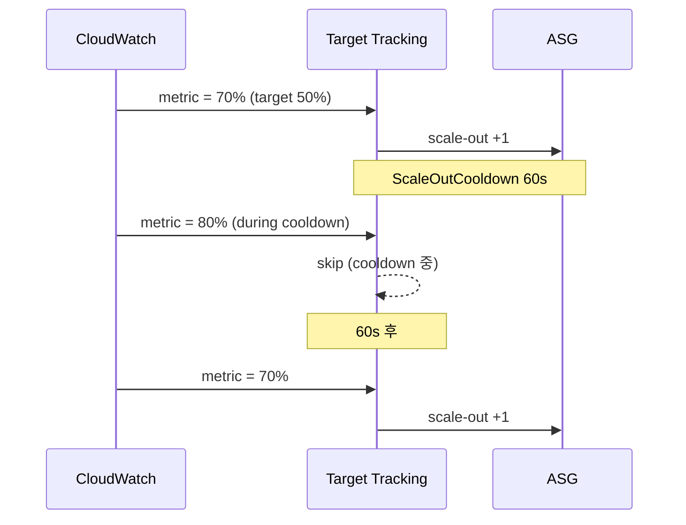

# Target Tracking — 표준 패턴

> 가장 흔한 정책. metric 목표값으로 자동 조정. Predefined / Custom metric.

## 1. 동작

```
실제 metric = target × 1.0   → scale-out
실제 metric < target × 0.9   → scale-in (10% buffer)
```

→ thermostat 같은 동작. Step Scaling 보다 단순.

## 2. EC2 ASG — Predefined

```bash
aws autoscaling put-scaling-policy --auto-scaling-group-name lab-asg \
  --policy-name cpu-50 \
  --policy-type TargetTrackingScaling \
  --target-tracking-configuration '{
    "TargetValue": 50.0,
    "PredefinedMetricSpecification": {
      "PredefinedMetricType": "ASGAverageCPUUtilization"
    },
    "ScaleOutCooldown": 60,
    "ScaleInCooldown": 300
  }'
```

| Predefined Metric (EC2 ASG) |
| --- |
| `ASGAverageCPUUtilization` |
| `ASGAverageNetworkIn` |
| `ASGAverageNetworkOut` |
| `ALBRequestCountPerTarget` |

## 3. ECS Service — Predefined

```bash
aws application-autoscaling put-scaling-policy \
  --policy-name cpu-60 \
  --service-namespace ecs \
  --resource-id service/bkurs-prod/api \
  --scalable-dimension ecs:service:DesiredCount \
  --policy-type TargetTrackingScaling \
  --target-tracking-scaling-policy-configuration '{
    "TargetValue": 60.0,
    "PredefinedMetricSpecification": {
      "PredefinedMetricType": "ECSServiceAverageCPUUtilization"
    }
  }'
```

| Predefined (ECS Service) |
| --- |
| `ECSServiceAverageCPUUtilization` |
| `ECSServiceAverageMemoryUtilization` |
| `ALBRequestCountPerTarget` |

## 4. ALBRequestCountPerTarget

```bash
LB_FULL=$(aws elbv2 describe-load-balancers --names bkurs-alb \
  --query 'LoadBalancers[0].LoadBalancerArn' --output text | awk -F'/' '{print "app/"$2"/"$3}')
TG_FULL=$(aws elbv2 describe-target-groups --names bkurs-api \
  --query 'TargetGroups[0].TargetGroupArn' --output text | awk -F'/' '{print "targetgroup/"$2"/"$3}')

aws application-autoscaling put-scaling-policy \
  --policy-name rps-500 \
  --service-namespace ecs \
  --resource-id service/bkurs-prod/api \
  --scalable-dimension ecs:service:DesiredCount \
  --policy-type TargetTrackingScaling \
  --target-tracking-scaling-policy-configuration "{
    \"TargetValue\": 500.0,
    \"PredefinedMetricSpecification\": {
      \"PredefinedMetricType\": \"ALBRequestCountPerTarget\",
      \"ResourceLabel\": \"$LB_FULL/$TG_FULL\"
    }
  }"
```

→ ALB 의 target 당 RPS 가 500 초과 시 task 추가.

## 5. Custom Metric

```bash
aws application-autoscaling put-scaling-policy \
  --policy-name queue-depth \
  --service-namespace ecs \
  --resource-id service/bkurs-prod/worker \
  --scalable-dimension ecs:service:DesiredCount \
  --policy-type TargetTrackingScaling \
  --target-tracking-scaling-policy-configuration '{
    "TargetValue": 5.0,
    "CustomizedMetricSpecification": {
      "MetricName": "ApproximateNumberOfMessagesVisible",
      "Namespace": "AWS/SQS",
      "Dimensions": [{ "Name": "QueueName", "Value": "bkurs-jobs" }],
      "Statistic": "Average"
    }
  }'
```

→ SQS 의 평균 visible messages = 5/worker. 큐 깊이 따라 worker scale.

## 6. EMF (Application metric) + Target Tracking

Application 이 EMF 로 metric publish → Target Tracking 활용:
```python
# Lambda Powertools
metrics.add_metric(name="ActiveSessions", unit=MetricUnit.Count, value=current_sessions)
```

Custom metric tracking:
```json
{
  "TargetValue": 100.0,
  "CustomizedMetricSpecification": {
    "MetricName": "ActiveSessions",
    "Namespace": "Bkurs",
    "Dimensions": [{ "Name": "Service", "Value": "api" }],
    "Statistic": "Sum"
  }
}
```

## 7. Multi-Policy 결합

```
3 policy: CPU 60% / Memory 70% / RPS 500
→ 어떤 것이라도 target 초과 → scale-out (max)
→ 모두 90% 미만 → scale-in (min)
```

권장 — production 은 CPU + Memory + RPS 셋.

## 8. Cooldown 의미



→ Cooldown 짧으면 over-shoot 위험, 길면 늦음.

권장:
- `ScaleOutCooldown` — 60s (spike 빠른 대응)
- `ScaleInCooldown` — 300-600s (보수적)

## 9. DisableScaleIn

```json
{
  "TargetValue": 50.0,
  "PredefinedMetricSpecification": {...},
  "DisableScaleIn": true
}
```

→ scale-out 만, scale-in 은 별도 (e.g. Scheduled).

## 10. Target Tracking + Scheduled

```
Scheduled Action 가 min/max 변경 (e.g. 09:00 → 10/30)
Target Tracking 이 desired 자동 (10~30 안에서)
```

→ 가장 강력한 조합 — predictable baseline + reactive 보정.

## 11. metric reporting 지연 대응

CloudWatch 기본 5분 → 5-min delayed.

대안:
- Detailed Monitoring (1분, $2.1/instance·월)
- Custom Metric (EMF 1분)
- Step Scaling (Target 보다 빠른 반응)

## 12. CloudWatch Alarm 자동 생성

Target Tracking 등록 시 자동:
```
TargetTracking-bkurs-asg-AlarmHigh-xxx   (scale-out, ≥ target)
TargetTracking-bkurs-asg-AlarmLow-xxx    (scale-in, < target * 0.9)
```

> 사용자가 직접 만들지 않아도 됨. 단 alarm 삭제 시 policy 도 동작 안 함.

## 13. 흔한 함정

| 함정 | 회피 |
| --- | --- |
| TargetValue 너무 높음 (80-90%) | 50-60% 권장 |
| Cooldown 너무 짧음 → oscillation | 300s+ scale-in |
| Metric reporting delay | Detailed Monitoring |
| max capacity 도달 → scale 안 됨 | max 늘림 |
| Multi-policy 충돌 | conservative target |
| Custom Metric dimension typo | console 확인 |

## 14. 다음

- ▶ [[02-step-and-simple]]
- ▶ [[03-scheduled]]
- ▶ [[../03-operations/01-lifecycle-hooks-and-warm-pool]]

## 15. 영상 / 자료

| 자료 |
| --- |
| [Target Tracking 공식](https://docs.aws.amazon.com/autoscaling/application/userguide/application-auto-scaling-target-tracking.html) |

## 16. 참고

- [[../auto-scaling]]
- [[../01-fundamentals/03-predictive-and-target-tracking]]
- [[../../ecs/03-service/03-auto-scaling]]
