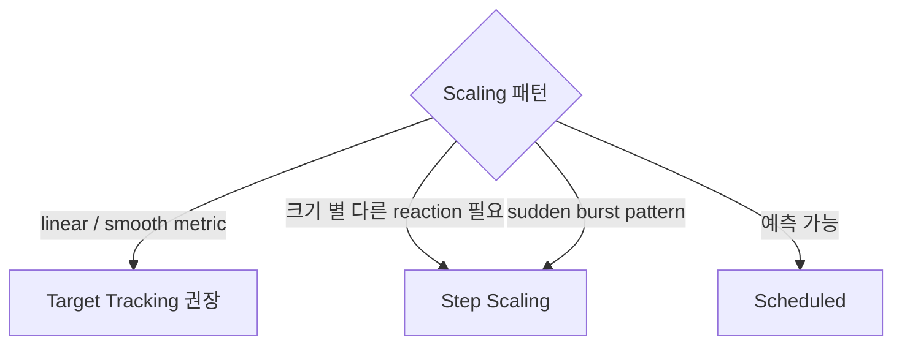

# Step Scaling + Simple Scaling

> Step = 임계치 단계 별 다른 adjustment. Simple = legacy. CloudWatch Alarm trigger.

## 1. 비교

| | Target Tracking | Step Scaling | Simple Scaling |
| --- | --- | --- | --- |
| Trigger | metric 자동 | CloudWatch Alarm | CloudWatch Alarm |
| Adjustment | 자동 | step 별 다름 | 1 step |
| Cooldown | per-policy | 처리 중 다음 무시 가능 | cooldown 동안 무시 |
| 권장 | 일반 | 크기별 차이 필요 | EOL |

## 2. Step Scaling

```bash
# 1. CloudWatch Alarm (CPU > 70%, 75%, 90%)
aws cloudwatch put-metric-alarm --alarm-name asg-cpu-high \
  --metric-name CPUUtilization --namespace AWS/EC2 \
  --statistic Average --period 60 --evaluation-periods 2 \
  --threshold 70 --comparison-operator GreaterThanThreshold \
  --dimensions Name=AutoScalingGroupName,Value=lab-asg

# 2. Step Scaling Policy
aws autoscaling put-scaling-policy --auto-scaling-group-name lab-asg \
  --policy-name step-cpu \
  --policy-type StepScaling \
  --adjustment-type ChangeInCapacity \
  --metric-aggregation-type Average \
  --step-adjustments '[
    { "MetricIntervalLowerBound": 0,  "MetricIntervalUpperBound": 10, "ScalingAdjustment": 1 },
    { "MetricIntervalLowerBound": 10, "MetricIntervalUpperBound": 20, "ScalingAdjustment": 2 },
    { "MetricIntervalLowerBound": 20,                                 "ScalingAdjustment": 5 }
  ]'

# 3. Alarm action 연결
aws cloudwatch put-metric-alarm --alarm-name asg-cpu-high \
  ...같은 옵션... \
  --alarm-actions arn:aws:autoscaling:...:policyARN
```

## 3. Step 의미

```
Alarm Threshold = 70%
실제 CPU 가 70 + lower < x ≤ 70 + upper 사이일 때 어떻게 할지.

CPU 70-80% (lower 0, upper 10):  +1
CPU 80-90% (lower 10, upper 20): +2
CPU 90%+  (lower 20):           +5
```

→ 갑작스러운 spike 에 더 큰 step.

## 4. AdjustmentType

| Type | 의미 |
| --- | --- |
| `ChangeInCapacity` | +1, +2 (절대) |
| `ExactCapacity` | 정확한 값으로 (e.g. 10) |
| `PercentChangeInCapacity` | +10% (current desired 의 %) |

```json
{ "MetricIntervalLowerBound": 0, "ScalingAdjustment": 10, "AdjustmentType": "PercentChangeInCapacity" }
```

→ current 10 → +10% = 11.

## 5. MinAdjustmentMagnitude

PercentChangeInCapacity 일 때:
```json
{
  "AdjustmentType": "PercentChangeInCapacity",
  "MinAdjustmentMagnitude": 2,
  "StepAdjustments": [{ "ScalingAdjustment": 10 }]
}
```

→ current 1 → +10% = 0.1 → 정수 보정 + 최소 2 → +2.

## 6. ECS Service 의 Step Scaling

```bash
aws application-autoscaling put-scaling-policy \
  --policy-name step-cpu-ecs \
  --service-namespace ecs \
  --resource-id service/bkurs-prod/api \
  --scalable-dimension ecs:service:DesiredCount \
  --policy-type StepScaling \
  --step-scaling-policy-configuration '{
    "AdjustmentType": "ChangeInCapacity",
    "MetricAggregationType": "Average",
    "StepAdjustments": [
      { "MetricIntervalLowerBound": 0,  "MetricIntervalUpperBound": 20, "ScalingAdjustment": 2 },
      { "MetricIntervalLowerBound": 20,                                 "ScalingAdjustment": 5 }
    ],
    "Cooldown": 60
  }'
```

## 7. Step Scaling vs Target Tracking 언제



예시:
- e-commerce 일반: Target Tracking
- Black Friday: Step Scaling (큰 step) + Predictive
- Batch 작업: SQS depth Target Tracking

## 8. Simple Scaling (legacy)

```bash
aws autoscaling put-scaling-policy --auto-scaling-group-name lab-asg \
  --policy-name simple-cpu \
  --policy-type SimpleScaling \
  --adjustment-type ChangeInCapacity \
  --scaling-adjustment 1 \
  --cooldown 300
```

→ Alarm trigger 시 +1, cooldown 300s 동안 다른 action 무시. **EOL — Step Scaling 권장**.

## 9. Alarm 의 ComparisonOperator

```
GreaterThanThreshold        — metric > threshold
GreaterThanOrEqualToThreshold
LessThanThreshold           — scale-in alarm
LessThanOrEqualToThreshold
GreaterThanUpperThreshold   — anomaly detection (band)
LessThanLowerOrGreaterThanUpperThreshold
```

## 10. Scale-In Step Scaling

scale-out + scale-in 모두 step:
```json
// scale-out
{ "MetricIntervalLowerBound": 0,  "ScalingAdjustment": 1 },
{ "MetricIntervalLowerBound": 10, "ScalingAdjustment": 3 }

// scale-in (별도 policy + 별도 alarm)
{ "MetricIntervalUpperBound": 0,  "ScalingAdjustment": -1 },
{ "MetricIntervalUpperBound": -20, "ScalingAdjustment": -3 }
```

## 11. 흔한 함정

| 함정 | 회피 |
| --- | --- |
| Step 의 lower/upper bound 누락 | 명확히 |
| Cooldown 짧음 → 과잉 scale-out | 충분히 |
| PercentChange 의 정수 보정 모름 | MinAdjustmentMagnitude |
| Step 안 겹침 → coverage gap | bound 연속 |
| Simple Scaling 사용 | Step 권장 |
| Alarm threshold typo | console 확인 |

## 12. 다음

- ▶ [[03-scheduled]]
- ▶ [[../03-operations/01-lifecycle-hooks-and-warm-pool]]

## 13. 영상 / 자료

| 자료 |
| --- |
| [Step Scaling 공식](https://docs.aws.amazon.com/autoscaling/application/userguide/application-auto-scaling-step-scaling-policies.html) |

## 14. 참고

- [[../auto-scaling]]
- [[01-target-tracking]]
