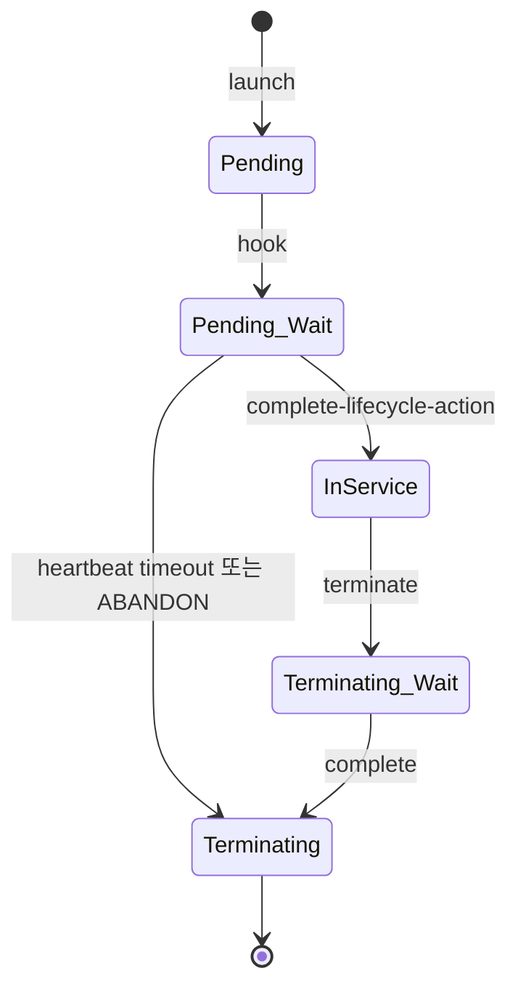

# Lifecycle Hooks + Warm Pool

> Launch / Terminate 시 custom 작업 + 미리 stopped instance 준비. cold start 시간 ↓.

## 1. Lifecycle Hook



| Hook | 시점 |
| --- | --- |
| `autoscaling:EC2_INSTANCE_LAUNCHING` | 새 instance Running 후, InService 전 |
| `autoscaling:EC2_INSTANCE_TERMINATING` | 종료 trigger 후, 실제 종료 전 |

## 2. Hook 설정

```bash
aws autoscaling put-lifecycle-hook --auto-scaling-group-name lab-asg \
  --lifecycle-hook-name launch-hook \
  --lifecycle-transition autoscaling:EC2_INSTANCE_LAUNCHING \
  --notification-target-arn arn:sqs:...:bkurs-asg-events \
  --role-arn arn:iam::...:role/asg-hook \
  --heartbeat-timeout 600 \
  --default-result CONTINUE
```

| 옵션 | 의미 |
| --- | --- |
| `notification-target-arn` | SQS / SNS / EventBridge |
| `role-arn` | ASG → SQS publish 권한 |
| `heartbeat-timeout` | 30-7200s (default 3600) |
| `default-result` | CONTINUE / ABANDON (timeout 시) |

## 3. Hook 처리 (worker)

```python
import boto3, json
sqs = boto3.client("sqs")
asg = boto3.client("autoscaling")

# poll
resp = sqs.receive_message(QueueUrl=QUEUE, WaitTimeSeconds=20)
for m in resp.get("Messages", []):
    body = json.loads(m["Body"])
    if body["LifecycleTransition"] == "autoscaling:EC2_INSTANCE_LAUNCHING":
        instance_id = body["EC2InstanceId"]
        # 1. Custom config (warm cache, fetch secret, register service mesh, etc)
        do_setup(instance_id)
        # 2. Heartbeat (선택 — 더 긴 시간)
        asg.record_lifecycle_action_heartbeat(...)
        # 3. Complete
        asg.complete_lifecycle_action(
            LifecycleHookName=body["LifecycleHookName"],
            AutoScalingGroupName=body["AutoScalingGroupName"],
            LifecycleActionToken=body["LifecycleActionToken"],
            LifecycleActionResult="CONTINUE"   # 또는 ABANDON
        )
    sqs.delete_message(QueueUrl=QUEUE, ReceiptHandle=m["ReceiptHandle"])
```

## 4. Terminating Hook 활용

```
Spot interruption (2분 통지):
- ALB target draining
- application graceful shutdown
- session migration
- Cache flush

→ complete 후 실제 termination
```

## 5. Lifecycle Hook + Lambda

```yaml
# EventBridge rule
EventPattern:
  source: [aws.autoscaling]
  detail-type:
    - "EC2 Instance-launch Lifecycle Action"
    - "EC2 Instance-terminate Lifecycle Action"
  detail:
    AutoScalingGroupName: [lab-asg]
Targets:
  - Arn: arn:lambda:...:function:asg-hook
```

→ SQS 대신 Lambda 가 즉시 처리.

## 6. Warm Pool

미리 stopped instance pool 유지 → 새 instance 시작 시 stopped → running 으로 빠르게.

```bash
aws autoscaling put-warm-pool --auto-scaling-group-name lab-asg \
  --min-size 5 \
  --max-group-prepared-capacity 10 \
  --pool-state Stopped \
  --instance-reuse-policy ReuseOnScaleIn=true
```

| 옵션 | 의미 |
| --- | --- |
| `min-size` | Warm Pool 의 최소 size |
| `max-group-prepared-capacity` | Warm + ASG instance 의 최대 합 |
| `pool-state` | Stopped / Running / Hibernated |
| `ReuseOnScaleIn` | scale-in 시 instance 를 Warm Pool 로 (terminate 안 함) |

## 7. Warm Pool 의 효과

```
Normal cold start:
1. New EC2 instance launch (~30s)
2. AMI download / boot (~60s)
3. user-data 실행 (~30-300s)
= ~2-7 분

Warm Pool 활용:
1. stopped → running (~30s)
2. (user-data 가 이미 실행됨 — boot 만)
= ~30s
```

→ Burst capacity 대응 ↑.

## 8. Lifecycle Hook + Warm Pool 결합

```yaml
Lifecycle Hook:
- LAUNCHING (Warm Pool 진입 시 실행)
- 모든 setup (download data, secret fetch, etc)
- complete-lifecycle-action

→ Warm Pool 안의 instance 는 이미 setup 끝남
→ scale-out 시 running 으로 전환만 = 매우 빠름
```

## 9. Hibernated Warm Pool

```bash
aws autoscaling put-warm-pool --auto-scaling-group-name lab-asg \
  --pool-state Hibernated \
  --min-size 5
```

- RAM 상태 EBS 에 dump
- 다시 시작 시 process state 그대로 복원
- 비용: hibernated 도 EBS 비용 발생

JVM warmup 큰 application 효과적.

## 10. Lifecycle Hook 비용

```
EC2 standby (Lifecycle Wait):       정상 EC2 비용
Warm Pool Stopped:                   EBS 비용만
Warm Pool Hibernated:                EBS 비용만 (RAM dump 추가)
```

## 11. 흔한 함정

| 함정 | 회피 |
| --- | --- |
| Lifecycle Hook heartbeat 못 보냄 → ABANDON | record_lifecycle_action_heartbeat |
| Worker 가 죽음 → instance 무한 대기 | default-result CONTINUE + alarm |
| Warm Pool 비용 인지 못함 | 필요한 burst capacity 만 |
| Hibernate 의 instance type 제한 | m / c / r 일부만 |
| Warm Pool 의 instance 도 Termination Policy 영향 | OldestLaunchTemplate 등 명시 |

## 12. Use Case

```
1. ALB target draining (Lifecycle Hook on terminate)
2. Vault secret pre-fetch (Hook on launch)
3. JVM warmup (Warm Pool + Hibernated)
4. Black Friday 대비 (Warm Pool 100 instance)
5. ECS task pre-pull image (Warm Pool 의 instance 가 미리 image 받음)
```

## 13. 다음

- ▶ [[02-troubleshooting]]
- ▶ [[../practice/01-asg-with-mixed-instances]]
- ▶ [[../practice/02-application-auto-scaling-ecs]]

## 14. 영상 / 자료

| 자료 |
| --- |
| [Lifecycle Hook 공식](https://docs.aws.amazon.com/autoscaling/ec2/userguide/lifecycle-hooks.html) |
| [Warm Pool 공식](https://docs.aws.amazon.com/autoscaling/ec2/userguide/ec2-auto-scaling-warm-pools.html) |

## 15. 참고

- [[../auto-scaling]]
- [[../01-fundamentals/01-ec2-asg-deep]]
