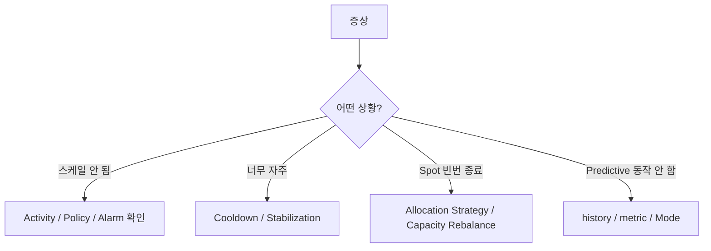

# Auto Scaling Troubleshooting

> 안 늘어남 / 너무 자주 / Spot 자주 종료 / Predictive 안 됨.

## 1. 진단 흐름



## 2. ASG Activity

```bash
aws autoscaling describe-scaling-activities --auto-scaling-group-name lab-asg \
  --max-items 20 \
  --query 'Activities[].{Time:StartTime,Status:StatusCode,Description:Description,Cause:Cause}'
```

흔한 cause:
```
"At 2026-05-22T10:00:00Z user requested an instance refresh"
"A scheduled action morning-peak was executed"
"A policy cpu-60 alarm-... was in alarm state"
"Insufficient capacity in availability zone ap-northeast-2c"
"Instance launch failed: client.InternalError"
```

## 3. Application Auto Scaling Activity

```bash
aws application-autoscaling describe-scaling-activities \
  --service-namespace ecs \
  --resource-id service/bkurs-prod/api \
  --max-items 20 \
  --query 'ScalingActivities[].{Time:StartTime,Status:StatusCode,Description:Description,Cause:Cause}'
```

## 4. Scale-out 안 됨

흔한 원인:
| 원인 | 진단 | 해결 |
| --- | --- | --- |
| max capacity 도달 | describe-auto-scaling-groups | max 늘림 |
| Policy disabled | describe-policies | enable |
| Alarm INSUFFICIENT_DATA | describe-alarms | metric reporting 확인 |
| Capacity 부족 (AZ) | activity | 다른 AZ subnet 추가 |
| IAM Role 권한 부족 | CloudTrail | role policy 확인 |
| Suspended Process | describe-auto-scaling-groups | resume |
| Cooldown 중 | activity | 대기 |
| Quota 도달 (EC2 vCPU) | service-quotas | 증액 |

```bash
# Suspended process 확인
aws autoscaling describe-auto-scaling-groups --auto-scaling-group-names lab-asg \
  --query 'AutoScalingGroups[0].SuspendedProcesses'
```

## 5. Scale-in 안 됨

흔한 원인:
| 원인 | 회피 |
| --- | --- |
| min capacity 도달 | min 줄임 |
| Scaling Protection 활성 | disable |
| Cooldown 길음 | 줄임 |
| Termination Policy 의도 안 맞음 | OldestLaunchTemplate / Default |
| DisableScaleIn=true | 검토 |

## 6. 너무 자주 (Oscillation)

```
metric 50% → scale out → 40% → scale in → 50% → scale out ...
```

해결:
- ScaleInCooldown 길게 (300-600s)
- TargetValue 와 hysteresis (10%) 활용
- Stabilization Window (Step Scaling)
- 큰 step (10% per scale-out)

## 7. Spot 자주 종료

```bash
# 최근 Spot interruption
aws ec2 describe-spot-instance-requests \
  --filters Name=state,Values=closed Name=status-code,Values=instance-terminated-by-price,instance-terminated-no-capacity \
  --query 'SpotInstanceRequests[].{Time:Status.UpdateTime,Reason:Status.Message}'
```

해결:
- Allocation Strategy → `capacity-optimized` 또는 `price-capacity-optimized`
- Mixed Instance Type (4 pool)
- Capacity Rebalance 활성
- OnDemand Base Capacity 보장

## 8. Predictive 동작 안 함

```bash
# Forecast 확인
aws autoscaling get-predictive-scaling-forecast \
  --auto-scaling-group-name lab-asg \
  --policy-name predictive-cpu \
  --start-time 2026-05-22T00:00:00Z --end-time 2026-05-23T00:00:00Z
```

흔한 원인:
- 14일 history 부족 (신규 ASG)
- 패턴 없음 (random)
- `Mode=ForecastOnly` (실제 scale 안 함)
- min=0 (baseline 없음)

## 9. Cooldown vs Stabilization Window

| | |
| --- | --- |
| ScaleOutCooldown | 다음 scale-out 까지 대기 (per-policy) |
| ScaleInCooldown | 다음 scale-in 까지 대기 |
| K8s HPA stabilizationWindow | recent N seconds 의 metric 평균 사용 |

권장:
```
ScaleOutCooldown:  60s
ScaleInCooldown:   300-600s
```

## 10. CloudWatch Alarm INSUFFICIENT_DATA

```bash
aws cloudwatch describe-alarms --alarm-names TargetTracking-bkurs-asg-AlarmHigh-xxx \
  --query 'MetricAlarms[0].{State:StateValue,Reason:StateReason}'
```

- metric 이 reporting 안 됨
- evaluation period 짧음
- dimension 잘못

## 11. ASG instance 가 자동 healthy 안 됨

```bash
# 상세
aws autoscaling describe-auto-scaling-instances --instance-ids i-xxx
# health-check-type ELB 이면 ALB target health 도 봄
aws elbv2 describe-target-health --target-group-arn arn:tg:... \
  --targets Id=i-xxx
```

흔한:
- ALB grace period 짧음
- target group health path 응답 X
- user-data 실패 → app 시작 안 됨 (`sudo cat /var/log/cloud-init-output.log`)

## 12. Service Quotas

```bash
# 현재 ASG limit
aws service-quotas get-service-quota --service-code autoscaling \
  --quota-code L-CDE20ADC

# 증액
aws service-quotas request-service-quota-increase \
  --service-code autoscaling \
  --quota-code L-CDE20ADC --desired-value 1000
```

다른 흔한 limit:
- EC2 vCPU (running on-demand)
- EC2 Spot
- Launch Templates
- ENI per region

## 13. CloudWatch Dashboard 권장 widget

```
- ASG: GroupMin/Desired/Max/InService/Pending/Terminating
- Target metric (CPU / Memory / RPS)
- Scaling activity timeline
- Alarm history
- Spot termination events
- Hook execution status
```

## 14. CloudTrail audit

```bash
# Policy update
aws cloudtrail lookup-events \
  --lookup-attributes AttributeKey=EventName,AttributeValue=PutScalingPolicy

# Resource scale
aws cloudtrail lookup-events \
  --lookup-attributes AttributeKey=EventName,AttributeValue=UpdateAutoScalingGroup
```

## 15. 디버깅 명령 cheat sheet

```bash
# ASG 상태
aws autoscaling describe-auto-scaling-groups --auto-scaling-group-names lab-asg

# 모든 정책
aws autoscaling describe-policies --auto-scaling-group-name lab-asg
aws application-autoscaling describe-scaling-policies --service-namespace ecs

# Recent activity
aws autoscaling describe-scaling-activities --auto-scaling-group-name lab-asg --max-items 10

# Alarm
aws cloudwatch describe-alarms --alarm-name-prefix TargetTracking-

# Spot allocation status
aws ec2 describe-spot-fleet-requests --query 'SpotFleetRequestConfigs[?ActivityStatus!=`fulfilled`]'

# Lifecycle Hook status
aws autoscaling describe-lifecycle-hooks --auto-scaling-group-name lab-asg
```

## 16. 다음

- ▶ [[../practice/01-asg-with-mixed-instances]]
- ▶ [[../practice/02-application-auto-scaling-ecs]]
- ▶ [[../../observability/cloudwatch/cloudwatch]]

## 17. 영상 / 자료

| 자료 |
| --- |
| [Auto Scaling Troubleshooting](https://docs.aws.amazon.com/autoscaling/ec2/userguide/CHAP_Troubleshooting.html) |

## 18. 참고

- [[../auto-scaling]]
- [[../01-fundamentals/01-ec2-asg-deep]]
- [[01-lifecycle-hooks-and-warm-pool]]
