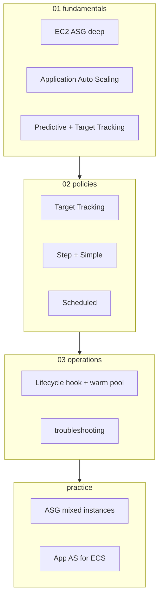
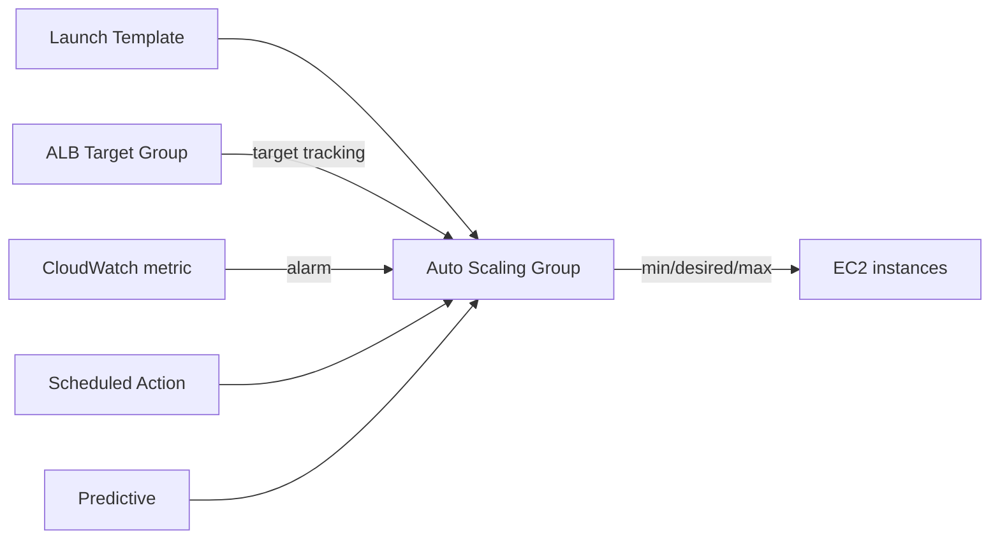
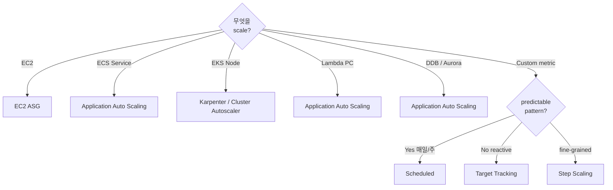

# AWS Auto Scaling

> **EC2 Auto Scaling (ASG)** + **Application Auto Scaling** (ECS / Lambda / DDB / Aurora / SageMaker / Spot Fleet 등). 4 정책 (Target Tracking / Step / Simple / Scheduled) + Predictive.

**[[../compute|↑ Compute]]** · **[[../../cloud-aws|↑↑ AWS]]**

---

## 1. 한 줄

```
Target metric (CPU 50%, RPS 1000, ...) 또는 Schedule 또는 ML 예측
   ↓
desired capacity 자동 조정 (EC2 / ECS task / Lambda PC / DDB throughput / Aurora reader)
```

## 2. 학습 roadmap



## 3. Sub-directory index

### [[01-fundamentals/01-ec2-asg-deep]] — EC2 ASG (Launch Template / Mixed Instance / Health Check)
ASG 의 desired/min/max + Launch Template + Mixed Instances Policy + Spot allocation.

### [[01-fundamentals/02-application-auto-scaling]] — ECS / Lambda / DDB / Aurora / SageMaker
Application Auto Scaling Service — 같은 정책 type 으로 11+ resource 의 scaling.

### [[01-fundamentals/03-predictive-and-target-tracking]] — Predictive (ML) + Target Tracking 깊이
Predictive forecast + Target Tracking 의 disable scale-in / cooldown / multi-metric.

### [[02-policies/01-target-tracking]] — Target Tracking 표준 패턴
CPU 50% / ALB RPS / 사용자 정의 metric.

### [[02-policies/02-step-and-simple]] — Step Scaling (대형 step) / Simple Scaling (legacy)
CloudWatch Alarm trigger + step adjustment.

### [[02-policies/03-scheduled]] — Cron / 시간대별 capacity
peak hour 미리 늘리기 / 야간 줄이기.

### [[03-operations/01-lifecycle-hooks-and-warm-pool]] — Lifecycle Hook + Warm Pool
launch / terminate 시 custom 작업 + 미리 instance 준비.

### [[03-operations/02-troubleshooting]] — 안 늘어남 / 너무 자주 / cool down 등
metric delay / cooldown / health check 실패.

### [[practice/01-asg-with-mixed-instances]] — ALB + Mixed (Spot+OnDemand) + Target Tracking (60분)

### [[practice/02-application-auto-scaling-ecs]] — ECS Service + CPU+RPS + Scheduled (45분)

## 4. 핵심 개념

| 개념 | 의미 |
| --- | --- |
| ASG | EC2 instance set (min/desired/max) |
| Launch Template | instance 생성 spec (AMI, type, SG, user-data) |
| Capacity Provider (ECS) | Auto Scaling Group + Managed Scaling |
| Application Auto Scaling | EC2 외 resource (ECS / Lambda / DDB / Aurora ...) |
| Target Tracking | metric 목표값으로 자동 조정 |
| Step Scaling | alarm 의 step 별 adjustment |
| Scheduled | cron 또는 일회성 |
| Predictive | ML 기반 forecast |
| Lifecycle Hook | launch / terminate 시 callback |
| Warm Pool | 미리 stopped 상태 instance (빠른 startup) |

## 5. 어떤 Service 가 Application Auto Scaling 인가?

| Resource | Scaling 종류 |
| --- | --- |
| ECS Service | DesiredCount |
| Spot Fleet | TargetCapacity |
| EMR Cluster | InstanceFleetCapacity |
| AppStream Fleet | DesiredCapacity |
| DynamoDB Table / GSI | ReadCapacity / WriteCapacity |
| Aurora Cluster | Read Replica 수 |
| Lambda Provisioned Concurrency | concurrent |
| Comprehend / SageMaker / Cassandra / Neptune / ElastiCache for Redis | 각자 |

→ 모두 같은 API (`application-autoscaling`).

## 6. EC2 Auto Scaling 의 출발



## 7. 결정 트리



## 8. bkurs-be 활용

```
ECS Service (api):
- Application Auto Scaling
- min 3 / max 20
- Target Tracking (CPU 60%, RPS 500/target)

ECS Capacity Provider (옵션 — EC2 launch type):
- Managed Scaling (ASG-based)

DDB Order Table:
- Application Auto Scaling
- Read/Write capacity Target 70%

Aurora reader:
- min 1 / max 5
- Target Tracking (CPU 50%)

Lambda PC (critical):
- Schedule 09:00 → 10, 21:00 → 2
```

## 9. 비용 영향

| | |
| --- | --- |
| Auto Scaling Service 자체 | 무료 |
| 늘어난 instance / task | 그 시간 만큼 |
| CloudWatch alarm | $0.10/alarm/월 |
| Predictive scaling | 무료 |

→ **Auto Scaling 자체는 무료** — under-provisioning 으로 안 됨, over-provisioning 비용 ↓.

## 10. 영상 / 자료

| 자료 |
| --- |
| [Auto Scaling 공식](https://docs.aws.amazon.com/autoscaling/) |
| [Application Auto Scaling](https://docs.aws.amazon.com/autoscaling/application/userguide/what-is-application-auto-scaling.html) |
| [Predictive Scaling](https://docs.aws.amazon.com/autoscaling/ec2/userguide/ec2-auto-scaling-predictive-scaling.html) |

## 11. 관련 hub

- [[../compute]]
- [[../ec2/ec2]]
- [[../ecs/ecs]]
- [[../eks/eks]] — Karpenter / CAS
- [[../lambda/lambda]] — Provisioned Concurrency
- [[../../database/dynamodb/dynamodb]]
- [[../../database/rds/rds]]
- [[../../observability/cloudwatch/cloudwatch]]
