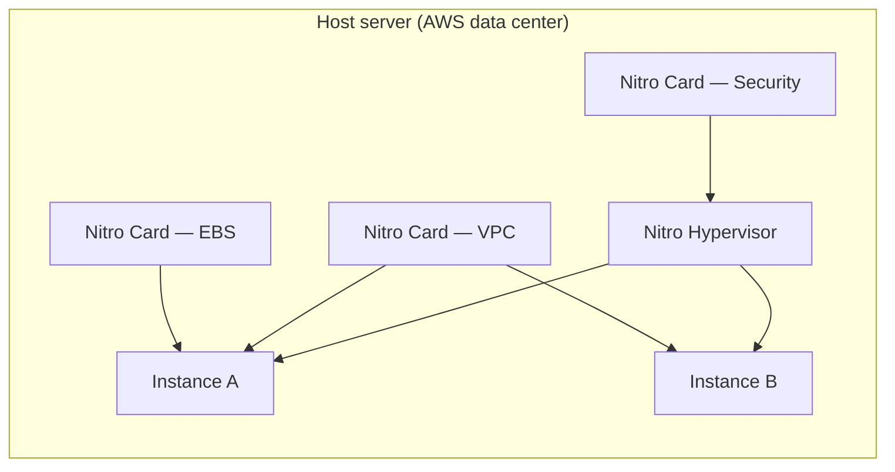
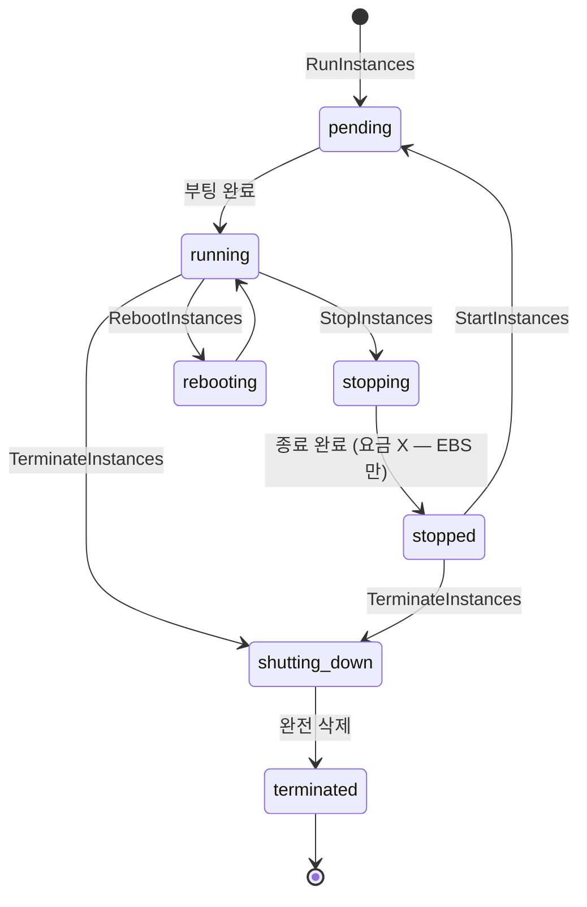

# EC2 Instance Overview

> Nitro Hypervisor + Nitro Card + Instance Type 의 조합 = "1대의 VM". Lifecycle 7 state 이해가 운영의 시작점.

## 1. 구성 요소



## 2. Nitro System

| 컴포넌트 | 역할 |
| --- | --- |
| **Nitro Hypervisor** | KVM 기반 미니멀 hypervisor. CPU/RAM 만 가상화 — overhead < 1% |
| **Nitro Card (VPC)** | ENI 처리 offload → host CPU 면제 |
| **Nitro Card (EBS)** | EBS NVMe protocol → 디스크 IO offload |
| **Nitro Security Chip** | 펌웨어 boot verify + 메모리 암호화 |
| **Nitro TPM** | 가상 TPM 2.0 (BitLocker / SecureBoot) |

> 이전 Xen 대비 — overhead 30% → 1%, IO 처리량 2배+.

## 3. Lifecycle 7 state



| 상태 | 요금 | 비고 |
| --- | --- | --- |
| pending | 부과 시작 시점은 running 부터 | 부팅 중 |
| running | 시간당 (분 단위 첫 1시간 후 초 단위) | 정상 |
| stopping | running 요금 마지막까지 | 종료 중 |
| stopped | 인스턴스 비용 0, **EBS / Elastic IP 요금 지속** | 재시작 가능 |
| shutting_down | 종료 중 | 마지막 요금 |
| terminated | 0 (EBS 삭제 옵션 따라) | root device 보존 X 시 EBS 삭제 |
| rebooting | running 비용 지속 | OS reboot 만 (IP/storage 그대로) |

## 4. Reboot vs Stop-Start vs Hibernate

| 작업 | IP 유지 | EBS root | Instance Store | Host change |
| --- | --- | --- | --- | --- |
| Reboot | ✓ | ✓ | ✓ | ✗ |
| Stop → Start | ✗ (Public IP) ✓ (Private IP) | ✓ | **✗ (데이터 소실)** | ✓ |
| Hibernate | ✗ (Public IP) | ✓ | ✗ | 가능 |
| Terminate | — | 옵션 | ✗ | — |

> Public IP 유지 필요 → **Elastic IP** ([[../02-networking/01-eni-and-ip]]).

## 5. Hibernate

```bash
aws ec2 stop-instances --instance-ids i-xxx --hibernate
```

조건:
- 인스턴스 시작 시 `HibernationOptions.Configured=true`
- root volume = EBS (gp3/io2)
- root volume size ≥ RAM 사이즈 + 부팅 여유
- 지원 instance type (m / c / r 일부)

→ RAM 상태를 root EBS 에 dump → start 시 그대로 복귀. JVM warmup / 큰 cache 유지에 유용.

## 6. 종료 시 root volume 보존

```bash
# 종료 시 root EBS 삭제 막기
aws ec2 modify-instance-attribute --instance-id i-xxx \
  --block-device-mappings '[{"DeviceName":"/dev/xvda","Ebs":{"DeleteOnTermination":false}}]'
```

## 7. Termination Protection

```bash
aws ec2 modify-instance-attribute --instance-id i-xxx --disable-api-termination
```

→ `TerminateInstances` 자동 실패. production DB / bastion 권장.

## 8. Stop Protection

```bash
aws ec2 modify-instance-attribute --instance-id i-xxx --disable-api-stop
```

→ 실수 stop 방지.

## 9. AZ / Placement

Instance 시작 시 **subnet 선택 = AZ 선택**. stop 후 start 해도 같은 AZ. AZ 옮기려면:
1. AMI 생성
2. 다른 AZ subnet 에서 새 인스턴스 생성

## 10. 흔한 함정

| 함정 | 회피 |
| --- | --- |
| stopped 인데 EBS 비용 부과 모름 | terminate 또는 snapshot+delete |
| reboot 으로 OS 패치 만족 안 함 | stop-start (host change) |
| instance store stop = 데이터 손실 | EBS 만 사용 |
| accidental terminate | termination protection |
| Elastic IP detach 후 미사용 | release 또는 attach |

## 11. 다음

- ▶ [[02-instance-types]]
- ▶ [[03-pricing-models]]
- ▶ [[04-amis-and-bootstrap]]

## 12. 영상 / 자료

| 자료 |
| --- |
| [Nitro Architecture — re:Invent](https://www.youtube.com/watch?v=tjP4S6tSP9Q) |
| [EC2 Instance Lifecycle](https://docs.aws.amazon.com/AWSEC2/latest/UserGuide/ec2-instance-lifecycle.html) |
| [Hibernation](https://docs.aws.amazon.com/AWSEC2/latest/UserGuide/Hibernate.html) |

## 13. 참고

- [[../ec2]]
- [[../03-storage/01-ebs-deep]]
- [[../02-networking/01-eni-and-ip]]
