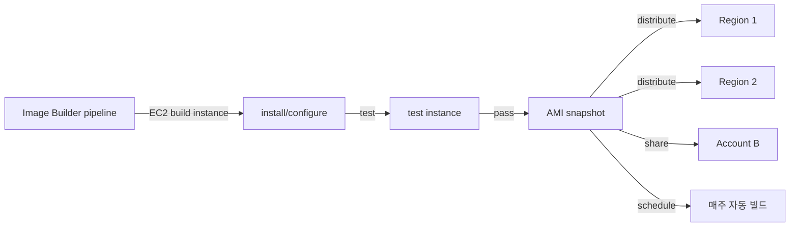

# AMIs + Bootstrap

> AMI = OS + 사전 설치 + 설정. Golden AMI vs JIT (user-data). production 은 Image Builder + 자동화.

## 1. AMI 구성

| 요소 | 설명 |
| --- | --- |
| **Root device** | EBS-backed (대부분) / Instance store-backed (EOL) |
| **Snapshot** | root + 추가 EBS snapshot |
| **Architecture** | x86_64 / arm64 |
| **Virtualization** | HVM (현대) / PV (EOL) |
| **Boot mode** | uefi / legacy-bios |
| **Permissions** | private / public / sharing |

## 2. AMI 종류

| 종류 | 설명 |
| --- | --- |
| **AWS published** | Amazon Linux / Windows Server |
| **Marketplace** | Bitnami / Apache (라이센스 비용 포함) |
| **Community** | 무료 (보안 검증 X) |
| **Private** | 내 계정 AMI |
| **Shared** | 다른 계정과 공유 |

## 3. 권장 OS

| OS | 특징 |
| --- | --- |
| **Amazon Linux 2023** | systemd / dnf / SELinux / Graviton ✓ — 권장 |
| **Amazon Linux 2** | EOL 2026-06-30 |
| **Ubuntu 24.04 LTS** | apt / 광범위한 패키지 |
| **Debian 12** | 안정 |
| **RHEL 9** | enterprise (라이센스 비용) |
| **Windows Server 2022** | 라이센스 포함 |
| **Bottlerocket** | 컨테이너 전용 minimal OS |

## 4. AMI 찾기

```bash
# SSM Parameter Store (공식)
aws ssm get-parameter --name /aws/service/ami-amazon-linux-latest/al2023-ami-kernel-default-x86_64 \
  --query Parameter.Value --output text
aws ssm get-parameter --name /aws/service/ami-amazon-linux-latest/al2023-ami-kernel-default-arm64

# Ubuntu
aws ssm get-parameter --name /aws/service/canonical/ubuntu/server/24.04/stable/current/amd64/hvm/ebs-gp3/ami-id

# 직접 검색
aws ec2 describe-images --owners amazon \
  --filters "Name=name,Values=al2023-ami-2023*-arm64" \
  --query 'sort_by(Images, &CreationDate)[-1].ImageId' --output text
```

## 5. user-data — 부팅 시 자동 실행

```bash
aws ec2 run-instances --user-data file://userdata.sh ...
```

`userdata.sh`:
```bash
#!/bin/bash
set -euxo pipefail

dnf update -y
dnf install -y docker
systemctl enable --now docker
usermod -aG docker ec2-user

# Spring Boot 자동 시작
cat > /etc/systemd/system/app.service <<EOF
[Unit]
Description=app
After=network.target
[Service]
ExecStart=/usr/bin/docker run --rm -p 8080:8080 myapp:latest
Restart=always
[Install]
WantedBy=multi-user.target
EOF
systemctl enable --now app
```

| 한도 | 16 KB (gzip + base64) |

> 더 크면 S3 에 script + curl + `bash`.

## 6. cloud-init #cloud-config

```yaml
#cloud-config
package_update: true
packages:
  - docker
  - htop
write_files:
  - path: /etc/app.conf
    content: |
      key=value
runcmd:
  - systemctl enable --now docker
  - useradd -m app
users:
  - name: app
    sudo: ALL=(ALL) NOPASSWD:ALL
    ssh_authorized_keys:
      - ssh-rsa AAAA...
```

> shebang `#!/bin/bash` 또는 `#cloud-config` 둘 다 OK. YAML 이 더 declarative.

## 7. IMDS 활용

```bash
TOKEN=$(curl -X PUT "http://169.254.169.254/latest/api/token" \
  -H "X-aws-ec2-metadata-token-ttl-seconds: 21600" -s)

curl -H "X-aws-ec2-metadata-token: $TOKEN" \
  http://169.254.169.254/latest/meta-data/instance-id
curl -H "X-aws-ec2-metadata-token: $TOKEN" \
  http://169.254.169.254/latest/dynamic/instance-identity/document
```

상세 → [[../05-security/02-imdsv2]]

## 8. Golden AMI vs JIT

| 패턴 | Golden AMI | JIT (user-data) |
| --- | --- | --- |
| build 시간 | 매번 빌드 ↓ | 부팅마다 ↑ |
| 부팅 시간 | 빠름 | 느림 |
| drift | snapshot 시점 고정 | latest |
| 재현성 | 높음 | 낮음 (네트워크 의존) |
| 권장 | production | dev / spike |

## 9. EC2 Image Builder

```bash
# Recipe 정의 (Console + JSON)
aws imagebuilder create-image-recipe \
  --name bkurs-base --semantic-version 1.0.0 \
  --parent-image arn:aws:imagebuilder:...:aws/amazon-linux-2023-arm64-x86 \
  --components componentArn=arn:aws:imagebuilder:...:component/install-docker/x.x.x

# Pipeline
aws imagebuilder create-image-pipeline ...
```

흐름:


## 10. Packer 대안

HashiCorp Packer — IaC 로 AMI 빌드:
```hcl
source "amazon-ebs" "base" {
  region        = "ap-northeast-2"
  source_ami    = "ami-..."
  instance_type = "m7g.large"
  ssh_username  = "ec2-user"
  ami_name      = "bkurs-base-${timestamp()}"
}

build {
  sources = ["source.amazon-ebs.base"]
  provisioner "shell" {
    inline = ["sudo dnf install -y docker"]
  }
}
```

## 11. AMI 공유

```bash
# 다른 계정에 launch 권한
aws ec2 modify-image-attribute --image-id ami-xxx \
  --launch-permission "Add=[{UserId=123456789012}]"

# Public
aws ec2 modify-image-attribute --image-id ami-xxx \
  --launch-permission "Add=[{Group=all}]"
```

KMS 암호화된 snapshot 공유:
- AMI 공유 + KMS key grant 둘 다 필요

## 12. AMI 정리 (DLM)

```bash
# 30일 이상 미사용 AMI deregister
aws ec2 describe-images --owners self \
  --query 'Images[?CreationDate<`2026-04-22`].[ImageId,Name,CreationDate]' --output table

aws ec2 deregister-image --image-id ami-xxx
```

→ Data Lifecycle Manager (DLM) 로 자동화 → [[../03-storage/03-snapshots-ami-lifecycle]]

## 13. 흔한 함정

| 함정 | 회피 |
| --- | --- |
| user-data 16 KB 초과 | S3 + curl |
| user-data 가 root 로 실행 안 함 | systemd unit + setUid |
| AMI 정리 안 함 → 비용 ↑ | DLM 자동 |
| Marketplace AMI 라이센스 비용 모름 | console 가격 확인 |
| AMI region 1 만 → DR ↓ | Image Builder 자동 복제 |
| IMDSv1 사용 | IMDSv2 강제 |

## 14. 다음

- ▶ [[../02-networking/01-eni-and-ip]]
- ▶ [[../03-storage/03-snapshots-ami-lifecycle]]
- ▶ [[../05-security/02-imdsv2]]
- ▶ [[../practice/01-launch-first-instance]]

## 15. 영상 / 자료

| 자료 |
| --- |
| [EC2 Image Builder — re:Invent](https://www.youtube.com/watch?v=ZHk2caqGsuc) |
| [cloud-init 공식](https://cloudinit.readthedocs.io/) |
| [Packer + AWS](https://developer.hashicorp.com/packer/integrations/hashicorp/amazon) |

## 16. 참고

- [[../ec2]]
- [[02-instance-types]]
- [[../03-storage/03-snapshots-ami-lifecycle]]
