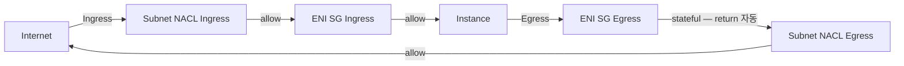

# Security Group / NACL

> 2 layer 방화벽. SG = ENI 레벨 stateful / NACL = subnet 레벨 stateless. SG 가 기본, NACL 은 보완.

## 1. 비교

| 항목 | Security Group | NACL |
| --- | --- | --- |
| Level | ENI | Subnet |
| Stateful | ✓ (return traffic 자동) | ✗ (양방향 명시) |
| Rule | Allow only | Allow + Deny |
| 순서 | 모든 rule 평가 | 번호 순서대로 (낮은 → 평가) |
| 적용 | instance launch / SG modify | subnet attach |
| Default | 모두 deny | default = all allow |
| SG ref | ✓ (sg-xxx) | ✗ (CIDR / IP 만) |
| 로깅 | VPC Flow Logs | VPC Flow Logs |

## 2. Security Group 동작

### Stateful
```
client (random:5234) → server (443) [allowed by ingress]
server (443) → client (random:5234) [stateful — egress rule 없이 통과]
```

### Allow only
```
ingress: allow tcp 443 from 0.0.0.0/0
ingress: allow tcp 22  from 10.0.0.0/8
ingress: 그 외 → 묵시적 deny
```

### Default
- VPC 마다 default SG (모든 traffic 허용 — 같은 SG 끼리만)
- 신규 SG = 모든 ingress deny, 모든 egress allow

## 3. SG Rule 구조

| 필드 | 의미 |
| --- | --- |
| Type | TCP / UDP / ICMP / All |
| Port | 22 / 80 / 443 / 0-65535 |
| Source | CIDR (10.0.0.0/8) / SG (sg-xxx) / Prefix List |
| Description | 자유 (필수 권장) |

```bash
aws ec2 authorize-security-group-ingress --group-id sg-xxx \
  --ip-permissions '[{
    "IpProtocol": "tcp", "FromPort": 8080, "ToPort": 8080,
    "UserIdGroupPairs": [{ "GroupId": "sg-alb", "Description": "ALB only" }]
  }]'
```

## 4. SG Reference (best practice)

```
sg-alb (Internet → ALB):
  Ingress: 443 from 0.0.0.0/0

sg-app (ALB → App):
  Ingress: 8080 from sg-alb     # CIDR 아닌 SG 자체

sg-db (App → DB):
  Ingress: 3306 from sg-app
```

→ instance 가 추가/제거돼도 CIDR 안 바꿔도 됨.

## 5. Prefix List

여러 IP 묶음 — 회사 IP 대역 / AWS service IP:
```bash
aws ec2 create-managed-prefix-list \
  --prefix-list-name corp-network --max-entries 10 \
  --address-family IPv4 \
  --entries Cidr=10.0.0.0/8 Cidr=192.168.0.0/16

# SG 에서 사용
--ip-permissions '[{"IpProtocol":"tcp","FromPort":22,"ToPort":22,"PrefixListIds":[{"PrefixListId":"pl-xxx"}]}]'
```

AWS Managed Prefix List:
- `com.amazonaws.region.s3` — S3 IP 대역
- `com.amazonaws.region.dynamodb`
- CloudFront, EC2 instance connect, etc.

## 6. NACL — subnet 방화벽

### 동작
- subnet 진/출 모든 traffic 통과
- Rule = ALLOW or DENY, 번호 순서대로 (1~32766)
- stateless — return traffic 도 rule 명시 필요
- 첫 매치된 rule 적용

```bash
aws ec2 create-network-acl --vpc-id vpc-xxx
aws ec2 create-network-acl-entry --network-acl-id acl-xxx \
  --rule-number 100 --protocol tcp --port-range From=443,To=443 \
  --cidr-block 0.0.0.0/0 --rule-action allow --ingress

# Return traffic (ephemeral port)
aws ec2 create-network-acl-entry --network-acl-id acl-xxx \
  --rule-number 100 --protocol tcp --port-range From=1024,To=65535 \
  --cidr-block 0.0.0.0/0 --rule-action allow --egress
```

### Default NACL
- 모든 traffic allow
- subnet 생성 시 자동 attach
- 명시적 NACL 안 만들면 default 유지

## 7. SG + NACL 평가 순서



## 8. 흔한 패턴

### Bastion / Jump host
```
sg-bastion: Ingress 22 from corp-prefix-list
sg-app:     Ingress 22 from sg-bastion (production)
sg-db:      Ingress 3306 from sg-app
```

> SSM Session Manager 가 더 안전 → [[../04-operations/01-ssm-session-manager]]

### ALB 3-tier
[[../../ecs/05-security/02-network-isolation]] §3

## 9. 흔한 함정

| 함정 | 회피 |
| --- | --- |
| `0.0.0.0/0` ingress (SSH/DB) | SG reference 또는 prefix list |
| NACL stateless 모름 → return 차단 | egress rule ephemeral port 명시 |
| SG 5 개 max attach | 통합 |
| 묵시적 deny 못 봄 | console "deny" 표시 X — rule 검토 |
| default SG 그대로 사용 | 명시적 SG |
| Rule description 없음 | description 필수 |

## 10. Flow Logs

```bash
aws ec2 create-flow-logs --resource-type VPC --resource-ids vpc-xxx \
  --traffic-type ALL \
  --log-destination-type cloud-watch-logs \
  --log-destination arn:aws:logs:...:log-group:vpc-flow
```

→ ENI level 모든 traffic accept/reject 기록.

## 11. SG 검증 도구

### Reachability Analyzer
```bash
aws ec2 create-network-insights-path \
  --source eni-xxx --destination eni-yyy \
  --protocol tcp --destination-port 8080

aws ec2 start-network-insights-analysis ...
```

→ 어디서 차단됐는지 자동 분석.

### Network Access Analyzer
- 의도하지 않은 path 탐지 (public access / cross-account)

## 12. CDK

```typescript
const sgApp = new ec2.SecurityGroup(this, 'AppSG', { vpc, description: 'app' });
const sgAlb = new ec2.SecurityGroup(this, 'AlbSG', { vpc, description: 'alb' });

sgAlb.addIngressRule(ec2.Peer.anyIpv4(), ec2.Port.tcp(443), 'HTTPS');
sgApp.addIngressRule(sgAlb, ec2.Port.tcp(8080), 'ALB only');
```

## 13. 다음

- ▶ [[03-placement-group]]
- ▶ [[../04-operations/01-ssm-session-manager]]
- ▶ [[../05-security/03-hardening]]

## 14. 영상 / 자료

| 자료 |
| --- |
| [SG vs NACL](https://docs.aws.amazon.com/vpc/latest/userguide/vpc-security-best-practices.html) |
| [Reachability Analyzer](https://docs.aws.amazon.com/vpc/latest/reachability/) |

## 15. 참고

- [[../ec2]]
- [[01-eni-and-ip]]
- [[../../../network/vpc/vpc]]
- [[../../ecs/05-security/02-network-isolation]]
