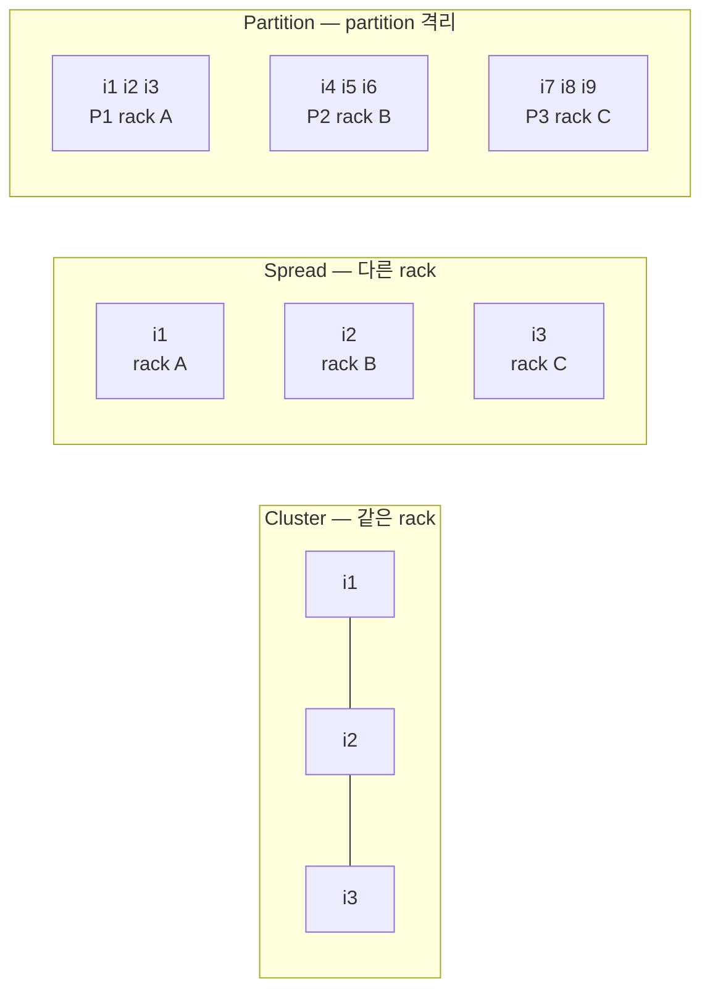
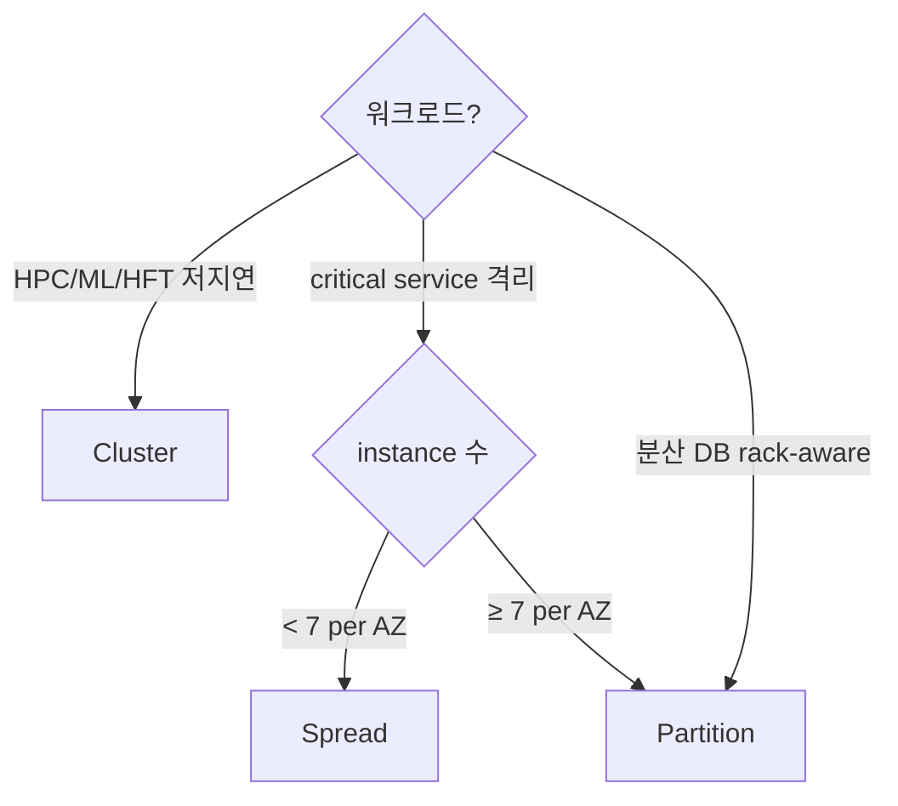

# Placement Group

> Instance 의 host 배치 전략. **Cluster** (저지연) / **Spread** (고가용) / **Partition** (분산 시스템 rack 격리).

## 1. 3 type 비교

| | Cluster | Spread | Partition |
| --- | --- | --- | --- |
| 배치 | 같은 AZ 같은 rack | 다른 rack | rack group (partition) 분리 |
| Latency | ★★★ (μs) | ★ | ★★ |
| Bandwidth | ★★★ (full 100 Gbps) | ★★ | ★★ |
| 한도 | per AZ ~7 type | per AZ 7 instance | 7 partition × n instance |
| 용도 | HPC / MPI | critical (DB primary/secondary) | HDFS / Cassandra / Kafka |



## 2. Cluster Placement Group

### 특징
- 같은 AZ
- bisection bandwidth 최대 (full)
- Latency 최소
- ENA + EFA 활용 시 200~400 Gbps

### 권장 type
- 같은 type 또는 같은 family (m / c / r 계열)
- 비-burstable (t-class 안 됨)

### 활용
- HPC (CFD / 분자동력학)
- 분산 ML training
- HFT
- 분산 캐시 (메모리 끼리)

```bash
aws ec2 create-placement-group --group-name hpc-cluster --strategy cluster

aws ec2 run-instances --instance-type c7gn.4xlarge --count 16 \
  --placement "GroupName=hpc-cluster" ...
```

## 3. Spread Placement Group

### 특징
- AZ 당 max 7 instance
- 각 instance 가 **다른 rack** (전원 / 네트워크 분리)
- AZ 자체와 rack 모두 보호

### 활용
- DB primary / secondary 분리
- 작은 cluster 의 critical instance
- HA storage system

```bash
aws ec2 create-placement-group --group-name critical-spread --strategy spread

# AZ 마다 max 7
aws ec2 run-instances --instance-type r6i.large --count 3 \
  --placement "GroupName=critical-spread" \
  --subnet-id subnet-az-a ...
```

## 4. Partition Placement Group

### 특징
- 1~7 partition / AZ
- partition 별 rack 분리
- partition 내 instance 는 같은 rack OK

### 활용
- HDFS / Hadoop
- Cassandra (rack-aware)
- Kafka (broker rack)
- Elasticsearch (shard distribution)

```bash
aws ec2 create-placement-group --group-name hadoop-pg \
  --strategy partition --partition-count 7

aws ec2 run-instances --instance-type i4i.8xlarge --count 1 \
  --placement "GroupName=hadoop-pg,PartitionNumber=2" ...
```

instance 의 partition 확인:
```bash
aws ec2 describe-instances --instance-ids i-xxx \
  --query 'Reservations[0].Instances[0].Placement.PartitionNumber'
```

## 5. 동작 한계

### Cluster
- capacity 부족 → "Insufficient Capacity" 발생 시 batch launch (all-or-nothing) 권장
- 사용하지 않으면 release → 다른 cluster 가 reuse

### Spread
- AZ 당 7 instance 한도
- 더 필요 시 PG 여러 개

### Partition
- partition 변경 시 instance 재생성

## 6. 비교 결정 트리



## 7. PG 이동

instance 가 한번 PG 에 launch 되면 PG 변경 불가. 변경:
```bash
aws ec2 stop-instances --instance-ids i-xxx
aws ec2 modify-instance-placement --instance-id i-xxx \
  --group-name new-pg
aws ec2 start-instances --instance-ids i-xxx
```

## 8. ASG 와 결합

```bash
aws autoscaling create-auto-scaling-group \
  --auto-scaling-group-name app \
  --placement-group critical-spread \
  --launch-template LaunchTemplateName=app-lt,Version='$Latest' \
  --min-size 3 --max-size 3 --desired-capacity 3
```

## 9. 비용

PG 자체는 **무료**. 다만 Cluster PG 사용 시 같은 family 강제로 sizing 제한.

## 10. 흔한 함정

| 함정 | 회피 |
| --- | --- |
| Cluster 에 t-class | non-burstable 만 |
| Cluster 부족 capacity → 부분 launch | batch all-or-nothing |
| Spread 8 이상 launch | AZ 추가 또는 PG 분리 |
| Partition number 명시 안 함 | random 할당 (OK) 또는 명시 |
| PG 변경 시 stop 필요 | 사전 계획 |

## 11. 다음

- ▶ [[../03-storage/01-ebs-deep]]
- ▶ [[../04-operations/02-monitoring-cloudwatch]]
- ▶ [[../05-security/01-iam-instance-profile]]

## 12. 영상 / 자료

| 자료 |
| --- |
| [Placement Groups 공식](https://docs.aws.amazon.com/AWSEC2/latest/UserGuide/placement-groups.html) |

## 13. 참고

- [[../ec2]]
- [[01-eni-and-ip]]
- [[../01-fundamentals/02-instance-types]]
