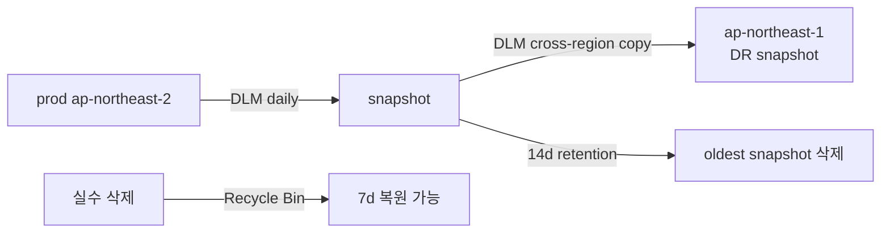

# Snapshot / AMI Lifecycle

> EBS Snapshot (block-level incremental → S3) + AMI (boot 이미지) + DLM 자동화 + Recycle Bin + Fast Snapshot Restore.

## 1. Snapshot 개념

- **Block-level incremental** → 변경된 block 만 저장
- 저장: **S3 (managed, hidden)**
- region 단위 (region 간 copy 명시)
- 암호화 EBS → 자동 암호화 snapshot

```mermaid
flowchart LR
  V[EBS Volume] -->|first snapshot| S1[Snapshot 1<br/>full block]
  V -->|second| S2[Snapshot 2<br/>changed block만]
  V -->|third|  S3[Snapshot 3<br/>changed block만]
  S1 & S2 & S3 -->|hidden S3| AWS[Amazon S3 - 내부]
```

> snapshot 3 만 가지고도 완전 복원 가능 (block 의 dependency 자동 처리).

## 2. Snapshot 생성

```bash
aws ec2 create-snapshot --volume-id vol-xxx \
  --description "before-upgrade" \
  --tag-specifications 'ResourceType=snapshot,Tags=[{Key=Name,Value=app-2026-05-22}]'

# 여러 volume = consistent snapshot (multi-volume crash-consistent)
aws ec2 create-snapshots --instance-specification "InstanceId=i-xxx" \
  --description "all volumes"
```

## 3. Snapshot 복원

```bash
# 새 volume 생성 (다른 AZ 가능)
aws ec2 create-volume --snapshot-id snap-xxx \
  --availability-zone ap-northeast-2c --volume-type gp3
```

> 처음 read 는 lazy load — block 이 첫 access 시 S3 에서 fetch → 처음 느림.

## 4. Fast Snapshot Restore (FSR)

```bash
aws ec2 enable-fast-snapshot-restores \
  --availability-zones ap-northeast-2a ap-northeast-2c \
  --source-snapshot-ids snap-xxx
```

→ snapshot 의 모든 block 이 미리 hot — restore 즉시 full performance. 비용 ~$0.75/h/snapshot/AZ.

## 5. Snapshot copy / share

```bash
# 다른 region
aws ec2 copy-snapshot --source-region ap-northeast-2 \
  --source-snapshot-id snap-xxx --destination-region ap-northeast-1 \
  --encrypted --kms-key-id alias/ebs

# Account 공유
aws ec2 modify-snapshot-attribute --snapshot-id snap-xxx \
  --create-volume-permission "Add=[{UserId=987654321098}]"
```

KMS 암호화 snapshot 공유:
- snapshot 공유 + KMS key grant 모두 필요

## 6. AMI = Boot 이미지 + Snapshot 들

```bash
# Running instance 에서 AMI 생성
aws ec2 create-image --instance-id i-xxx --name "app-v1.0.0" \
  --no-reboot --description "production v1"

# AMI 의 snapshot 확인
aws ec2 describe-images --image-ids ami-xxx \
  --query 'Images[0].BlockDeviceMappings'
```

> `--no-reboot` 옵션 — reboot 안 함, file system consistency 보장 X. critical 은 reboot OK.

## 7. AMI deregister + Snapshot 정리

```bash
# AMI deregister (snapshot 안 지워짐)
aws ec2 deregister-image --image-id ami-xxx

# Snapshot 같이 삭제
SNAPS=$(aws ec2 describe-images --image-ids ami-xxx \
  --query 'Images[0].BlockDeviceMappings[].Ebs.SnapshotId' --output text)
for s in $SNAPS; do
  aws ec2 delete-snapshot --snapshot-id $s
done
```

## 8. Data Lifecycle Manager (DLM) — 자동 백업

```bash
aws dlm create-lifecycle-policy --execution-role-arn arn:aws:iam::...:role/AWSDataLifecycleManagerDefaultRole \
  --description "daily snapshot" \
  --state ENABLED \
  --policy-details '{
    "PolicyType": "EBS_SNAPSHOT_MANAGEMENT",
    "TargetTags": [{"Key": "Backup", "Value": "daily"}],
    "Schedules": [{
      "Name": "daily",
      "CreateRule": { "Interval": 24, "IntervalUnit": "HOURS", "Times": ["03:00"] },
      "RetainRule": { "Count": 14 },
      "TagsToAdd": [{"Key": "DLM", "Value": "true"}],
      "CrossRegionCopyRules": [{
        "Target": "ap-northeast-1",
        "Encrypted": true,
        "RetainRule": { "Interval": 30, "IntervalUnit": "DAYS" }
      }]
    }]
  }'
```

→ 매일 03:00 snapshot, 14일 보존, region 간 자동 copy 30일.

## 9. AMI Lifecycle (DLM)

```json
{
  "PolicyType": "IMAGE_MANAGEMENT",
  "TargetTags": [{"Key": "AMIBackup", "Value": "weekly"}],
  "Schedules": [{
    "Name": "weekly",
    "CreateRule": { "Interval": 7, "IntervalUnit": "DAYS", "Times": ["02:00"] },
    "RetainRule": { "Count": 8 }
  }]
}
```

## 10. Recycle Bin

실수 삭제 보호:
```bash
aws rbin create-rule --resource-type EBS_SNAPSHOT \
  --retention-period RetentionPeriodValue=7,RetentionPeriodUnit=DAYS \
  --description "7d recovery" \
  --resource-tags ResourceTagKey=Environment,ResourceTagValue=prod

aws rbin create-rule --resource-type EC2_IMAGE \
  --retention-period RetentionPeriodValue=14,RetentionPeriodUnit=DAYS \
  --description "AMI 14d recovery"
```

→ delete 후 7일/14일 동안 복원 가능.

복원:
```bash
aws rbin list-rules --resource-type EBS_SNAPSHOT
aws ec2 restore-snapshot-from-recycle-bin --snapshot-id snap-xxx
```

## 11. Cross-region DR 패턴



## 12. Snapshot 비용

- $0.05/GB·월 (changed block 만)
- Standard tier
- **Archive tier** ($0.0125/GB·월) — 90일 이상 archive (복원 24~72h)

## 13. EBS direct API

snapshot block 을 직접 read:
```bash
aws ebs list-changed-blocks --first-snapshot-id snap-A --second-snapshot-id snap-B
aws ebs get-snapshot-block --snapshot-id snap-xxx --block-index 0 --block-token "..."
```

→ 백업 도구 / 변경 분석.

## 14. 흔한 함정

| 함정 | 회피 |
| --- | --- |
| AMI deregister 후 snapshot 남음 | snapshot 도 같이 삭제 |
| DLM 미설정 → 백업 없음 | DLM 자동 |
| snapshot 처음 read 느림 | FSR (critical 만) |
| KMS snapshot 공유 시 grant 없음 | key grant 추가 |
| Region copy 누락 → DR ↓ | DLM cross-region |
| Recycle Bin 비활성 → 실수 영구 손실 | Recycle Bin |

## 15. 다음

- ▶ [[../04-operations/01-ssm-session-manager]]
- ▶ [[../05-security/01-iam-instance-profile]]
- ▶ [[../practice/01-launch-first-instance]]

## 16. 영상 / 자료

| 자료 |
| --- |
| [Snapshot 공식](https://docs.aws.amazon.com/AWSEC2/latest/UserGuide/EBSSnapshots.html) |
| [DLM](https://docs.aws.amazon.com/AWSEC2/latest/UserGuide/snapshot-lifecycle.html) |
| [Recycle Bin](https://docs.aws.amazon.com/AWSEC2/latest/UserGuide/recycle-bin.html) |

## 17. 참고

- [[../ec2]]
- [[01-ebs-deep]]
- [[../01-fundamentals/04-amis-and-bootstrap]]
