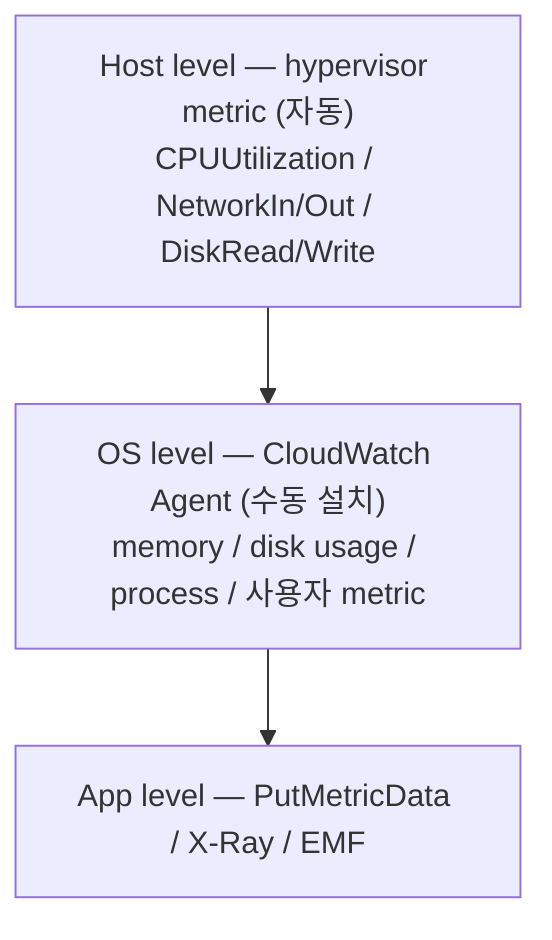

# CloudWatch Monitoring

> Basic (5분, 무료) / Detailed (1분, 유료) / CloudWatch Agent (in-OS) / Application Insights (자동 분석).

## 1. 3 layer



## 2. Basic vs Detailed Monitoring

| | Basic | Detailed |
| --- | --- | --- |
| Interval | 5분 | 1분 |
| 비용 | 무료 | $2.10/instance/월 |
| 자동 활성 | ✓ | ✗ |
| 권장 | dev | production |

```bash
aws ec2 monitor-instances --instance-ids i-xxx       # Detailed 활성
aws ec2 unmonitor-instances --instance-ids i-xxx     # Basic 으로
```

## 3. Hypervisor metric (자동)

| Metric | 의미 |
| --- | --- |
| CPUUtilization | CPU % |
| NetworkIn / NetworkOut | bytes |
| NetworkPacketsIn / Out | packets |
| DiskReadBytes / DiskWriteBytes | instance store IO |
| EBSReadOps / WriteOps / Bytes / Throughput | EBS IO |
| StatusCheckFailed (Instance/System) | 0 / 1 |
| MetadataNoToken | IMDSv1 사용 횟수 |
| CPUCreditUsage / Balance | t-class burstable |

> **Memory / Disk Usage 는 자동 metric 에 없음** → CloudWatch Agent 필요.

## 4. CloudWatch Agent 설치

```bash
sudo dnf install -y amazon-cloudwatch-agent

# Wizard
sudo /opt/aws/amazon-cloudwatch-agent/bin/amazon-cloudwatch-agent-config-wizard
```

`/opt/aws/amazon-cloudwatch-agent/etc/amazon-cloudwatch-agent.json`:
```json
{
  "agent": { "metrics_collection_interval": 60, "run_as_user": "cwagent" },
  "metrics": {
    "namespace": "EC2/Custom",
    "append_dimensions": {
      "InstanceId": "${aws:InstanceId}",
      "AutoScalingGroupName": "${aws:AutoScalingGroupName}"
    },
    "metrics_collected": {
      "mem": { "measurement": ["mem_used_percent","mem_available_percent","mem_used"] },
      "disk": { "measurement": ["used_percent","inodes_free"], "resources": ["*"] },
      "diskio": { "measurement": ["io_time","read_bytes","write_bytes","reads","writes"], "resources": ["*"] },
      "swap": { "measurement": ["swap_used_percent"] },
      "netstat": { "measurement": ["tcp_established","tcp_time_wait"] },
      "processes": { "measurement": ["running","sleeping","dead"] }
    }
  },
  "logs": {
    "logs_collected": {
      "files": {
        "collect_list": [
          { "file_path": "/var/log/nginx/access.log", "log_group_name": "/ec2/nginx/access", "log_stream_name": "{instance_id}", "retention_in_days": 30 },
          { "file_path": "/var/log/messages", "log_group_name": "/ec2/messages", "log_stream_name": "{instance_id}" }
        ]
      }
    }
  }
}
```

```bash
sudo /opt/aws/amazon-cloudwatch-agent/bin/amazon-cloudwatch-agent-ctl \
  -a fetch-config -m ec2 -s -c file:/opt/aws/amazon-cloudwatch-agent/etc/amazon-cloudwatch-agent.json
```

## 5. IAM 권한 (CloudWatch Agent)

Instance Profile 추가:
```json
{
  "Effect": "Allow",
  "Action": ["cloudwatch:PutMetricData","logs:CreateLogGroup","logs:CreateLogStream","logs:PutLogEvents","logs:DescribeLogStreams","ssm:GetParameter"],
  "Resource": "*"
}
```

또는 managed policy `CloudWatchAgentServerPolicy` attach.

## 6. Application Insights

자동으로 application stack 분석 + alarm 생성:
```bash
aws application-insights create-application \
  --resource-group-name bkurs-prod \
  --auto-config-enabled \
  --auto-create
```

→ Java / .NET / SQL Server / IIS / nginx 자동 인식 → 이상 자동 알람.

## 7. CloudWatch Alarm

```bash
aws cloudwatch put-metric-alarm \
  --alarm-name bkurs-cpu-80 \
  --metric-name CPUUtilization --namespace AWS/EC2 \
  --statistic Average --period 300 --evaluation-periods 3 \
  --threshold 80 --comparison-operator GreaterThanThreshold \
  --dimensions Name=InstanceId,Value=i-xxx \
  --alarm-actions arn:aws:sns:...:topic/ops

# Recovery alarm (자동 복구)
aws cloudwatch put-metric-alarm \
  --alarm-name bkurs-system-recovery \
  --metric-name StatusCheckFailed_System --namespace AWS/EC2 \
  --statistic Maximum --period 60 --evaluation-periods 2 \
  --threshold 1 --comparison-operator GreaterThanOrEqualToThreshold \
  --dimensions Name=InstanceId,Value=i-xxx \
  --alarm-actions arn:aws:automate:ap-northeast-2:ec2:recover
```

## 8. Auto Recovery / Auto Scaling Health Replacement

| Status Check Failed | 의미 | 자동 복구 |
| --- | --- | --- |
| Instance Check (1/2) | OS / network | EC2 Auto Recovery |
| System Check (2/2) | host 자체 | EC2 Auto Recovery |

→ alarm action `arn:aws:automate:region:ec2:recover` 면 stop-start (다른 host).

## 9. Detailed monitoring + Spot interruption metric

```bash
# Spot 회수 alert
curl http://169.254.169.254/latest/meta-data/spot/instance-action
# {"action":"terminate","time":"..."}

# CloudWatch metric: aws.events 의 EC2 Spot Instance Interruption Warning
```

→ EventBridge → Lambda 로 graceful drain.

## 10. Logs 활용

```
# Logs Insights
fields @timestamp, @message
| filter @logStream like /i-xxx/
| filter level = "ERROR"
| stats count() by bin(5m)
```

## 11. Embedded Metric Format (EMF)

application log → metric 자동 추출:
```python
import aws_embedded_metrics
@aws_embedded_metrics.metric_scope
def handler(event, metrics):
    metrics.put_metric("OrderProcessed", 1, "Count")
    metrics.set_dimensions({"Service": "api"})
```

## 12. 흔한 함정

| 함정 | 회피 |
| --- | --- |
| Memory metric 없음 | CloudWatch Agent |
| Detailed monitoring 미활성 → 5분 | $2.1/instance — production 가치 |
| StatusCheck recovery 미설정 → 수동 stop-start | recover alarm |
| Spot interruption alert 없음 | EventBridge rule |
| Logs retention 무한 | 30일 default |
| t3 CPU credit balance 미감시 | CPUCreditBalance alarm |

## 13. 다음

- ▶ [[03-troubleshooting]]
- ▶ [[../05-security/01-iam-instance-profile]]
- ▶ [[../../observability/cloudwatch/cloudwatch]]

## 14. 영상 / 자료

| 자료 |
| --- |
| [CloudWatch Agent 공식](https://docs.aws.amazon.com/AmazonCloudWatch/latest/monitoring/Install-CloudWatch-Agent.html) |
| [Application Insights](https://aws.amazon.com/cloudwatch/features/application-insights/) |

## 15. 참고

- [[../ec2]]
- [[01-ssm-session-manager]]
- [[../../ecs/04-operations/02-container-insights]]
