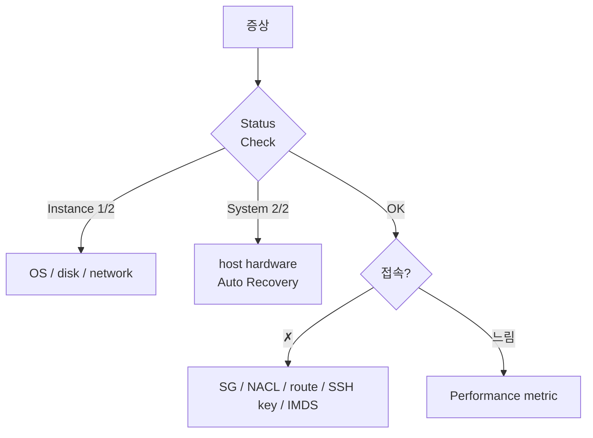

# EC2 Troubleshooting

> Status Check / System log / Console output / EC2 Rescue / Reachability Analyzer.

## 1. 진단 흐름



## 2. Status Check 2 종

| 종류 | 검사 |
| --- | --- |
| **Instance Status Check** | OS 부팅, FS, network config |
| **System Status Check** | host hardware, network reach |
| **EBS Status Check** | volume IO |

→ 둘 다 `1/2 passed` 이면 instance 자체 문제, `0/2` 이면 host.

```bash
aws ec2 describe-instance-status --instance-ids i-xxx
```

## 3. Console output

```bash
aws ec2 get-console-output --instance-id i-xxx --latest
```

→ 부팅 로그 (BIOS / kernel / cloud-init). SSH 안 될 때 유일한 가시성.

흔한 부팅 실패 keyword:
- `unable to mount root fs` — EBS 손상
- `out of memory` — RAM 부족
- `kernel panic` — kernel update 실패
- `dependency failed` — systemd

## 4. Console screenshot

```bash
aws ec2 get-console-screenshot --instance-id i-xxx
# {"ImageData": "iVBOR...base64"}

aws ec2 get-console-screenshot --instance-id i-xxx \
  --query ImageData --output text | base64 -d > screen.jpg
```

→ Windows BSOD / 부팅 화면 확인.

## 5. SSH 접속 안 됨 — 진단 순서

1. **Status Check** — 1/2 면 OS, 2/2 면 host
2. **SG** — port 22, source IP — [[../02-networking/02-security-group-and-nacl]]
3. **NACL** — egress 1024-65535 (return)
4. **Route Table** — IGW 또는 NAT
5. **Public IP** — 있는지 / Elastic IP detach 안 됐는지
6. **Key** — 올바른 pem? `chmod 400 myapp.pem`
7. **User** — `ec2-user` (AL) / `ubuntu` (Ubuntu) / `centos` (CentOS) / `admin` (Debian)
8. **OS firewall** — iptables / firewalld
9. **IMDS** — 가끔 부팅 시 hang
10. **SSM Session Manager** 로 우회 시도 — [[01-ssm-session-manager]]

### Reachability Analyzer
```bash
aws ec2 create-network-insights-path \
  --source eni-xxx --destination eni-yyy \
  --protocol tcp --destination-port 22
aws ec2 start-network-insights-analysis ...
```

## 6. SSH key 잃었을 때 복구

방법 1 — SSM Run Command (Instance Profile 있으면):
```bash
aws ssm send-command --instance-ids i-xxx \
  --document-name AWS-RunShellScript \
  --parameters 'commands=["echo ssh-rsa AAAA... >> /home/ec2-user/.ssh/authorized_keys"]'
```

방법 2 — Root volume 분리 후 재마운트:
```
1. Instance stop
2. Root volume detach
3. 다른 instance 에 secondary 로 attach
4. mount → authorized_keys 추가
5. detach → 원 instance 에 root 로 attach → start
```

## 7. EC2 Serial Console

Nitro instance 의 직접 serial 접근:
```bash
aws ec2 send-serial-console-ssh-public-key --instance-id i-xxx \
  --serial-port 0 --ssh-public-key file://~/.ssh/id_rsa.pub

ssh -i ~/.ssh/id_rsa i-xxx.port0@serial-console.ec2-instance-connect.ap-northeast-2.aws
```

→ network 없어도 OS 콘솔 직접. **enable on Console 먼저** (account 단위).

## 8. 성능 저하 진단

### CPU
```bash
top
mpstat -P ALL 1
# %iowait 높으면 IO 병목
```

### EBS
```bash
iostat -xz 1
# %util 80%+ 면 EBS 한도
```

### Network
```bash
ss -s
nethogs
sar -n DEV 1
```

CloudWatch:
- CPUCreditBalance (t-class)
- EBSIOBalance% (gp3 burst)
- NetworkIn / Out (instance type 한도)

### Memory (OS)
```bash
free -h
vmstat 1
```

## 9. EC2 Rescue (Linux)

```bash
# 자동 진단
sudo curl -O https://aws-ec2rescue-linux.s3.amazonaws.com/ec2rl-bundled.tgz
tar -xf ec2rl-bundled.tgz && cd ec2rl-*
sudo ./ec2rl run
```

생성된 report → `/var/tmp/ec2rl/` → S3 업로드 가능.

## 10. CannotPullImage / docker 관련 (ECS launch type EC2)

[[../../ecs/04-operations/03-troubleshooting]] §5 참조.

## 11. Spot interruption

```bash
# IMDS 에서 termination notice 확인 (2 min)
curl http://169.254.169.254/latest/meta-data/spot/instance-action
```

→ user-data 또는 systemd 의 graceful shutdown script.

## 12. AZ failure / Outage 시

- StatusCheckFailed_System → Auto Recovery (다른 host 로)
- AZ 전체 다운 → ASG / ALB cross-AZ
- Region 다운 → DR region (DLM cross-region snapshot 활용)

## 13. CloudTrail — API call audit

```bash
aws cloudtrail lookup-events \
  --lookup-attributes AttributeKey=ResourceName,AttributeValue=i-xxx \
  --max-items 30 \
  --query 'Events[].{Time:EventTime,Event:EventName,User:Username}'
```

→ 누가 terminate / stop 했는지.

## 14. 흔한 함정

| 증상 | 흔한 원인 |
| --- | --- |
| SSH timeout | SG 22 누락 / NACL ephemeral 미허용 |
| SSH refused | sshd 실행 안 함 (OS 부팅 안 됨) |
| Permission denied (publickey) | 잘못된 user / key |
| Cannot mount root | EBS volume detach 또는 손상 |
| Network 느림 | network burst 한도 (m5.large 등) |
| IO 느림 | EBS burst credit 고갈 (gp3 baseline 부족) |
| t3 갑자기 느림 | CPU credit 고갈 (unlimited 권장) |
| Spot 자주 죽음 | capacity-optimized 미설정 |

## 15. 다음

- ▶ [[../05-security/01-iam-instance-profile]]
- ▶ [[../05-security/02-imdsv2]]
- ▶ [[../05-security/03-hardening]]

## 16. 영상 / 자료

| 자료 |
| --- |
| [EC2 Rescue](https://docs.aws.amazon.com/AWSEC2/latest/UserGuide/ec2rl.html) |
| [Reachability Analyzer](https://docs.aws.amazon.com/vpc/latest/reachability/) |

## 17. 참고

- [[../ec2]]
- [[01-ssm-session-manager]]
- [[02-monitoring-cloudwatch]]
