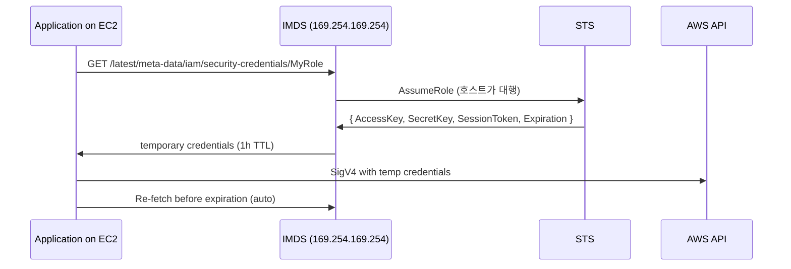

# IAM Instance Profile

> Instance 가 AWS API 호출할 때 사용. Access Key 평생 노출 금지. STS 자동 rotate + CloudTrail audit.

## 1. 동작



> AWS SDK 가 자동으로 IMDS 에서 credential 가져오고 갱신.

## 2. Instance Profile vs IAM Role

| Instance Profile | IAM Role |
| --- | --- |
| EC2 의 wrapper | IAM 의 본질 |
| 1:1 매핑 (Role 하나만 담음) | 단독 사용 |
| Console 에서 자동 생성 | 명시 생성 |

Console 은 Role 생성 시 Instance Profile 자동 만들어줌. CLI 는 따로:
```bash
aws iam create-instance-profile --instance-profile-name myprofile
aws iam add-role-to-instance-profile --instance-profile-name myprofile --role-name myrole
```

## 3. Role 만들기

```bash
# Trust policy
cat > trust.json <<'EOF'
{
  "Version": "2012-10-17",
  "Statement": [{
    "Effect": "Allow",
    "Principal": { "Service": "ec2.amazonaws.com" },
    "Action": "sts:AssumeRole",
    "Condition": {
      "StringEquals": { "aws:SourceAccount": "123456789012" }
    }
  }]
}
EOF

aws iam create-role --role-name BkursAppRole --assume-role-policy-document file://trust.json

# Inline policy
cat > policy.json <<'EOF'
{
  "Version": "2012-10-17",
  "Statement": [
    {
      "Effect": "Allow",
      "Action": ["s3:GetObject","s3:PutObject"],
      "Resource": "arn:aws:s3:::bkurs-backup-prod/*"
    },
    {
      "Effect": "Allow",
      "Action": "ssm:GetParameter",
      "Resource": "arn:aws:ssm:ap-northeast-2:123:parameter/bkurs-be/prod/*"
    }
  ]
}
EOF

aws iam put-role-policy --role-name BkursAppRole \
  --policy-name S3SSM --policy-document file://policy.json
```

## 4. Instance 에 attach

```bash
# Launch 시
aws ec2 run-instances --iam-instance-profile Name=BkursAppProfile ...

# 운영 중
aws ec2 associate-iam-instance-profile --instance-id i-xxx \
  --iam-instance-profile Name=BkursAppProfile

# 교체
aws ec2 replace-iam-instance-profile-association \
  --association-id iip-xxx --iam-instance-profile Name=NewProfile
```

## 5. STS chain — Instance Role → 다른 Role

```bash
# Instance 안에서
aws sts assume-role \
  --role-arn arn:aws:iam::987654321098:role/CrossAccountRole \
  --role-session-name "fromEC2"
```

→ Cross-account access (보안 그룹별 권한 분리).

Trust policy:
```json
{
  "Effect": "Allow",
  "Principal": { "AWS": "arn:aws:iam::123456789012:role/BkursAppRole" },
  "Action": "sts:AssumeRole",
  "Condition": {
    "StringEquals": { "aws:PrincipalTag/Environment": "prod" }
  }
}
```

## 6. STS Session Tag

```bash
aws ec2 modify-instance-attribute --instance-id i-xxx \
  --instance-credential-specification "InstanceMetadataTags=enabled"
```

→ instance tag → STS session tag → ABAC.

Policy 의 condition:
```json
"Condition": {
  "StringEquals": { "aws:PrincipalTag/Environment": "${ec2:ResourceTag/Environment}" }
}
```

## 7. Audit (CloudTrail)

```bash
# 특정 instance Role 의 사용
aws cloudtrail lookup-events \
  --lookup-attributes AttributeKey=Username,AttributeValue=BkursAppRole \
  --max-items 50
```

또는 STS audit:
```bash
aws cloudtrail lookup-events \
  --lookup-attributes AttributeKey=EventName,AttributeValue=AssumeRole \
  --max-items 50
```

## 8. credential cache

application 안에서 일시 cache:
- SDK 자동 캐시 (in-memory, ~10분)
- expiration 직전 자동 갱신
- application restart 시 새 credential
- IMDS hop limit 1 → container 안에서 호출 (multi-hop) 시 hop limit 2 필요 ([[02-imdsv2]])

## 9. 흔한 함정

| 함정 | 회피 |
| --- | --- |
| Access Key 직접 코드에 | Instance Profile |
| Role 권한 wildcard (`*`) | least-privilege + ARN 한정 |
| Trust policy SourceAccount 누락 | confused deputy 차단 |
| Container 안에서 IMDS hop=1 → 호출 실패 | hop=2 또는 ECS Task Role |
| Role 교체 후 application 재시작 안 함 | replace-iam-instance-profile + SDK cache flush |
| CloudTrail 비활성 | management event 활성 |

## 10. 다음

- ▶ [[02-imdsv2]]
- ▶ [[03-hardening]]
- ▶ [[../../iam/iam]]

## 11. 영상 / 자료

| 자료 |
| --- |
| [Instance Profile 공식](https://docs.aws.amazon.com/IAM/latest/UserGuide/id_roles_use_switch-role-ec2.html) |
| [IAM Best Practices](https://docs.aws.amazon.com/IAM/latest/UserGuide/best-practices.html) |

## 12. 참고

- [[../ec2]]
- [[02-imdsv2]]
- [[../04-operations/01-ssm-session-manager]]
- [[../../ecs/05-security/01-iam-best-practices]]
