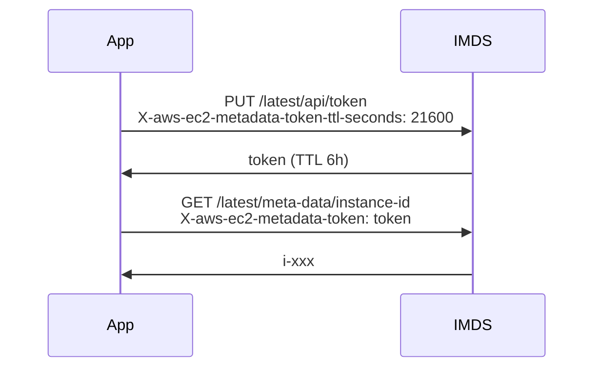

# IMDSv2 — Instance Metadata Service v2

> IMDSv1 의 SSRF 취약점 차단. Session token 기반 PUT-then-GET. **모든 instance 에서 강제 권장**.

## 1. IMDS 란?

```
http://169.254.169.254/latest/meta-data/
http://169.254.169.254/latest/dynamic/
http://169.254.169.254/latest/user-data
```

EC2 안에서만 접근 가능한 host-only metadata endpoint. Instance ID / AZ / role credentials / user-data.

## 2. IMDSv1 의 문제 — SSRF

```python
# 취약 application
@app.route("/proxy")
def proxy():
    url = request.args.get("url")
    return requests.get(url).text  # SSRF
```

공격:
```
GET /proxy?url=http://169.254.169.254/latest/meta-data/iam/security-credentials/MyRole
→ Role credential 누출
```

> Capital One 2019 사고 — IMDSv1 SSRF → 1억 정보 유출.

## 3. IMDSv2 동작



| 차이 | IMDSv1 | IMDSv2 |
| --- | --- | --- |
| 인증 | 없음 (GET 만) | session token (PUT+GET) |
| Header | 자유 | `X-aws-ec2-metadata-token` 필수 |
| SSRF 방어 | ✗ | ✓ (대부분의 SSRF 가 PUT method 못 보냄) |
| Hop limit | 64 (default) | 1 (default, container 차단) |

## 4. 강제 활성

### 신규 launch
```bash
aws ec2 run-instances --metadata-options \
  "HttpTokens=required,HttpPutResponseHopLimit=2,InstanceMetadataTags=enabled,HttpEndpoint=enabled" ...
```

### 기존 instance
```bash
aws ec2 modify-instance-metadata-options --instance-id i-xxx \
  --http-tokens required \
  --http-put-response-hop-limit 2 \
  --instance-metadata-tags enabled
```

| 옵션 | 의미 |
| --- | --- |
| `HttpTokens=required` | IMDSv2 강제 (v1 차단) |
| `HttpTokens=optional` | 둘 다 (기본 — 비추) |
| `HttpPutResponseHopLimit` | 1 = host only, 2 = container 도 OK |
| `InstanceMetadataTags=enabled` | instance tag 를 IMDS 에서 조회 |
| `HttpEndpoint=disabled` | IMDS 완전 차단 (특수) |

## 5. Hop limit 의미

```
hop=1: host 의 application 만 IMDS 호출 가능
hop=2: container 안의 application 도 가능 (NAT 1 단계)
hop=3+: nested container / VM
```

Container workload — hop=2 권장. 그러나 ECS / EKS 는 별도 metadata endpoint (Task Role / IRSA) 가 더 안전.

## 6. Account 단위 강제

```bash
# 새 instance 의 default 를 required 로
aws ec2 modify-instance-metadata-defaults \
  --http-tokens required \
  --http-put-response-hop-limit 2 \
  --instance-metadata-tags enabled

# 이미 launch 한 모든 instance scan
aws ec2 describe-instances \
  --query 'Reservations[].Instances[?MetadataOptions.HttpTokens!=`required`].[InstanceId,MetadataOptions.HttpTokens]' \
  --output table
```

## 7. SDK 호환

| SDK | IMDSv2 |
| --- | --- |
| AWS SDK Java v2 | ✓ |
| AWS SDK Python boto3 | ✓ (>=1.12) |
| AWS SDK Node.js v3 | ✓ |
| AWS CLI v2 | ✓ |
| AWS SDK Go v2 | ✓ |
| ✗ 일부 자체 구현 / 오래된 client | 대응 필요 |

## 8. CloudWatch monitoring

```bash
# IMDSv1 사용 횟수
aws cloudwatch get-metric-statistics \
  --namespace AWS/EC2 --metric-name MetadataNoToken \
  --dimensions Name=InstanceId,Value=i-xxx \
  --start-time 2026-05-15T00:00:00Z --end-time 2026-05-22T00:00:00Z \
  --period 3600 --statistics Sum
```

→ 0 이면 IMDSv2 만 사용 중 → `required` 로 변경 안전.

## 9. CDK / Terraform

```typescript
new ec2.Instance(this, 'App', {
  ...
  requireImdsv2: true,
});
```

```hcl
resource "aws_instance" "app" {
  metadata_options {
    http_endpoint               = "enabled"
    http_tokens                 = "required"
    http_put_response_hop_limit = 2
    instance_metadata_tags      = "enabled"
  }
}
```

## 10. ASG / Launch Template

```bash
aws ec2 create-launch-template-version \
  --launch-template-id lt-xxx \
  --launch-template-data '{
    "MetadataOptions": {
      "HttpTokens": "required",
      "HttpPutResponseHopLimit": 2,
      "InstanceMetadataTags": "enabled"
    }
  }'
```

## 11. 호환 안 되는 application 대응

1. SDK 업데이트
2. user-data 의 `curl` script 에 PUT-then-GET 추가:
```bash
TOKEN=$(curl -X PUT "http://169.254.169.254/latest/api/token" \
  -H "X-aws-ec2-metadata-token-ttl-seconds: 21600" -s)
REGION=$(curl -H "X-aws-ec2-metadata-token: $TOKEN" -s \
  http://169.254.169.254/latest/meta-data/placement/region)
```

## 12. 흔한 함정

| 함정 | 회피 |
| --- | --- |
| `HttpTokens=optional` 그대로 production | required |
| hop=1 그대로 container | hop=2 |
| container 에서 호출 안 됨 | ECS Task Role / EKS IRSA |
| SDK 오래된 버전 | 최신 SDK |
| MetadataNoToken alarm 없음 | CloudWatch alarm |
| Account-level default 미설정 | modify-instance-metadata-defaults |

## 13. 다음

- ▶ [[03-hardening]]
- ▶ [[../04-operations/01-ssm-session-manager]]
- ▶ [[../../iam/iam]]

## 14. 영상 / 자료

| 자료 |
| --- |
| [IMDSv2 공식](https://docs.aws.amazon.com/AWSEC2/latest/UserGuide/configuring-instance-metadata-service.html) |
| [Capital One SSRF 분석](https://www.capitalone.com/about/newsroom/cyber-incident/) |

## 15. 참고

- [[../ec2]]
- [[01-iam-instance-profile]]
- [[03-hardening]]
