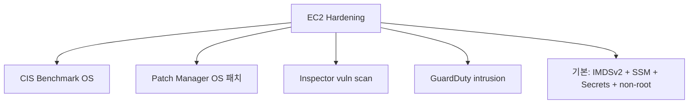

# EC2 Hardening

> CIS Benchmark + SSM Patch Manager + Inspector + GuardDuty + Secrets/IMDSv2/SSM Session Manager 결합.

## 1. 5 pillar



## 2. CIS Benchmark

[Center for Internet Security](https://www.cisecurity.org/) 의 OS 표준:
- Filesystem (no tmp exec, no suid binary check)
- Services (cron / sshd / firewalld 만)
- Network (sysctl ip_forward=0, ICMP redirect off)
- Logging (auditd, journald rotation)
- Access (sshd PasswordAuthentication no, root login no)
- Cron (RAW permission)

**CIS Hardened AMI** (Marketplace) 즉시 사용 가능. 직접 적용:
```bash
git clone https://github.com/CISOfy/lynis
sudo ./lynis audit system
```

또는 Ansible role `dev-sec/ansible-collection-hardening` / Chef InSpec.

## 3. SSM Patch Manager

```bash
# Patch Baseline (default = AWS managed)
aws ssm get-default-patch-baseline --operating-system AMAZON_LINUX_2023

# Custom baseline — Critical/Security 만 자동
aws ssm create-patch-baseline --name bkurs-baseline \
  --operating-system AMAZON_LINUX_2023 \
  --approval-rules '{
    "PatchRules": [{
      "PatchFilterGroup": {
        "PatchFilters": [
          { "Key": "CLASSIFICATION", "Values": ["Security","Bugfix","Critical"] }
        ]
      },
      "ApproveAfterDays": 7,
      "ComplianceLevel": "CRITICAL",
      "EnableNonSecurity": false
    }]
  }'

# Maintenance Window — 매주 일요일 03:00
aws ssm create-maintenance-window --name "PatchMW" \
  --schedule "cron(0 3 ? * SUN *)" --duration 4 --cutoff 1
```

→ 자동 schedule + apply + reboot. CloudWatch 에 compliance metric.

## 4. Amazon Inspector

```bash
aws inspector2 enable --resource-types EC2 ECR LAMBDA
```

자동 scan:
- OS package (CVE / CVSS)
- network reachability (open from internet)
- Container image
- Lambda function

Finding 예:
```
HIGH: CVE-2024-XXXX in openssl-3.0.7 — upgrade to 3.0.8
HIGH: SSH port 22 open from 0.0.0.0/0
```

EventBridge:
```yaml
EventPattern:
  source: [aws.inspector2]
  detail-type: [Inspector2 Finding]
  detail:
    severity: [HIGH, CRITICAL]
Targets:
  - SNS topic / Lambda
```

## 5. GuardDuty

```bash
aws guardduty create-detector --enable
```

자동 탐지:
- Unusual API call from unfamiliar IP
- EC2 mining (CPU spike + crypto pool DNS)
- Compromised instance (C&C 통신)
- Brute force SSH / RDP
- DNS exfiltration
- Malware (Runtime Monitoring)

Severity: 1.0 ~ 8.9.

## 6. Linux 패치 정책

```bash
# Amazon Linux 2023
sudo dnf update -y --security
sudo dnf needs-restarting -r   # reboot 필요 판단

# Ubuntu
sudo unattended-upgrade -d
```

→ Patch Manager 가 자동화하지만 baseline 잘 익혀두기.

## 7. Filesystem 권장

- `/tmp` → tmpfs + noexec, nosuid, nodev
- `/var/log` → 별도 partition
- AIDE / Tripwire — file integrity

```bash
sudo dnf install -y aide
sudo aide --init
sudo mv /var/lib/aide/aide.db.new.gz /var/lib/aide/aide.db.gz
sudo aide --check
```

## 8. SSH (사용 시) 강화

`/etc/ssh/sshd_config`:
```
PermitRootLogin no
PasswordAuthentication no
PubkeyAuthentication yes
ChallengeResponseAuthentication no
ClientAliveInterval 300
MaxAuthTries 3
AllowUsers ec2-user
Protocol 2
```

→ **그러나 SSM Session Manager 가 더 안전** ([[../04-operations/01-ssm-session-manager]]).

## 9. fail2ban / CrowdSec

SSH brute force 차단:
```bash
sudo dnf install -y fail2ban
sudo systemctl enable --now fail2ban
```

## 10. Disk 암호화

- EBS — default encryption ON ([[../03-storage/01-ebs-deep]] §7)
- LUKS — OS 안 추가 layer (KMS 와 결합)

## 11. Audit

- auditd (systemd-journald)
- CloudWatch Agent → CloudTrail / VPC Flow / sshd log

```bash
sudo systemctl enable --now auditd
sudo ausearch -m USER_LOGIN -ts today
```

## 12. AWS Config + Security Hub

```bash
# Config 활성
aws configservice put-configuration-recorder ...
aws configservice start-configuration-recorder ...

# Security Hub
aws securityhub enable-security-hub --enable-default-standards
```

→ CIS AWS Foundations Benchmark 자동 점검.

## 13. 권장 baseline 체크리스트

```
[ ] IMDSv2 강제 (HttpTokens=required)
[ ] Instance Profile 최소 권한
[ ] SSM Session Manager (SSH 22 inbound 차단)
[ ] EBS encryption default
[ ] Default SG 사용 X
[ ] SSM Patch Manager + Maintenance Window
[ ] Amazon Inspector 활성 (EC2/ECR/Lambda)
[ ] GuardDuty 활성
[ ] CloudTrail 활성 (management event + data event)
[ ] AWS Config + CIS Benchmark
[ ] VPC Flow Logs 활성
[ ] Termination Protection (production)
[ ] CloudWatch Agent + auditd
[ ] AMI 정리 (30일 미사용 deregister)
[ ] Secrets — SSM/Secrets Manager (env plain X)
```

## 14. 흔한 함정

| 함정 | 회피 |
| --- | --- |
| OS 패치 수동 | Patch Manager |
| SSH 22 인터넷 노출 | SSM |
| 보안 group 0.0.0.0/0 ingress | SG reference / prefix list |
| AMI 갱신 안 함 → CVE 누적 | Golden AMI 매주 rebuild |
| Inspector 미활성 | enable |
| auditd 비활성 | enable |

## 15. 다음

- ▶ [[../practice/01-launch-first-instance]]
- ▶ [[../practice/02-ssm-ssh-less]]
- ▶ [[../practice/03-asg-with-launch-template]]

## 16. 영상 / 자료

| 자료 |
| --- |
| [CIS Benchmark](https://www.cisecurity.org/cis-benchmarks) |
| [Inspector — AWS](https://www.youtube.com/watch?v=jJr-RT9XHUg) |
| [GuardDuty — AWS](https://www.youtube.com/watch?v=czsuZcdAVPI) |

## 17. 참고

- [[../ec2]]
- [[01-iam-instance-profile]]
- [[02-imdsv2]]
- [[../04-operations/01-ssm-session-manager]]
