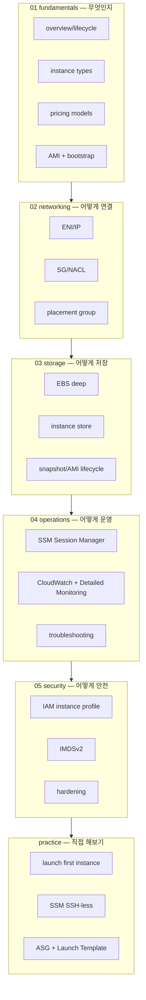
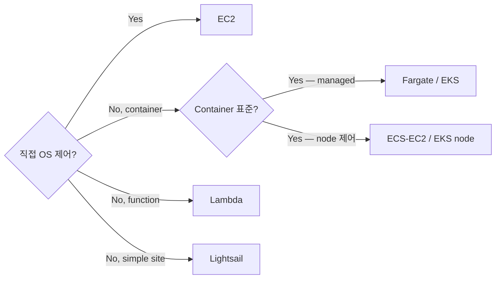

# AWS EC2 — Elastic Compute Cloud

> **가상 머신 (VM)** — 임의의 OS / 응용 실행. AWS 의 가장 기본 자원. 모든 컴퓨팅 추상화 (ECS / EKS / Lambda / RDS) 의 토대.

**[[../compute|↑ Compute]]** · **[[../../cloud-aws|↑↑ AWS]]**

---

## 1. 한 줄

```
Hypervisor (Nitro) + AMI (OS image) + Instance Type (CPU/RAM) + EBS (디스크) + ENI (네트워크)
                                  → Instance (가상 머신 1대)
```

## 2. 학습 roadmap



## 3. Sub-directory index

### [[01-fundamentals/01-instance-overview]] — Instance lifecycle / Nitro / hypervisor
pending / running / stopping / stopped / terminating / terminated 상태. Nitro Hypervisor + Card 의 의미.

### [[01-fundamentals/02-instance-types]] — 7 family (t/m/c/r/i/g/x) + Graviton
범용 / 컴퓨팅 / 메모리 / 스토리지 / 가속기 / 거대 메모리. ARM (Graviton) -20% 비용.

### [[01-fundamentals/03-pricing-models]] — On-Demand / Reserved / Savings Plan / Spot / Dedicated
4 pricing 모델 + Capacity Reservation + Spot Fleet.

### [[01-fundamentals/04-amis-and-bootstrap]] — AMI / user data / cloud-init / Image Builder
AMI 구성요소 + 자동 부팅 스크립트 + EC2 Image Builder + Golden AMI.

### [[02-networking/01-eni-and-ip]] — ENI / Private/Public/Elastic IP
ENI multi-attach / secondary IP / IPv6 / Elastic IP cost.

### [[02-networking/02-security-group-and-nacl]] — SG (stateful) vs NACL (stateless)
SG = ENI level / NACL = subnet level. 적용 순서 + log.

### [[02-networking/03-placement-group]] — Cluster / Spread / Partition
저지연 (Cluster) / 고가용 (Spread) / HDFS (Partition).

### [[03-storage/01-ebs-deep]] — gp3 / io2 / st1 / sc1 + IOPS + Multi-Attach
type / IOPS / throughput / snapshot / Multi-Attach.

### [[03-storage/02-instance-store]] — NVMe local SSD
i3/i4i/r6id 의 nvme local — stop 시 사라짐.

### [[03-storage/03-snapshots-ami-lifecycle]] — Snapshot Lifecycle / FSR / Recycle Bin
DLM 자동 백업 + Fast Snapshot Restore + Recycle Bin.

### [[04-operations/01-ssm-session-manager]] — Key-less shell + port-forward
SSH 22 안 열어도 됨. audit log.

### [[04-operations/02-monitoring-cloudwatch]] — Basic / Detailed / Agent / Insights
1분 vs 5분 / CloudWatch Agent / Application Insights.

### [[04-operations/03-troubleshooting]] — Boot 실패 / SSH 불가 / Performance
console output / EC2 Rescue / failure categories.

### [[05-security/01-iam-instance-profile]] — Instance Role + assume + audit
IAM instance profile vs role, STS chain, CloudTrail.

### [[05-security/02-imdsv2]] — Metadata 서비스 v2 강제
IMDSv1 의 SSRF 취약점, hop-limit, 강제 활성.

### [[05-security/03-hardening]] — Patch Manager / Inspector / CIS Benchmark
SSM Patch Manager + Inspector vulnerability scan + CIS hardening AMI.

### [[practice/01-launch-first-instance]] — 첫 EC2 (Console + CLI + Terraform)
20분 — Amazon Linux 2023 / SG / user data 로 nginx 자동 설치.

### [[practice/02-ssm-ssh-less]] — Session Manager 로 key 없이 접속
agent 설치 + IAM 권한 + audit log.

### [[practice/03-asg-with-launch-template]] — ALB + Launch Template + ASG
target tracking + scheduled / health check / rolling refresh.

## 4. 핵심 개념 1줄

| 개념 | 의미 |
| --- | --- |
| Instance Type | CPU/RAM spec — t3.medium / c6i.large / r6i.xlarge |
| AMI | OS + 소프트웨어 snapshot |
| Key Pair | SSH key (생성 시 1회 download) — SSM 권장 |
| Security Group | ENI level stateful 방화벽 |
| ENI | 가상 네트워크 카드 (1+) |
| EBS | 영구 디스크 (가상 SAN) |
| Instance Store | 호스트 직접 NVMe — ephemeral |
| Launch Template | 인스턴스 생성 템플릿 |
| ASG | 부하 따라 수량 자동 ↑↓ |
| Elastic IP | 고정 public IP (사용 안 할 때 시간당 과금) |

## 5. EC2 vs 대안



| | EC2 | ECS Fargate | Lambda |
| --- | --- | --- | --- |
| 단위 | VM | container | function |
| OS 패치 | 사용자 | AWS | AWS |
| 시간 한계 | 무한 | 무한 | 15분 |
| 기본 cost | 인스턴스 비용 | vCPU/RAM 시간 | invocation |
| 적합 | DB / 거대 RAM / GPU / VPN | 일반 web/API | event |

## 6. bkurs-be 적용

```
production: ECS Fargate ARM64 (EC2 직접 미사용)
RDS:        managed (Aurora / RDS — EC2 직접 안 띄움)
bastion:    SSM Session Manager (EC2 t4g.nano) → private subnet 접근
```

> EC2 는 "**다른 추상화로 해결 안 되는 곳**" 에만. DB, bastion, GPU, 거대 RAM.

## 7. 가격 모델 요약

| 모델 | 할인 | 용도 |
| --- | --- | --- |
| On-Demand | 0% | 시작 / 짧은 작업 |
| Compute Savings Plan 1y | ~17~40% | baseline |
| Compute Savings Plan 3y | ~50% | 큰 baseline |
| Reserved Instance (Standard 3y all-up) | ~70% | 같은 type 고정 |
| Spot | 70~90% | 내결함 batch |
| Dedicated Host | premium | 라이센스 BYOL |

자세히 → [[01-fundamentals/03-pricing-models]]

## 8. 흔한 함정

| 함정 | 어디 |
| --- | --- |
| 큰 인스턴스 24x7 | [[01-fundamentals/03-pricing-models]] |
| SSH 22 인터넷 노출 | [[04-operations/01-ssm-session-manager]] / [[05-security/03-hardening]] |
| Spot interruption | [[01-fundamentals/03-pricing-models]] §Spot |
| gp2 → gp3 마이그 안 함 | [[03-storage/01-ebs-deep]] |
| instance store stop = 데이터 손실 | [[03-storage/02-instance-store]] |
| OS 패치 수동 | [[05-security/03-hardening]] |
| IMDSv1 SSRF | [[05-security/02-imdsv2]] |

## 9. 영상 / 자료

| 자료 |
| --- |
| [EC2 Deep Dive — re:Invent](https://www.youtube.com/watch?v=H-S3l3FCJgQ) |
| [Nitro System — re:Invent](https://www.youtube.com/watch?v=tjP4S6tSP9Q) |
| [Graviton — AWS](https://aws.amazon.com/ec2/graviton/) |
| [AWS Well-Architected — Compute](https://docs.aws.amazon.com/wellarchitected/latest/compute-pillar/welcome.html) |

## 10. 관련 hub

- [[../compute]] — Compute hub
- [[../ecs/ecs]] — Container 대안
- [[../lambda/lambda]] — Serverless 대안
- [[../ecr/ecr]] — Image registry
- [[../auto-scaling/auto-scaling]] — ASG
- [[../../storage/ebs/ebs]] — EBS deep
- [[../../network/vpc/vpc]] — VPC
- [[../../iam/iam]] — IAM
