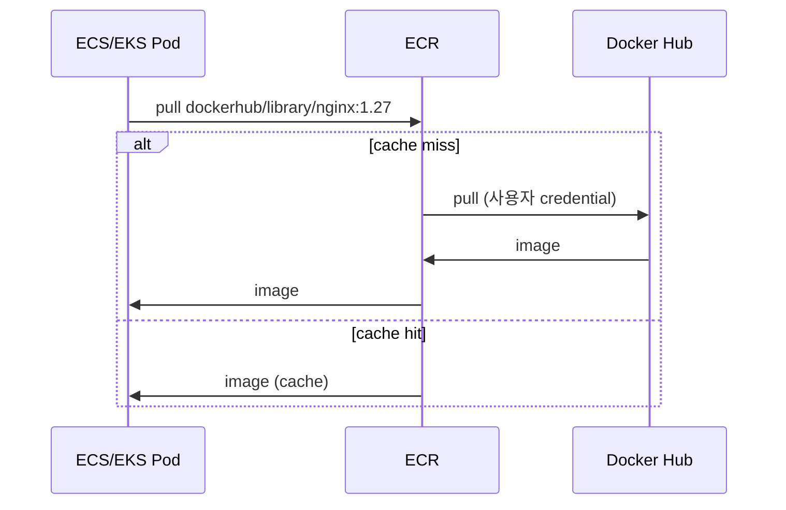

# ECR Private / Public / Pull-Through

> 3 type — Private (default) / Public Gallery / Pull-through Cache. Pull-through 가 Docker Hub rate limit 우회.

## 1. 3 type 비교

| | Private | Public Gallery | Pull-through |
| --- | --- | --- | --- |
| 위치 | account / region | gallery.ecr.aws (global) | private (mirror cache) |
| URL | `<acct>.dkr.ecr.<region>.amazonaws.com/<repo>` | `public.ecr.aws/<alias>/<repo>` | private 과 동일 |
| Auth (pull) | IAM | anonymous | IAM |
| Auth (push) | IAM | IAM | upstream 의 credential |
| Multi-region | manual / replication | global | per-region cache |
| 비용 (저장) | $0.10/GB·월 | 무료 (50GB 까지) | $0.10/GB·월 (cached) |
| 비용 (pull) | 같은 region 무료 | 무료 (계정 인증 시 outbound) | 같은 region 무료 |
| 권장 | 내부 image | OSS / 공유 | Docker Hub rate 회피 |

## 2. Private ECR

```bash
aws ecr create-repository --repository-name bkurs-be
aws ecr get-login-password | docker login --username AWS --password-stdin <acct>.dkr.ecr.<region>.amazonaws.com
docker push <acct>.dkr.ecr.<region>.amazonaws.com/bkurs-be:v1
```

> 위에 자세히 ([[01-repository-and-image]]).

## 3. Public ECR Gallery

오픈소스 / public image 배포:
```bash
aws ecr-public create-repository --repository-name bkurs-cli --region us-east-1
# Public ECR 은 us-east-1 만

aws ecr-public get-login-password --region us-east-1 | \
  docker login --username AWS --password-stdin public.ecr.aws

docker tag bkurs-cli:v1 public.ecr.aws/abc123/bkurs-cli:v1
docker push public.ecr.aws/abc123/bkurs-cli:v1
```

Gallery URL: `https://gallery.ecr.aws/abc123/bkurs-cli`.

활용:
- AWS 가 제공하는 official: `public.ecr.aws/lambda/python`, `public.ecr.aws/eks-distro/...`
- OSS 자체 image

## 4. Pull-through Cache

Upstream registry (Docker Hub / GHCR / Quay) 의 image 를 ECR 에 mirror:
```bash
# Docker Hub
aws ecr create-pull-through-cache-rule \
  --ecr-repository-prefix dockerhub \
  --upstream-registry-url registry-1.docker.io

# 사용
docker pull <acct>.dkr.ecr.<region>.amazonaws.com/dockerhub/library/nginx:1.27-alpine

# GHCR
aws ecr create-pull-through-cache-rule \
  --ecr-repository-prefix ghcr \
  --upstream-registry-url ghcr.io \
  --credential-arn arn:secret:...

# 사용
docker pull <acct>.dkr.ecr.<region>.amazonaws.com/ghcr/openai/whisper:latest

# 다른 ECR private
aws ecr create-pull-through-cache-rule \
  --ecr-repository-prefix shared \
  --upstream-registry-url 987654321098.dkr.ecr.us-east-1.amazonaws.com \
  --credential-arn arn:secret:...
```

| Upstream | URL |
| --- | --- |
| Docker Hub | registry-1.docker.io |
| GHCR | ghcr.io |
| Quay | quay.io |
| 다른 ECR | <acct>.dkr.ecr... |
| Kubernetes (k8s.io / k8s.gcr.io) | registry.k8s.io |
| ECR Public | public.ecr.aws |
| GitLab / Azure | 가능 |

## 5. 왜 Pull-through?

### Docker Hub rate limit
- Anonymous: 100 pull / 6h
- Free authenticated: 200 / 6h
- 큰 cluster 의 pod restart spike = rate limit 도달

→ **Pull-through 가 첫 1번만 Docker Hub 호출 후 ECR cache** = 무제한.

### 보안 (image 검증)
- Pull-through 에 사용자 정책 (scan / lifecycle) 적용
- Docker Hub 직접 호출 차단 (egress 제한)

### 비용
- 같은 region 의 pull 은 무료
- Docker Hub 의 cross-region DT 비용 없음

## 6. Pull-through Cache 의 동작



→ Repository 자동 생성 (`dockerhub/library/nginx`). Lifecycle policy / scan 적용 가능.

## 7. Pull-through credential (private upstream)

```bash
aws secretsmanager create-secret --name dockerhub-cred \
  --secret-string '{"username":"bkurs","accessToken":"dckr_pat_xxx"}'

aws ecr create-pull-through-cache-rule \
  --ecr-repository-prefix dockerhub \
  --upstream-registry-url registry-1.docker.io \
  --credential-arn arn:aws:secretsmanager:...:secret:dockerhub-cred-xxx
```

## 8. Lambda Container 의 Pull-through

```bash
aws ecr create-pull-through-cache-rule \
  --ecr-repository-prefix lambda \
  --upstream-registry-url public.ecr.aws/lambda
```

Lambda Container Dockerfile:
```dockerfile
# 기존
FROM public.ecr.aws/lambda/python:3.12

# Pull-through 사용
FROM 123.dkr.ecr.ap-northeast-2.amazonaws.com/lambda/python:3.12
```

→ build cache + 보안 일관성.

## 9. 한도

| | |
| --- | --- |
| Pull-through rule | 100 / account / region |
| Upstream registry per rule | 1 |
| Repository prefix length | 30 chars |

## 10. EKS / ECS 의 Pull-through 활용

### EKS Pod
```yaml
spec:
  containers:
    - image: 123.dkr.ecr.../dockerhub/library/redis:7
```

> Pod 가 ECR 호출 = Node IAM Role 의 ECR 권한.

### ECS Task Definition
```json
"image": "123.dkr.ecr.../dockerhub/library/redis:7"
```

> ECS Execution Role 의 ECR 권한.

## 11. 흔한 함정

| 함정 | 회피 |
| --- | --- |
| Docker Hub 직접 사용 → rate limit | Pull-through |
| Pull-through credential 누락 (private upstream) | Secrets Manager |
| Repository prefix 충돌 (`dockerhub` vs custom) | unique prefix |
| Public ECR push 권한 (us-east-1 만) | region 명시 |
| Pull-through 의 lifecycle 미설정 → 누적 | lifecycle policy |
| ECR scan 권한 자동 적용 안 됨 | scanOnPush 활성 |

## 12. 다음

- ▶ [[03-pricing-and-limits]]
- ▶ [[../02-operations/01-push-pull-auth]]
- ▶ [[../03-security/01-scanning-and-inspector]]

## 13. 영상 / 자료

| 자료 |
| --- |
| [Pull-through Cache](https://docs.aws.amazon.com/AmazonECR/latest/userguide/pull-through-cache.html) |
| [ECR Public Gallery](https://gallery.ecr.aws) |

## 14. 참고

- [[../ecr]]
- [[01-repository-and-image]]
- [[../../../docker/dockerfile/registry]]
