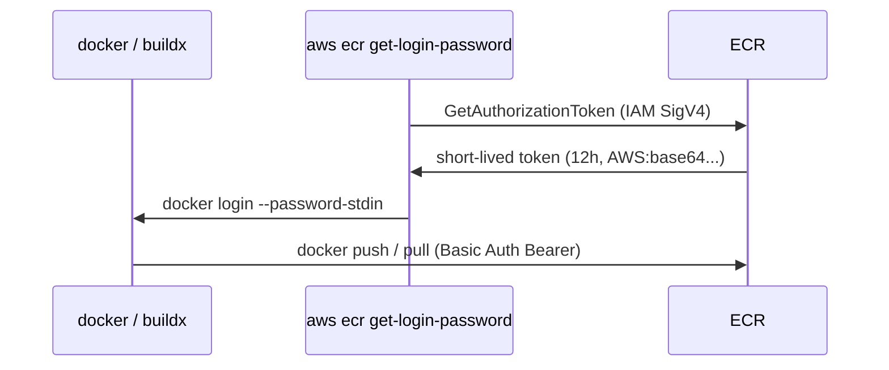

# ECR Push / Pull / Auth

> Short-lived token (12h) + IAM. docker / buildx / helm / cosign 모두 동일.

## 1. 인증 흐름



## 2. Login

```bash
# Private ECR
aws ecr get-login-password --region ap-northeast-2 | \
  docker login --username AWS \
  --password-stdin <acct>.dkr.ecr.ap-northeast-2.amazonaws.com

# Public ECR (us-east-1 만)
aws ecr-public get-login-password --region us-east-1 | \
  docker login --username AWS --password-stdin public.ecr.aws
```

> Token 12 시간 valid. 그 후 재로그인. CI 환경에서는 매번 호출.

## 3. Push

```bash
# Tag
docker tag bkurs-be:v1 <acct>.dkr.ecr.ap-northeast-2.amazonaws.com/bkurs-be:v1
docker push <acct>.dkr.ecr.ap-northeast-2.amazonaws.com/bkurs-be:v1

# Buildx (multi-arch)
docker buildx build \
  --platform linux/amd64,linux/arm64 \
  -t <acct>.dkr.ecr.../bkurs-be:v1 \
  --push .
```

## 4. Pull

```bash
docker pull <acct>.dkr.ecr.../bkurs-be:v1
docker pull <acct>.dkr.ecr.../bkurs-be@sha256:abc...
```

ECS / EKS / Lambda 의 image pull = 자동 — Execution Role / Pod IAM / Lambda Execution Role 의 ECR 권한.

## 5. IAM Policy

### Push 권한
```json
{
  "Effect": "Allow",
  "Action": [
    "ecr:GetAuthorizationToken"
  ],
  "Resource": "*"
},
{
  "Effect": "Allow",
  "Action": [
    "ecr:BatchCheckLayerAvailability",
    "ecr:GetDownloadUrlForLayer",
    "ecr:BatchGetImage",
    "ecr:InitiateLayerUpload",
    "ecr:UploadLayerPart",
    "ecr:CompleteLayerUpload",
    "ecr:PutImage"
  ],
  "Resource": "arn:aws:ecr:ap-northeast-2:123:repository/bkurs-be"
}
```

### Pull only
```json
{
  "Effect": "Allow",
  "Action": [
    "ecr:BatchCheckLayerAvailability",
    "ecr:GetDownloadUrlForLayer",
    "ecr:BatchGetImage"
  ],
  "Resource": "arn:aws:ecr:ap-northeast-2:123:repository/bkurs-be"
},
{
  "Effect": "Allow",
  "Action": "ecr:GetAuthorizationToken",
  "Resource": "*"
}
```

AWS managed:
- `AmazonEC2ContainerRegistryPowerUser` — push + pull
- `AmazonEC2ContainerRegistryReadOnly` — pull only
- `AmazonEC2ContainerRegistryFullAccess` — admin

## 6. GitHub Actions — OIDC

OIDC = secret 안 박고 short-lived credential:

```yaml
name: build-and-push
on: { push: { branches: [main] } }
permissions:
  id-token: write    # OIDC
  contents: read

jobs:
  build:
    runs-on: ubuntu-latest
    steps:
      - uses: actions/checkout@v4

      - uses: aws-actions/configure-aws-credentials@v4
        with:
          role-to-assume: arn:aws:iam::123:role/GitHubActionsECRPush
          aws-region: ap-northeast-2

      - uses: aws-actions/amazon-ecr-login@v2
        id: ecr

      - uses: docker/setup-buildx-action@v3

      - uses: docker/build-push-action@v5
        with:
          push: true
          platforms: linux/amd64,linux/arm64
          tags: |
            ${{ steps.ecr.outputs.registry }}/bkurs-be:${{ github.sha }}
            ${{ steps.ecr.outputs.registry }}/bkurs-be:latest
          cache-from: type=gha
          cache-to: type=gha,mode=max
```

### IAM Role (OIDC trust)
```json
{
  "Version": "2012-10-17",
  "Statement": [{
    "Effect": "Allow",
    "Principal": {
      "Federated": "arn:aws:iam::123:oidc-provider/token.actions.githubusercontent.com"
    },
    "Action": "sts:AssumeRoleWithWebIdentity",
    "Condition": {
      "StringEquals": {
        "token.actions.githubusercontent.com:aud": "sts.amazonaws.com"
      },
      "StringLike": {
        "token.actions.githubusercontent.com:sub": "repo:bkurs/bkurs-be:ref:refs/heads/main"
      }
    }
  }]
}
```

## 7. EKS Pod / ECS Task 자동 pull

### EKS — Node IAM Role
```bash
# 1. eksctl 가 자동 생성 시 OK
# 2. 직접 만든 cluster — node role 에 ECR ReadOnly attach
eksctl utils associate-iam-policy --cluster bkurs-prod \
  --policy-arn arn:aws:iam::aws:policy/AmazonEC2ContainerRegistryReadOnly \
  --role-name nodegroup-role
```

### ECS — Execution Role
```bash
aws iam attach-role-policy --role-name ecsTaskExecutionRole \
  --policy-arn arn:aws:iam::aws:policy/AmazonEC2ContainerRegistryReadOnly
```

또는 inline:
```json
{
  "Effect": "Allow",
  "Action": [
    "ecr:GetAuthorizationToken",
    "ecr:BatchCheckLayerAvailability",
    "ecr:GetDownloadUrlForLayer",
    "ecr:BatchGetImage"
  ],
  "Resource": "*"
}
```

### Lambda Container — Execution Role
Lambda 는 자동 (image-pull 만 lambda service 가 함).

## 8. Helper credential (Docker daemon)

```bash
# Long-running daemon — Helper 자동 refresh
docker-credential-ecr-login

# ~/.docker/config.json
{
  "credHelpers": {
    "<acct>.dkr.ecr.ap-northeast-2.amazonaws.com": "ecr-login"
  }
}
```

→ docker pull 시 자동 token 갱신.

## 9. Pull-through cache pull

```bash
docker pull <acct>.dkr.ecr.../dockerhub/library/nginx:1.27
```

→ 자동으로 Docker Hub 에서 pull + ECR cache.

## 10. Helm chart push

```bash
helm registry login --username AWS --password $(aws ecr get-login-password --region ap-northeast-2) \
  <acct>.dkr.ecr.ap-northeast-2.amazonaws.com

helm push my-chart-1.0.0.tgz oci://<acct>.dkr.ecr.ap-northeast-2.amazonaws.com/charts
```

## 11. Cosign 서명

```bash
cosign sign --key awskms:///alias/cosign <acct>.dkr.ecr.../bkurs-be:v1.0.0

# Verify
cosign verify --key awskms:///alias/cosign <acct>.dkr.ecr.../bkurs-be:v1.0.0
```

자세히 → [[../03-security/02-immutability-and-signing]]

## 12. Build Cache (registry-based)

```bash
docker buildx build \
  --cache-from type=registry,ref=<acct>.dkr.ecr.../bkurs-be:cache \
  --cache-to type=registry,ref=<acct>.dkr.ecr.../bkurs-be:cache,mode=max \
  --push -t <acct>.dkr.ecr.../bkurs-be:v1 .
```

→ cache image 별도 tag → 다음 build 가 layer 재사용.

## 13. 흔한 함정

| 함정 | 회피 |
| --- | --- |
| Long-lived AWS Access Key | OIDC + IAM Role |
| Token 12h 만료 | 자동 refresh (helper / GHA login) |
| Push 권한 부족 | InitiateLayerUpload / UploadLayerPart / PutImage 모두 |
| Public ECR push 시 region 오류 | us-east-1 만 |
| platform 안 명시 → x86 만 | buildx --platform |
| Image cache 없음 → 느림 | GHA `type=gha` 또는 registry cache |

## 14. 다음

- ▶ [[02-lifecycle-and-replication]]
- ▶ [[03-cross-account-and-region]]
- ▶ [[../03-security/01-scanning-and-inspector]]

## 15. 영상 / 자료

| 자료 |
| --- |
| [ECR Push/Pull](https://docs.aws.amazon.com/AmazonECR/latest/userguide/Registries.html) |
| [GitHub Actions OIDC](https://docs.github.com/en/actions/deployment/security-hardening-your-deployments/configuring-openid-connect-in-amazon-web-services) |
| [docker-credential-ecr-login](https://github.com/awslabs/amazon-ecr-credential-helper) |

## 16. 참고

- [[../ecr]]
- [[../01-fundamentals/01-repository-and-image]]
- [[../../iam/iam]]
