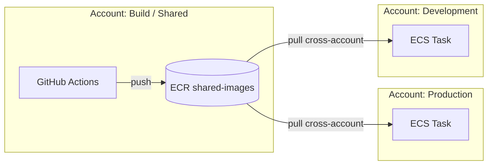
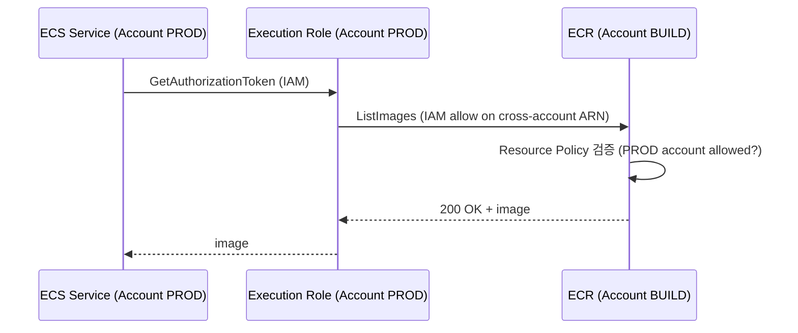

# Cross-Account / Cross-Region Sharing

> Repository Policy + IAM. Cross-account pull 표준 패턴 + ECR Replication 으로 mirror.

## 1. 시나리오 — Multi-Account



> AWS Organizations 권장 — multi-account 분리 (build / prod / dev / security / log archive).

## 2. Repository Policy (Resource-Based)

Source account (build) 의 repository:
```bash
aws ecr set-repository-policy --repository-name bkurs-be \
  --policy-text "$(cat <<'EOF'
{
  "Version": "2012-10-17",
  "Statement": [
    {
      "Sid": "AllowProdAccountPull",
      "Effect": "Allow",
      "Principal": {
        "AWS": [
          "arn:aws:iam::PROD_ACCOUNT:root",
          "arn:aws:iam::DEV_ACCOUNT:root"
        ]
      },
      "Action": [
        "ecr:GetDownloadUrlForLayer",
        "ecr:BatchGetImage",
        "ecr:BatchCheckLayerAvailability"
      ]
    }
  ]
}
EOF
)"
```

> `"AWS": "arn:aws:iam::PROD_ACCOUNT:root"` = 그 account 의 모든 principal (특정 role 로 좁힐 수 있음).

## 3. Pull side — IAM (consumer account)

Production account 의 ECS Execution Role:
```json
{
  "Version": "2012-10-17",
  "Statement": [
    {
      "Effect": "Allow",
      "Action": "ecr:GetAuthorizationToken",
      "Resource": "*"
    },
    {
      "Effect": "Allow",
      "Action": [
        "ecr:GetDownloadUrlForLayer",
        "ecr:BatchGetImage",
        "ecr:BatchCheckLayerAvailability"
      ],
      "Resource": "arn:aws:ecr:ap-northeast-2:BUILD_ACCOUNT:repository/bkurs-be"
    }
  ]
}
```

## 4. ECS Task Definition image URI

```json
{
  "image": "BUILD_ACCOUNT.dkr.ecr.ap-northeast-2.amazonaws.com/bkurs-be:v1.0.0"
}
```

> Image URI 는 source account 의 registry. Execution Role 의 권한으로 pull.

## 5. Cross-account auto-trust — AWS Organizations

```json
{
  "Effect": "Allow",
  "Principal": "*",
  "Action": [
    "ecr:GetDownloadUrlForLayer",
    "ecr:BatchGetImage"
  ],
  "Condition": {
    "StringEquals": {
      "aws:PrincipalOrgID": "o-xxxxxx"
    }
  }
}
```

→ Organization 안의 모든 account 자동 pull 허용.

## 6. Cross-Region Replication

[[02-lifecycle-and-replication]] §6 참조.

ECR Replication 은 destination account / region 의 image 동기화. Repository Policy 도 자동 복제 ✗ (각 region 따로).

## 7. ECS Cross-Account image pull 의 IAM 흐름



→ **IAM (consumer) + Resource Policy (producer) 둘 다 통과 필요**.

## 8. EKS Cross-Account image pull

EKS Node IAM Role 의 권한:
```json
{
  "Effect": "Allow",
  "Action": [
    "ecr:GetAuthorizationToken",
    "ecr:BatchCheckLayerAvailability",
    "ecr:GetDownloadUrlForLayer",
    "ecr:BatchGetImage"
  ],
  "Resource": [
    "*",   // GetAuthorizationToken 만 "*" 필수
    "arn:aws:ecr:ap-northeast-2:BUILD_ACCOUNT:repository/bkurs-be"
  ]
}
```

## 9. Cross-Region pull (no replication)

같은 account 의 다른 region:
- Cross-region pull 가능 (Resource Policy 불필요)
- 단 **DT cost cross-region** (DT-Out)
- 권장 — Replication 으로 같은 region 에 미리 mirror

## 10. ECR Public Gallery — public pull

```bash
# Push (us-east-1 만)
aws ecr-public create-repository --repository-name bkurs-cli --region us-east-1

# Pull (anonymous OK, IAM 도 가능)
docker pull public.ecr.aws/<alias>/bkurs-cli:v1
```

> Public ECR 은 **outbound DT 무료 5TB/월** (authenticated).

## 11. ECS / EKS Trust ECR (실패 시)

```bash
# 1. ECR Repository Policy
aws ecr get-repository-policy --repository-name bkurs-be --region ap-northeast-2

# 2. Account 의 IAM Role 권한
aws iam get-role-policy --role-name ecsTaskExecutionRole --policy-name p

# 3. CloudTrail
aws cloudtrail lookup-events \
  --lookup-attributes AttributeKey=EventName,AttributeValue=BatchGetImage \
  --max-items 20
```

## 12. ECR Resource Policy 의 한계

| 한계 | 회피 |
| --- | --- |
| 10 KB | 작게 |
| repository 단위 만 | account / region 전체 = 별도 |
| Service principal 만 (e.g. ecs.amazonaws.com) — 직접 안 됨 | IAM Role principal 만 |

## 13. PrivateLink — VPC 안에서만 pull

```bash
# Interface VPC Endpoint
aws ec2 create-vpc-endpoint --vpc-id vpc-xxx \
  --service-name com.amazonaws.ap-northeast-2.ecr.dkr \
  --vpc-endpoint-type Interface \
  --subnet-ids subnet-priv-a subnet-priv-b \
  --security-group-ids sg-endpoint \
  --private-dns-enabled

aws ec2 create-vpc-endpoint --vpc-id vpc-xxx \
  --service-name com.amazonaws.ap-northeast-2.ecr.api \
  --vpc-endpoint-type Interface \
  ...

# S3 Gateway (image layer)
aws ec2 create-vpc-endpoint --vpc-id vpc-xxx \
  --service-name com.amazonaws.ap-northeast-2.s3 \
  --vpc-endpoint-type Gateway \
  --route-table-ids rtb-priv-1 rtb-priv-2
```

→ private subnet 의 task / pod 이 NAT 없이 ECR pull.

## 14. 흔한 함정

| 함정 | 회피 |
| --- | --- |
| Repository Policy 만 (IAM 누락) | 둘 다 |
| Cross-account 시 `:root` 대신 `*` | confused deputy |
| Public ECR push region 오류 | us-east-1 |
| ECR API endpoint VPC 권한 누락 | endpoint policy |
| Pull-through 의 cross-account 활용 | 직접 share 가 단순 |

## 15. 다음

- ▶ [[../03-security/01-scanning-and-inspector]]
- ▶ [[../03-security/02-immutability-and-signing]]
- ▶ [[../03-security/03-resource-policy]]

## 16. 영상 / 자료

| 자료 |
| --- |
| [Cross-account ECR](https://docs.aws.amazon.com/AmazonECR/latest/userguide/repository-policies.html) |
| [VPC Endpoint for ECR](https://docs.aws.amazon.com/AmazonECR/latest/userguide/vpc-endpoints.html) |

## 17. 참고

- [[../ecr]]
- [[01-push-pull-auth]]
- [[02-lifecycle-and-replication]]
