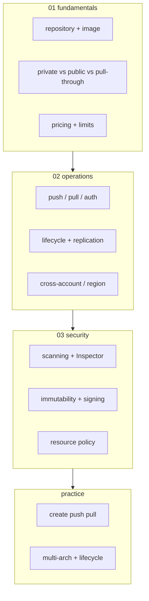
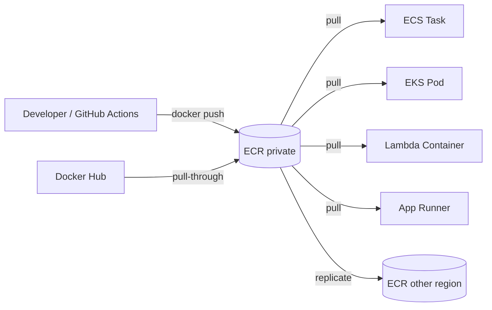

# AWS ECR — Elastic Container Registry

> **Container Image Registry** — Docker Hub 대안 + AWS native. ECS / EKS / Lambda Container 모두 ECR 기본.

**[[../compute|↑ Compute]]** · **[[../../cloud-aws|↑↑ AWS]]**

---

## 1. 한 줄

```
Docker Image / OCI Artifact 저장소
  + Scan (Basic / Enhanced Inspector)
  + Lifecycle Policy (오래된 image 자동 삭제)
  + Cross-Region Replication
  + Cross-Account Sharing
  + Pull-Through Cache (Docker Hub / GHCR mirror)
```

## 2. 학습 roadmap



## 3. Sub-directory index

### [[01-fundamentals/01-repository-and-image]] — Repository / Image / Manifest
ECR repository, image, manifest, layer, tag.

### [[01-fundamentals/02-private-vs-public-vs-pull-through]] — Private / Public / Pull-through Cache
private (default) vs public (gallery.ecr.aws) vs Pull-through (Docker Hub / GHCR mirror).

### [[01-fundamentals/03-pricing-and-limits]] — Storage / Transfer / Scan 비용
$0.10/GB·월 storage / DT 일반 / scan 비용.

### [[02-operations/01-push-pull-auth]] — Authentication / docker login / IAM
short-lived token (12h) + Docker / buildx / Helm.

### [[02-operations/02-lifecycle-and-replication]] — Lifecycle / Cross-region 자동
오래된 image 자동 expire + multi-region 복제.

### [[02-operations/03-cross-account-and-region]] — Repository Policy / Account sharing
Account A → Account B 의 image pull.

### [[03-security/01-scanning-and-inspector]] — Basic (Clair) / Enhanced (Inspector v2)
push scan + 지속 모니터 + EventBridge.

### [[03-security/02-immutability-and-signing]] — IMMUTABLE + Cosign + KMS
tag immutable + Sigstore Cosign + SLSA provenance.

### [[03-security/03-resource-policy]] — IAM + Repository Policy
pull / push 권한 + cross-account.

### [[practice/01-create-push-pull]] — ECR repo + buildx push (15분)

### [[practice/02-multi-arch-and-lifecycle]] — arm64+amd64 + lifecycle + scan (30분)

## 4. 핵심 개념

| 개념 | 의미 |
| --- | --- |
| Registry | Account-level ECR endpoint |
| Repository | image 묶음 (`bkurs-be`) — 여러 tag/version |
| Image | tagged manifest (`bkurs-be:v1`) |
| Manifest | layer / config / annotation 의 JSON spec |
| Layer | image 의 component (`COPY` / `RUN` 결과) |
| Digest | sha256 hash (`@sha256:abc...`) — immutable |
| Tag | human alias (`latest`, `v1`) — mutable (또는 IMMUTABLE) |
| Pull-through cache | upstream (Docker Hub / GHCR) 자동 mirror |

## 5. ECR endpoint URL

```
private: <account>.dkr.ecr.<region>.amazonaws.com/<repo>:<tag>
         123456789012.dkr.ecr.ap-northeast-2.amazonaws.com/bkurs-be:v1

public:  public.ecr.aws/<alias>/<repo>:<tag>
         public.ecr.aws/lambda/python:3.12
```

## 6. ECR 의 위치



## 7. ECR vs alternatives

| | ECR Private | Docker Hub | GHCR | GCR / Artifact Registry |
| --- | --- | --- | --- | --- |
| 위치 | AWS region | global | global | GCP region |
| AWS 통합 | ★★★ | ✗ | ✗ | ✗ |
| Rate limit | per IAM | rate-limited (free 100 pull/6h) | free 제한 | rate |
| 비용 | $0.10/GB·월 + DT | free or paid | free | free or paid |
| Scan | Basic + Enhanced | paid | dependabot | container analysis |
| 권장 | AWS 환경 | OSS / 공개 | GitHub 통합 | GCP 환경 |

## 8. bkurs-be 활용

```
bkurs-be image:
  - 123.dkr.ecr.ap-northeast-2.amazonaws.com/bkurs-be:v1.0.0
  - Build: GitHub Actions → buildx → ECR push
  - Run:   ECS Fargate (또는 Lambda Container)
  - Scan:  Enhanced (Inspector v2) + EventBridge → Discord
  - Sign:  Cosign (KMS key)
  - Tag:   IMMUTABLE (latest 사용 금지)
  - Lifecycle: 30 production / 7d untagged 보존
  - Replication: ap-northeast-2 → ap-northeast-1 (DR)
```

## 9. 비용 예 (bkurs-be)

| | |
| --- | --- |
| Storage 5 GB × 30 image | $1.50/월 |
| Push (free) | $0 |
| Pull 같은 region | $0 |
| Cross-region DT | $0.09/GB |
| Enhanced scan | $0.09/scan |
| Lifecycle clean | 무료 |
| Replication storage | $0.10/GB·월 (dest) |

월 추정: ~**$3-5/월** (소규모).

## 10. 영상 / 자료

| 자료 |
| --- |
| [ECR 공식](https://docs.aws.amazon.com/AmazonECR/latest/userguide/) |
| [Pull-through Cache](https://docs.aws.amazon.com/AmazonECR/latest/userguide/pull-through-cache.html) |
| [Cosign with ECR](https://docs.sigstore.dev/cosign/overview/) |
| [SLSA framework](https://slsa.dev) |

## 11. 관련 hub

- [[../compute]]
- [[../ecs/ecs]] — image consumer
- [[../eks/eks]]
- [[../lambda/lambda]]
- [[../../../docker/docker]]
- [[../../iam/iam]]
