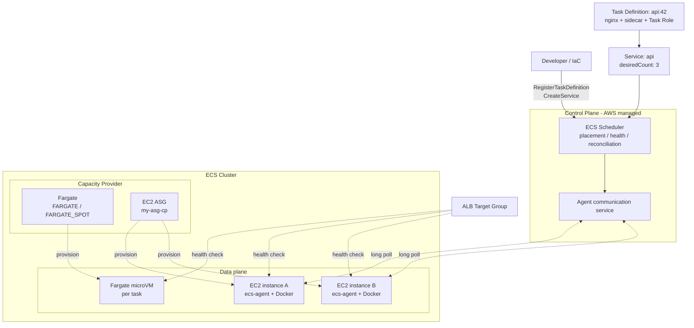
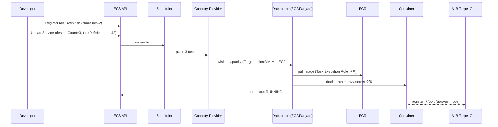

# ECS 아키텍처 — 6 핵심 개념의 관계

> ECS 의 control plane / data plane / 6 핵심 개념 (cluster / task definition / task / service /
> capacity provider / launch type) 을 한 번에 이해. 다른 모든 영역은 본 doc 위에 쌓임.

## 1. 한 장 아키텍처



## 2. Control plane vs Data plane

| Plane | 책임 | 누가 |
| --- | --- | --- |
| **Control plane** | scheduler / reconciliation / API / service state | AWS managed (요금 무료) |
| **Data plane** | container 실제 실행 | Fargate microVM / EC2 (사용자 책임) |

> Control plane 은 무료 — task / Fargate / EC2 사용분만 과금. K8s 의 EKS 와 다른 점 (EKS 는 control plane $0.10/h).

## 3. 6 핵심 개념 상세

### 3.1 Cluster — 논리 그룹

```bash
aws ecs create-cluster --cluster-name bkurs-prod
```

- 논리 단위 — 같은 cluster 안 task / service 가 동일 capacity provider 풀 사용
- VPC 와 1:N (한 cluster 가 여러 VPC 의 subnet 사용 가능)
- 단순 namespace — 자원 격리는 없음 (IAM 으로 격리)

### 3.2 Task Definition — container spec (불변 immutable)

```json
{
  "family": "bkurs-be",
  "containerDefinitions": [{
    "name": "api",
    "image": "ghcr.io/seum-running/bkurs-be:v1.2.3",
    "essential": true,
    "portMappings": [{ "containerPort": 8080 }],
    "memory": 1024,
    "cpu": 512,
    "environment": [...],
    "secrets": [...],
    "logConfiguration": {...},
    "healthCheck": {...}
  }],
  "requiresCompatibilities": ["FARGATE"],
  "networkMode": "awsvpc",
  "cpu": "512",
  "memory": "1024",
  "executionRoleArn": "...",
  "taskRoleArn": "..."
}
```

- **family + revision** — `bkurs-be:42` 는 family `bkurs-be` 의 42 번째 revision
- 한 task definition = 1+ container (sidecar 포함)
- 불변 — 새 revision 만 가능

자세히 → [[../02-task-definition/01-overview]]

### 3.3 Task — 실행 인스턴스

```
Task = 1 task definition revision 의 running 인스턴스
     = 1 Fargate microVM (Fargate)
     또는 1 EC2 host 위 N container (EC2 launch)
```

수명:
- `RunTask` — 일회성 (cron / 마이그레이션)
- Service 의 자동 spawn — desiredCount 유지

### 3.4 Service — desired state 유지

```bash
aws ecs create-service \
  --cluster bkurs-prod \
  --service-name api \
  --task-definition bkurs-be:42 \
  --desired-count 3 \
  --launch-type FARGATE \
  --network-configuration "awsvpcConfiguration={subnets=[subnet-xx,subnet-yy],securityGroups=[sg-zz]}" \
  --load-balancers "targetGroupArn=arn:...,containerName=api,containerPort=8080"
```

- **desiredCount** 가 핵심 — task 가 죽으면 자동 재시작
- LB / scaling / deployment 자동
- 자세히 → [[../03-service/01-service-overview]]

### 3.5 Capacity Provider — 어디서 실행할까

| Capacity Provider | 의미 |
| --- | --- |
| **FARGATE** | AWS managed microVM. 비싸지만 운영 0 |
| **FARGATE_SPOT** | Fargate 의 spot — 70% 할인, interruption 가능 |
| **사용자 정의 EC2 ASG** | 본인 EC2 (Auto Scaling Group) — 가장 cheap |
| **EXTERNAL** | on-prem / 다른 cloud (ECS Anywhere) |

Capacity Provider Strategy:
```json
[
  { "capacityProvider": "FARGATE",      "weight": 1, "base": 3 },
  { "capacityProvider": "FARGATE_SPOT", "weight": 4 }
]
```
→ 기본 3 task 는 FARGATE, 나머지는 1:4 ratio 로 Spot.

자세히 → [[02-launch-type-and-capacity-provider]]

### 3.6 Launch Type vs Capacity Provider — 차이

| Launch Type | Capacity Provider Strategy |
| --- | --- |
| 단순 — task 하나에 1 launch type | mixed — FARGATE + SPOT 비율 |
| `--launch-type FARGATE` | `--capacity-provider-strategy ...` |
| 권장: simple workload | 권장: 비용 최적화 |

> 현재 신규 service 는 **Capacity Provider Strategy** 권장.

## 4. 흐름 — task 가 시작되기까지



## 5. ECS vs Kubernetes 어휘 매핑

| ECS | Kubernetes |
| --- | --- |
| Cluster | Cluster |
| Task Definition | Pod template (Deployment 안) |
| Task | Pod |
| Service | Deployment + Service |
| Capacity Provider | Node group / cluster-autoscaler |
| Container Insights | metric-server + Prometheus |
| ECS Exec | `kubectl exec` |
| Task Role | IRSA (IAM Role for Service Account) |
| ECS Service Connect | Istio / Linkerd (lite) |

→ K8s 경험자도 자연스럽게 전환 가능.

## 6. 자주 묻는 함정

| 함정 | 회피 |
| --- | --- |
| `Service` 가 `Task Definition` 의 latest revision 안 따라감 | `UpdateService --force-new-deployment` 또는 명시적 revision update |
| Fargate task 가 시작 안 됨 (ENI 부족) | VPC 의 subnet IP 한도 / awsvpc ENI 한도 확인 |
| Capacity Provider 가 EC2 인데 instance 없음 | ASG 의 desired/min 확인. Managed Scaling 활성 |
| `Launch Type` 과 `Capacity Provider Strategy` 동시 지정 | 둘 중 하나 (CP strategy 권장) |
| 같은 cluster 의 task 끼리 통신 의도와 다름 | awsvpc 모드 + SG 확인. Service Connect 검토 |

## 7. 다음

- ▶ [[02-launch-type-and-capacity-provider]] — Fargate / EC2 / Capacity Provider 깊이
- ▶ [[03-fargate-deep]] — Fargate 내부 (Firecracker / Graviton)
- ▶ [[04-ecs-vs-eks-vs-lambda]] — 선택 기준
- ▶ [[../02-task-definition/01-overview]] — Task Definition 시작

## 8. 영상 / 자료

| 자료 |
| --- |
| [AWS ECS Tutorial — TechWorld with Nana](https://www.youtube.com/watch?v=esISkPlnxL0) |
| [ECS Deep Dive — re:Invent](https://www.youtube.com/watch?v=NEFazIw_5g8) |
| [공식 ECS Concepts](https://docs.aws.amazon.com/AmazonECS/latest/developerguide/Welcome.html) |

## 9. 참고

- [[../ecs]] — root hub
- [[../../../docker/fundamentals/concepts]] — Docker 측 개념
- [[../../iam/iam]] — IAM Role 의 의미
