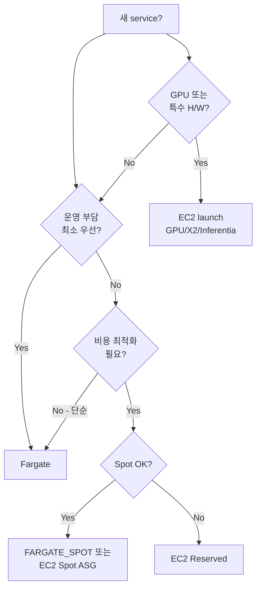

# ECS Launch Type / Capacity Provider

> "task 를 어디서 실행할까" — Fargate vs EC2 vs EXTERNAL. **Capacity Provider Strategy** 가 신규
> 권장 — Launch Type 보다 유연 + 비용 최적화. Spot mix 가능.

## 1. 3 가지 launch type

| Launch Type | 책임 / 의미 |
| --- | --- |
| **FARGATE** | AWS managed — task 마다 microVM. 운영 0. 비싸지만 단순 |
| **EC2** | 본인 EC2 ASG. ecs-agent 가 task 받음. 가장 cheap |
| **EXTERNAL** | ECS Anywhere — on-prem / 다른 cloud 의 머신 등록 |

## 2. Fargate vs EC2 — 결정 트리



## 3. Fargate vs EC2 비교 표

| 항목 | Fargate | EC2 launch |
| --- | --- | --- |
| **OS 패치** | AWS | 사용자 (AMI 갱신) |
| **ASG / cluster autoscaler** | 불필요 | 필요 (Capacity Provider Managed Scaling) |
| **bin-packing** | task 마다 microVM (낭비) | 여러 task 한 EC2 (효율) |
| **시작 시간** | 30-60s | 빠름 (instance 이미 hot) |
| **가격** | vCPU/RAM × 초 | EC2 시간 + container 무료 |
| **Spot** | FARGATE_SPOT (~70% 할인) | EC2 Spot (~90% 할인) |
| **GPU** | ✗ (2025 까지) | ✓ |
| **ENI** | task 마다 1개 (awsvpc) | 공유 가능 (awsvpc trunking) |
| **SSH** | ✗ — `ecs exec` 만 | ✓ + `ecs exec` |
| **Daemon process** | ✗ (sidecar 만) | ✓ |
| **Custom Docker daemon config** | ✗ | ✓ |

> **간단한 결정**: 새 service 는 **Fargate**. bin-packing / GPU / 비용 critical → EC2.

## 4. Fargate 가격 모델 (2026, ap-northeast-2)

| vCPU | RAM (GB) | $/h (Linux/x86) | $/h (Linux/Graviton2) |
| --- | --- | --- | --- |
| 0.25 | 0.5 | $0.013 | $0.010 |
| 0.5 | 1 | $0.025 | $0.020 |
| 1 | 2 | $0.05 | $0.04 |
| 2 | 4 | $0.10 | $0.08 |
| 4 | 8 | $0.20 | $0.16 |

> Graviton2 (`runtimePlatform.cpuArchitecture: ARM64`) → 20% 할인 + 성능 ↑. ARM64 image 빌드 필요
> ([[../../../../docker/practice/06-multi-platform-build]]).

## 5. Capacity Provider — 4 타입

```bash
# 1. FARGATE (built-in)
aws ecs create-cluster --cluster-name c1 \
  --capacity-providers FARGATE FARGATE_SPOT

# 2. EC2 ASG (사용자 정의)
aws ecs create-capacity-provider \
  --name my-ec2-cp \
  --auto-scaling-group-provider \
  "autoScalingGroupArn=arn:aws:autoscaling:...,managedScaling={status=ENABLED,targetCapacity=100,minimumScalingStepSize=1,maximumScalingStepSize=10},managedTerminationProtection=ENABLED"

aws ecs put-cluster-capacity-providers \
  --cluster c1 \
  --capacity-providers FARGATE FARGATE_SPOT my-ec2-cp \
  --default-capacity-provider-strategy capacityProvider=FARGATE,weight=1
```

| 타입 | 사용 |
| --- | --- |
| FARGATE | 일반 |
| FARGATE_SPOT | dev / fault-tolerant 워크로드 |
| EC2 ASG | 비용 최적화 / bin-packing |
| EXTERNAL | ECS Anywhere (on-prem) |

## 6. Capacity Provider Strategy — 혼합 사용

```json
[
  { "capacityProvider": "FARGATE",      "weight": 1, "base": 3 },
  { "capacityProvider": "FARGATE_SPOT", "weight": 4 }
]
```

해석:
- 첫 3 task 는 FARGATE (base — 보장)
- 그 이후 task 는 1:4 ratio (FARGATE 1, SPOT 4)

→ 20% 안정 + 80% 비용 절감.

### service 에 적용

```bash
aws ecs update-service --cluster c1 --service api \
  --capacity-provider-strategy \
    capacityProvider=FARGATE,base=3,weight=1 \
    capacityProvider=FARGATE_SPOT,weight=4 \
  --force-new-deployment
```

## 7. FARGATE_SPOT — Spot interruption

- 2분 grace warning (SIGTERM)
- 사용자 task 가 `--stop-timeout` + graceful shutdown 처리
- 권장: stateless / horizontally scaled service

`task definition`:
```json
{
  "stopTimeout": 120        // SIGTERM 후 graceful 시간 (max 120s)
}
```

→ 진행 중 요청 처리 후 종료. 자세히 → [[../../../docker/practice/15-healthcheck-restart-resources]]

## 8. EC2 launch + Managed Scaling

ECS Capacity Provider 가 ASG 의 desired count 자동 조정:

1. task 가 대기 (`PROVISIONING`) → ASG scale-out
2. ASG 가 새 EC2 띄움 → ecs-agent 가 register
3. task placement → 시작
4. task 모두 종료 → ASG scale-in (managed termination protection)

`Managed Scaling` 켜기:
```bash
aws ecs create-capacity-provider \
  --auto-scaling-group-provider \
  "managedScaling={status=ENABLED,targetCapacity=100}"
```

`targetCapacity=100` — instance 의 100% 활용 (낭비 0). 80~90% 권장 (헤드룸).

## 9. ECS Anywhere (EXTERNAL)

```bash
# on-prem 머신 (Ubuntu / RHEL) 에서
curl -o ecs-anywhere-install.sh \
  https://amazon-ecs-agent.s3.amazonaws.com/ecs-anywhere-install-latest.sh
sudo bash ecs-anywhere-install.sh \
  --region ap-northeast-2 \
  --cluster c1 \
  --activation-id $ACTIVATION_ID \
  --activation-code $ACTIVATION_CODE
```

→ 그 머신이 ECS cluster 의 EXTERNAL launch type instance.

활용:
- on-prem 서버 cloud-managed
- edge 컴퓨팅
- hybrid cloud

> SSM Agent 가 control plane 통신 — 인터넷 outbound 필요.

## 10. Architecture 선택 시나리오

| 상황 | 권장 |
| --- | --- |
| 신규 dev / staging | FARGATE only |
| 신규 prod (단순) | FARGATE only |
| 신규 prod (비용 최적화) | FARGATE base + FARGATE_SPOT |
| 기존 EC2 → 점진 마이그 | Mixed Capacity Provider (EC2 + Fargate) |
| 대규모 / bin-packing | EC2 ASG (Managed Scaling) |
| 글로벌 한 cluster | FARGATE (단순) |
| GPU / ML | EC2 (p3 / p4 instance) |
| on-prem 통합 | EXTERNAL (ECS Anywhere) |

## 11. 흔한 함정

| 함정 | 회피 |
| --- | --- |
| `--launch-type` 과 `--capacity-provider-strategy` 동시 | 둘 중 하나 (CP strategy 권장) |
| EC2 capacity provider — task 가 PROVISIONING 에 멈춤 | ASG min/desired 확인 + Managed Scaling 활성 |
| Fargate 가 너무 비쌈 | Capacity Provider Strategy 로 Spot mix |
| Graviton2 image 가 amd64 만 | multi-arch build ([[../../../../docker/practice/06-multi-platform-build]]) |
| ENI 부족 — Fargate 대량 launch fail | subnet 의 IP 확장 또는 awsvpc trunking (EC2 launch) |
| SPOT interruption 으로 task drop | base+weight 로 일부 FARGATE 보장 + graceful shutdown |

## 12. 다음

- ▶ [[03-fargate-deep]] — Fargate 내부 (Firecracker / microVM)
- ▶ [[04-ecs-vs-eks-vs-lambda]]
- ▶ [[../04-operations/04-cost-optimization]] — Fargate Spot / Compute Savings Plan / Reserved

## 13. 영상 / 자료

| 자료 |
| --- |
| [Fargate Best Practices — re:Invent](https://www.youtube.com/watch?v=YJjA5KIu4FA) |
| [ECS Capacity Providers Deep Dive](https://www.youtube.com/watch?v=Bz5ZWWiQUKw) |
| [공식 Capacity Providers docs](https://docs.aws.amazon.com/AmazonECS/latest/developerguide/cluster-capacity-providers.html) |

## 14. 참고

- [[../ecs]] — hub
- [[../../ec2/ec2]] — EC2 일반
- [[../../auto-scaling/auto-scaling]] — ASG 일반
- [[01-architecture]] — 6 핵심 개념
