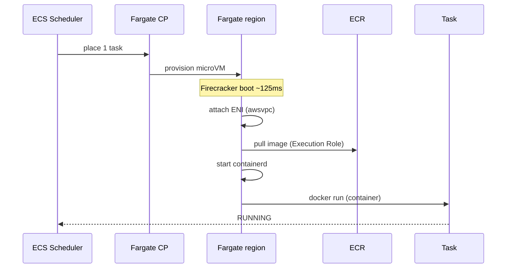

# ECS Fargate Deep

> Fargate 가 어떻게 동작하는가 — Firecracker microVM + Linux kernel + container runtime. Graviton
> ARM64 / Rosetta 활용 + 가격 모델 / 한도.

## 1. Fargate 의 정체

Fargate 는 **task 마다 별도 microVM** 띄움. 다른 task 와 kernel 공유 X — VM 격리.

```
┌─────────────────────────────────────────────────────────────┐
│  Fargate "host" (AWS Nitro / EC2 underlying)                │
│  ┌──────────────────────┐  ┌──────────────────────┐         │
│  │ microVM (task 1)     │  │ microVM (task 2)     │         │
│  │ ┌──────────────────┐ │  │ ┌──────────────────┐ │         │
│  │ │ Linux kernel     │ │  │ │ Linux kernel     │ │         │
│  │ │ containerd       │ │  │ │ containerd       │ │         │
│  │ │ container A      │ │  │ │ container B      │ │         │
│  │ │ + sidecar        │ │  │ │                  │ │         │
│  │ └──────────────────┘ │  │ └──────────────────┘ │         │
│  └──────────────────────┘  └──────────────────────┘         │
│       Firecracker (KVM)        Firecracker (KVM)            │
└─────────────────────────────────────────────────────────────┘
```

| 특징 | 의미 |
| --- | --- |
| **Firecracker** | AWS 의 microVM runtime. 부팅 ~125ms. 메모리 footprint 5MB |
| **VM 격리** | task 간 kernel exploit 불가 (K8s/Docker 의 namespace 격리보다 강력) |
| **Container runtime** | containerd (이전 Docker) |
| **OS** | Amazon Linux 2 또는 2023 (Fargate platform version 으로 결정) |

영상: [Firecracker — Containerd Summit](https://www.youtube.com/watch?v=BeppPXEcKZc)

## 2. Fargate platform version

```json
"platformVersion": "1.4.0"     // 또는 "LATEST"
```

| Version | 의미 |
| --- | --- |
| 1.0.0 | EOL |
| 1.3.0 | EOL |
| **1.4.0** | 현재 stable (default). EFS / ephemeral storage 20GB / awslogs 등 |
| LATEST | 자동 최신 (1.4.0 alias) |

업데이트:
- Service 의 platformVersion 변경 + `--force-new-deployment`

## 3. Fargate 한도

| 항목 | 한도 |
| --- | --- |
| vCPU | 0.25 / 0.5 / 1 / 2 / 4 / 8 / 16 |
| Memory | vCPU 따라 — 예: 1 vCPU → 2~8GB |
| Ephemeral storage | 20GB (default) — task definition 으로 200GB 까지 확장 |
| Network interface (ENI) | task 당 1 |
| Public IP | assignPublicIp option |
| GPU | ✗ (2026 까지 미지원) |
| Daemon-style task | ✗ (service `replica` only) |
| Windows containers | ✓ (Linux 와 별도 platform) |

자세히: https://docs.aws.amazon.com/AmazonECS/latest/developerguide/AWS_Fargate.html

## 4. Graviton (ARM64) — 가격/성능

```json
{
  "runtimePlatform": {
    "cpuArchitecture": "ARM64",          // 또는 X86_64
    "operatingSystemFamily": "LINUX"
  }
}
```

| Architecture | $/h (1vCPU, 2GB) | 성능 (대비) |
| --- | --- | --- |
| X86_64 | $0.05 | 1.0x |
| ARM64 (Graviton2) | $0.04 (-20%) | 0.9~1.2x |

> 권장: 신규 service 는 ARM64 우선 검토 — multi-arch image 빌드 시.

multi-arch build 가이드 → [[../../../../docker/practice/06-multi-platform-build]]

### Rosetta 2 on Fargate (미지원)

Fargate 는 macOS 의 Rosetta 같은 x86 emulation 안 제공 — image 자체가 ARM64 여야 함.

## 5. Fargate ephemeral storage

기본 20GB — `/`, `/tmp` 등 task 안 모든 file system.

확장:
```json
{
  "ephemeralStorage": {
    "sizeInGiB": 100        // 21~200
  }
}
```

> 21+ 만 명시 — 추가 GB 마다 추가 비용 ($0.000111/GB/h). 200GB ≈ $16/월.

영구 storage 는 EFS — [[../02-task-definition/04-volumes-and-efs]]

## 6. Fargate 부팅 흐름



총 시간: image size + ENI attach + boot — **일반적 30~60초**. 작은 image (alpine 50MB) → 20초.

## 7. Network — awsvpc mode 만

Fargate 는 **awsvpc** mode 강제 — task 마다 자체 ENI + IP.

```json
{
  "networkMode": "awsvpc",
  "containerDefinitions": [{
    "portMappings": [{ "containerPort": 8080 }]
  }]
}
```

| Mode | Fargate | EC2 |
| --- | --- | --- |
| awsvpc | ✓ (강제) | ✓ |
| bridge | ✗ | ✓ |
| host | ✗ | ✓ |
| none | ✗ | ✓ |

자세히 → [[../02-task-definition/03-network-mode]]

## 8. SSH / 디버깅 — ECS Exec

Fargate 에는 SSH 안 됨. 대신 **ECS Exec** (SSM agent 내장):

```bash
aws ecs execute-command \
  --cluster bkurs-prod \
  --task abc123... \
  --container api \
  --command "/bin/bash" \
  --interactive
```

요구사항:
- Task Role 에 `ssmmessages:*` 권한
- Task Definition 의 `enableExecuteCommand: true`

자세히 → [[../04-operations/01-ecs-exec]]

## 9. 가격 최적화

| 전략 | 효과 |
| --- | --- |
| **right-sizing** (CPU/Memory) | 과대 할당 회피 — Container Insights 로 실측 |
| **ARM64 / Graviton** | 20% 할인 |
| **Spot (FARGATE_SPOT)** | 70% 할인 (interruption OK 워크로드) |
| **Compute Savings Plan** | 1 년 commit → 17%, 3 년 → 27% 할인 |
| **right-sizing + Auto Scaling** | desired count 동적 |
| **ECR pull cache** | image pull 시간 / 비용 ↓ |
| **awslogs cost** | log level 조정, retention 단축 |

자세히 → [[../04-operations/04-cost-optimization]]

## 10. Fargate vs Lambda vs App Runner

| 항목 | Fargate | Lambda | App Runner |
| --- | --- | --- | --- |
| **모델** | 영구 실행 | event-driven | 영구 (HTTP) |
| **시작 시간** | 30~60s | 100ms~ (warm 0ms) | ~60s |
| **최대 실행 시간** | 무제한 | 15분 | 무제한 |
| **container image** | ✓ | ✓ (10GB까지) | ✓ |
| **가격** | vCPU/RAM 시간 | 요청 + duration | request 시간 |
| **HTTPS LB** | 별도 ALB | API Gateway | 내장 |
| **DB connection pool** | ✓ | ⚠ (cold start 문제) | ✓ |
| **권장** | API 서비스 | event / cron / short | git push 만 (가장 단순) |

## 11. 흔한 함정

| 함정 | 회피 |
| --- | --- |
| Fargate 시작이 매번 60s+ | 작은 image / multi-stage / ECR pull through cache |
| 비용 폭주 | Container Insights + Cost Explorer + right-sizing |
| ARM image 호환 안 됨 | multi-arch build (Docker buildx) |
| ENI 부족 | subnet IP / region 한도 |
| Spot interruption 으로 service 불안정 | base 일부 FARGATE 보장 + graceful shutdown |

## 12. 영상 / 자료

| 자료 |
| --- |
| [Firecracker microVM — re:Invent](https://www.youtube.com/watch?v=BeppPXEcKZc) |
| [Fargate Internals — re:Invent 2023](https://www.youtube.com/watch?v=8q5QcWmHnoo) |
| [Graviton 활용 — AWS](https://www.youtube.com/watch?v=mZ-ZGyqLMzg) |
| [공식 Fargate docs](https://docs.aws.amazon.com/AmazonECS/latest/developerguide/AWS_Fargate.html) |

## 13. 다음

- ▶ [[04-ecs-vs-eks-vs-lambda]] — 선택 기준
- ▶ [[../02-task-definition/01-overview]] — Task Definition 시작
- ▶ [[../04-operations/04-cost-optimization]] — 비용

## 14. 참고

- [[../ecs]]
- [[02-launch-type-and-capacity-provider]]
- [[../../../../docker/fundamentals/runtime-comparison]] — runtime 비교
