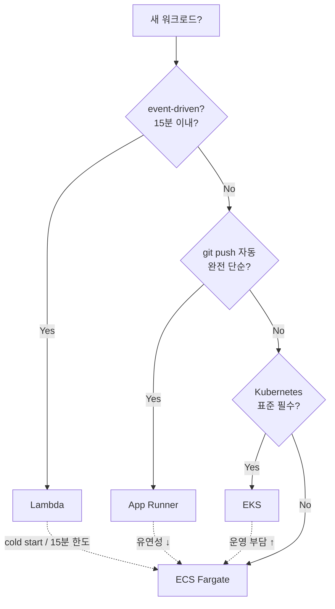

# ECS vs EKS vs Lambda vs App Runner

> AWS 의 4 container/serverless compute 옵션 비교. 신규 서비스 시작 시 결정 트리 + 마이그레이션
> 시나리오.

## 1. 한 장 결정 트리



## 2. 비교 표

| 항목 | **ECS** | **EKS** | **Lambda** | **App Runner** |
| --- | --- | --- | --- | --- |
| **모델** | container orchestrator | Kubernetes | event-driven function | managed HTTP container |
| **표준** | AWS proprietary | K8s (CNCF) | AWS proprietary | AWS proprietary |
| **시작 시간** | 30-60s | 30-60s | 100ms~ (warm 0) | ~60s |
| **최대 실행** | 무제한 | 무제한 | 15분 | 무제한 |
| **Control plane 비용** | 무료 | $0.10/h ($73/월) | 무료 | 무료 |
| **요청 비용** | vCPU/RAM 시간 | vCPU/RAM 시간 + EKS | 요청 + duration | request + duration |
| **운영 부담** | ★★ | ★★★★ | ★ | ★ |
| **이식성** | AWS only | 모든 cloud | AWS only | AWS only |
| **GPU** | EC2 launch only | ✓ | ✗ | ✗ |
| **WebSocket** | ALB | ALB + NLB | API Gateway WS | ✓ |
| **HTTPS LB 내장** | 별도 ALB | 별도 ALB | 별도 API GW | ✓ |
| **dev 친화** | ★★ | ★★★ | ★ | ★★★ |
| **scaling** | Auto Scaling | HPA / cluster-autoscaler | 자동 | 자동 |
| **상태 (Persistent)** | EFS / FSx mount | PVC | ✗ (외부 store) | ✗ |
| **권장 사례** | REST API / worker | multi-cloud / 복잡 | event / cron / short HTTP | git push 만 |

## 3. 시나리오별 권장

### Bkurs-be 같은 Spring Boot REST API
**ECS Fargate** — task 정의 단순 + ALB + Container Insights + Capacity Provider Spot mix.

대안:
- EKS — 회사가 multi-cloud / 이미 K8s 운영 시
- App Runner — git push 만 원하면

### 짧은 event-driven (S3 trigger / SQS consumer)
**Lambda** — cold start 받아들이는 경우.

대안:
- ECS task (RunTask) + EventBridge — 15분 넘는 작업
- ECS Service + SQS — long-running consumer

### Kubernetes 표준이 회사 정책
**EKS** — pod / Helm / kubectl. 운영 부담 + control plane 비용 감수.

### 가장 단순한 시작 (학습 / 프로토타입)
**App Runner** — git repo URL → 자동 빌드 / HTTPS / 자동 scaling.

## 4. EKS 와 비교 — 깊이

| 항목 | ECS | EKS |
| --- | --- | --- |
| **YAML** | task definition (JSON) | K8s manifest (deployment / service / ingress) |
| **CLI** | aws ecs ... | kubectl |
| **IaC** | Terraform / CDK / CloudFormation | Terraform / CDK / Helm |
| **Service Mesh** | Service Connect (lite) | Istio / Linkerd / Cilium |
| **Multi-cluster** | 가능하지만 어려움 | 표준 (federation) |
| **CD tool** | CodeDeploy / GitHub Actions | ArgoCD / Flux |
| **이식성** | AWS only | 모든 cloud / on-prem |
| **운영자 학습** | 1-2 주 | 1-2 개월 |

> ECS = "AWS 한 곳에서 깊이 통합 단순"
> EKS = "표준 K8s + 어디서나 / 다른 cloud / 운영 부담"

## 5. Lambda 와 비교 — 깊이

| 항목 | ECS Fargate | Lambda |
| --- | --- | --- |
| **cold start** | 매번 (30-60s) | 100ms~ (warm 0ms) |
| **최대 실행 시간** | 무제한 | 15분 |
| **메모리** | 0.5~32GB | 128MB~10GB |
| **container image** | 표준 OCI | OCI 가능 (10GB까지) |
| **DB connection** | pool 영구 | request 마다 new (또는 RDS Proxy) |
| **VPC integration** | native | ENI attach (cold start ↑) |
| **요청 모델** | 영구 listen | event 단위 |
| **가격 (idle)** | 시간 비용 발생 | 0 (요청 없음) |
| **가격 (peak)** | vCPU/RAM 시간 | 요청수 × duration |

> 트래픽 spiky / 0→peak: Lambda 우세.
> 안정 트래픽 (예: 100 RPS 24시간): ECS Fargate 가 cheap.

손익분기점 (대략):
- Lambda 가 더 cheap: < 500 만 요청/월
- ECS 가 더 cheap: > 500 만 요청/월 (지속 트래픽)

## 6. App Runner 와 비교

| 항목 | ECS | App Runner |
| --- | --- | --- |
| 설정 | task def + service + LB + SG + IAM | git URL 하나 |
| 빌드 | CI 별도 | 내장 (Buildpacks 또는 Dockerfile) |
| HTTPS | 별도 ACM + ALB | 자동 |
| auto-scaling | manual rule | 자동 (1-25 인스턴스) |
| 가격 | vCPU 시간 | request 시간 + GB-month |
| 유연성 | ★★★ | ★ |
| 권장 | API / worker | landing page / 마이크로서비스 한 종류 |

## 7. 마이그레이션 시나리오

### EC2 직접 → ECS Fargate
1. Dockerfile 작성 (EC2 의 user-data 흐름 → image build)
2. ECR push
3. Task Definition (env / secret SSM 매핑)
4. ALB Target Group (IP target — awsvpc)
5. Service 생성 + Capacity Provider FARGATE
6. DNS 갈아끼움

영향:
- EC2 의 ssh 사라짐 → `ecs exec`
- EBS 영구 → EFS (또는 RDS 분리)
- user-data 의 cron → EventBridge + RunTask

### Docker Compose → ECS
- `docker compose convert` (외부 도구) 또는 수동
- 또는 Docker Desktop > Compose Bridge → K8s 변환 후 → EKS

### Lambda → ECS (15분 초과 작업)
- Lambda 의 handler → main() 으로 변경
- container image 같은 entrypoint
- EventBridge → ECS RunTask (event-driven 유지)

### EKS → ECS
- Helm chart → Task Definition + Service
- Ingress → ALB Target Group
- 운영 부담 ↓ + 비용 ↓ (control plane $73/월 절감)
- 잃는 것: K8s 이식성

### ECS → EKS
- Task Definition → Pod template
- Service → Deployment + Service
- multi-cloud 가능 / K8s 표준
- 운영 부담 ↑

## 8. 비용 예시 (1 vCPU / 2GB / 24h, ap-northeast-2)

| 옵션 | 월 비용 (대략) |
| --- | --- |
| ECS Fargate (1 task) | $36 |
| ECS Fargate (Graviton) | $29 |
| ECS Fargate (Spot) | $11 |
| ECS EC2 (t3.small) | $15 (instance) + 무료 (container) = $15 |
| EKS (1 pod) | $36 + $73 (control plane) = $109 |
| Lambda (10M 요청, 500ms 평균) | $20 |
| App Runner (1 instance idle) | $25 |

> 단순 비교 — 실제는 LB / data transfer / log / scan 등 추가.

## 9. 결정 체크리스트

```
1. 워크로드 type?
   - HTTP API → ECS / EKS / App Runner / Lambda
   - event/cron → Lambda / ECS RunTask
   - background worker → ECS / EKS

2. 이식성 필요?
   - Yes → EKS
   - No → ECS

3. 운영 부담 감수?
   - Min → Lambda / App Runner / ECS Fargate
   - Mid → ECS Fargate
   - Max OK → EKS / ECS EC2

4. 비용 critical?
   - Yes → ECS Fargate Spot + Graviton, 또는 EC2 reserved
   - No → ECS Fargate

5. 팀 expertise?
   - K8s 경험 → EKS
   - AWS 처음 → App Runner → ECS
```

## 10. 영상 / 자료

| 자료 |
| --- |
| [ECS vs EKS vs Fargate — A Cloud Guru](https://www.youtube.com/watch?v=q-bvFKgjnY8) |
| [Container 선택 — re:Invent](https://www.youtube.com/watch?v=8s3uYM45Igk) |
| [Lambda vs Fargate — AWS docs](https://aws.amazon.com/blogs/containers/lambda-vs-fargate/) |
| [App Runner Tutorial — AWS](https://www.youtube.com/watch?v=zoRy0fyTu9c) |

## 11. 다음

- ▶ [[../02-task-definition/01-overview]] — Task Definition 본격
- ▶ [[../03-service/01-service-overview]] — Service 운영
- ▶ [[../eks/eks]] — EKS deep
- ▶ [[../lambda/lambda]] — Lambda deep
- ▶ [[../../../../10-projects/bkurs-be/handover/operations/env-deployment]] — bkurs-be 의 ECS 결정

## 12. 참고

- [[../ecs]]
- [[01-architecture]] — ECS 핵심 개념
- [[02-launch-type-and-capacity-provider]]
- [[03-fargate-deep]]
