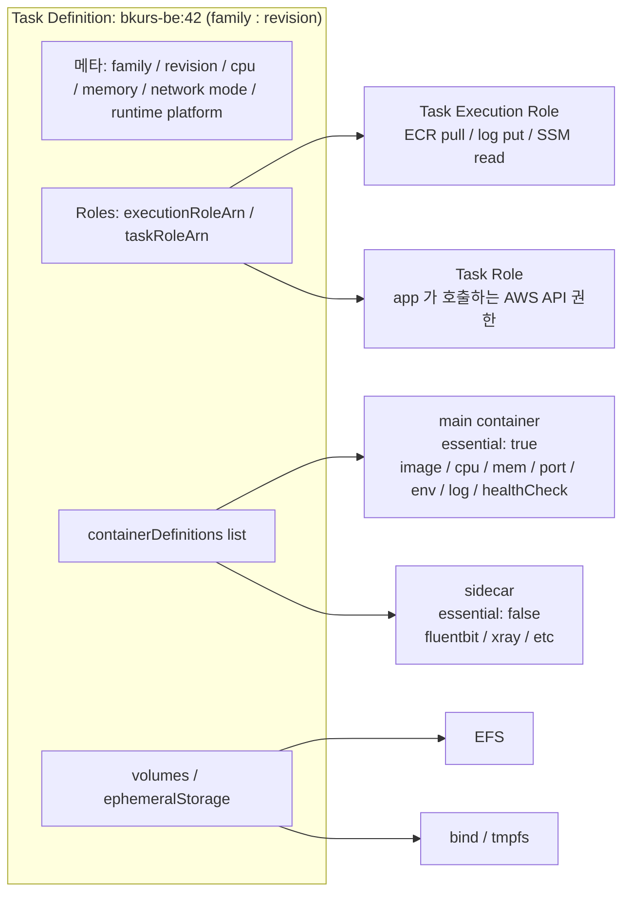

# ECS Task Definition Overview

> ECS 의 **container spec 청사진**. immutable — 변경은 새 revision. Service 가 이 revision 을 가리킴. 한 task definition = 1+ container.

## 1. 구조 한 장



## 2. 최소 task definition (Fargate)

```json
{
  "family": "bkurs-be",
  "requiresCompatibilities": ["FARGATE"],
  "networkMode": "awsvpc",
  "cpu": "1024",
  "memory": "2048",
  "runtimePlatform": {
    "cpuArchitecture": "ARM64",
    "operatingSystemFamily": "LINUX"
  },
  "executionRoleArn": "arn:aws:iam::123:role/ecsTaskExecutionRole",
  "taskRoleArn": "arn:aws:iam::123:role/bkurs-be-task",
  "containerDefinitions": [
    {
      "name": "api",
      "image": "ghcr.io/seum-running/bkurs-be:v1.2.3",
      "essential": true,
      "portMappings": [{ "containerPort": 8080, "protocol": "tcp" }],
      "environment": [
        { "name": "SPRING_PROFILES_ACTIVE", "value": "prod" }
      ],
      "secrets": [
        { "name": "DB_PASSWORD", "valueFrom": "arn:aws:ssm:...:parameter/bkurs-be/prod/DB_PASSWORD" }
      ],
      "logConfiguration": {
        "logDriver": "awslogs",
        "options": {
          "awslogs-group": "/ecs/bkurs-be",
          "awslogs-region": "ap-northeast-2",
          "awslogs-stream-prefix": "ecs"
        }
      },
      "healthCheck": {
        "command": ["CMD-SHELL", "curl -f http://localhost:8080/actuator/health || exit 1"],
        "interval": 30, "timeout": 5, "retries": 3, "startPeriod": 60
      }
    }
  ]
}
```

## 3. 핵심 필드 매트릭스

| 필드 | 의미 | 자세히 |
| --- | --- | --- |
| `family` | 논리적 이름 (예: `bkurs-be`) | 본 doc |
| `revision` | 자동 증가 (`bkurs-be:42`) | 본 doc |
| `requiresCompatibilities` | FARGATE / EC2 / EXTERNAL | [[../01-fundamentals/02-launch-type-and-capacity-provider]] |
| `cpu` / `memory` | task 전체 자원 | [[02-image-and-resources]] |
| `networkMode` | awsvpc / bridge / host / none | [[03-network-mode]] |
| `volumes` | EFS / bind / tmpfs | [[04-volumes-and-efs]] |
| `ephemeralStorage` | Fargate 의 task 디스크 (20~200GB) | [[../01-fundamentals/03-fargate-deep]] |
| `executionRoleArn` | ECS agent 권한 (ECR pull / log / SSM) | [[06-iam-roles]] |
| `taskRoleArn` | 앱 자체의 AWS API 권한 | [[06-iam-roles]] |
| `runtimePlatform` | ARM64 / X86_64, OS | [[../01-fundamentals/03-fargate-deep]] |
| `containerDefinitions[]` | 1+ container | 본 doc + 하위 |
| `containerDefinitions[*].essential` | 죽으면 task 전체 죽음 | 본 doc |
| `dependsOn` | container 시작 순서 | [[08-healthcheck]] |

## 4. family / revision 의 의미

- `family` 변경 안 됨 (논리적 식별자)
- 매 `register-task-definition` → `revision` +1
- service 는 **특정 revision** 가리킴 — 이전 revision 으로 rollback 쉬움
- `:latest` 지원 안 함 — 항상 revision 명시

### 사용 예

```bash
# register
aws ecs register-task-definition --cli-input-json file://taskdef.json
# → bkurs-be:42

# update service → 새 revision
aws ecs update-service \
  --cluster bkurs-prod --service api \
  --task-definition bkurs-be:42 \
  --force-new-deployment

# rollback
aws ecs update-service --task-definition bkurs-be:41 ...
```

## 5. essential vs sidecar

```json
"containerDefinitions": [
  { "name": "api", "essential": true },         // 죽으면 task 전체 죽음 (재시작)
  { "name": "fluentbit", "essential": false }   // 죽어도 task 유지
]
```

권장:
- main app: `essential: true`
- sidecar (log / metric): `essential: false`

## 6. 일반적 sidecar 패턴

```
┌─ task ──────────────────────────────────────┐
│                                              │
│  ┌─ main container ────┐                     │
│  │ Spring Boot api     │                     │
│  │ stdout → fluentbit  │                     │
│  └──────────────────┬──┘                     │
│                     │                        │
│  ┌─ sidecar log ────▼─┐  ┌─ sidecar trace ─┐ │
│  │ fluentbit           │  │ aws-otel-collector│
│  │ → CloudWatch / Loki │  │ → X-Ray          │ │
│  └─────────────────────┘  └──────────────────┘ │
└──────────────────────────────────────────────┘
```

자세히 → [[07-logging]] (firelens)

## 7. 자주 묻는 함정

| 함정 | 회피 |
| --- | --- |
| service 가 latest revision 안 따라감 | 명시적 `--task-definition family:revision` 또는 `--force-new-deployment` |
| 한 task definition 의 cpu/memory vs container 별 합 | task cpu/memory ≥ Σ container 합 |
| `essential: true` container 1개 없음 | 최소 1개 필수 |
| Fargate 가 `--memory-swap` 무시 | Fargate 는 swap 안 됨 — memory hard limit 만 |
| revision 100+ 누적 | 옛 revision 정기 deregister (`deregister-task-definition`) |

## 8. 다음

- ▶ [[02-image-and-resources]] — image / cpu / memory / pids / GPU
- ▶ [[03-network-mode]] — awsvpc / bridge / host / none
- ▶ [[06-iam-roles]] — Task Execution vs Task Role
- ▶ [[../03-service/01-service-overview]] — Service 작성

## 9. 영상 / 자료

| 자료 |
| --- |
| [Task Definition 공식](https://docs.aws.amazon.com/AmazonECS/latest/developerguide/task_definitions.html) |
| [ECS Workshop Task Def](https://ecsworkshop.com/) |

## 10. 참고

- [[../ecs]]
- [[../01-fundamentals/01-architecture]]
