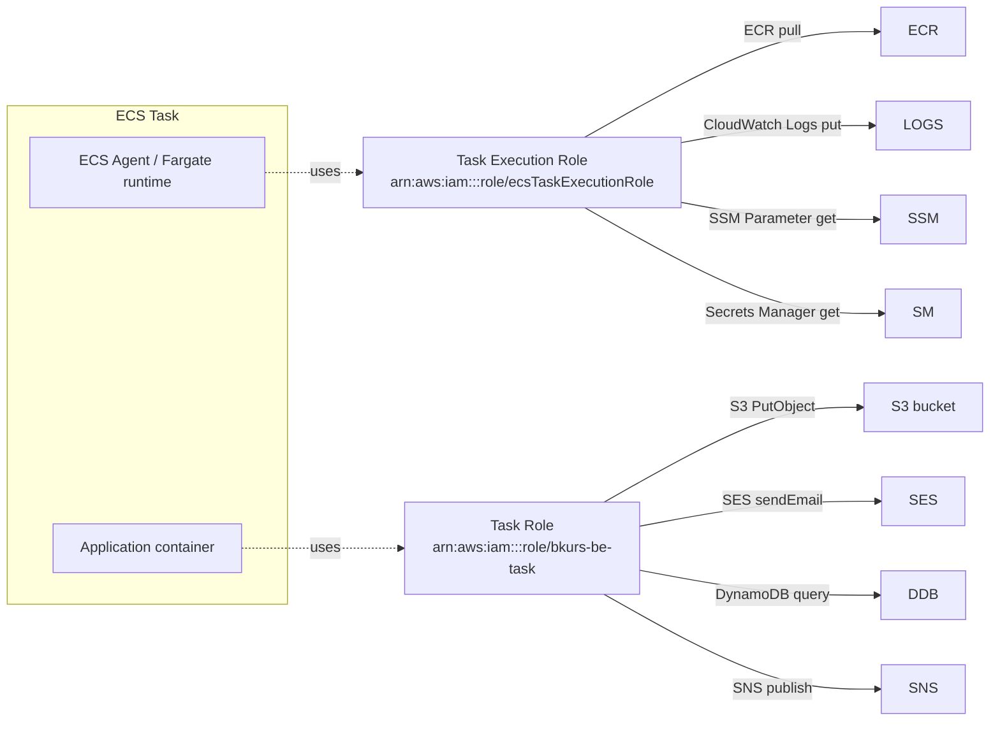

# Task Definition — IAM Roles

> ECS 의 두 IAM Role 차이가 가장 헷갈리는 부분. **Execution Role** (ECS agent 가 task 시작 시 사용) vs **Task Role** (앱 자체가 사용). 둘 다 task definition 의 별도 필드.

## 1. 두 Role 의 책임 차이



| Role | 사용자 | 시점 | 권한 |
| --- | --- | --- | --- |
| **Task Execution Role** | ECS agent / Fargate runtime | task 시작 / log put | ECR pull, awslogs, SSM, Secrets Manager |
| **Task Role** | container 안 application | task 실행 중 | S3, SES, DynamoDB, ... (앱이 호출하는 AWS API) |

## 2. Task Execution Role — 표준 정책

AWS 가 제공하는 managed policy `AmazonECSTaskExecutionRolePolicy`:

```json
{
  "Version": "2012-10-17",
  "Statement": [
    {
      "Effect": "Allow",
      "Action": [
        "ecr:GetAuthorizationToken",
        "ecr:BatchCheckLayerAvailability",
        "ecr:GetDownloadUrlForLayer",
        "ecr:BatchGetImage",
        "logs:CreateLogStream",
        "logs:PutLogEvents"
      ],
      "Resource": "*"
    }
  ]
}
```

추가 권장:
```json
{
  "Effect": "Allow",
  "Action": ["ssm:GetParameters"],
  "Resource": "arn:aws:ssm:ap-northeast-2:123:parameter/bkurs-be/prod/*"
},
{
  "Effect": "Allow",
  "Action": ["secretsmanager:GetSecretValue"],
  "Resource": "arn:aws:secretsmanager:...:secret:bkurs-be/prod/*"
},
{
  "Effect": "Allow",
  "Action": ["kms:Decrypt"],
  "Resource": "arn:aws:kms:...:key/aws/ssm"
}
```

### Trust policy

```json
{
  "Version": "2012-10-17",
  "Statement": [{
    "Effect": "Allow",
    "Principal": { "Service": "ecs-tasks.amazonaws.com" },
    "Action": "sts:AssumeRole"
  }]
}
```

## 3. Task Role — 애플리케이션 별 정의

bkurs-be 예:
```json
{
  "Version": "2012-10-17",
  "Statement": [
    {
      "Sid": "S3UploadsAccess",
      "Effect": "Allow",
      "Action": ["s3:PutObject", "s3:GetObject", "s3:DeleteObject"],
      "Resource": "arn:aws:s3:::bkurs-prod-uploads/*"
    },
    {
      "Sid": "SesSendEmail",
      "Effect": "Allow",
      "Action": ["ses:SendEmail", "ses:SendRawEmail"],
      "Resource": "*",
      "Condition": {
        "StringEquals": { "ses:FromAddress": "noreply@bkurs.kr" }
      }
    },
    {
      "Sid": "EcsExecAccess",
      "Effect": "Allow",
      "Action": [
        "ssmmessages:CreateControlChannel",
        "ssmmessages:CreateDataChannel",
        "ssmmessages:OpenControlChannel",
        "ssmmessages:OpenDataChannel"
      ],
      "Resource": "*"
    }
  ]
}
```

`ssmmessages:*` 는 ECS Exec ([[../04-operations/01-ecs-exec]]) 활성 시 필수.

Trust policy 동일 — `ecs-tasks.amazonaws.com`.

## 4. Task Definition 의 두 Role

```json
{
  "executionRoleArn": "arn:aws:iam::123:role/ecsTaskExecutionRole",
  "taskRoleArn":      "arn:aws:iam::123:role/bkurs-be-task"
}
```

둘 다 가능 (보통 권장 — 분리). 또는 하나만:
- Execution 만 — 앱이 AWS API 호출 안 함
- Task 만 — image 가 public, secret 안 씀 (드물다)

## 5. credential 주입 흐름

Application 안에서 AWS SDK 호출 시 (예: `S3Client.putObject(...)`)

```
SDK → 환경변수 AWS_CONTAINER_CREDENTIALS_RELATIVE_URI 확인
    → http://169.254.170.2/{path}
    → ECS agent metadata endpoint
    → Task Role 의 임시 STS credentials 반환 (~1시간 자동 rotate)
```

→ 코드에서 access key 명시 불필요. 보안 ↑.

## 6. boundary (Permissions Boundary)

회사 정책 — Task Role 이 너무 많은 권한 받지 못하도록:

```bash
aws iam put-role-permissions-boundary \
  --role-name bkurs-be-task \
  --permissions-boundary arn:aws:iam::123:policy/AppRoleBoundary
```

boundary 정책 안의 권한만 effective (intersection).

## 7. cross-account access

Task 가 다른 계정의 S3 접근:

```json
// Task Role 에
{
  "Effect": "Allow",
  "Action": "s3:GetObject",
  "Resource": "arn:aws:s3:::other-account-bucket/*"
}
```

+ S3 bucket policy (다른 계정):
```json
{
  "Effect": "Allow",
  "Principal": { "AWS": "arn:aws:iam::THIS-ACCOUNT:role/bkurs-be-task" },
  "Action": "s3:GetObject",
  "Resource": "arn:aws:s3:::other-account-bucket/*"
}
```

## 8. ECS Exec — Task Role 의 추가 권한

```json
{
  "Sid": "EcsExec",
  "Effect": "Allow",
  "Action": [
    "ssmmessages:CreateControlChannel",
    "ssmmessages:CreateDataChannel",
    "ssmmessages:OpenControlChannel",
    "ssmmessages:OpenDataChannel"
  ],
  "Resource": "*"
}
```

활성:
```bash
aws ecs update-service \
  --cluster bkurs-prod --service api \
  --enable-execute-command
```

자세히 → [[../04-operations/01-ecs-exec]]

## 9. K8s IRSA 비교

| ECS | K8s (EKS) |
| --- | --- |
| Task Role | IRSA (IAM Role for Service Account) |
| 자동 credential 주입 (`AWS_CONTAINER_CREDENTIALS_*`) | service account 의 JWT → STS → IAM role |
| Task definition 의 `taskRoleArn` | ServiceAccount annotation `eks.amazonaws.com/role-arn` |

같은 개념 — workload 별 fine-grained IAM.

## 10. 흔한 함정

| 함정 | 회피 |
| --- | --- |
| Execution Role 에 S3 권한 부여 (앱이 쓸 거라고) | 잘못 — Task Role 에 |
| Task Role 만 두고 ECR pull 안 됨 | Execution Role 도 필수 |
| `ecs-tasks.amazonaws.com` 누락 | Trust policy 확인 |
| ECS Exec 권한 누락 | `ssmmessages:*` 추가 |
| 권한이 너무 많음 (`s3:*` Resource `*`) | least privilege — 특정 bucket / action |
| KMS Decrypt 빠짐 | SecureString SSM 시 KMS 권한 필요 |

## 11. 다음

- ▶ [[07-logging]]
- ▶ [[08-healthcheck]]
- ▶ [[../05-security/01-iam-best-practices]]
- ▶ [[../../iam/iam]] — IAM 일반

## 12. 영상 / 자료

| 자료 |
| --- |
| [ECS IAM Roles — AWS](https://www.youtube.com/watch?v=g2k9_ec5BfY) |
| [Task Role vs Execution Role 공식](https://docs.aws.amazon.com/AmazonECS/latest/developerguide/task_execution_IAM_role.html) |

## 13. 참고

- [[../ecs]]
- 공식 trust policy: https://docs.aws.amazon.com/AmazonECS/latest/developerguide/task-iam-roles.html
