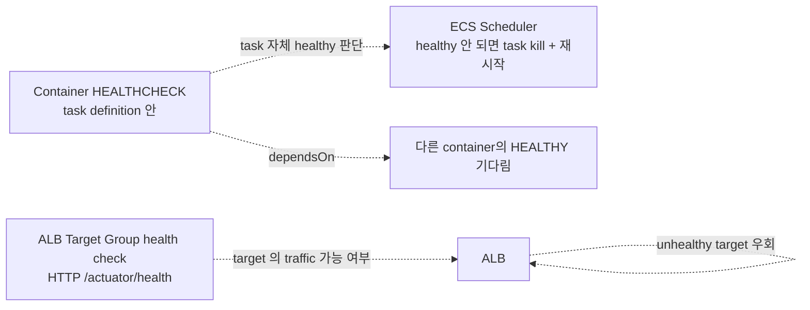
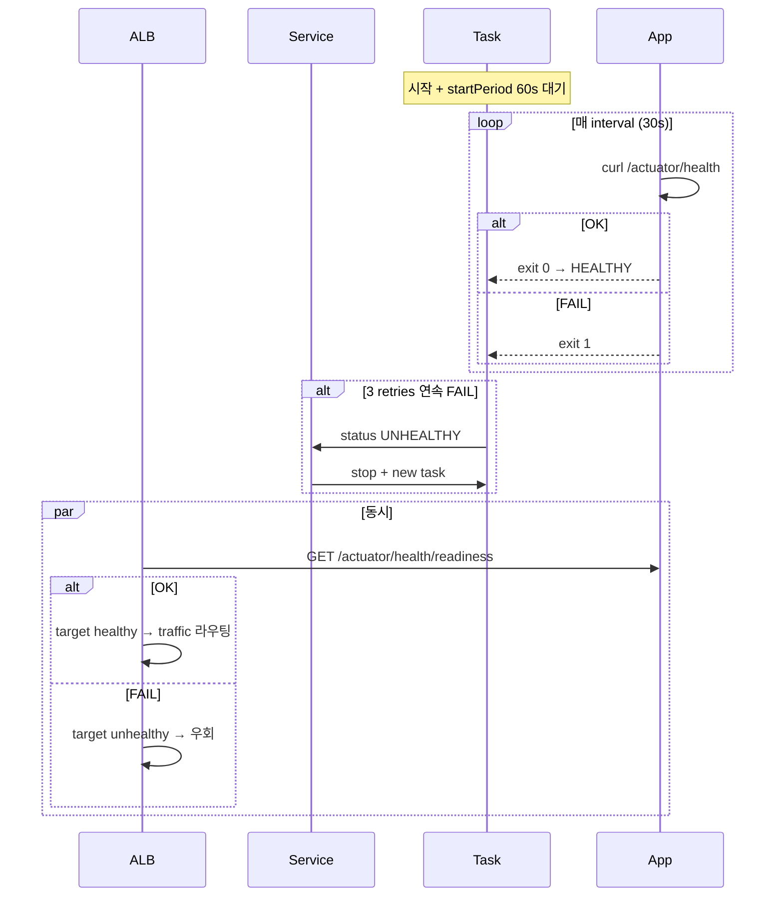

# Task Definition — HealthCheck

> ECS 는 **2 종 healthcheck** 가능: container healthCheck (Docker HEALTHCHECK 동등) + ALB target
> group health check. 둘 다 권장 — 다른 의도, 보완 관계.

## 1. 2 종 healthcheck



| 종류 | 누가 확인 | 효과 |
| --- | --- | --- |
| **Container healthCheck** | ECS agent (docker) | task 의 healthy 상태 — unhealthy 면 task 재시작 |
| **ALB Target Group health check** | ALB | target 으로 traffic 보낼지 결정 |

## 2. Container healthCheck — Dockerfile vs Task Def

### Dockerfile (편의)

```dockerfile
HEALTHCHECK --interval=30s --timeout=5s --start-period=60s --retries=3 \
  CMD curl -f http://localhost:8080/actuator/health || exit 1
```

### Task Definition (덮어쓰기 / 명시)

```json
{
  "containerDefinitions": [{
    "healthCheck": {
      "command": ["CMD-SHELL", "curl -f http://localhost:8080/actuator/health || exit 1"],
      "interval": 30,
      "timeout": 5,
      "retries": 3,
      "startPeriod": 60
    }
  }]
}
```

| 옵션 | default | 의미 |
| --- | --- | --- |
| `interval` | 30s | 검사 주기 |
| `timeout` | 5s | 각 검사 timeout |
| `retries` | 3 | N회 연속 실패 시 unhealthy |
| `startPeriod` | 0 | 시작 후 grace (failure 안 침) |

### 상태

```bash
aws ecs describe-tasks --cluster bkurs-prod --tasks abc123 \
  --query 'tasks[0].containers[0].healthStatus'
# "HEALTHY"
```

## 3. dependsOn — container 시작 순서

```json
{
  "containerDefinitions": [
    {
      "name": "db-init",
      "essential": false,
      "command": ["sh", "-c", "wait-for-db.sh && flyway migrate"]
    },
    {
      "name": "api",
      "essential": true,
      "dependsOn": [
        { "containerName": "db-init", "condition": "SUCCESS" }
      ]
    }
  ]
}
```

`condition`:
- `START` — 시작했으면
- `COMPLETE` — exit (코드 무관)
- `SUCCESS` — exit 0
- `HEALTHY` — healthCheck PASS

> sidecar (예: fluentbit) 가 먼저 시작해야 main app 의 log 안 누락. dependsOn 활용.

## 4. ALB Target Group health check

ALB / NLB 가 정기 HTTP request 보냄. 응답 비교 후 target 의 traffic 라우팅 결정.

```bash
aws elbv2 modify-target-group \
  --target-group-arn arn:... \
  --health-check-path /actuator/health \
  --health-check-protocol HTTP \
  --health-check-port traffic-port \
  --health-check-interval-seconds 15 \
  --health-check-timeout-seconds 5 \
  --healthy-threshold-count 2 \
  --unhealthy-threshold-count 3 \
  --matcher HttpCode=200
```

| 옵션 | 의미 |
| --- | --- |
| `path` | 검사 URL |
| `port` | `traffic-port` (target port 사용) 또는 명시 |
| `interval` | 5~300s |
| `timeout` | < interval |
| `healthy-threshold` | N회 연속 200 → healthy |
| `unhealthy-threshold` | N회 연속 실패 → unhealthy |
| `matcher` | `200` / `200-299` / `200,302` |

## 5. healthCheckGracePeriodSeconds — Service 옵션

ALB 가 task 시작 직후 unhealthy 로 판정해서 즉시 kill 하는 것 방지:

```bash
aws ecs create-service \
  --health-check-grace-period-seconds 120 \
  --load-balancers "targetGroupArn=arn:...,containerName=api,containerPort=8080"
```

→ 120초 동안은 ALB unhealthy 무시.

Spring Boot 의 시작 시간 (특히 cold start) 따라 60~300 권장.

## 6. Liveness vs Readiness — Spring Boot

Spring Boot Actuator 의 2 endpoint:
- `/actuator/health/liveness` — 앱 "살아있나" (LivenessState)
- `/actuator/health/readiness` — 앱 "traffic 받을 준비" (ReadinessState)

```yaml
# application.yml
management:
  endpoint:
    health:
      probes: { enabled: true }
```

`/health/readiness` 가 OK → ALB target healthy. DB connection pool / 다른 의존성 안 됐으면 NOT_READY.

ECS Container healthCheck: 보통 `/actuator/health` (general).
ALB Target Group: `/actuator/health/readiness` 권장.

## 7. 권장 조합

```
Task Definition (healthCheck) → /actuator/health
Service healthCheckGracePeriodSeconds → 120
ALB Target Group → /actuator/health/readiness, interval 15s, threshold 2/3
```

Container 의 startup probe 와 readiness 분리 효과.

## 8. healthcheck 실패 시 흐름



## 9. 흔한 함정

| 함정 | 회피 |
| --- | --- |
| `startPeriod` 너무 짧음 → 시작 중 fail | 30~120s 으로 |
| ALB grace period 짧음 → task 무한 재시작 | `healthCheckGracePeriodSeconds 120+` |
| /health 가 DB 의존 → DB 잠시 다운 시 모든 task kill | liveness vs readiness 분리 |
| `curl` 이 image 에 없음 (distroless) | wget / shell built-in 또는 image 변경 |
| `CMD` 가 아닌 `CMD-SHELL` 의도 | "CMD-SHELL" 명시 |
| dependsOn 무한 wait | timeout 명시 |
| ALB matcher 가 200 만 — redirect 응답 fail | `200,302` 도 포함 |

## 10. CDK 예

```typescript
container.addHealthCheck({
  command: ['CMD-SHELL', 'curl -f http://localhost:8080/actuator/health || exit 1'],
  interval: cdk.Duration.seconds(30),
  timeout: cdk.Duration.seconds(5),
  retries: 3,
  startPeriod: cdk.Duration.seconds(60),
});

new ecs.FargateService(this, 'Service', {
  cluster, taskDefinition,
  healthCheckGracePeriod: cdk.Duration.seconds(120),
  // ...
});

targetGroup.configureHealthCheck({
  path: '/actuator/health/readiness',
  interval: cdk.Duration.seconds(15),
  healthyThresholdCount: 2,
  unhealthyThresholdCount: 3,
  healthyHttpCodes: '200',
});
```

## 11. 다음

- ▶ [[../03-service/01-service-overview]] — service 흐름
- ▶ [[../03-service/05-load-balancer-integration]] — ALB target group
- ▶ [[../04-operations/03-troubleshooting]] — task 가 healthy 안 되는 시나리오

## 12. 영상 / 자료

| 자료 |
| --- |
| [Spring Boot probes — Spring docs](https://docs.spring.io/spring-boot/docs/current/reference/html/actuator.html#actuator.endpoints.kubernetes-probes) |
| [ECS Healthcheck 공식](https://docs.aws.amazon.com/AmazonECS/latest/developerguide/healthcheck.html) |

## 13. 참고

- [[../ecs]]
- [[../../../../docker/practice/15-healthcheck-restart-resources]] — Docker 측 HEALTHCHECK
