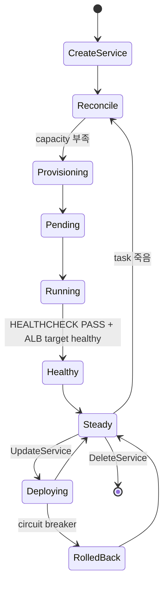

# ECS Service Overview

> **desiredCount** 유지 + 자동 재시작 + LB 통합 + 배포 제어. Service 가 task definition 의 desired state 를 유지하는 reconciler.

## 1. Service vs Task

| 항목 | Task | Service |
| --- | --- | --- |
| 수명 | 1회성 또는 외부 schedule | 영구 reconciliation |
| API | `RunTask` | `CreateService` |
| desired | 명시 N | desiredCount 유지 |
| LB | 직접 register 안 함 | 자동 register/deregister |
| 재시작 | 안 함 (실패 시 죽음) | 자동 (always) |
| 사용 | cron / migration / batch | API / worker / 영구 service |

## 2. 최소 Service 생성

```bash
aws ecs create-service \
  --cluster bkurs-prod --service-name api \
  --task-definition bkurs-be:42 \
  --desired-count 3 \
  --launch-type FARGATE \
  --network-configuration "awsvpcConfiguration={subnets=[subnet-aaa,subnet-bbb,subnet-ccc],securityGroups=[sg-task],assignPublicIp=DISABLED}" \
  --load-balancers "targetGroupArn=arn:...,containerName=api,containerPort=8080" \
  --health-check-grace-period-seconds 120
```

## 3. 핵심 옵션

| 옵션 | 의미 |
| --- | --- |
| `desiredCount` | 유지할 task 수 (auto scaling 이 동적 변경) |
| `launchType` 또는 `capacityProviderStrategy` | 어디서 실행 ([[../01-fundamentals/02-launch-type-and-capacity-provider]]) |
| `schedulingStrategy` | REPLICA (default) / DAEMON (EC2 only) |
| `deploymentController` | ECS / CODE_DEPLOY / EXTERNAL ([[02-deployment-rolling-and-bg]]) |
| `deploymentConfiguration` | maximumPercent / minimumHealthyPercent / circuit breaker |
| `loadBalancers` | ALB / NLB target group |
| `serviceRegistries` | Cloud Map ([[04-service-discovery-and-connect]]) |
| `healthCheckGracePeriodSeconds` | LB unhealthy 무시 기간 |
| `enableExecuteCommand` | ECS Exec ([[../04-operations/01-ecs-exec]]) |
| `propagateTags` | TASK_DEFINITION / SERVICE |

## 4. Scheduling Strategy

| Strategy | 의미 |
| --- | --- |
| **REPLICA** (default) | desiredCount 개 task — Fargate / EC2 |
| **DAEMON** (EC2 only) | 각 EC2 instance 마다 1 task — log collector / monitoring agent |

> Fargate 는 DAEMON 미지원.

## 5. Deployment Configuration

```bash
--deployment-configuration "maximumPercent=200,minimumHealthyPercent=100,deploymentCircuitBreaker={enable=true,rollback=true}"
```

| 옵션 | 의미 | 권장 |
| --- | --- | --- |
| `maximumPercent` | 새 task 추가 한도 | 200 (무중단) |
| `minimumHealthyPercent` | 유지 task 한도 | 100 (무중단) |
| `deploymentCircuitBreaker.enable` | 실패 시 deployment 중단 | true |
| `deploymentCircuitBreaker.rollback` | 자동 rollback | true |

## 6. Service lifecycle



## 7. Update Service

```bash
# task definition 만 (rolling 자동)
aws ecs update-service --cluster bkurs-prod --service api --task-definition bkurs-be:43

# desired count
aws ecs update-service --service api --desired-count 5

# 같은 revision 재시작
aws ecs update-service --service api --force-new-deployment

# capacity provider strategy 변경
aws ecs update-service --service api \
  --capacity-provider-strategy capacityProvider=FARGATE,base=3,weight=1 capacityProvider=FARGATE_SPOT,weight=4
```

## 8. 흔한 함정

| 함정 | 회피 |
| --- | --- |
| `latest` revision 안 따라감 | `--force-new-deployment` 또는 명시적 revision |
| `minimumHealthyPercent=0` → 잠시 0 task | 100 권장 |
| LB grace period 짧음 → infinite restart | 120+ |
| DAEMON + Fargate | EC2 only |
| circuit breaker 없음 → 무한 시도 | enable + rollback=true |

## 9. CDK / Terraform

```typescript
new ecs.FargateService(this, 'Api', {
  cluster, taskDefinition, desiredCount: 3,
  capacityProviderStrategies: [
    { capacityProvider: 'FARGATE', base: 3, weight: 1 },
    { capacityProvider: 'FARGATE_SPOT', weight: 4 },
  ],
  circuitBreaker: { rollback: true },
  healthCheckGracePeriod: cdk.Duration.seconds(120),
  enableExecuteCommand: true,
});
```

## 10. 다음

- ▶ [[02-deployment-rolling-and-bg]] — Blue-Green
- ▶ [[03-auto-scaling]]
- ▶ [[04-service-discovery-and-connect]]
- ▶ [[05-load-balancer-integration]]

## 11. 영상 / 자료

| 자료 |
| --- |
| [ECS Service Walkthrough — AWS](https://www.youtube.com/watch?v=esISkPlnxL0) |
| [공식 Service](https://docs.aws.amazon.com/AmazonECS/latest/developerguide/ecs_services.html) |

## 12. 참고

- [[../ecs]]
- [[../01-fundamentals/01-architecture]]
- [[../02-task-definition/01-overview]]
