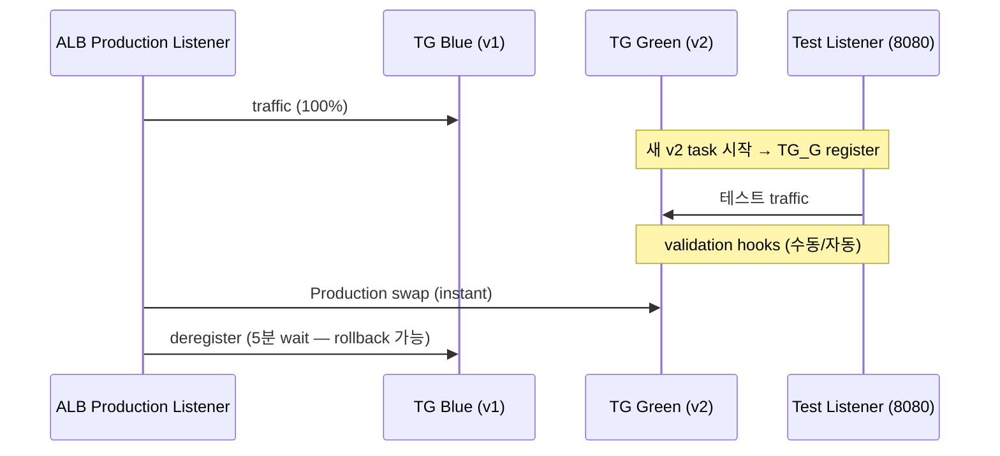
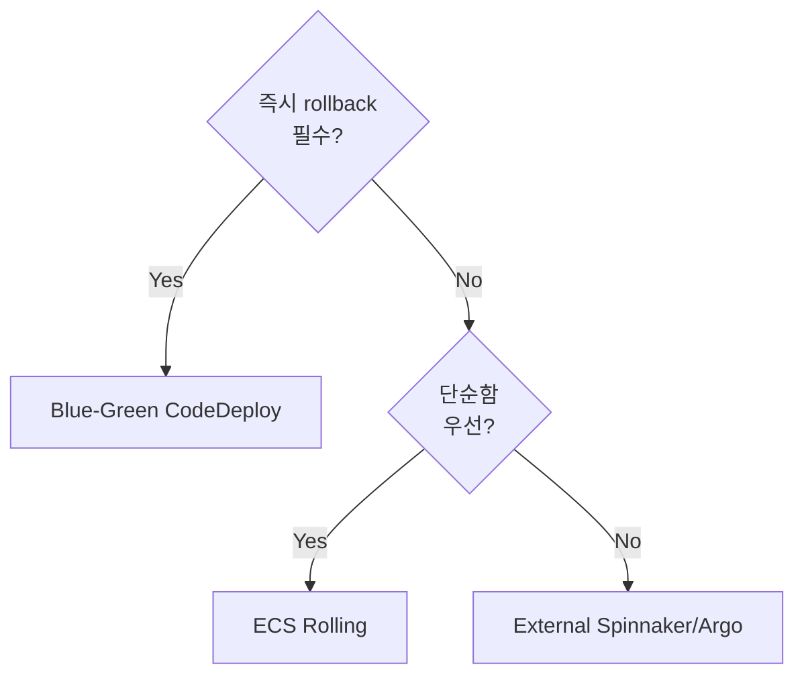

# ECS Deployment — Rolling / Blue-Green / External

> 3 controller. **Rolling (ECS default)** 단순, **Blue-Green (CodeDeploy)** 안전, **External** 유연.

## 1. 3 controller

| Controller | 특징 | 추가 도구 |
| --- | --- | --- |
| **ECS** (default) | Rolling update | 없음 |
| **CODE_DEPLOY** | Blue-Green | CodeDeploy 필수 |
| **EXTERNAL** | 직접 task 관리 | 사용자 코드 |

## 2. Rolling deployment (ECS default)

```
v1 ▣▣▣      ▶ v2 새 task 1 추가 (max 200%)
v1 ▣▣▣ ▢v2  ▶ v2 healthy 대기
v1 ▣▣ ▢v2   ▶ v1 1개 종료 (min 100% 유지)
   ▢▢▢v2   ▶ 완료
```

설정:
```bash
--deployment-configuration "maximumPercent=200,minimumHealthyPercent=100,deploymentCircuitBreaker={enable=true,rollback=true}"
```

| 장점 | 단점 |
| --- | --- |
| 단순, 추가 도구 0, 무중단 | v1+v2 동시 traffic (DB schema backward compat 필요), 즉시 rollback 어려움 |

## 3. Blue-Green deployment (CodeDeploy)



| 장점 | 단점 |
| --- | --- |
| 즉시 cutover + rollback / 검증 hook / canary | CodeDeploy 설정 복잡, 비용 ↑ (v1+v2 동시) |

### 설정 흐름

1. **2 target group** — Blue / Green
2. **ALB 2 listener** — 80 (prod) / 8080 (test)
3. **CodeDeploy Application** + Deployment Group
4. ECS Service `deploymentController=CODE_DEPLOY`
5. `appspec.yaml`:

```yaml
version: 0.0
Resources:
  - TargetService:
      Type: AWS::ECS::Service
      Properties:
        TaskDefinition: arn:aws:ecs:...:task-definition/bkurs-be:43
        LoadBalancerInfo:
          ContainerName: api
          ContainerPort: 8080
Hooks:
  - BeforeAllowTraffic: arn:aws:lambda:...:function:before-validate
  - AfterAllowTraffic: arn:aws:lambda:...:function:after-validate
```

### Traffic shifting modes

| Mode | 설명 |
| --- | --- |
| AllAtOnce | 100% 즉시 swap |
| TimeBasedCanary | 10% → wait N분 → 100% |
| TimeBasedLinear | 10% / 10분 점진 |

권장: **TimeBasedCanary 10%+5분**.

## 4. External deployment

```bash
aws ecs create-service --deployment-controller type=EXTERNAL ...
```

사용자가 직접 `CreateTaskSet` / `UpdateServicePrimaryTaskSet` / `DeleteTaskSet`. 활용: GitOps / Spinnaker / Argo Rollouts ECS provider. 거의 드물게 사용.

## 5. Deployment Circuit Breaker

```bash
--deployment-configuration "deploymentCircuitBreaker={enable=true,rollback=true}"
```

새 deployment 의 실패 자동 감지 → 이전 revision 자동 복구. 권장 항상 활성.

## 6. CloudWatch alarms — rollback trigger

```bash
--deployment-configuration "alarms={alarmNames=[bkurs-be-5xx,bkurs-be-latency],rollback=true,enable=true}"
```

→ deployment 5분 동안 alarm 발생 → 자동 rollback.

## 7. CodeDeploy validation hook 예

```python
# Lambda: BeforeAllowTraffic
import boto3

def lambda_handler(event, context):
    elbv2 = boto3.client("elbv2")
    res = elbv2.describe_target_health(TargetGroupArn="arn:...:target-group/green/...")
    healthy = sum(1 for t in res["TargetHealthDescriptions"]
                  if t["TargetHealth"]["State"] == "healthy")
    status = "Succeeded" if healthy >= 3 else "Failed"
    boto3.client("codedeploy").put_lifecycle_event_hook_execution_status(
        deploymentId=event["DeploymentId"],
        lifecycleEventHookExecutionId=event["LifecycleEventHookExecutionId"],
        status=status,
    )
```

## 8. 결정 트리



bkurs-be 권장: **Rolling + Circuit Breaker + CloudWatch alarm**. critical 서비스 시 Blue-Green.

## 9. 흔한 함정

| 함정 | 회피 |
| --- | --- |
| Rolling 시 v1+v2 혼합 traffic | backward compat (DB schema / API) |
| Blue-Green 비용 2배 (잠시) | TimeBasedCanary 짧게 |
| circuit breaker 없음 → 무한 시도 | enable + rollback=true |
| ALB grace period 짧음 | 120+ |

## 10. 다음

- ▶ [[03-auto-scaling]]
- ▶ [[../practice/03-blue-green-with-codedeploy]]
- ▶ [[../04-operations/03-troubleshooting]]

## 11. 영상 / 자료

| 자료 |
| --- |
| [ECS Blue-Green — AWS](https://www.youtube.com/watch?v=NHU8KdCKjas) |
| [CodeDeploy ECS 공식](https://docs.aws.amazon.com/AmazonECS/latest/developerguide/deployment-type-bluegreen.html) |
| [Argo Rollouts ECS](https://argo-rollouts.readthedocs.io/en/stable/) |

## 12. 참고

- [[../ecs]]
- [[01-service-overview]]
- [[../../../../10-projects/bkurs-be/handover/operations/env-deployment#3]]
