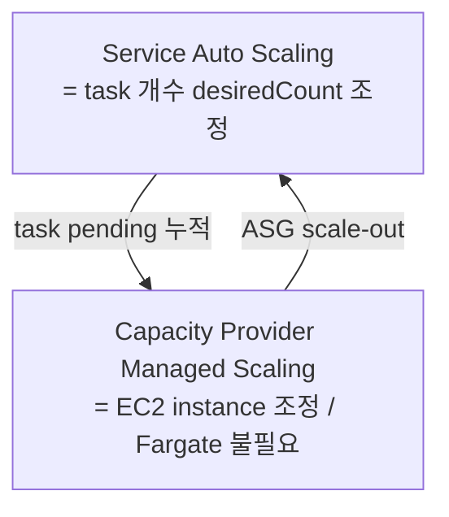

# ECS Auto Scaling

> Service 의 desiredCount 동적 조정 (Application Auto Scaling). 3 policy: target tracking (단순) / step / scheduled. EC2 launch 시 Capacity Provider Managed Scaling.

## 1. 2 레벨 scaling



## 2. 등록

```bash
# 1. scalable target
aws application-autoscaling register-scalable-target \
  --service-namespace ecs \
  --resource-id service/bkurs-prod/api \
  --scalable-dimension ecs:service:DesiredCount \
  --min-capacity 2 --max-capacity 20

# 2. policy (target tracking)
aws application-autoscaling put-scaling-policy \
  --policy-name target-cpu-50 \
  --service-namespace ecs --resource-id service/bkurs-prod/api \
  --scalable-dimension ecs:service:DesiredCount \
  --policy-type TargetTrackingScaling \
  --target-tracking-scaling-policy-configuration file://policy.json
```

`policy.json`:
```json
{
  "TargetValue": 50.0,
  "PredefinedMetricSpecification": {
    "PredefinedMetricType": "ECSServiceAverageCPUUtilization"
  },
  "ScaleOutCooldown": 60,
  "ScaleInCooldown": 300
}
```

## 3. 3 policy

### 3.1 Target Tracking — 가장 단순

| Predefined metric |
| --- |
| `ECSServiceAverageCPUUtilization` |
| `ECSServiceAverageMemoryUtilization` |
| `ALBRequestCountPerTarget` |

custom metric:
```json
{
  "CustomizedMetricSpecification": {
    "MetricName": "http_server_requests_seconds_count",
    "Namespace": "bkurs",
    "Dimensions": [{ "Name": "service", "Value": "api" }],
    "Statistic": "Sum"
  },
  "TargetValue": 100.0
}
```

### 3.2 Step Scaling

특정 임계치 (e.g. CPU > 70% → +2 task, > 90% → +5 task):
```bash
--step-scaling-policy-configuration '{
  "AdjustmentType": "ChangeInCapacity",
  "StepAdjustments": [
    { "MetricIntervalLowerBound": 0,  "MetricIntervalUpperBound": 20, "ScalingAdjustment": 2 },
    { "MetricIntervalLowerBound": 20, "ScalingAdjustment": 5 }
  ],
  "Cooldown": 60,
  "MetricAggregationType": "Average"
}'
```

+ CloudWatch alarm 으로 trigger.

### 3.3 Scheduled

매일 09:00~18:00 min 10, 그 외 min 2:
```bash
aws application-autoscaling put-scheduled-action \
  --service-namespace ecs \
  --resource-id service/bkurs-prod/api \
  --scalable-dimension ecs:service:DesiredCount \
  --scheduled-action-name business-hours \
  --schedule "cron(0 9 ? * MON-FRI *)" \
  --scalable-target-action MinCapacity=10,MaxCapacity=30
```

## 4. Cooldown

| 옵션 | 권장 |
| --- | --- |
| ScaleOutCooldown | 60s (짧음 — 빠른 spike 대응) |
| ScaleInCooldown | 300~600s (보수적) |

> Scale-in 보수적, Scale-out 적극적.

## 5. Capacity Provider Managed Scaling (EC2)

```bash
aws ecs create-capacity-provider \
  --auto-scaling-group-provider "
    autoScalingGroupArn=arn:...,
    managedScaling={status=ENABLED,targetCapacity=100,minimumScalingStepSize=1,maximumScalingStepSize=10,instanceWarmupPeriod=300},
    managedTerminationProtection=ENABLED
  "
```

| 옵션 | 의미 |
| --- | --- |
| `targetCapacity` | instance utilization 목표 (80~100) |
| `managedTerminationProtection` | scale-in 시 task 가진 instance 보호 |

Fargate 는 본 설정 불필요.

## 6. Predictive Scaling

CloudWatch metric 의 머신러닝 예측. 일정 패턴 + ML 예측 활용 시.

## 7. 권장 — bkurs-be

```typescript
const scalable = service.autoScaleTaskCount({ minCapacity: 3, maxCapacity: 20 });
scalable.scaleOnCpuUtilization('cpu', {
  targetUtilizationPercent: 60,
  scaleInCooldown: cdk.Duration.minutes(10),
  scaleOutCooldown: cdk.Duration.seconds(60),
});
scalable.scaleOnMemoryUtilization('mem', { targetUtilizationPercent: 70 });
scalable.scaleOnRequestCount('rps', {
  requestsPerTarget: 1000,
  targetGroup: alb.targetGroup,
});
```

## 8. 흔한 함정

| 함정 | 회피 |
| --- | --- |
| metric reporting delay | scale-out cooldown 짧게 + step scaling |
| oscillation | cooldown ↑ |
| Spot interruption 으로 갑자기 in | base FARGATE 보장 |
| EC2 instance 부족 → task pending | CP Managed Scaling 활성 |
| min=0 cold start | min 1+ |

## 9. 다음

- ▶ [[04-service-discovery-and-connect]]
- ▶ [[05-load-balancer-integration]]
- ▶ [[../04-operations/04-cost-optimization]]

## 10. 영상 / 자료

| 자료 |
| --- |
| [ECS Auto Scaling 공식](https://docs.aws.amazon.com/AmazonECS/latest/developerguide/service-auto-scaling.html) |

## 11. 참고

- [[../ecs]]
- [[../auto-scaling/auto-scaling]]
