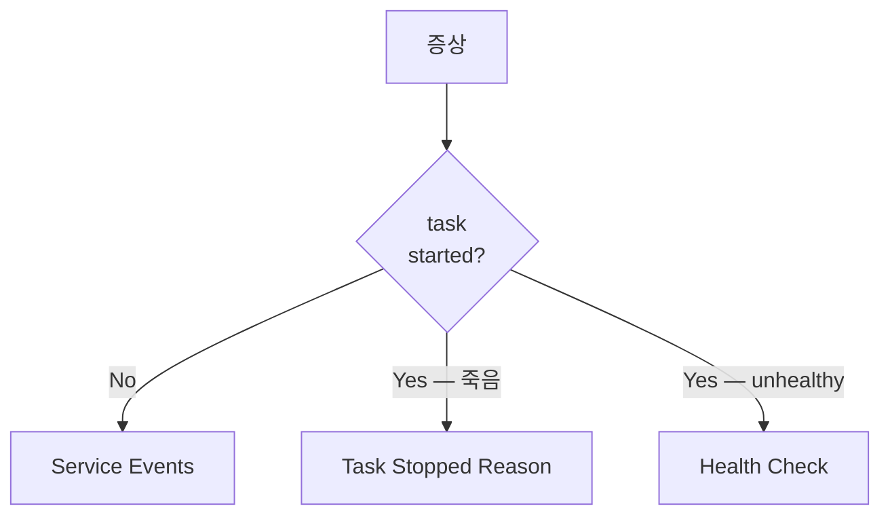

# ECS Troubleshooting

> 흔한 ECS 장애 + 진단 명령.

## 1. 진단 흐름



## 2. Service Events

```bash
aws ecs describe-services --cluster bkurs-prod --services api \
  --query 'services[0].events[0:10]'
```

| 메시지 | 원인 |
| --- | --- |
| `unable to place a task` | EC2 부족 — Managed Scaling 활성 |
| `RESOURCE:CPU/MEMORY` | task spec 이 instance 못 맞춤 |
| `network interface attachment failed` | ENI 한도 / subnet IP 부족 |
| `task was retired by AWS health event` | Fargate platform 갱신 |

## 3. Task Stopped Reason

```bash
aws ecs describe-tasks --cluster bkurs-prod --tasks <TASK-ARN> \
  --query 'tasks[0].{Status:lastStatus,Reason:stoppedReason,Containers:containers[].[name,exitCode,reason]}'
```

| reason | 의미 |
| --- | --- |
| `Essential container in task exited` | main container 종료 — log 확인 |
| `Task failed ELB health checks` | ALB target unhealthy — grace ↑ |
| `OutOfMemoryError` | memory limit 초과 |
| `CannotPullContainerError` | ECR 권한 / image / network |
| `ResourceInitializationError: unable to pull secrets` | SSM / Secrets Manager 권한 |

## 4. Container exit code

| code | 의미 |
| --- | --- |
| 0 | 정상 |
| 1 | application error |
| 137 | SIGKILL — OOMKilled |
| 143 | SIGTERM — graceful |
| 139 | SIGSEGV |

## 5. CannotPullContainerError

| 원인 | 해결 |
| --- | --- |
| ECR 권한 없음 | Execution Role 의 ecr 권한 |
| private GHCR | repositoryCredentials |
| network outbound 막힘 | VPC Endpoint 또는 NAT |
| image tag 오타 | 정확한 tag |
| platform mismatch | runtimePlatform 의 arch 일치 |

## 6. ResourceInitializationError

```bash
aws iam simulate-principal-policy \
  --policy-source-arn arn:aws:iam::123:role/ecsTaskExecutionRole \
  --action-names ssm:GetParameters \
  --resource-arns arn:aws:ssm:...:parameter/bkurs-be/prod/DB_PASSWORD
```

→ Execution Role 의 SSM / KMS / Secrets Manager 권한 점검.

## 7. ENI 부족

```
RESOURCE:ENI count exceeded
```

해결:
- subnet CIDR 확장
- ENI Trunking (EC2)
- Service Quotas 증액

## 8. Stuck deployment

```bash
aws ecs describe-services --query 'services[0].deployments'
```

`IN_PROGRESS` 멈춤. 해결:
```bash
aws ecs update-service --task-definition bkurs-be:42  # 이전 healthy
aws ecs delete-service --force                          # 또는
```

## 9. EC2 instance 가 register 안 됨

```bash
sudo cat /var/log/ecs/ecs-agent.log
cat /etc/ecs/ecs.config        # ECS_CLUSTER=bkurs-prod
```

흔한 원인: IAM instance profile / ECS_CLUSTER env / network / AMI.

## 10. 디버깅 도구

| 도구 | 용도 |
| --- | --- |
| `aws ecs describe-tasks/services` | event |
| ECS Exec | shell ([[01-ecs-exec]]) |
| CloudWatch Logs Insights | app log |
| Container Insights | metric |
| VPC Flow Logs | network |
| X-Ray | trace |

## 11. 일반 fix 순서

```
1. Service Events
2. Task Stopped Reason + exit code
3. application log (awslogs)
4. ECS Exec → 컨테이너 진단
5. Health Check 결과
6. Container Insights metric
7. EventBridge + Alarms
```

## 12. 흔한 함정

| 함정 | 회피 |
| --- | --- |
| Events 보지 않고 task 만 | events 가 가장 풍부 |
| log group 자동 생성 안 됨 | Execution Role 의 logs:CreateLogGroup |
| Image pull error 가 Execution Role 권한 | Task Role 아님 |
| platform arch mismatch | runtimePlatform 명시 |

## 13. 다음

- ▶ [[04-cost-optimization]]
- ▶ [[01-ecs-exec]]
- ▶ [[02-container-insights]]
- ▶ [[../../../../docker/practice/17-debug-and-troubleshoot]]

## 14. 영상 / 자료

| 자료 |
| --- |
| [ECS Troubleshooting — AWS](https://www.youtube.com/watch?v=Y_QYS5SCe6E) |
| [공식](https://docs.aws.amazon.com/AmazonECS/latest/developerguide/troubleshooting.html) |

## 15. 참고

- [[../ecs]]
- [[../03-service/01-service-overview]]
- [[../02-task-definition/06-iam-roles]]
