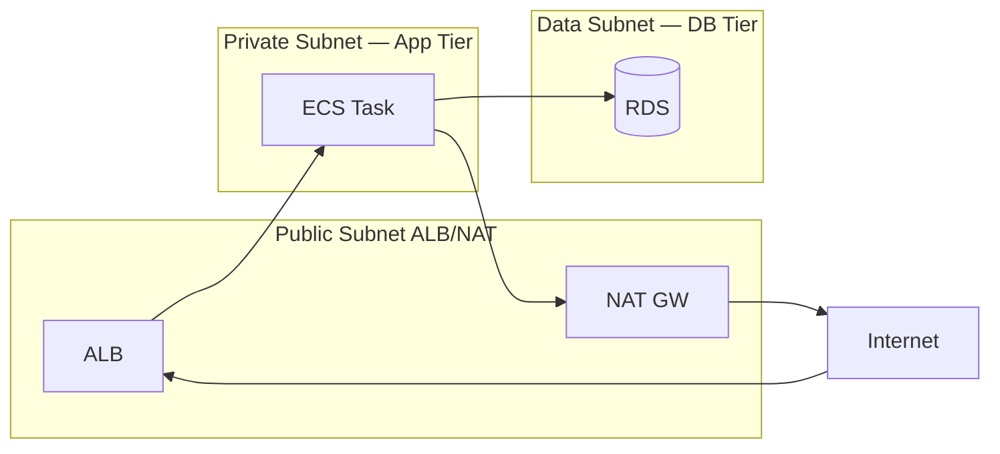

# ECS Network Isolation

> task 를 private subnet + 최소 SG + VPC Endpoint 로. public IP 절대 금지.

## 1. VPC 구조 (3-tier)



| Subnet | 용도 | 라우팅 |
| --- | --- | --- |
| Public | ALB / NAT | IGW |
| Private | ECS task | NAT (outbound only) |
| Data | RDS / ElastiCache | no internet |

## 2. ECS Task — private subnet

```bash
--network-configuration "awsvpcConfiguration={subnets=[subnet-priv-a,...],securityGroups=[sg-task],assignPublicIp=DISABLED}"
```

> `assignPublicIp=ENABLED` 는 절대 안 됨 (NAT 비용 + 보안).

## 3. Security Group — 3 layer

### SG: ALB (sg-alb)
```
Ingress: 0.0.0.0/0 → 443
Egress:  sg-task   → 8080
```

### SG: Task (sg-task)
```
Ingress: sg-alb     → 8080   (ALB only)
         sg-task    → 8080   (task ↔ task — internal)
Egress:  sg-db      → 3306
         sg-redis   → 6379
         0.0.0.0/0  → 443    (VPC Endpoint / ECR / S3)
```

### SG: RDS (sg-db)
```
Ingress: sg-task → 3306
Egress:  none
```

> SG 끼리 reference (CIDR 보다 안전).

## 4. NACL

stateless. SG 보완. allow rule + deny rule 양쪽 명시 필요.

| | SG | NACL |
| --- | --- | --- |
| level | ENI | Subnet |
| stateful | ✓ | ✗ |
| rule | allow only | allow + deny |
| 권장 | 기본 도구 | 차단 시 사용 |

## 5. VPC Endpoint — NAT 비용 0

| Service | Type | 비용 |
| --- | --- | --- |
| S3 / DynamoDB | Gateway | 무료 |
| ECR (api + dkr) | Interface | $7/월/AZ |
| Logs | Interface | $7/월/AZ |
| SSM / Secrets Manager | Interface | $7/월/AZ |
| ECS / ECS-Agent / ECS-Telemetry | Interface | $7/월/AZ |
| KMS | Interface | $7/월/AZ |

```bash
aws ec2 create-vpc-endpoint --vpc-id vpc-xxx \
  --service-name com.amazonaws.ap-northeast-2.ecr.dkr \
  --vpc-endpoint-type Interface \
  --subnet-ids subnet-priv-a subnet-priv-b subnet-priv-c \
  --security-group-ids sg-endpoint \
  --private-dns-enabled
```

## 6. PrivateLink — 외부 SaaS

회사 자체 PrivateLink 로 Datadog / MongoDB Atlas / Snowflake → public 우회.

## 7. WAF + Shield

ALB 앞:
- AWS WAF → SQL injection / XSS / rate limit (IP / 5분)
- Shield Standard 무료 / Advanced $3000/월

## 8. VPC Flow Logs

```bash
aws ec2 create-flow-logs \
  --resource-type VPC --resource-ids vpc-xxx \
  --traffic-type ALL \
  --log-destination-type cloud-watch-logs \
  --log-destination arn:aws:logs:...:log-group:vpc-flow
```

→ ENI level 모든 traffic. blocked / accepted 모두 audit.

## 9. Egress 제한 (egress only IGW / DNS firewall)

- Route 53 Resolver DNS Firewall — 특정 domain 만 allow
- VPC Network Firewall — Suricata rule

## 10. Service Connect mTLS

task 간 자동 TLS — [[../03-service/04-service-discovery-and-connect]] §5.

## 11. 흔한 함정

| 함정 | 회피 |
| --- | --- |
| public IP 부여 | DISABLED |
| 0.0.0.0/0 ingress | SG reference |
| 모든 traffic NAT | VPC Endpoint |
| Flow Log OFF | 활성 |
| WAF rule 0 | OWASP managed rule |
| NACL allow only | 차단 시 사용 |

## 12. 다음

- ▶ [[03-secret-management]]
- ▶ [[04-image-security]]
- ▶ [[../../network/vpc/vpc]]

## 13. 영상 / 자료

| 자료 |
| --- |
| [VPC + ECS](https://docs.aws.amazon.com/AmazonECS/latest/developerguide/networking.html) |
| [VPC Endpoint](https://docs.aws.amazon.com/vpc/latest/privatelink/vpc-endpoints.html) |

## 14. 참고

- [[../ecs]]
- [[../02-task-definition/03-network-mode]]
- [[../03-service/05-load-balancer-integration]]
