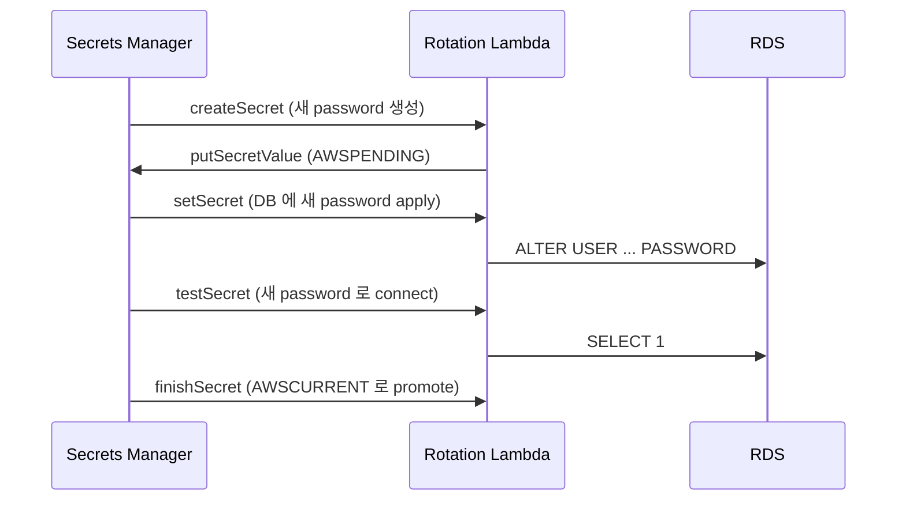

# ECS Secret Management

> Task definition `secrets` 활용 — SSM SecureString / Secrets Manager. KMS encrypt + rotation. plain text env 절대 금지.

## 1. 비교

| | SSM Parameter SecureString | Secrets Manager |
| --- | --- | --- |
| 비용 | 무료 (Standard) | $0.40/secret/월 |
| size limit | 4KB (Standard) / 8KB (Advanced) | 64KB |
| rotation | ✗ (Lambda 직접) | ✓ (자동) |
| 권장 | 일반 secret | DB password / API key 자동 rotation |

## 2. SSM SecureString

```bash
aws ssm put-parameter \
  --name /bkurs-be/prod/DB_PASSWORD \
  --value "P@ssw0rd!" --type SecureString \
  --key-id alias/bkurs-prod \
  --tags Key=Environment,Value=prod Key=Service,Value=bkurs-be
```

Task definition:
```json
{
  "secrets": [
    { "name": "DB_PASSWORD", "valueFrom": "arn:aws:ssm:...:parameter/bkurs-be/prod/DB_PASSWORD" }
  ]
}
```

## 3. Secrets Manager

```bash
aws secretsmanager create-secret \
  --name bkurs-be/prod/db \
  --secret-string '{"username":"bkurs","password":"P@ss","host":"rds.xxx.rds.amazonaws.com","port":3306,"dbname":"bkurs"}' \
  --kms-key-id alias/bkurs-prod
```

Task definition:
```json
{
  "secrets": [
    { "name": "DB_HOST",     "valueFrom": "arn:secret:bkurs-be/prod/db:host::" },
    { "name": "DB_USER",     "valueFrom": "arn:secret:bkurs-be/prod/db:username::" },
    { "name": "DB_PASSWORD", "valueFrom": "arn:secret:bkurs-be/prod/db:password::" }
  ]
}
```

> JSON key selector `:KEY::` 가 핵심.

## 4. Automatic Rotation (Secrets Manager)

```bash
aws secretsmanager rotate-secret \
  --secret-id bkurs-be/prod/db \
  --rotation-lambda-arn arn:lambda:...:function:SecretsManagerRDSPostgreSQLRotationSingleUser \
  --rotation-rules AutomaticallyAfterDays=30
```

> RDS Postgres / MySQL / Aurora / Redshift / DocumentDB 의 4 rotation Lambda 가 미리 제공.



> task 는 다음 deployment 또는 secret cache TTL 후 갱신. **즉시 반영 필요면 force-new-deployment**.

## 5. KMS 통합

- SSM SecureString: KMS key 필수
- Secrets Manager: KMS key 필수
- Task Role 의 `kms:Decrypt` 권한 필요 (with Condition `kms:ViaService`)

## 6. plain text env 사용 안 됨

```json
// ✗ 금지
{ "environment": [ { "name": "DB_PASSWORD", "value": "P@ssw0rd!" } ] }

// ✓ 표준
{ "secrets":     [ { "name": "DB_PASSWORD", "valueFrom": "arn:ssm:..." } ] }
```

> `environment` 는 `aws ecs describe-task-definition` 으로 평문 노출. `secrets` 는 task 내에서만.

## 7. environmentFiles (S3)

```json
{
  "environmentFiles": [
    { "value": "arn:aws:s3:::bkurs-config/prod.env", "type": "s3" }
  ]
}
```

- S3 server-side encryption + bucket policy 로 보호
- secret 자체보다는 일반 config 추천

## 8. application level — Spring Boot

`bootstrap.yml`:
```yaml
aws:
  paramstore:
    enabled: true
    prefix: /bkurs-be
    profile-separator: /
    fail-fast: true
```

Spring Cloud AWS — Parameter Store 직접 호출 (env injection 없이).

## 9. Audit

```bash
# Secrets Manager
aws cloudtrail lookup-events \
  --lookup-attributes AttributeKey=EventName,AttributeValue=GetSecretValue \
  --max-items 50

# SSM
aws cloudtrail lookup-events \
  --lookup-attributes AttributeKey=EventName,AttributeValue=GetParameters
```

## 10. 흔한 함정

| 함정 | 회피 |
| --- | --- |
| plain text env | `secrets` 또는 `environmentFiles` |
| KMS 권한 누락 | `kms:Decrypt` + Condition |
| rotation 후 task 안 갱신 | force-new-deployment 또는 cache TTL |
| Secrets Manager $$$ | 일반 config → SSM, 자동 rotation 만 Secrets Manager |
| JSON key selector 빠짐 | `:KEY::` |

## 11. 권장 — bkurs-be

- DB password: Secrets Manager (auto rotation 30일)
- JWT secret: Secrets Manager
- API key (OpenAI / Kakao / SES) : SSM SecureString
- 일반 config (DB host, region): plain env

## 12. 다음

- ▶ [[04-image-security]]
- ▶ [[01-iam-best-practices]]
- ▶ [[../../security-and-iam/secrets-manager/secrets-manager]]
- ▶ [[../../security-and-iam/kms/kms]]

## 13. 영상 / 자료

| 자료 |
| --- |
| [Secrets Manager — AWS](https://www.youtube.com/watch?v=VqXucHxh1KE) |
| [Secret rotation](https://docs.aws.amazon.com/secretsmanager/latest/userguide/rotating-secrets.html) |

## 14. 참고

- [[../ecs]]
- [[../02-task-definition/05-environment-and-secrets]]
- [[../02-task-definition/06-iam-roles]]
