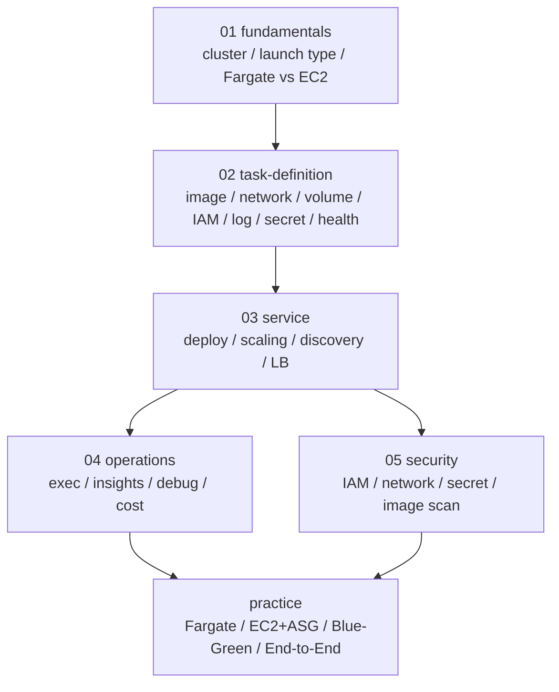

# AWS ECS — 마스터 hub

| 버전 | 작성일 | 주요 변경 |
| --- | --- | --- |
| v.1.0.0 | 2026-05-14 | ECS 개념 + Fargate + 사용 |
| v.2.0.0 | 2026-05-22 | 5 카테고리 sub-directory 화 (fundamentals / task-definition / service / operations / security) + practice + 학습 영상 |

**[[../compute|↑ Compute]]** · **[[../../cloud-aws|↑↑ AWS]]**

> AWS 의 **container orchestrator** — Kubernetes 와 같은 의도 + AWS native + 단순. 본 hub 는
> 인덱스만, 깊이는 sub-directory.

---

## 1. 학습 로드맵

---

## 2. 전체 인덱스

### 01 fundamentals — 기초 (필수, 통과 후 02 로)
| doc | 내용 |
| --- | --- |
| [[01-fundamentals/01-architecture]] | 6 개념 + cluster/task/service 의 관계 + control plane / data plane |
| [[01-fundamentals/02-launch-type-and-capacity-provider]] | Fargate / EC2 / EXTERNAL + Capacity Provider Strategy |
| [[01-fundamentals/03-fargate-deep]] | Fargate microVM / Firecracker / Graviton / 가격 모델 |
| [[01-fundamentals/04-ecs-vs-eks-vs-lambda]] | 선택 기준 + 마이그레이션 시나리오 |

### 02 task-definition — Task 설계 (8 sub, 후속)
| doc | 내용 |
| --- | --- |
| [[02-task-definition/01-overview]] | 구조 + family / revision / containerDefinitions |
| [[02-task-definition/02-image-and-resources]] | image / cpu / memory / pids / GPU |
| [[02-task-definition/03-network-mode]] | awsvpc (Fargate default) / bridge / host / none |
| [[02-task-definition/04-volumes-and-efs]] | bind / EFS / FSx / ephemeral storage |
| [[02-task-definition/05-environment-and-secrets]] | env / secrets (SSM / Secrets Manager) / envFiles |
| [[02-task-definition/06-iam-roles]] | Task Execution Role vs Task Role — 차이 + 권장 정책 |
| [[02-task-definition/07-logging]] | awslogs / firelens (fluentbit) / splunk / external |
| [[02-task-definition/08-healthcheck]] | container healthCheck + dependsOn + ALB target group |

### 03 service — Service 운영 (5 sub, 후속)
| doc | 내용 |
| --- | --- |
| [[03-service/01-service-overview]] | desiredCount / schedulingStrategy / deploymentController |
| [[03-service/02-deployment-rolling-and-bg]] | rolling (ECS default) / Blue-Green (CodeDeploy) / external |
| [[03-service/03-auto-scaling]] | target tracking / step scaling / scheduled / Application Auto Scaling |
| [[03-service/04-service-discovery-and-connect]] | Cloud Map (DNS) / ECS Service Connect (service mesh) |
| [[03-service/05-load-balancer-integration]] | ALB / NLB target group + health check + sticky / SNI |

### 04 operations — 운영 / 모니터링 (4 sub, 후속)
| doc | 내용 |
| --- | --- |
| [[04-operations/01-ecs-exec]] | SSM agent + ecs exec → 컨테이너 안 shell |
| [[04-operations/02-container-insights]] | CloudWatch Container Insights + 대시보드 + alarm |
| [[04-operations/03-troubleshooting]] | task fail / stopped reason / ENI 부족 / image pull fail |
| [[04-operations/04-cost-optimization]] | Fargate Spot / Compute Savings Plan / EC2 Reserved / right-sizing |

### 05 security — 보안 (4 sub, 후속)
| doc | 내용 |
| --- | --- |
| [[05-security/01-iam-best-practices]] | least privilege + boundary + IRSA-like |
| [[05-security/02-network-isolation]] | private subnet / SG / VPC endpoints / awsvpc trunking |
| [[05-security/03-secret-management]] | SSM Parameter Store vs Secrets Manager + rotation |
| [[05-security/04-image-security]] | ECR scan / Cosign signing + ECS validate (후속) |

### practice — 실습 (4 sub, 후속)
| 실습 | 내용 |
| --- | --- |
| [[practice/01-fargate-first-service]] | 첫 Fargate service — Hello world container |
| [[practice/02-ec2-with-asg]] | EC2 capacity provider + ASG + bin-packing |
| [[practice/03-blue-green-with-codedeploy]] | CodeDeploy Blue-Green + alarm rollback |
| [[practice/04-spring-boot-end-to-end]] | Spring Boot + RDS + ALB + Container Insights 종합 |

---

## 3. 5 분 정리

| 개념 | 한 줄 |
| --- | --- |
| **Cluster** | 논리 그룹 (capacity provider 묶음) |
| **Task Definition** | container spec (image / cpu / mem / network / IAM / env / log / health) |
| **Task** | 실행 중인 container 인스턴스 (1 task = 1+ container) |
| **Service** | desiredCount 유지 + 자동 재시작 + LB 통합 |
| **Capacity Provider** | task 를 어디서 실행할까 (Fargate / Fargate Spot / EC2 ASG) |
| **Launch Type** | Fargate / EC2 / EXTERNAL (직접 호스트) |

자세히 → [[01-fundamentals/01-architecture]]

---

## 4. 학습 영상

| 영상 | 길이 | 추천 |
| --- | --- | --- |
| [AWS ECS Tutorial — TechWorld with Nana](https://www.youtube.com/watch?v=esISkPlnxL0) | 90분 | 종합 입문 ★★ |
| [ECS vs EKS vs Fargate — A Cloud Guru](https://www.youtube.com/watch?v=q-bvFKgjnY8) | 15분 | 선택 기준 |
| [ECS Deep Dive — re:Invent 2023](https://www.youtube.com/watch?v=NEFazIw_5g8) | 60분 | 깊이 |
| [ECS Service Connect — AWS](https://www.youtube.com/watch?v=Bz5ZWWiQUKw) | 30분 | service mesh |
| [Fargate Best Practices — re:Invent](https://www.youtube.com/watch?v=YJjA5KIu4FA) | 50분 | 운영 |
| [AWS Containers Roadmap](https://github.com/aws/containers-roadmap) | github | 신기능 추적 |

---

## 5. 관련

- [[../compute]] — Compute hub
- [[../ec2/ec2]] — EC2 (ECS EC2 launch 의 underlying)
- [[../ecr/ecr]] — Container Registry
- [[../eks/eks]] — Kubernetes 대안
- [[../lambda/lambda]] — serverless 대안
- [[../../network/alb/alb]] — Load Balancer 통합
- [[../../iam/iam]] — IAM Role
- [[../../observability/cloudwatch/cloudwatch]] — Container Insights
- [[../../../docker/docker]] — Docker (image / Dockerfile)
- [[../../../docker/practice/practice]] — Docker 실습
- [[../../../../10-projects/bkurs-be/handover/operations/env-deployment]] — bkurs-be 의 ECS on EC2 배포 SSoT

## 6. 참고

- 공식 docs: https://docs.aws.amazon.com/ecs/
- ECS Workshop: https://ecsworkshop.com/
- Containers Roadmap: https://github.com/aws/containers-roadmap
