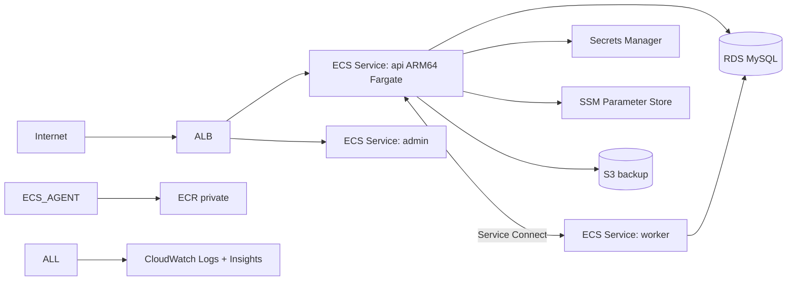

# 실습 4 — Spring Boot end-to-end

> 목표: bkurs-be 와 유사한 실제 production-grade 구성. 2~3 시간.

## 구성



## 1. VPC + Subnet (3-tier)

```bash
# CDK / Terraform 권장 — 여기선 CDK
npx aws-cdk init app --language typescript
```

`lib/network-stack.ts`:
```typescript
import { Stack, StackProps } from 'aws-cdk-lib';
import { Construct } from 'constructs';
import * as ec2 from 'aws-cdk-lib/aws-ec2';

export class NetworkStack extends Stack {
  public readonly vpc: ec2.Vpc;
  constructor(scope: Construct, id: string, props?: StackProps) {
    super(scope, id, props);
    this.vpc = new ec2.Vpc(this, 'Vpc', {
      maxAzs: 3,
      natGateways: 1,
      subnetConfiguration: [
        { name: 'public',  subnetType: ec2.SubnetType.PUBLIC,             cidrMask: 24 },
        { name: 'private', subnetType: ec2.SubnetType.PRIVATE_WITH_EGRESS, cidrMask: 24 },
        { name: 'data',    subnetType: ec2.SubnetType.PRIVATE_ISOLATED,    cidrMask: 24 },
      ],
      gatewayEndpoints: { S3: { service: ec2.GatewayVpcEndpointAwsService.S3 } },
    });
    for (const svc of ['ECR_DOCKER','ECR','SECRETS_MANAGER','SSM','CLOUDWATCH_LOGS']) {
      this.vpc.addInterfaceEndpoint(svc, { service: ec2.InterfaceVpcEndpointAwsService[svc] });
    }
  }
}
```

## 2. RDS

```typescript
import * as rds from 'aws-cdk-lib/aws-rds';
const cluster = new rds.DatabaseInstance(this, 'Db', {
  engine: rds.DatabaseInstanceEngine.mysql({ version: rds.MysqlEngineVersion.VER_9_0 }),
  vpc, vpcSubnets: { subnetType: ec2.SubnetType.PRIVATE_ISOLATED },
  instanceType: ec2.InstanceType.of(ec2.InstanceClass.T4G, ec2.InstanceSize.SMALL),
  credentials: rds.Credentials.fromGeneratedSecret('admin'),
  multiAz: true, backupRetention: cdk.Duration.days(7), storageEncrypted: true,
});
```

## 3. Spring Boot — application.yml

```yaml
spring:
  datasource:
    url: jdbc:mysql://${DB_HOST}:${DB_PORT}/${DB_NAME}
    username: ${DB_USER}
    password: ${DB_PASSWORD}
  jpa:
    hibernate.ddl-auto: validate
management:
  endpoints.web.exposure.include: health,info,prometheus
  endpoint.health.probes.enabled: true
  health.livenessstate.enabled: true
  health.readinessstate.enabled: true
```

## 4. Dockerfile (distroless + ARM64)

```dockerfile
# syntax=docker/dockerfile:1.7
FROM --platform=$BUILDPLATFORM eclipse-temurin:21-jdk AS build
WORKDIR /src
COPY --link gradlew settings.gradle.kts build.gradle.kts ./
COPY --link gradle gradle
RUN --mount=type=cache,target=/root/.gradle ./gradlew --no-daemon dependencies || true
COPY --link . .
RUN --mount=type=cache,target=/root/.gradle ./gradlew --no-daemon bootJar -x test

FROM gcr.io/distroless/java21-debian12:nonroot
WORKDIR /app
COPY --from=build /src/build/libs/*.jar /app/app.jar
EXPOSE 8080
USER nonroot:nonroot
ENTRYPOINT ["java","-XX:MaxRAMPercentage=75","-jar","/app/app.jar"]
```

## 5. Task definition

```typescript
const td = new ecs.FargateTaskDefinition(this, 'ApiTd', {
  cpu: 1024, memoryLimitMiB: 2048,
  runtimePlatform: { cpuArchitecture: ecs.CpuArchitecture.ARM64, operatingSystemFamily: ecs.OperatingSystemFamily.LINUX },
});

td.addContainer('api', {
  image: ecs.ContainerImage.fromEcrRepository(repo, 'v1.0.0'),
  portMappings: [{ containerPort: 8080, name: 'http', appProtocol: ecs.AppProtocol.http }],
  logging: ecs.LogDrivers.awsLogs({ streamPrefix: 'api', logRetention: logs.RetentionDays.ONE_MONTH }),
  environment: { JAVA_OPTS: '-XX:MaxRAMPercentage=75' },
  secrets: {
    DB_HOST:     ecs.Secret.fromSecretsManager(dbSecret, 'host'),
    DB_PORT:     ecs.Secret.fromSecretsManager(dbSecret, 'port'),
    DB_NAME:     ecs.Secret.fromSecretsManager(dbSecret, 'dbname'),
    DB_USER:     ecs.Secret.fromSecretsManager(dbSecret, 'username'),
    DB_PASSWORD: ecs.Secret.fromSecretsManager(dbSecret, 'password'),
  },
  healthCheck: { command: ['CMD-SHELL', 'curl -fsS http://localhost:8080/actuator/health/liveness || exit 1'], interval: cdk.Duration.seconds(30), startPeriod: cdk.Duration.seconds(60) },
});
```

## 6. Service + auto scaling + Service Connect

```typescript
const ns = new servicediscovery.PrivateDnsNamespace(this, 'NS', { name: 'bkurs.internal', vpc });
cluster.addDefaultCloudMapNamespace({ name: 'bkurs.internal', useForServiceConnect: true });

const svc = new ecs.FargateService(this, 'Api', {
  cluster, taskDefinition: td, desiredCount: 3,
  capacityProviderStrategies: [
    { capacityProvider: 'FARGATE',      base: 2, weight: 1 },
    { capacityProvider: 'FARGATE_SPOT', weight: 4 },
  ],
  circuitBreaker: { rollback: true },
  enableExecuteCommand: true,
  healthCheckGracePeriod: cdk.Duration.seconds(120),
  serviceConnectConfiguration: {
    namespace: 'bkurs.internal',
    services: [{ portMappingName: 'http', port: 8080, dnsName: 'api' }],
    logDriver: ecs.LogDrivers.awsLogs({ streamPrefix: 'envoy' }),
  },
});

const scalable = svc.autoScaleTaskCount({ minCapacity: 3, maxCapacity: 20 });
scalable.scaleOnCpuUtilization('cpu', { targetUtilizationPercent: 60 });
scalable.scaleOnMemoryUtilization('mem', { targetUtilizationPercent: 70 });
scalable.scaleOnRequestCount('rps', { requestsPerTarget: 500, targetGroup: tg });
```

## 7. ALB + listener rule

```typescript
const alb = new elbv2.ApplicationLoadBalancer(this, 'Alb', { vpc, internetFacing: true });
const lis = alb.addListener('HTTPS', { port: 443, certificates: [cert] });

const tgApi = lis.addTargets('Api', {
  port: 8080, protocol: elbv2.ApplicationProtocol.HTTP,
  targets: [svc],
  healthCheck: { path: '/actuator/health/readiness', healthyThresholdCount: 2, interval: cdk.Duration.seconds(15) },
  deregistrationDelay: cdk.Duration.seconds(30),
});

lis.addAction('admin', {
  conditions: [elbv2.ListenerCondition.pathPatterns(['/admin/*'])],
  priority: 10,
  action: elbv2.ListenerAction.forward([tgAdmin]),
});
```

## 8. CodePipeline (CI/CD)

GitHub Actions → ECR push → CodeDeploy Blue-Green:
```yaml
- name: Build
  run: |
    docker buildx build --platform linux/arm64 -t $ECR:$SHA --push .
- name: Render task definition
  uses: aws-actions/amazon-ecs-render-task-definition@v1
  with: { task-definition: taskdef.json, container-name: api, image: ${{ env.ECR }}:${{ env.SHA }} }
- name: Deploy
  uses: aws-actions/amazon-ecs-deploy-task-definition@v1
  with: { task-definition: ${{ steps.render.outputs.task-definition }}, service: api, cluster: bkurs-prod, codedeploy-appspec: appspec.yaml, codedeploy-application: api, codedeploy-deployment-group: dg1 }
```

## 9. Observability

- Container Insights `ON`
- Alarms: ALB 5xx / Target Response Time / Task CPU+Mem
- Logs Insights query saved
- EventBridge → Discord (task STOPPED)
- X-Ray (옵션) — `aws-xray-sdk-spring-boot`

## 10. Security check

- Task / Execution role 분리 ([[../05-security/01-iam-best-practices]])
- Secrets Manager + rotation 30일 ([[../05-security/03-secret-management]])
- private subnet + SG reference + VPC Endpoint ([[../05-security/02-network-isolation]])
- ECR scanOnPush + IMMUTABLE + distroless ([[../05-security/04-image-security]])
- ECS Exec audit ON ([[../04-operations/01-ecs-exec]])

## 11. 학습 포인트

- 3-tier VPC + VPC Endpoint
- Fargate ARM64 Spot mix
- Service Connect 자동 DNS + Envoy metric
- Secrets Manager 자동 rotation → DB password
- Spring Boot Liveness / Readiness 분리
- CodeDeploy Blue-Green + alarm rollback
- 5 security pillar 통합

## 12. 비용

| 항목 | 월 |
| --- | --- |
| Fargate ARM64 3 base + 5 spot | $80 |
| RDS t4g.small Multi-AZ | $50 |
| ALB | $20 |
| NAT (1 AZ) | $32 |
| Logs (30d) | $10 |
| ECR | <$1 |
| Secrets Manager (2) | $1 |
| **합계** | **~$195/월** |

## 13. 다음

- ▶ [[../ecs]]
- ▶ [[../04-operations/04-cost-optimization]]
- ▶ [[../../../../10-projects/bkurs-be/handover/operations/env-deployment]]

## 14. 참고

- [[../ecs]]
- [[01-fargate-first-service]] / [[02-ec2-with-asg]] / [[03-blue-green-with-codedeploy]]
- 모든 03-service / 04-operations / 05-security
