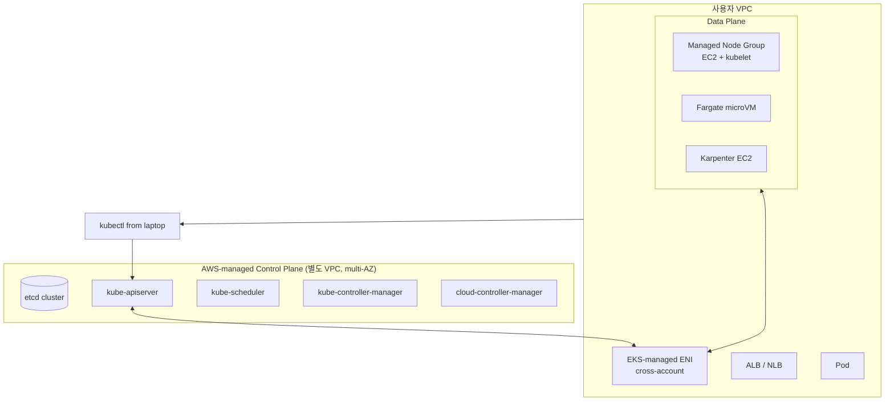
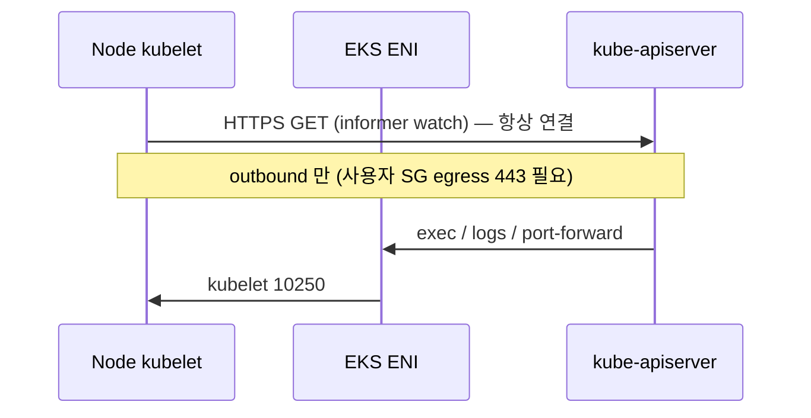
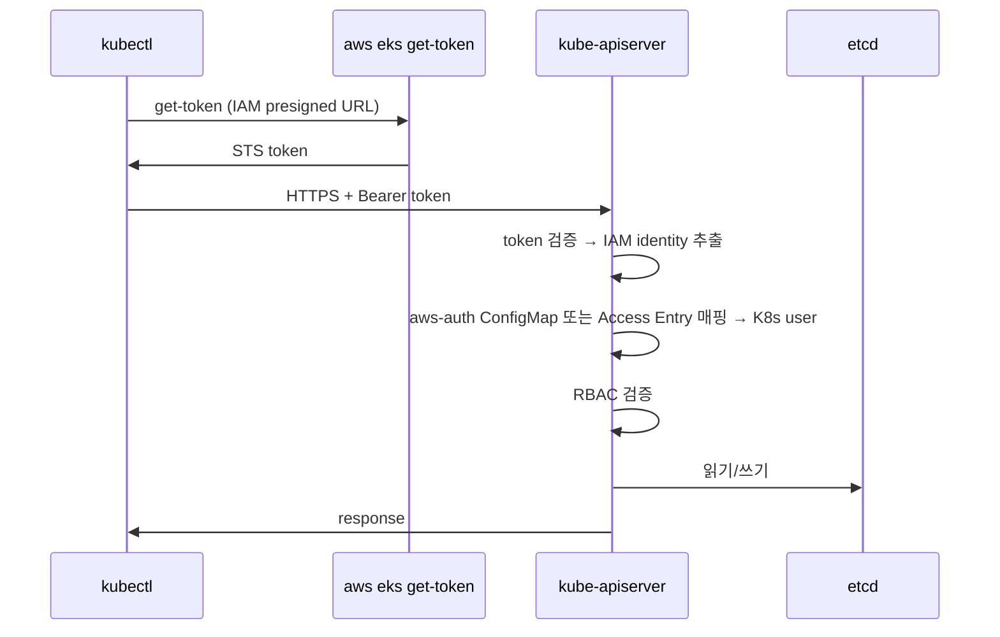

# EKS Architecture

> Control Plane (Managed multi-AZ) + Data Plane (EC2/Fargate). VPC ENI 로 cross-account network 연결.

## 1. 전체 구조



## 2. Control Plane 구성

| 컴포넌트 | 역할 | 가시성 |
| --- | --- | --- |
| **etcd** | cluster state (key-value DB) | ✗ (AWS managed) |
| **kube-apiserver** | API gateway | ✓ (public/private endpoint) |
| **kube-scheduler** | pod → node 결정 | ✗ |
| **kube-controller-manager** | controller loop | ✗ |
| **cloud-controller-manager** | AWS API 호출 (ELB / EBS) | ✗ |

> 3 AZ 분산 + etcd Raft. SLA 99.95%. patches / upgrades AWS 책임.

## 3. Data Plane 구성

| 옵션 | 누가 관리 | 패치 |
| --- | --- | --- |
| **Managed Node Group** | AWS (ASG) + 사용자 | AWS 가 새 AMI 출시 → 사용자가 drain+rolling update |
| **Self-managed Node** | 사용자 (직접 ASG / Launch Template) | 직접 |
| **Fargate** | AWS (microVM) | AWS |
| **Karpenter** | 사용자 (Karpenter controller) + AWS (EC2) | Karpenter 가 자동 |
| **EKS Auto Mode** (2024) | AWS | AWS |

## 4. Cluster endpoint

```
public:           kubectl from internet (default — IP allowlist)
private:          VPC 안에서만
public + private: 둘 다
```

```bash
aws eks update-cluster-config --name bkurs-prod \
  --resources-vpc-config endpointPrivateAccess=true,endpointPublicAccess=true,publicAccessCidrs=[\"203.0.113.0/24\"]
```

권장: production = **private + IP-restricted public** (kubectl 가능).

## 5. Cross-account ENI (control plane → node 통신)

EKS 가 사용자 VPC 에 자동 ENI 생성 (AWS 가 소유, 사용자 subnet 에 위치):
- `kube-apiserver` → `kubelet` (exec / logs / port-forward)
- 사용자 subnet 최소 2 AZ 필요 (multi-AZ HA)

## 6. Node ↔ Control Plane 통신



→ Node SG 의 inbound 10250 (from EKS ENI) + outbound 443 (to apiserver).

## 7. kubectl 의 흐름



자세히 → [[../05-security/02-rbac-and-aws-auth]]

## 8. Managed Add-on

AWS 가 lifecycle 관리하는 cluster 기본 컴포넌트:

| Add-on | 역할 |
| --- | --- |
| **VPC CNI** | pod 가 VPC IP 직접 ([[../03-networking/01-vpc-cni-and-pod-network]]) |
| **CoreDNS** | cluster DNS |
| **kube-proxy** | Service iptables/ipvs |
| **EBS CSI Driver** | PersistentVolume → EBS ([[../02-workload/03-storage-csi]]) |
| **EFS CSI Driver** | EFS |
| **Pod Identity Agent** | Pod Identity ([[../05-security/01-irsa-pod-identity]]) |
| **CloudWatch Observability** | metric / log |
| **Snapshot Controller** | CSI snapshot |
| **Mountpoint S3 CSI** | S3 mount |
| **Adot** | OpenTelemetry |

```bash
aws eks list-addons --cluster-name bkurs-prod
aws eks describe-addon-versions --kubernetes-version 1.30 \
  --addon-name vpc-cni \
  --query 'addons[0].addonVersions[0].addonVersion'

aws eks create-addon --cluster-name bkurs-prod \
  --addon-name vpc-cni --addon-version v1.18.0-eksbuild.1 \
  --resolve-conflicts OVERWRITE
```

## 9. Etcd / 스토리지

- AWS 가 etcd 운영 (multi-AZ, encryption at rest with KMS, snapshot)
- 사용자가 추가 KMS key 사용 가능:
```bash
aws eks create-cluster --encryption-config "[{\"resources\":[\"secrets\"],\"provider\":{\"keyArn\":\"arn:aws:kms:...:key/abc\"}}]"
```

→ Kubernetes Secret 만 envelope encryption.

## 10. K8s 객체 hierarchy

```
Cluster
├─ Namespace (격리)
│  ├─ Pod (1+ container)
│  ├─ Deployment / StatefulSet / DaemonSet / Job (workload)
│  ├─ Service (Pod 묶음 가상 IP)
│  ├─ Ingress / HTTPRoute (외부 진입)
│  ├─ ConfigMap / Secret (설정)
│  ├─ ServiceAccount (Pod identity)
│  ├─ PersistentVolumeClaim → PV (스토리지)
│  └─ NetworkPolicy (방화벽)
├─ Node (Pod 실행 머신)
├─ PersistentVolume (cluster-wide storage)
├─ StorageClass / VolumeAttachment
├─ ClusterRole / ClusterRoleBinding (RBAC)
└─ CustomResourceDefinition (확장)
```

## 11. 흔한 함정

| 함정 | 회피 |
| --- | --- |
| public endpoint open to 0.0.0.0/0 | private + IP 제한 |
| node subnet 1 AZ | 최소 2 AZ |
| ENI 부족 (subnet 작음) | /24 이상 / Prefix Delegation |
| etcd KMS encryption 비활성 | encryption-config |
| Managed Add-on 안 쓰고 self | managed 권장 |
| version 14개월 지나 Extended Support | 적시 upgrade |

## 12. 다음

- ▶ [[02-cluster-and-versioning]]
- ▶ [[03-node-types]]
- ▶ [[04-eks-vs-ecs-vs-vanilla-k8s]]

## 13. 영상 / 자료

| 자료 |
| --- |
| [EKS Internals — re:Invent](https://www.youtube.com/watch?v=4sn5NHt5cWM) |
| [공식 EKS Architecture](https://docs.aws.amazon.com/eks/latest/userguide/clusters.html) |

## 14. 참고

- [[../eks]]
- [[../../ecs/01-fundamentals/01-architecture]]
- [[../../../network/vpc/vpc]]
