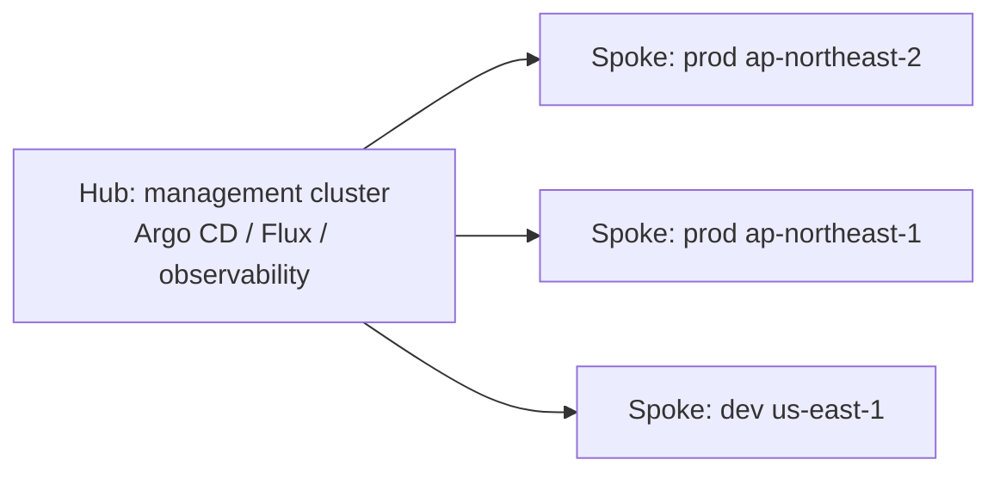

# EKS Cluster + Versioning

> K8s 4개월마다 release. EKS = release 후 ~3개월 지원, 14개월 후 Extended Support 또는 forced upgrade. Version skew 1.

## 1. K8s release cycle

- Major release: 매 4개월 (k8s 1.30 / 1.31 / 1.32)
- EKS 지원: release 후 14개월
- Extended Support: +12개월 ($0.50/h 추가 — control plane $73 → $438/월)

## 2. Version Skew 정책

```
kube-apiserver:  X      (e.g. 1.30)
kubelet:         X, X-1, X-2  (1.30 / 1.29 / 1.28 OK)
kubectl:         X+1, X, X-1
```

→ control plane 먼저 upgrade, node 는 그 다음.

## 3. Upgrade 흐름

```mermaid
flowchart TD
  A[현재 1.29] --> B[1. Control Plane → 1.30]
  B --> C[2. Add-on (VPC CNI/CoreDNS/kube-proxy) upgrade]
  C --> D[3. Managed Node Group 또는 Karpenter NodePool → 1.30 AMI]
  D --> E[4. Fargate Profile re-deploy]
  E --> F[5. 어플리케이션 API 호환 검증]
  F --> G[완료 — 다음 release 까지 ~4개월]
```

```bash
# Control Plane
aws eks update-cluster-version --name bkurs-prod --kubernetes-version 1.30

# Add-on
aws eks update-addon --cluster-name bkurs-prod --addon-name vpc-cni \
  --addon-version v1.18.x-eksbuild.x --resolve-conflicts OVERWRITE

# Managed Node Group
aws eks update-nodegroup-version --cluster-name bkurs-prod \
  --nodegroup-name worker --kubernetes-version 1.30
```

## 4. Upgrade 전 검증

```bash
# Deprecated API 감지
pluto detect-files -d ./k8s-manifests
# 또는 kubent (kube-no-trouble)
kubent --target-version 1.30

# CIS compliance
kube-bench
```

| Common deprecation |
| --- |
| `PodSecurityPolicy` (1.25 제거) → Pod Security Admission |
| `Ingress.extensions/v1beta1` → `networking.k8s.io/v1` |
| `Endpoints` → `EndpointSlices` |

## 5. Cluster 생성

```bash
# eksctl (권장)
eksctl create cluster --name bkurs-prod \
  --region ap-northeast-2 --version 1.30 \
  --vpc-private-subnets subnet-aaa,subnet-bbb,subnet-ccc \
  --vpc-public-subnets subnet-ddd,subnet-eee,subnet-fff \
  --fargate \
  --without-nodegroup

# 또는 aws CLI
aws eks create-cluster --name bkurs-prod --version 1.30 \
  --role-arn arn:aws:iam::...:role/eks-cluster-role \
  --resources-vpc-config "subnetIds=subnet-aaa,subnet-bbb,subnet-ccc,endpointPrivateAccess=true,endpointPublicAccess=true" \
  --encryption-config "[{\"resources\":[\"secrets\"],\"provider\":{\"keyArn\":\"arn:kms:...\"}}]" \
  --logging '{"clusterLogging":[{"types":["api","audit","authenticator","controllerManager","scheduler"],"enabled":true}]}'

# kubectl context
aws eks update-kubeconfig --name bkurs-prod
kubectl get nodes
```

## 6. Control Plane Logging

5 가지 component log → CloudWatch:
- `api` — API server (audit 의 source)
- `audit` — every API request
- `authenticator` — IAM ↔ K8s 매핑
- `controllerManager`
- `scheduler`

```bash
aws eks update-cluster-config --name bkurs-prod \
  --logging '{"clusterLogging":[{"types":["api","audit","authenticator","controllerManager","scheduler"],"enabled":true}]}'
```

> 비용 주의 — audit log 가 가장 큼.

## 7. Add-on 호환성

```bash
aws eks describe-addon-versions --kubernetes-version 1.30 \
  --addon-name vpc-cni \
  --query 'addons[0].addonVersions[].addonVersion'
```

→ K8s version 별 최신 / 호환 list. update-addon 시 명시.

## 8. Extended Support

```
1.29 release date:    2024-02
EKS End of Support:   2025-04 (14개월)
Extended Support 시작: 2025-04 → +12개월 = 2026-04
완전 EOL:             2026-04 이후 자동 upgrade
```

비용:
- Standard: $0.10/h
- Extended: $0.10 + $0.50 = $0.60/h ($438/월)

권장 — Extended Support 가급적 회피, 적시 upgrade.

## 9. blue-green cluster upgrade

major 변경 (e.g., 1.27 → 1.30 jump) 시:
1. 새 cluster 1.30 생성
2. Argo CD / Helm 으로 workload 배포
3. Route 53 / ALB weighted routing 으로 traffic 점진 shift
4. old cluster 종료

## 10. Cluster 삭제

```bash
# 모든 node group / fargate profile 먼저 삭제
eksctl delete cluster --name bkurs-prod --wait

# 또는 cli
aws eks list-nodegroups --cluster-name bkurs-prod \
  | jq -r '.nodegroups[]' | xargs -I{} aws eks delete-nodegroup --cluster-name bkurs-prod --nodegroup-name {}
aws eks delete-cluster --name bkurs-prod
```

## 11. Multi-cluster — Hub-Spoke



장점: GitOps + 중앙 관리. 도구: Argo CD ApplicationSet / Cluster API.

## 12. 흔한 함정

| 함정 | 회피 |
| --- | --- |
| add-on upgrade 빠짐 → version skew | 같은 PR 에 add-on update |
| node 1 AZ → control plane HA 못 살림 | 3 AZ |
| Extended Support 모름 → 4배 비용 | 적시 upgrade 일정 |
| audit log 비활성 → 사고 분석 ↓ | audit 만이라도 활성 |
| deprecated API → 1.25/1.27 단계에서 깨짐 | kubent / pluto 사전 검증 |

## 13. 다음

- ▶ [[03-node-types]]
- ▶ [[04-eks-vs-ecs-vs-vanilla-k8s]]
- ▶ [[../02-workload/01-pod-deployment]]

## 14. 영상 / 자료

| 자료 |
| --- |
| [EKS Version Skew 정책](https://docs.aws.amazon.com/eks/latest/userguide/kubernetes-versions.html) |
| [Extended Support 발표](https://aws.amazon.com/blogs/containers/amazon-eks-extended-support/) |
| [kubent](https://github.com/doitintl/kube-no-trouble) |

## 15. 참고

- [[../eks]]
- [[01-architecture]]
- [[../05-security/02-rbac-and-aws-auth]]
