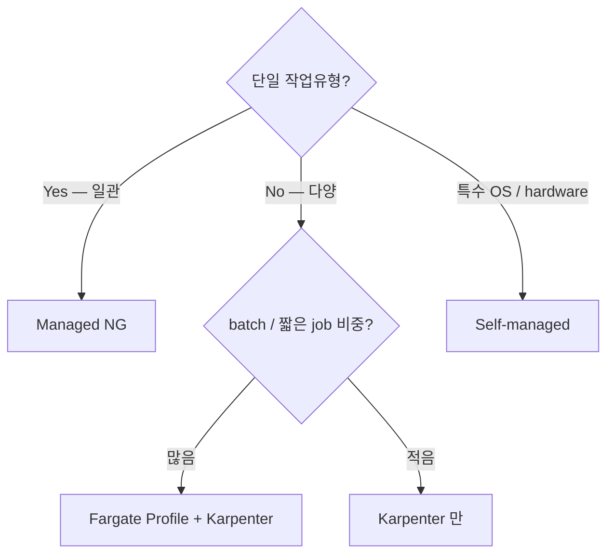

# EKS Node Types

> 4 옵션. Managed NG (간단) / Self-managed (full control) / Fargate (serverless) / Karpenter (효율 ★). 권장: **Karpenter + Fargate 소량 혼합**.

## 1. 4 옵션 비교

| | Managed NG | Self-managed | Fargate | Karpenter |
| --- | --- | --- | --- | --- |
| 기반 | ASG + EC2 | ASG + EC2 (직접) | microVM | EC2 직접 (no ASG) |
| Scaling | Cluster Autoscaler (ASG) | CAS | per-pod | just-in-time |
| Node 수명 | ASG 가 관리 | 사용자 | per-pod | Karpenter 가 즉시 |
| 스케일 속도 | ~5분 | ~5분 | ~30초 | ~30초 (다양한 type) |
| Bin-packing | 보통 | 보통 | per-pod (작은 단위) | ★★★ (자동 right-sizing) |
| 비용 | EC2 + EBS | EC2 | $0.05/vCPU/h | EC2 (Spot 적극) |
| 운영 부담 | ↓ | ↑↑ | ↓↓↓ | ↓ |
| 권장 | 단순 cluster | 특수 요구 | 짧은 job / sensitive | **일반 production ★** |

## 2. Managed Node Group

```bash
eksctl create nodegroup --cluster bkurs-prod \
  --name worker --node-type m7g.large \
  --nodes 3 --nodes-min 2 --nodes-max 10 \
  --instance-types m7g.large,m7g.xlarge \
  --node-labels environment=prod \
  --tags Environment=prod \
  --asg-access \
  --external-dns-access \
  --full-ecr-access \
  --ssh-access --ssh-public-key my-key
```

특징:
- AWS 가 ASG, Launch Template 자동 관리
- AMI 갱신 시 사용자가 `update-nodegroup-version` (drain + rolling)
- Spot instance 옵션
- taint / label 지원
- Capacity Type: ON_DEMAND / SPOT

## 3. Self-managed Node

직접 Launch Template + ASG + bootstrap.sh:
```bash
#!/bin/bash
/etc/eks/bootstrap.sh bkurs-prod \
  --b64-cluster-ca $CA \
  --apiserver-endpoint $ENDPOINT
```

언제: 특수 OS (Bottlerocket / Talos / Flatcar 직접) / 특수 hardware / 커스텀 kubelet args.

## 4. Fargate

Pod 단위 microVM (Firecracker):
```bash
eksctl create fargateprofile --cluster bkurs-prod \
  --name jobs --namespace jobs --labels role=batch
```

특징:
- pod 마다 microVM (격리 ↑)
- vCPU / Memory 만 요청 → AWS 가 capacity 제공
- 비용: $0.05/vCPU/h (ECS Fargate 와 동일)
- 한도:
  - GPU ✗
  - DaemonSet ✗
  - HostNetwork / HostPort / Privileged ✗
  - EBS PVC ✗ (EFS 만)
  - Topology spread ✗ (1 AZ 만)

활용:
- 짧은 batch job
- Service Mesh 통합 (사이드카 limit 주의)
- sensitive workload (격리)
- 변동 큰 traffic spike

## 5. Karpenter (★ 권장)

ASG 없이 직접 EC2 instance 생성 (just-in-time):

```yaml
apiVersion: karpenter.sh/v1
kind: NodePool
metadata:
  name: default
spec:
  template:
    spec:
      requirements:
        - key: kubernetes.io/arch
          operator: In
          values: ["arm64", "amd64"]
        - key: karpenter.k8s.aws/instance-category
          operator: In
          values: ["m", "c", "r"]
        - key: karpenter.k8s.aws/instance-generation
          operator: Gt
          values: ["6"]
        - key: karpenter.sh/capacity-type
          operator: In
          values: ["on-demand", "spot"]
      nodeClassRef:
        name: default
  limits:
    cpu: "1000"
  disruption:
    consolidationPolicy: WhenEmpty
    consolidateAfter: 30s
```

→ Pod 가 pending 되면 Karpenter 가 **알맞은 instance type 직접 launch** (보통 30~60초).

### 장점
- ASG 없음 → instance type 100+ 선택지 자유
- 작은 instance / 큰 instance 자동 선택 (workload 따라)
- Consolidation — 사용 안 하는 instance 자동 종료
- Spot interruption 자동 graceful 교체
- 30초 scale-out

### vs Cluster Autoscaler
| | CAS | Karpenter |
| --- | --- | --- |
| 기반 | ASG | 직접 EC2 |
| 결정 | "어떤 ASG scale-out" | "어떤 instance type 새로" |
| 속도 | ~5분 | ~30초 |
| Bin-packing | 보통 | ★★★ |
| Spot 안정 | 수동 | 자동 (capacityOptimized) |
| 추천 | EOL | ★ |

## 6. 결정 트리



## 7. EKS Auto Mode (2024)

```bash
eksctl create cluster --name auto --enable-auto-mode
```

= AWS 가 Karpenter / Add-on / VPC CNI 통합 관리. 단순 cluster 권장.

## 8. Node Group + Fargate 혼합

```yaml
# critical workload → Managed NG (or Karpenter)
# isolation 필요 → Fargate
# batch → Fargate
```

예시:
```bash
# Fargate Profile — namespace 'jobs' 의 모든 pod
eksctl create fargateprofile --cluster bkurs-prod \
  --name jobs --namespace jobs

# Karpenter 가 main workload (namespace=default) 처리
```

## 9. Bottlerocket

K8s 전용 minimal OS:
- Read-only root filesystem
- Container-aware updates (in-place A/B)
- Atomic image
- AWS 공식 지원

```yaml
amiFamily: Bottlerocket
```

## 10. Taints / Tolerations

```yaml
# Node taint
- key: workload-type
  value: gpu
  effect: NoSchedule

# Pod toleration
tolerations:
  - key: workload-type
    operator: Equal
    value: gpu
    effect: NoSchedule
```

→ critical / GPU node 분리.

## 11. node SG / Security Group

기본 SG (managed):
- ingress: control plane (10250 kubelet)
- ingress: cluster security group (node-to-node)
- egress: 443 (apiserver / IMDS)

추가 SG = `eks.amazonaws.com/managed-security-group` tag.

## 12. 흔한 함정

| 함정 | 회피 |
| --- | --- |
| Cluster Autoscaler 만 (Karpenter 미사용) | Karpenter 권장 |
| Fargate + DaemonSet 안 됨 | Fargate 외에서 |
| Managed NG version 까먹음 | update-nodegroup-version |
| Spot mix 안 함 | Karpenter capacity-type mix |
| Bottlerocket 미사용 | Bottlerocket 권장 |
| Consolidation 비활성 | WhenEmpty/Underutilized |

## 13. 다음

- ▶ [[04-eks-vs-ecs-vs-vanilla-k8s]]
- ▶ [[../04-operations/01-autoscaling-cas-karpenter]]
- ▶ [[../practice/02-karpenter-and-alb-ingress]]

## 14. 영상 / 자료

| 자료 |
| --- |
| [Karpenter Deep Dive](https://www.youtube.com/watch?v=2I9qZQKoTKE) |
| [공식 Karpenter](https://karpenter.sh) |
| [EKS Best Practices — Node](https://aws.github.io/aws-eks-best-practices/karpenter/) |

## 15. 참고

- [[../eks]]
- [[01-architecture]]
- [[../../ecs/01-fundamentals/02-launch-type-and-capacity-provider]]
