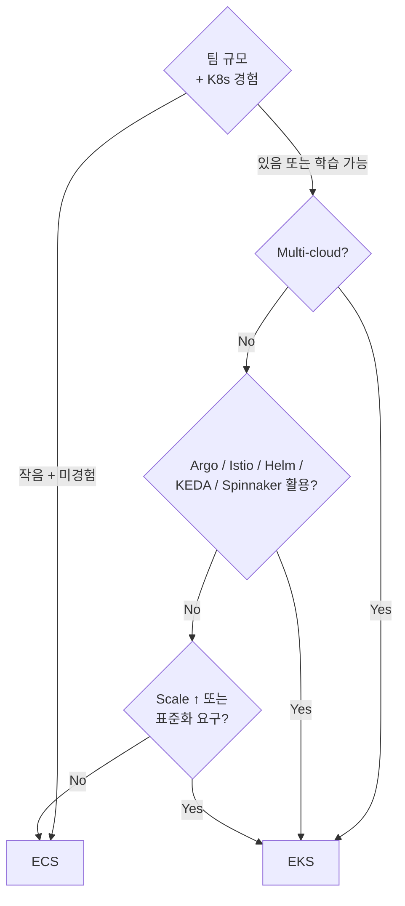

# EKS vs ECS vs Vanilla K8s

> Compute 선택은 비용보다 **운영 부담 + ecosystem + 표준** 의 trade-off.

## 1. 큰 그림

| | EKS | ECS | Vanilla K8s (kops / kubeadm) |
| --- | --- | --- | --- |
| 표준 | Kubernetes | AWS 독자 | Kubernetes |
| 학습 곡선 | 가파름 | 완만 | 가장 가파름 |
| Multi-cloud | ✓ | ✗ | ✓ |
| Control Plane | AWS managed | AWS managed | 직접 |
| Ecosystem | 거대 (Helm/Argo/Istio/KEDA) | AWS 한정 | 거대 |
| 비용 (cluster) | $73/월 | $0 | EC2 만 |
| 운영 부담 | ↑↑ | ↓ | ↑↑↑ |
| HA | 99.95% SLA | 99.9% SLA | 직접 |
| 권장 | 큰 조직 / multi-cloud / 표준 | 작은~중간 / AWS 만 | 학습 / 특수 |

## 2. 결정 트리



## 3. 운영 비교

### ECS — "AWS 가 제공한 도구만 쓰면 충분"
| 영역 | 부담 |
| --- | --- |
| Service 정의 | task definition JSON (간단) |
| 배포 | CodeDeploy Blue-Green |
| Service Discovery | Service Connect (managed) |
| Auto Scaling | Application Auto Scaling |
| Observability | Container Insights 자동 |
| Network | awsvpc per task (자동) |
| Storage | EFS / EBS attach 옵션 |

### EKS — "표준 K8s 의 모든 것을 활용 가능"
| 영역 | 도구 |
| --- | --- |
| Manifest | Helm / Kustomize / Argo CD |
| 배포 | Argo Rollouts / Flagger (canary / shadow) |
| Service Discovery | Service / DNS / Service Mesh (Istio / Linkerd) |
| Auto Scaling | HPA / VPA / KEDA / Cluster Autoscaler / Karpenter |
| Observability | Prometheus / Grafana / Loki / Tempo / Jaeger / OpenTelemetry |
| Network | VPC CNI / Cilium / Calico |
| Storage | EBS/EFS/FSx CSI / Rook / OpenEBS |

> 더 강력하지만 **선택의 짐**.

## 4. 비용 예 — 같은 워크로드 (10 services, 3 nodes equivalent)

| | ECS Fargate | EKS Fargate | EKS Karpenter+Spot |
| --- | --- | --- | --- |
| Cluster | $0 | $73 | $73 |
| Compute | $200 | $200 | $80 (Spot 60%) |
| 외 | ALB / NAT / Logs 동일 | 동일 | 동일 |
| 월 합계 | ~$200 | ~$273 | ~$153 |

→ ECS 가 항상 싸지는 않음. Karpenter+Spot 효율이 더 큼.

## 5. 표준 (vendor lock-in) 관점

| | ECS | EKS |
| --- | --- | --- |
| task definition → docker compose? | 비슷하나 별도 | ✗ |
| ECS Service → K8s Deployment? | ✗ (재작성 필요) | 직접 호환 |
| 다른 cloud (GKE / AKS) 이전 | ✗ (re-write) | ✓ (Helm chart 그대로) |
| On-prem | ECS Anywhere (제한) | EKS Anywhere |

## 6. Vanilla K8s (kops / kubeadm) 가치

| 언제 | 이유 |
| --- | --- |
| 학습 / 자격증 | K8s 내부 이해 |
| 특수 — bare metal | EKS 못 씀 |
| Cost extreme | $73 control plane도 부담 시 (작은 cluster) |
| 완전 control | AWS managed 의 제약 우회 |

→ production 권장 ✗. 사용자가 직접 etcd / control plane HA / 패치 / 모니터링.

## 7. Hybrid 전략

```
Production critical:    EKS (표준 + ecosystem)
Internal tooling:       ECS (간단 + AWS native)
Short batch:            Lambda / Fargate
Event-driven:           Lambda
```

> 회사 규모가 커지면 두 가지 다 운영 — 적재적소.

## 8. Migration

### ECS → EKS
1. task definition → Deployment manifest
2. Service Connect → K8s Service + AWS Load Balancer Controller (Ingress)
3. Application Auto Scaling → HPA + Karpenter
4. CodeDeploy Blue-Green → Argo Rollouts
5. Container Insights → Container Insights for EKS

### EKS → ECS
- 도구 의존 (Argo / Istio) 가 있다면 어렵음
- 단순 Deployment 면 task definition 으로 변환 가능

## 9. bkurs-be 의 권장

```
현재 (스타트업 단계):
- ECS Fargate ARM64 + Service Connect + CodeDeploy
- 작은 팀이 운영 가능
- AWS 만

이전 trigger:
- 팀이 K8s 경험 갖춤
- Multi-region / multi-cloud 요구
- Service Mesh 필요 (Istio)
- ArgoCD GitOps 필요
- 100+ service 운영

→ EKS Auto Mode 또는 EKS + Karpenter
```

## 10. 흔한 잘못된 결정

| 흔한 오해 | 사실 |
| --- | --- |
| "EKS 가 무조건 좋다" | 작은 팀엔 ECS 가 ROI ↑ |
| "ECS 는 lock-in" | EKS 도 AWS Load Balancer Controller / IRSA 등 lock-in 요소 있음 |
| "Vanilla K8s 가 싸다" | 자체 운영 부담 = 사람 비용 (>$73) |
| "EKS = Kubernetes" | EKS 는 K8s 의 AWS managed flavor |
| "Karpenter = ECS Capacity Provider" | 더 강력 + 100+ instance 자유 선택 |

## 11. 영상 / 자료

| 자료 |
| --- |
| [EKS vs ECS — re:Invent](https://www.youtube.com/watch?v=WCbi-pZxhx0) |
| [Container Service comparison](https://docs.aws.amazon.com/decision-guides/latest/containers-on-aws-how-to-choose/) |

## 12. 참고

- [[../eks]]
- [[../../ecs/01-fundamentals/04-ecs-vs-eks-vs-lambda]]
- [[../../lambda/lambda]]
