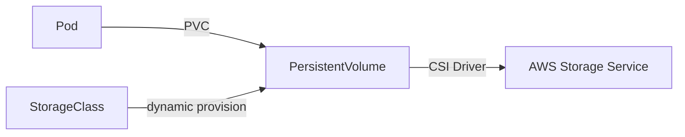

# EKS Storage — CSI

> PersistentVolume + StorageClass + CSI Driver. EBS (block) / EFS (NFS) / S3 (object mount) / FSx (Lustre).

## 1. CSI 개념



| 객체 | 역할 |
| --- | --- |
| **PV** | 실제 volume (cluster-scoped) |
| **PVC** | pod 의 volume 요청 (namespace-scoped) |
| **StorageClass** | dynamic provision template |
| **CSI Driver** | AWS API 호출하여 volume 생성/삭제 |

## 2. CSI Driver 비교

| | EBS CSI | EFS CSI | S3 CSI (Mountpoint) | FSx CSI |
| --- | --- | --- | --- | --- |
| 종류 | block | NFS | object mount | Lustre / OpenZFS / NetApp |
| accessModes | RWO | RWO/RWX | RWX | RWX |
| Fargate | ✗ | ✓ | ✓ (1.30+) | ✗ |
| Multi-AZ | ✗ (AZ scope) | ✓ | ✓ | ✓ |
| 권장 | DB / 단일 pod | shared file | log archive / static | HPC / ML |

## 3. EBS CSI

```bash
# Managed Add-on
aws eks create-addon --cluster-name bkurs-prod --addon-name aws-ebs-csi-driver \
  --service-account-role-arn arn:aws:iam::...:role/EBSCSIRole \
  --resolve-conflicts OVERWRITE
```

### StorageClass
```yaml
apiVersion: storage.k8s.io/v1
kind: StorageClass
metadata: { name: ebs-gp3 }
provisioner: ebs.csi.aws.com
volumeBindingMode: WaitForFirstConsumer
allowVolumeExpansion: true
parameters:
  type: gp3
  iops: "5000"
  throughput: "250"
  encrypted: "true"
  kmsKeyId: alias/ebs
```

> `WaitForFirstConsumer` — pod scheduling 후 volume 생성 (AZ mismatch 방지).

### PVC + Pod
```yaml
apiVersion: v1
kind: PersistentVolumeClaim
metadata: { name: data }
spec:
  accessModes: [ReadWriteOnce]
  storageClassName: ebs-gp3
  resources: { requests: { storage: 100Gi } }
---
apiVersion: v1
kind: Pod
metadata: { name: db }
spec:
  containers:
    - name: db
      image: postgres:16
      volumeMounts: [{ name: data, mountPath: /var/lib/postgresql/data }]
  volumes:
    - name: data
      persistentVolumeClaim: { claimName: data }
```

### Snapshot
```yaml
apiVersion: snapshot.storage.k8s.io/v1
kind: VolumeSnapshotClass
metadata: { name: ebs-snap }
driver: ebs.csi.aws.com
deletionPolicy: Retain
---
apiVersion: snapshot.storage.k8s.io/v1
kind: VolumeSnapshot
metadata: { name: db-snap-2026-05-22 }
spec:
  volumeSnapshotClassName: ebs-snap
  source: { persistentVolumeClaimName: data }
```

### Volume Expansion
```bash
kubectl patch pvc data -p '{"spec":{"resources":{"requests":{"storage":"200Gi"}}}}'
```

→ CSI 가 EBS modify-volume + filesystem 확장 자동.

## 4. EFS CSI

### Add-on 설치
```bash
aws eks create-addon --cluster-name bkurs-prod --addon-name aws-efs-csi-driver \
  --service-account-role-arn arn:aws:iam::...:role/EFSCSIRole
```

### StorageClass (Dynamic provision via Access Point)
```yaml
apiVersion: storage.k8s.io/v1
kind: StorageClass
metadata: { name: efs-sc }
provisioner: efs.csi.aws.com
parameters:
  provisioningMode: efs-ap
  fileSystemId: fs-xxx
  directoryPerms: "700"
  gidRangeStart: "1000"
  gidRangeEnd: "2000"
  basePath: "/dynamic"
```

→ PVC 당 EFS Access Point 자동 생성 → multi-pod RWX.

### PVC + Pod
```yaml
apiVersion: v1
kind: PersistentVolumeClaim
metadata: { name: shared }
spec:
  accessModes: [ReadWriteMany]
  storageClassName: efs-sc
  resources: { requests: { storage: 5Gi } }     # billing 단위, 실제 무한
```

## 5. S3 CSI (Mountpoint)

```bash
aws eks create-addon --cluster-name bkurs-prod --addon-name aws-mountpoint-s3-csi-driver \
  --service-account-role-arn arn:aws:iam::...:role/S3CSIRole
```

```yaml
apiVersion: v1
kind: PersistentVolume
metadata: { name: s3-log }
spec:
  capacity: { storage: 100Gi }
  accessModes: [ReadWriteMany]
  mountOptions:
    - allow-other
    - region ap-northeast-2
  csi:
    driver: s3.csi.aws.com
    volumeHandle: bkurs-log-archive
    volumeAttributes:
      bucketName: bkurs-log-archive
```

활용: log archive / static asset / ML training data (read-mostly).

## 6. FSx CSI (Lustre / OpenZFS / NetApp ONTAP / Windows)

```bash
aws eks create-addon --addon-name aws-fsx-csi-driver ...
```

- **Lustre** — HPC parallel filesystem (GB/s throughput)
- **OpenZFS** — high IOPS NAS
- **NetApp ONTAP** — enterprise NAS
- **Windows File Server** — SMB

## 7. RWO vs RWX accessModes

| Mode | 동시 read/write |
| --- | --- |
| ReadWriteOnce (RWO) | 1 node |
| ReadWriteOncePod (RWOP) | 1 pod |
| ReadWriteMany (RWX) | 여러 node |
| ReadOnlyMany (ROX) | 여러 node read-only |

→ EBS = RWO / EFS / S3 / FSx = RWX.

## 8. 정적 vs 동적 provisioning

| | 동적 | 정적 |
| --- | --- | --- |
| PV | StorageClass 가 자동 | 사용자가 직접 |
| 사용 | dev / 일반 | 기존 volume 재사용 |

```yaml
# 정적 PV (기존 EBS 재사용)
apiVersion: v1
kind: PersistentVolume
metadata: { name: existing }
spec:
  capacity: { storage: 100Gi }
  accessModes: [ReadWriteOnce]
  csi:
    driver: ebs.csi.aws.com
    volumeHandle: vol-xxx
    fsType: xfs
```

## 9. Backup — Velero

```bash
helm install velero vmware-tanzu/velero \
  --namespace velero \
  --set "configuration.backupStorageLocation[0].bucket=bkurs-velero" \
  --set "snapshotsEnabled=true"
```

→ namespace / PVC / etcd 전체 backup → S3 + EBS snapshot.

## 10. 흔한 함정

| 함정 | 회피 |
| --- | --- |
| WaitForFirstConsumer 미설정 → AZ mismatch | volumeBindingMode: WaitForFirstConsumer |
| Fargate + EBS | EFS 또는 S3 |
| EFS Burst Credit 고갈 | Provisioned Throughput |
| StorageClass 의 KMS 권한 누락 | EBS CSI Role kms:Decrypt |
| RWX 필요한데 EBS 사용 | EFS |
| PV reclaim Retain → 삭제 시 orphan | 명시적 reclaim Policy |

## 11. CSI Driver Role (IRSA)

```json
{
  "Effect": "Allow",
  "Action": [
    "ec2:CreateVolume","ec2:AttachVolume","ec2:DetachVolume","ec2:DeleteVolume",
    "ec2:DescribeVolumes","ec2:DescribeSnapshots","ec2:CreateSnapshot","ec2:DeleteSnapshot",
    "ec2:ModifyVolume"
  ],
  "Resource": "*"
}
```

자세히 → [[../05-security/01-irsa-pod-identity]]

## 12. 다음

- ▶ [[../03-networking/01-vpc-cni-and-pod-network]]
- ▶ [[../05-security/01-irsa-pod-identity]]
- ▶ [[../../storage/ebs/ebs]]
- ▶ [[../../storage/efs/efs]]

## 13. 영상 / 자료

| 자료 |
| --- |
| [EBS CSI 공식](https://github.com/kubernetes-sigs/aws-ebs-csi-driver) |
| [EFS CSI 공식](https://github.com/kubernetes-sigs/aws-efs-csi-driver) |
| [Mountpoint S3](https://github.com/awslabs/mountpoint-s3) |

## 14. 참고

- [[../eks]]
- [[01-pod-deployment]] §StatefulSet
- [[../../ec2/03-storage/01-ebs-deep]]
