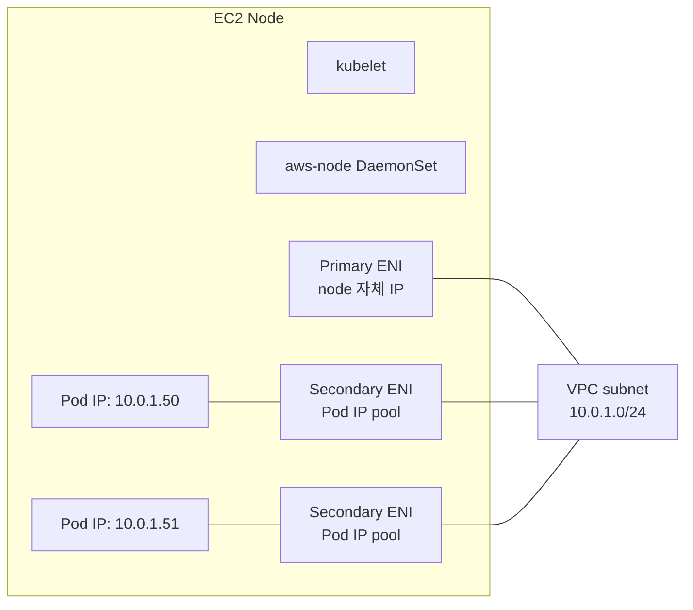

# VPC CNI — Pod Network

> AWS VPC CNI = pod 가 **VPC IP 직접**. No overlay (Flannel / Calico 다름). ENI Trunking + Prefix Delegation 으로 density 확장.

## 1. VPC CNI 동작



- Pod 가 VPC IP 직접 받음
- Security Group / Route Table 그대로 적용
- 다른 AWS service 와 직접 통신 (NAT 불필요)
- Overlay encapsulation 없음 → 성능 ↑

## 2. ENI / Pod 한도

```
Pod max = (ENI 수 × IP/ENI) − 1
```

| instance | ENI | IP/ENI | Pod max | Prefix Delegation |
| --- | --- | --- | --- | --- |
| t3.large | 3 | 12 | 35 | 110 |
| m7g.large | 3 | 10 | 29 | 110 |
| m7g.4xlarge | 8 | 30 | 234 | 110 |
| m7g.16xlarge | 8 | 50 | 393 | 110 |

→ Prefix Delegation 이 dense placement 핵심.

## 3. Prefix Delegation (IP density ↑)

```bash
kubectl set env daemonset aws-node -n kube-system \
  ENABLE_PREFIX_DELEGATION=true \
  WARM_PREFIX_TARGET=1
```

ENI 마다 /28 (16 IP) prefix 할당 → instance 당 110 pod 가능.

## 4. ENI Trunking (per-task SG 와 비슷)

```bash
kubectl set env daemonset aws-node -n kube-system \
  ENABLE_POD_ENI=true
```

→ 별도 SecurityGroupPolicy 적용 pod 가 별도 branch ENI 가짐. [[02-security-group-per-pod]] 와 같이 사용.

## 5. Subnet 사이즈 계획

```
3 AZ × 1 subnet = 3 subnet
각 subnet /24 = 254 IP
Node 최대 = 254 / (pod-per-node) = ...
```

큰 cluster:
- node subnet: /24 ~ /22 (사용 가능 IP 250 ~ 1000)
- Pod subnet 분리 (Custom Networking) — node 와 다른 subnet → IPv4 절약

## 6. Custom Networking (pod = secondary CIDR)

```bash
# Secondary CIDR (e.g., 100.64.0.0/16) 를 VPC 에 추가
aws ec2 associate-vpc-cidr-block --vpc-id vpc-xxx --cidr-block 100.64.0.0/16

# CNI 설정
kubectl set env daemonset aws-node -n kube-system \
  AWS_VPC_K8S_CNI_CUSTOM_NETWORK_CFG=true \
  ENI_CONFIG_LABEL_DEF=topology.kubernetes.io/zone

# ENIConfig (AZ 별)
apiVersion: crd.k8s.amazonaws.com/v1alpha1
kind: ENIConfig
metadata: { name: ap-northeast-2a }
spec:
  subnet: subnet-pod-az-a
  securityGroups: [sg-pod]
```

→ Pod 는 100.64.0.0/16 사용, Node 는 10.0.0.0/16. IPv4 비용 절감 + dense.

## 7. IPv6

```bash
# CNI IPv6 mode
kubectl set env daemonset aws-node -n kube-system \
  ENABLE_IPV6=true \
  ENABLE_PREFIX_DELEGATION=true
```

→ IPv4 부족 / 비용 회피.

## 8. CoreDNS

cluster 내 DNS:
```
api.default.svc.cluster.local   →  Service ClusterIP
my-pod.default.svc.cluster.local →  Headless Pod IP
```

ConfigMap (`kube-system/coredns`):
```
Corefile: |
  .:53 {
    errors
    health
    kubernetes cluster.local in-addr.arpa ip6.arpa {
      pods insecure
      fallthrough in-addr.arpa ip6.arpa
    }
    prometheus :9153
    forward . /etc/resolv.conf
    cache 30
    reload
    loadbalance
  }
```

> DNS resolution 실패 = cluster 의 가장 흔한 장애. CoreDNS replica + autoscale 권장.

## 9. NodeLocal DNS Cache

DaemonSet 으로 node 마다 DNS cache:
```bash
kubectl apply -f https://k8s.io/examples/admin/dns/nodelocaldns.yaml
```

→ CoreDNS 부하 ↓, latency ↓, conntrack 폭주 방지.

## 10. ip-masq-agent

```yaml
# pod 에서 외부로 나갈 때 NAT (IP masquerade)
nonMasqueradeCIDRs:
  - 10.0.0.0/8      # VPC 안은 NAT 안 함
masqLinkLocal: false
```

→ VPC 내부 통신은 원본 IP 유지 (보안 그룹 / audit).

## 11. CNI 버전 / Add-on 관리

```bash
# 최신 호환 버전 확인
aws eks describe-addon-versions --kubernetes-version 1.30 \
  --addon-name vpc-cni --query 'addons[0].addonVersions[0].addonVersion'

# 갱신
aws eks update-addon --cluster-name bkurs-prod --addon-name vpc-cni \
  --addon-version v1.18.0-eksbuild.1 --resolve-conflicts OVERWRITE
```

## 12. Cilium / Calico (대안 CNI)

VPC CNI 가 default 이지만 교체 가능:
- **Cilium** — eBPF / Service Mesh / Network Policy / observability
- **Calico** — Network Policy + 일부 cases

> 단점 — AWS native (Pod IP = VPC IP) 사라짐. 대부분 VPC CNI 유지 권장.

## 13. WARM Targets / 동작 tuning

```
WARM_ENI_TARGET (default 1)       — 미리 hold 할 ENI 수
WARM_IP_TARGET (default 0)        — 미리 hold IP 수
MINIMUM_IP_TARGET                  — 최소 IP 보장
WARM_PREFIX_TARGET (default 1)    — Prefix Delegation 시 prefix 수
```

→ 대규모 동시 pod 시작 시 ENI provision 지연 회피.

## 14. 흔한 함정

| 함정 | 회피 |
| --- | --- |
| Subnet IP 부족 → pod pending | Prefix Delegation / Custom Networking / 큰 subnet |
| ENI provision delay → pod startup 느림 | WARM_ENI / WARM_IP |
| CoreDNS replica 1 | autoscale + NodeLocalDNS |
| ip-masq 잘못 → SG audit broken | nonMasqueradeCIDR 명시 |
| CNI version 오래됨 | managed add-on update |
| EKS upgrade 시 CNI 안 따라 올림 | 동시에 upgrade |

## 15. 다음

- ▶ [[02-security-group-per-pod]]
- ▶ [[03-network-policy]]
- ▶ [[../04-operations/01-autoscaling-cas-karpenter]]
- ▶ [[../05-security/01-irsa-pod-identity]]

## 16. 영상 / 자료

| 자료 |
| --- |
| [VPC CNI Deep Dive](https://www.youtube.com/watch?v=qhJ75kSGu0Q) |
| [공식 amazon-vpc-cni-k8s](https://github.com/aws/amazon-vpc-cni-k8s) |
| [Prefix Delegation 공식](https://docs.aws.amazon.com/eks/latest/userguide/cni-increase-ip-addresses.html) |

## 17. 참고

- [[../eks]]
- [[../01-fundamentals/01-architecture]]
- [[../../ec2/02-networking/01-eni-and-ip]]
