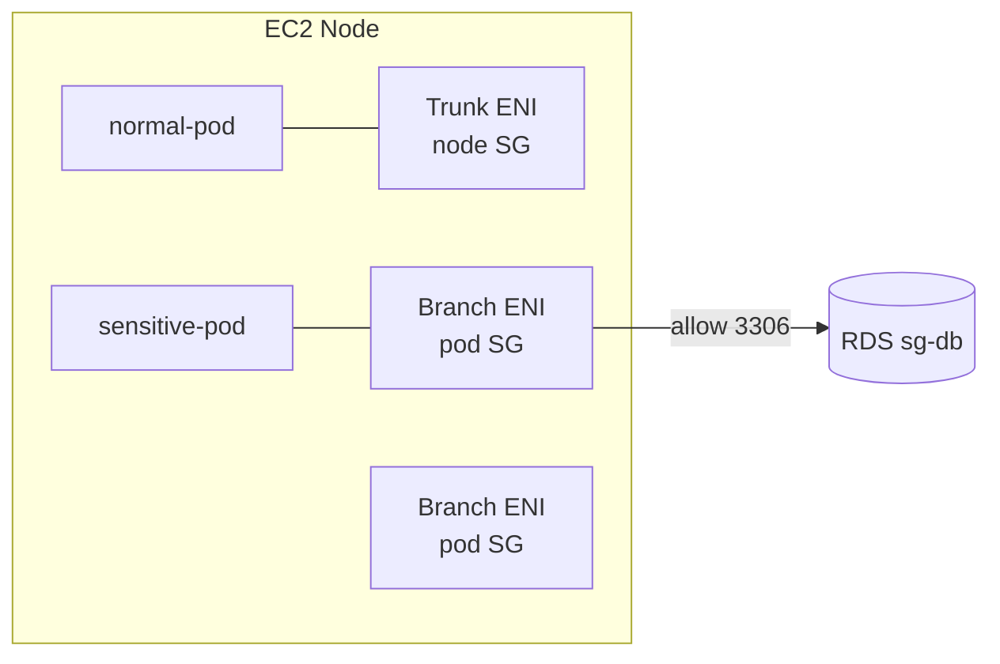

# Security Group per Pod

> Pod 마다 별도 SG (branch ENI 활용). DB 접근 / sensitive workload 격리. ECS Task 의 SG 동등.

## 1. 동작



- 일반 pod → node SG (Trunk ENI 공유)
- SGP 적용 pod → Branch ENI + 명시 SG
- ENI Trunking 활성 필요

## 2. 활성

```bash
kubectl set env daemonset aws-node -n kube-system \
  ENABLE_POD_ENI=true
```

EKS 가 자동으로 Trunk ENI 활용:
- Node IAM role 의 `AmazonEKSVPCResourceController` 권한 필요
- Nitro 기반 instance (t3 / m5 / m6 / m7 / c5+ / r5+ ...)

## 3. SecurityGroupPolicy CRD

```yaml
apiVersion: vpcresources.k8s.aws/v1beta1
kind: SecurityGroupPolicy
metadata:
  name: sensitive-pod-sg
  namespace: prod
spec:
  podSelector:
    matchLabels:
      sensitivity: high
  securityGroups:
    groupIds:
      - sg-pod-db        # DB 접근 가능
      - sg-pod-ssm       # SSM 접근
```

→ `sensitivity: high` label 의 pod 가 시작 시 Branch ENI + 명시 SG 자동 할당.

## 4. 활용 패턴

### DB 접근 격리
```
sg-pod-db:
  Egress: sg-rds 3306
sg-rds:
  Ingress: sg-pod-db 3306
```

→ `sensitivity: high` label 의 pod 만 DB 접근, 다른 pod (예: cache / batch) 는 차단.

### Multi-tenant 격리
namespace 마다 다른 SG → 같은 cluster 의 다른 팀이 자원 격리.

## 5. ServiceAccount 와 결합

```yaml
apiVersion: vpcresources.k8s.aws/v1beta1
kind: SecurityGroupPolicy
metadata: { name: db-pods, namespace: prod }
spec:
  serviceAccountSelector:
    matchLabels:
      role: db-client
  securityGroups:
    groupIds: [sg-pod-db]
```

→ ServiceAccount 가 `role: db-client` label 면 자동 적용.

## 6. Liveness/Readiness Probe 와 충돌

```yaml
# Pod SG 적용 시 kubelet 의 probe 가 차단될 수 있음
spec:
  enablePodNetwork: true       # CNI 가 kubelet 의 probe 만 allow
```

또는 SG egress 에 kubelet (port 10250 from Trunk ENI) 명시.

## 7. Fargate 와 호환

| | EC2 node | Fargate |
| --- | --- | --- |
| SecurityGroupPolicy | ✓ | ✗ (Fargate Profile 의 SG 사용) |

Fargate 의 SG 는 Profile 생성 시 명시:
```bash
eksctl create fargateprofile --cluster bkurs-prod \
  --name jobs --namespace jobs \
  --subnets subnet-aaa,subnet-bbb \
  --pod-execution-role-arn arn:aws:iam::...:role/FargatePodRole
# SG 는 Cluster SG + 추가 사용자 SG
```

## 8. 한도

| 한도 |
| --- |
| Branch ENI 수 = instance type 따라 (~ENI×5) |
| SGP 한도 = pod 의 5 SG max (SG limit) |
| Branch ENI provisioning ~30초 (pod startup ↑) |

## 9. 확인

```bash
# pod 의 SG 확인
kubectl get pod -n prod -o yaml | grep -A 5 "annotations"
# vpc.amazonaws.com/pod-eni: "[{...,SecurityGroups:[sg-pod-db]...}]"

# Trunk / Branch ENI 확인
aws ec2 describe-network-interfaces --filters \
  Name=interface-type,Values=trunk,branch \
  Name=attachment.instance-id,Values=i-xxx \
  --query 'NetworkInterfaces[].{Type:InterfaceType,Id:NetworkInterfaceId,SGs:Groups[].GroupId}'
```

## 10. 흔한 함정

| 함정 | 회피 |
| --- | --- |
| ENABLE_POD_ENI 미활성 | aws-node env 추가 |
| Branch ENI 부족 → 새 pod pending | Trunking ENI 큰 instance |
| Probe 차단 | enablePodNetwork:true 또는 SG egress 명시 |
| Fargate 에 SGP 적용 | Fargate Profile SG 만 |
| SGP 변경 시 기존 pod 안 따라 옴 | pod restart |
| VPCResourceController role 권한 부족 | AmazonEKSVPCResourceController policy attach |

## 11. 비교 — Network Policy

| | SecurityGroupPolicy | NetworkPolicy |
| --- | --- | --- |
| Layer | AWS SG (VPC) | K8s (Calico/Cilium) |
| Cross-VPC | ✓ | ✗ |
| Scope | AWS resource | cluster 안 |
| 적용 | label / SA selector | namespace / label |
| 권장 use | AWS resource 접근 (RDS/S3) | east-west traffic |

→ 두 가지 같이 사용.

## 12. 다음

- ▶ [[03-network-policy]]
- ▶ [[../05-security/01-irsa-pod-identity]]
- ▶ [[../05-security/02-rbac-and-aws-auth]]

## 13. 영상 / 자료

| 자료 |
| --- |
| [Security Groups for Pods](https://docs.aws.amazon.com/eks/latest/userguide/security-groups-for-pods.html) |

## 14. 참고

- [[../eks]]
- [[01-vpc-cni-and-pod-network]]
- [[../../ecs/05-security/02-network-isolation]]
